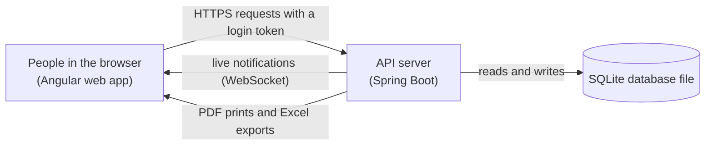
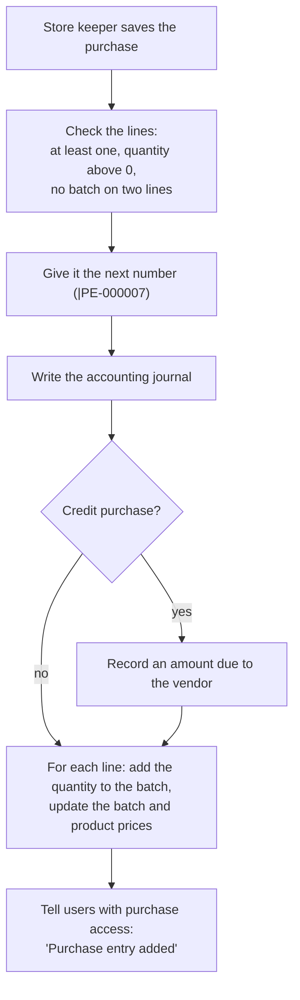
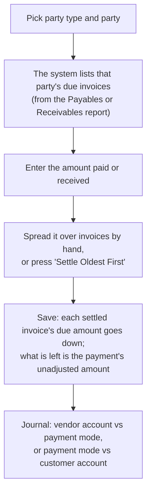
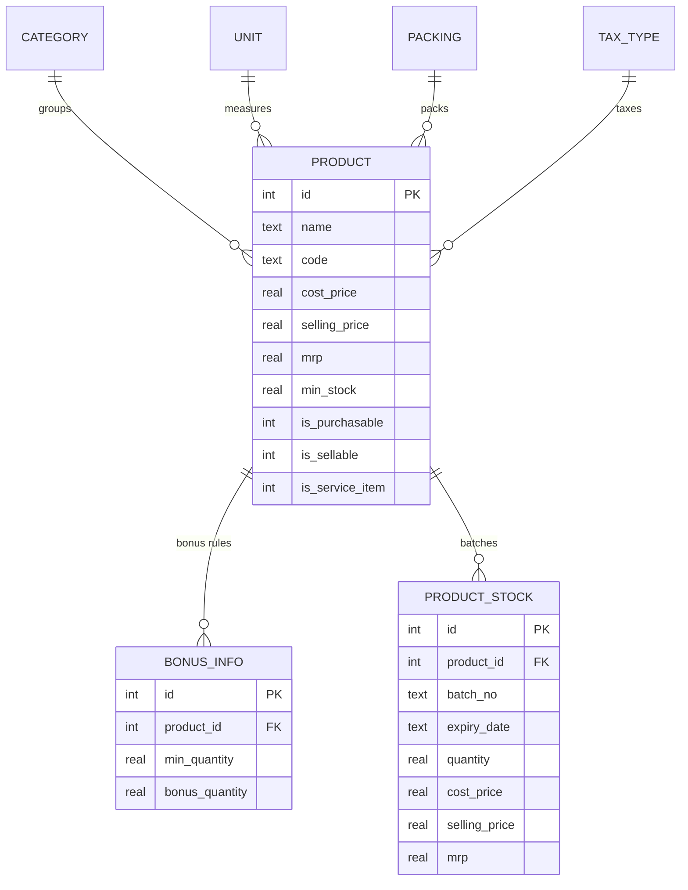
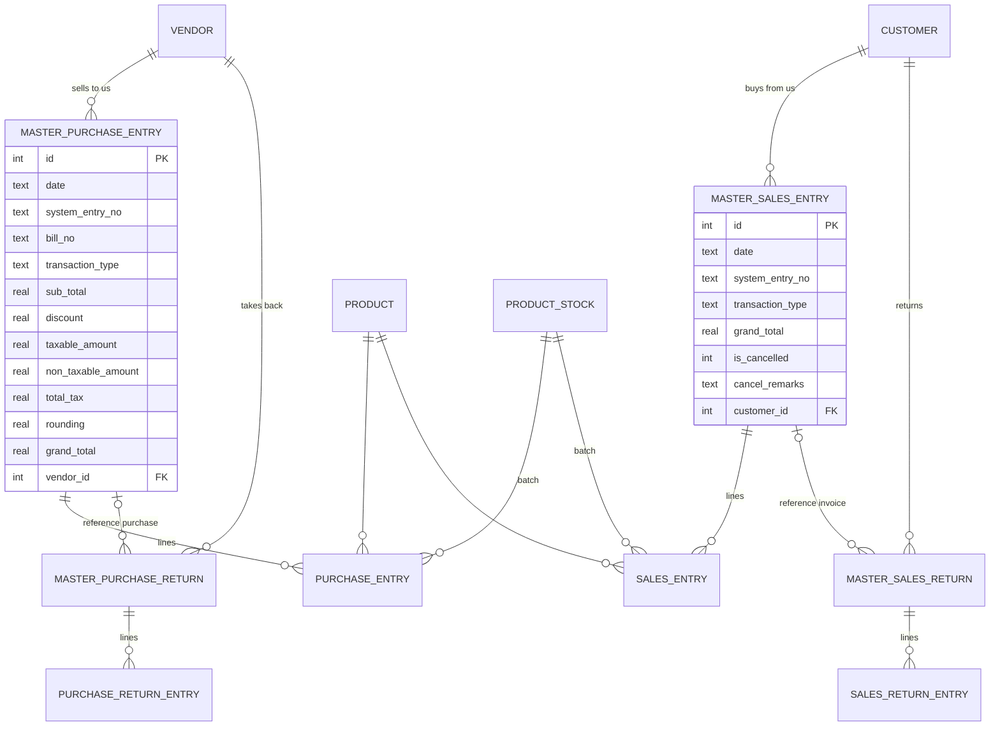
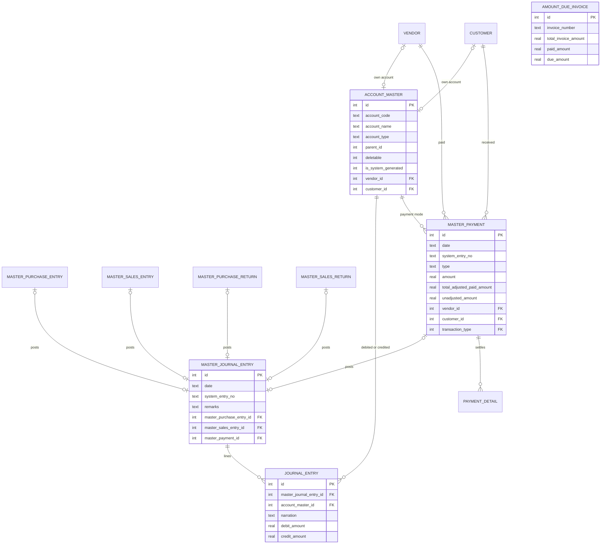
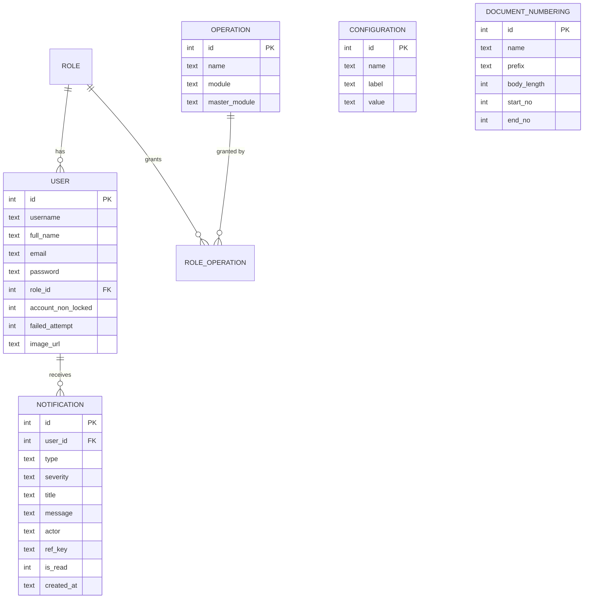

# Inventory System — Business Requirements Document

> This document describes **what** the Inventory System does and **why**, in everyday language. It is the starting point of the implementation guide in the `docs/` folder. Read it first; then read `docs/backend/backend-setup.md` and `docs/frontend/frontend-setup.md`, and after that the feature documents.

## 1. About this document

**Who it is for.** Anyone who needs a clear picture of the system: a business owner, a new developer, a tester, or someone who wants to build the same system from scratch. No programming knowledge is needed for sections 1 to 8. Sections 9 and 10 describe the database and are written for developers, but still in plain words.

**What it covers.**

| Section | What you learn |
|---|---|
| 2. The business problem | Why the system exists |
| 3. Who uses it | The people and their roles |
| 4. What the system does | The modules, at a glance |
| 5. Key ideas | Words the rest of the document uses (batch, document, journal, ...) |
| 6. The main business flows | What happens, step by step, when someone buys, sells, pays, ... |
| 7. Business rules | The rules the system enforces, grouped by area |
| 8. Permissions | Who may do what |
| 9. Screens | The pages of the web app |
| 10. Data | Every table, with diagrams of how they connect |
| 11. Technical boundaries | What the system is and is not |
| 12. Glossary | Short definitions |

## 2. The business problem

A small trading business buys goods from **vendors**, keeps them in stock, and sells them to **customers**. Every day the owner needs answers to simple questions:

- How many of each product do I have right now? Which batch is it in, and when does it expire?
- How much do I owe each vendor, and how much does each customer owe me?
- How much did I buy and sell this month? What was returned?
- Is any product running out?
- Where did the money go? Are my books balanced?

Doing this in notebooks or spreadsheets breaks down quickly: stock counts drift, unpaid invoices are forgotten, and accounting is done twice (once for the bill, once for the books). The Inventory System solves this by making **one entry do everything**. When a purchase is saved, the stock goes up and the accounting entry is written automatically. When a sale is saved, the stock goes down, the customer's balance goes up, and the sales account is credited. The books are always in step with the stock.

**Goals of the system**

1. Keep an accurate, batch-level stock count that changes only through recorded documents (purchases, sales, returns, adjustments).
2. Keep double-entry accounting books automatically, so the owner never posts a purchase or sale by hand.
3. Track money owed to vendors and by customers, invoice by invoice, and let payments settle those invoices.
4. Give reports, a dashboard, printable documents and Excel exports built from the same data.
5. Let the owner control who can see and do what, with roles and permissions.
6. Warn people when stock runs low or a document is added, cancelled or deleted.

## 3. Who uses it

The system is for **one company**. Everyone who logs in is a **user**, and every user has exactly **one role**. A role is a named list of **permissions** (the system calls them *operations*, for example `CreatePurchaseEntry`). The role decides which menus a user sees and which buttons they may press.

The system ships with one role, **Admin**, which holds every permission, and one user, `admin` (password `Admin@123`), created automatically the first time the server starts. The owner creates other roles to fit the business. Typical examples:

| Role (example) | What they do | Permissions they would get |
|---|---|---|
| Store keeper | Records purchases, counts stock, fixes stock | Purchase entry, purchase return, opening stock, stock adjustment, stock edit, products (view) |
| Sales clerk | Sells goods and takes customer returns | Sales entry, sales return, customers, products (view) |
| Accountant | Records payments, journals, reads the ledger and trial balance | Payments, payment adjustment, journal entries, chart of accounts, opening balance, reports |
| Manager / owner | Sees everything, manages users | Admin |

Each user also has a profile (name, email, contact, an optional picture) and can change their own password.

## 4. What the system does, at a glance

The system has two parts: a **web app** that people use in the browser, and a **server** (the API) that holds the data and enforces every rule. The server keeps everything in a single database file (SQLite), so nothing else needs to be installed.

The modules, in the order a business would set them up:

| Module | What it holds | Pages |
|---|---|---|
| **Settings** | Company name and address (printed on documents), default calendar for files (AD or BS), low-stock threshold, document number formats; a fiscal year and a rounding default are stored for later use | Configuration, Document Numbering |
| **Master data** | The small lists products are described with | Categories, Units, Packings, Tax Types |
| **Products** | Everything you buy or sell, with prices, flags and bonus rules; stock per batch | Products |
| **Parties** | Vendors (you buy from them) and customers (you sell to them); each automatically gets an account in the books | Vendors, Customers |
| **Purchases** | Purchase entries (goods in) and purchase returns (goods back to the vendor) | Purchase Entry, Purchase Return |
| **Sales** | Sales invoices (goods out) and sales returns (goods back from the customer) | Sales Entry, Sales Return |
| **Inventory** | Opening stock, stock adjustments (a document for stock count differences), stock edit (direct overwrite) | Opening Stock, Stock Adjustment, Stock Edit |
| **Accounting** | Chart of accounts, manual journal entries, payments and their settlement, payment adjustments, opening balances | Chart of Accounts, Journal Entries, Payments, Payment Adjustments, Opening Balance |
| **Reports** | Registers and totals for purchases, sales and returns; stock; journal, ledger, trial balance; receivables and payables | Reports |
| **Dashboard** | Cash, payables, receivables; purchase vs sales trend; near-expiry batches; low-stock products | Dashboard |
| **Users and roles** | Users with one role each; roles as a permission matrix | Users, Roles |
| **Notifications** | A bell in the header with live alerts; low-stock warnings | Header |
| **Print and export** | Every list, document and report as a PDF or an Excel file; a "range print" of all documents in a period | Everywhere |

## 5. Key ideas, explained

These are the words the rest of this document relies on.

**Product.** Something the business buys or sells. A product has a name (unique), a code, a barcode, a category, a unit (piece, box, ...), a packing, a tax type, three prices (cost price, selling price, MRP), minimum and maximum stock levels, and flags: *purchasable*, *sellable*, *service item* (not stocked, like a repair service), *has expiry date*, *batch available*. A product can also have **bonus rules**: "buy at least 24, get 1 free".

**Batch.** Stock is counted **per batch** of a product, not just per product. A batch is created the first time a purchase, sales return or opening stock names a new batch number for that product. Each batch has its own quantity, its own cost/selling/MRP prices, and one expiry date. Lines that do not name a batch go into the product's **default batch** (the one with no batch number). The default batch always has batch id **0** in the system; every other batch has its own id. Batch numbers are unique within a product.

**Stock.** The quantity of a batch right now. It changes only through documents: purchase (up), purchase return (down), sale (down), sales return (up), stock adjustment (In up / Out down), opening stock (set once), stock edit (overwrite). A product's total stock is the sum of its batches.

**Party.** A vendor or a customer. Both have the same details (name, registration number, contact, address, email). When a party is created the system also creates an **account** for them in the books (under *Trader Payable* for vendors and *Trade Receivables* for customers), so that credit purchases and sales can be posted to them.

**Document.** A dated record with a system-generated number: purchase entry, purchase return, sales entry (invoice), sales return, payment, journal entry, stock adjustment. Most documents have a header (date, party, totals, remarks) and **lines** (one per product batch, or per account for a journal).

**Document number.** Every document gets a number like `|PE-000001`: a prefix per document type, then a zero-padded counter. The leading `|` is part of the number. The next number is always the last saved number plus one. The web app shows numbers without the `|`.

| Document | Prefix | Example |
|---|---|---|
| Purchase entry | `\|PE-` | `\|PE-000001` |
| Purchase return | `\|PR-` | `\|PR-000001` |
| Sales entry (invoice) | `\|SI-` | `\|SI-000001` |
| Sales return | `\|SR-` | `\|SR-000001` |
| Stock adjustment | `\|SA-` | `\|SA-000001` |
| Journal entry | `\|J-` | `\|J-000001` |
| Payment | `\|P-` | `\|P-000001` |

(The numbering table also holds rows for Purchase Order, Sales Order and BDE, which are reserved and not used by any page.)

**Cash or credit.** A purchase, sale or return is either **Cash** (settled now) or **Credit** (pay later). A credit purchase creates an **amount due** to the vendor; a credit sale creates an amount due from the customer. Cash documents create no amount due.

**Amount due (invoice).** The system keeps one "amount due" record per credit purchase or sale, keyed by the document number, with the total, the amount paid so far and the amount still due. This is what the Payables and Receivables reports list, and what payments settle.

**Payment.** Money paid to a vendor or received from a customer, through a **payment mode** (an account such as Cash or a bank). A payment can settle one or more due invoices (fully or partly). Whatever is not applied to an invoice is the payment's **unadjusted amount** (an advance), which can be applied later with a **payment adjustment**.

**Accounts and the journal (double-entry bookkeeping in one paragraph).** The books are a list of **accounts** (Cash, Sales, VAT Purchase, each vendor, each customer, ...), grouped into types under five headings: Assets, Liability, Equity, Income, Expenses. Every business event is written as a **journal** with at least two lines; each line **debits** or **credits** one account, and the debits always equal the credits. Assets and expenses grow with debits; liabilities, equity and income grow with credits. For example, buying goods for 100 in cash is *debit Purchase 100, credit Cash 100*. The system writes these journals itself for purchases, sales, returns and payments; people write **manual journals** only for other things (rent, fuel, salaries). A **ledger** is one account's lines in date order with a running balance; the **trial balance** is every account's totals side by side.

**Opening stock and opening balance.** What the business already has on the day it starts using the system: the stock of each product batch, and the balance of each account (cash in hand, bank balance, money owed). Both are entered once, at the start.

**Calendar.** Dates are stored and sent as AD dates (`YYYY-MM-DD`). On screen, every list and report has an **AD / BS** switch (BS, Bikram Sambat, the Nepali calendar, is the default), and the date pickers convert between the two. A printed or exported file uses the calendar the page is showing; a file requested without one uses the company setting *Calendar Type*. The data itself always stays AD.

**Rounding.** A document total can be rounded to a whole amount. The difference (positive or negative paisa) is recorded as *rounding* and posted to the *Adjustment* account so the books still balance.

## 6. The main business flows

### 6.1 Setting up a new company

The order that works on a fresh database:

1. **Log in** as `admin`.
2. **Settings → Configuration**: company name, registration, address, contact, email (these print on every document), the default calendar for files, the low-stock quantity. (Fiscal year and default rounding are stored but nothing uses them yet; every document form starts with rounding on.)
3. **Master data**: units, categories, packings, tax types (the database starts with a few of each, including *VAT 13%*, *Tax Free* and *Exempted*).
4. **Products**, each with its unit, tax type and prices.
5. **Vendors** and **customers** (their accounts are created for you).
6. **Opening stock** for each product batch you already hold, and the **opening balance** of the accounts (cash, bank, what you owe and are owed).
7. **Users and roles** for the staff.
8. Day-to-day work: purchases, sales, payments, adjustments, journals; then reports.

### 6.2 Buying goods (purchase entry)

The store keeper records the vendor's bill as a **purchase entry**: date, bill date and bill number, vendor, cash or credit, and one line per product batch with quantity and prices. Typing a batch number that the product does not have yet **creates** that batch; leaving it blank uses the default batch. The web app calculates the totals (see 7.1) and sends them; the server stores them as sent.

When the purchase is saved, in one go:

**The journal written for a purchase** (totals as sent by the web app):

| Account | Debit | Credit | When |
|---|---|---|---|
| VAT Free Purchase | non-taxable amount | | if there is a non-taxable amount |
| VAT Purchase | taxable amount | | if there is a taxable amount |
| Tax | total tax | | with the taxable amount |
| Adjustment | rounding (if positive) | rounding (if negative) | if rounding is not zero |
| **Cash** (cash purchase) or **the vendor's account** (credit purchase) | | grand total | always |

A purchase **can be edited**: the lines sent replace the old ones, the stock moves accordingly, and the journal and amount due are rewritten. It **can be deleted**, which takes the stock back out and removes the journal and the amount due. Both are refused when the goods have already been sold ("Product Stock is Already Used") or when payments were already recorded against the invoice.

### 6.3 Returning goods to a vendor (purchase return)

Goods go back to the vendor. The return names the vendor, optionally the **reference purchase** they came in on (which pre-fills every line at full quantity), and one line per product batch **picked** from the batches that currently hold stock. The stock goes **down**, and the journal is the exact mirror of a purchase (credit the purchase and tax accounts, debit Cash or the vendor's account). Returning more than the batch holds is refused. A purchase return does not change the amount due of the original purchase (see 7.4). Purchase returns can be edited and deleted.

### 6.4 Selling goods (sales entry)

The sales clerk makes an **invoice**: date, customer, cash or credit, and one line per product batch picked from the batches in stock (the web app pre-selects the batch with the earliest expiry). The server checks that each batch holds enough. Stock goes **down**; the journal is written; a credit sale records an amount due from the customer.

**The journal written for a sale:**

| Account | Debit | Credit | When |
|---|---|---|---|
| VAT Free Sales | | non-taxable amount | if there is a non-taxable amount |
| VAT Sales | | taxable amount | if there is a taxable amount |
| Tax | | total tax | with the taxable amount |
| Adjustment | rounding (if negative) | rounding (if positive) | if rounding is not zero |
| **Cash** (cash sale) or **the customer's account** (credit sale) | grand total | | always |

**Sales are never edited or deleted.** An invoice is a legal document given to a customer, so a wrong one is **cancelled** with a reason instead. Cancelling puts the stock back, removes the journal and the amount due, and marks the invoice cancelled; its lines stay so everyone can still see what it sold. An invoice cannot be cancelled when a payment was already recorded against it or when a sales return names it (cancel the return first).

### 6.5 Taking goods back from a customer (sales return)

The customer returns goods. The return names the customer, optionally the **reference invoice** (not a cancelled one), and lines that **type** a batch number: the goods go back into that batch, or into a new batch, or the default batch. Stock goes **up**; the journal is the mirror of a sale (debit the sales and tax accounts, credit Cash or the customer's account). Like invoices, sales returns are **cancelled**, not edited or deleted; cancelling takes the goods back out of stock, which is refused if they have been sold since.

### 6.6 Receiving and paying money (payments)

An accountant records a **payment**: the party type (Vendor = money out, Customer = money in), the party, the date, the **payment mode** (Cash, Petty Cash or any bank account added to the chart of accounts), the amount, and optionally which due invoices it settles and by how much.

**The journal written for a payment:**

| Payment to / from | Debit | Credit |
|---|---|---|
| Vendor (money out) | the vendor's account | the payment mode account (Cash, bank) |
| Customer (money in) | the payment mode account | the customer's account |

Rules: the amount must be above zero; the settled amounts together cannot exceed the payment; each settled amount cannot exceed that invoice's due amount. Editing a payment first gives back everything it settled, then applies the new settlement list. Deleting a payment makes the settled invoices due again.

**Payment adjustment.** A payment with an unadjusted amount (an advance, or an overpayment) appears on the Payment Adjustments page. "Adjust" applies that leftover to the party's due invoices, in the same way.

### 6.7 Fixing stock

- **Opening stock** is entered once per product batch, at the start. A batch that already has stock cannot get opening stock again.
- **Stock adjustment** is a document (with a number, date and remarks) for the result of a physical count, breakage, loss or a found item. Each line picks a product batch, says **In** or **Out**, a quantity and a reason. Out cannot take more than the batch holds. Adjustments can be edited (the old changes are reversed first) and deleted (reversed). No accounting entry is written for a stock adjustment.
- **Stock edit** directly overwrites one batch's quantity, prices and expiry date. It leaves no history, so it is meant for corrections (for example a wrong expiry date), not for day-to-day changes.

### 6.8 Other accounting entries

- **Manual journal entries** record anything that is not a purchase, sale, return or payment: paying rent, a bank charge, interest received, buying furniture. Each line debits or credits one account; the totals must match. The journals the system writes for documents are **not** listed here and cannot be changed here; the document itself is changed instead.
- **Chart of accounts**: the list of accounts, each with a type and an optional parent account. System accounts (Cash, Sales, VAT Purchase, Tax, Adjustment, ...) are needed by the automatic journals and cannot be deleted. A vendor's or customer's account can only be removed by deleting the party.
- **Opening balance**: one journal, dated the start day, with the opening debit or credit of each account. Saving it again replaces it.

### 6.9 Reports and the dashboard

Reports are tables for a date range (by default the current month) that can be searched, sorted, totalled, printed and exported:

| Group | Reports |
|---|---|
| Purchase | Purchase register (one row per purchase), purchases by vendor, by product, by batch |
| Purchase return | The same four for returns |
| Sales | Sales register (cancelled invoices shown but not totalled), sales by customer, by product, by batch |
| Sales return | The same four for returns |
| Inventory | Current stock and stock value of every batch |
| Accounting | Journal (every line), ledger of one account with running balance, trial balance, receivables (what customers owe), payables (what you owe vendors) |

The **dashboard** shows: cash, payables and receivables today and a week ago; purchases vs sales per day, week or month; sales and purchase totals with returns for the last months; batches expiring soon (or expired); products at or below their minimum stock and products with no stock.

### 6.10 Printing and exporting

Every list, every document and every report has **Print** (PDF) and **Export** (Excel). The server builds the file with the company letterhead from the settings, the date in the chosen calendar (AD or BS), and the name of who printed it. A document prints as an invoice, voucher or receipt with the party's details, the lines, the totals and signature lines; a cancelled invoice is stamped CANCELLED with its reason. The header's printer button offers a **range print**: all documents of one type in a date range, one per page, in one PDF.

### 6.11 Notifications

The bell in the header lists each user's notifications and receives new ones live, without reloading:

| Event | Who is told |
|---|---|
| A purchase, purchase return, sale, sales return, payment or stock adjustment is **added**, **cancelled** or **deleted** (not edited) | Everyone whose role may view that kind of document, except the person who did it |
| A product's total stock falls to the **low stock quantity** setting or below | Everyone who may view stock (Stock Edit), including the person who did it |
| A product's total stock falls to **zero** | The same people |

An unread low-stock alert about a product is updated, not repeated, when the stock falls again. Low stock and out of stock also pop up as a toast.

## 7. Business rules

The rules the server enforces. If a rule is broken the save is refused with a message (the exact messages are in the feature documents).

### 7.1 Documents with lines (purchases, sales, returns)

| Rule | Why |
|---|---|
| At least one line, and every quantity above zero | A document with nothing on it, or a negative line, would move stock the wrong way |
| A product batch may appear on only one line | Two lines for one batch would have to be merged, and one line's prices would silently win |
| Every document gets the next number for its type; numbers are never reused | Numbers are the audit trail and the key of the amount due |
| A vendor's bill number cannot repeat for the same vendor | Catches the same bill being entered twice |
| The **web app computes the totals** and the server stores them as sent | One place does the arithmetic the user sees on screen; the server only checks what must be true for the books |
| Totals: gross = sum of quantity × rate; discount = a percent of gross or a flat amount, capped at gross; the discount is spread over the lines in proportion, so taxable and non-taxable parts both shrink; tax = the discounted taxable amount × the line's tax rate; total = taxable + non-taxable + tax; rounding = (whole total − total) when rounding is on; grand total = total + rounding | So that `grand total = taxable + non-taxable + tax + rounding`, which is exactly how the journal is posted |
| Purchases and sales returns **type** a batch number (new numbers create batches); sales, purchase returns and stock adjustments **pick** an existing batch | Goods coming in may be a new batch; goods going out must come from a batch that exists |
| A batch keeps one expiry date; a line with a different date is refused; a blank date keeps the batch's | A different date is almost always a typo; use Stock Edit to correct deliberately |
| A line's prices update the batch's prices and the product's prices | The latest purchase price is the current price |
| Stock cannot go below zero (selling, returning to vendor, adjusting out) | You cannot give what you do not have |
| Removing or reducing purchased stock that has since been sold is refused | The sale already used it |
| Sales and sales returns are never edited or deleted, only cancelled with a reason; cancelled documents keep their lines | Invoices are legal documents; the trail must stay |
| A sale cannot be cancelled while a sales return names it, or after a payment was recorded against it | Undo in the reverse order |
| A reference purchase must belong to the same vendor; a reference invoice must belong to the same customer and not be cancelled | A return belongs to one party's history |
| A purchase named by a purchase return cannot be deleted | The return would point at nothing |
| Cash documents create no amount due; credit documents do; switching a credit document to cash after payments were recorded is refused | The amount due is what payments settle |

### 7.2 Stock and batches

| Rule | Why |
|---|---|
| The default batch (no batch number) is always batch id 0; other batches have their own id | A product that never used batches still has one place for its stock |
| Batch numbers are unique within a product | A number identifies one batch |
| Opening stock can be entered once per batch | A second time would double count |
| Stock adjustment lines are exactly `In` or `Out`, quantity above zero, batch must exist | Only existing stock can be counted |
| Editing or deleting an adjustment reverses its earlier changes first | So the net effect is only the current document |
| Stock edit overwrites and keeps no history | It is a correction tool, not a document |
| A product with document lines cannot be deleted; deleting a product removes its batches | Documents must keep pointing at real products |

### 7.3 Accounting

| Rule | Why |
|---|---|
| Every journal balances: total debits = total credits; amounts cannot be negative; the total cannot be zero | Double-entry bookkeeping |
| The journals written for purchases, sales, returns and payments carry the document's own number, are rewritten whenever the document changes, and cannot be edited or deleted on the Journal page | The document is the source of truth |
| The opening balance is one journal and cannot be edited on the Journal page either | It has its own page |
| System accounts cannot be deleted; vendor and customer accounts go with their party; an account used by journal lines cannot be deleted | The automatic journals need them |
| Rounding differences go to the Adjustment account | So every journal still balances to the paisa |
| Amounts are stored rounded to the paisa (two decimals) and compared with half a paisa of tolerance | Computers store decimals imprecisely |

### 7.4 Payments and amounts due

| Rule | Why |
|---|---|
| A credit purchase or sale creates one amount-due record keyed by the document number; cash documents create none | It is the list of open invoices |
| A payment's amount must be above zero; the settled amounts cannot exceed the payment; each settled amount cannot exceed the invoice's due amount | Money can only go where there is something to pay |
| The part of a payment not applied to invoices is its unadjusted amount; it can be applied later with a payment adjustment | Advances and overpayments are normal |
| Editing a payment reverses everything it settled (including later adjustments) and applies the new list; deleting it reverses everything | The result is only what the current payment says |
| A blank narration is filled in ("Payment received from ...") | The ledger needs a readable line |
| **Returns do not change the amount due** of the original invoice; a credit return is posted to the party's account only | The dues list is per invoice, and a return is its own document; settle the difference through a payment or adjustment |

### 7.5 Parties and master data

| Rule | Why |
|---|---|
| Names of units, categories, packings and tax types are unique; product names are unique | A list with duplicates is useless |
| A record that others use (a unit on a product, a vendor on a purchase, ...) cannot be deleted | Links must stay valid; deactivate instead |
| Inactive records stay on old documents but disappear from the drop-downs of new ones | History stays readable |
| Creating a vendor or customer creates their account; renaming them renames it; deleting them deletes it, if nothing uses either | One party, one account |

### 7.6 Users, roles and security

| Rule | Why |
|---|---|
| Everything except logging in and reading the company settings needs a valid login token; a token lasts one hour | Stateless, simple sessions |
| Five wrong passwords in a row lock the account for one hour; a wrong current password on the Change Password page counts too | Stops password guessing, even with a stolen session |
| Passwords must be at least 8 characters with upper and lower case letters, a number and a symbol | Basic strength |
| Each action needs a named permission; a role is a set of permissions; the Admin role has all of them | Fine-grained control |
| Usernames and emails are unique; passwords are never returned; a blank password on edit keeps the old one | Basic hygiene |
| A role still held by users should not be deleted (the web app checks the count first) | Those users would lose their menu |
| Profile pictures are stored on the server and need a login to view | Private data |

## 8. Permissions

A permission is a named *operation*. They are grouped into modules, and modules into master modules (the sidebar's sections). The full list:

| Master module | Module | Operations |
|---|---|---|
| Masters | Category | CreateCategory, ViewCategory, EditCategory, DeleteCategory |
| Masters | Unit | CreateUnit, ViewUnit, EditUnit, DeleteUnit |
| Masters | Packing | CreatePacking, ViewPacking, EditPacking, DeletePacking |
| Masters | TaxType | CreateTaxType, ViewTaxType, EditTaxType, DeleteTaxType |
| Product | Product | CreateProduct, ViewProduct, EditProduct, DeleteProduct |
| Purchase | Vendor | CreateVendor, ViewVendor, EditVendor, DeleteVendor |
| Purchase | PurchaseEntry | CreatePurchaseEntry, ViewPurchaseEntry, EditPurchaseEntry, DeletePurchaseEntry |
| Purchase | PurchaseReturn | CreatePurchaseReturn, ViewPurchaseReturn, EditPurchaseReturn, DeletePurchaseReturn |
| Sales | Customer | CreateCustomer, ViewCustomer, EditCustomer, DeleteCustomer |
| Sales | SalesEntry | CreateSalesEntry, ViewSalesEntries, CancelSalesEntry |
| Sales | SalesReturn | CreateSalesReturn, ViewSalesReturns, CancelSalesReturn |
| Inventory | StockAdjustment | CreateStockAdjustment, ViewStockAdjustment, EditStockAdjustment, DeleteStockAdjustment |
| Inventory | StockEdit | ViewStockEdit, EditStockEdit |
| Inventory | OpeningStock | ViewOpeningStock, CreateOpeningStock |
| Accounting | AccountMaster | CreateAccountMaster, ViewAccountMaster, EditAccountMaster, DeleteAccountMaster, ViewAccount (the accounting reports) |
| Accounting | JournalEntry | CreateJournalEntry, ViewJournalEntries, EditJournalEntry, DeleteJournalEntry |
| Accounting | Payment | CreatePayment, ViewVendorPayment, ViewCustomerPayment, EditPayment, DeletePayment |
| Accounting | PaymentAdjustment | ViewPaymentAdjustment, CreatePaymentAdjustment |
| Accounting | OpeningBalance | ViewOpeningBalance, CreateOpeningBalance |
| User and Roles | User | CreateUser, ViewUser, EditUser, DeleteUser |
| User and Roles | Role | CreateRole, ViewRole, EditRole, DeleteRole |
| Settings | Configuration | CreateConfiguration, ViewConfiguration, EditConfiguration, DeleteConfiguration |
| Settings | DocumentNumbering | CreateDocumentNumbering, ViewDocumentNumbering, EditDocumentNumbering, DeleteDocumentNumbering |

How they are used:

- **Menus and pages**: a sidebar link and its page need the module's View operation. Payments need either View operation; Reports need any operation that opens one report.
- **Buttons**: Add, Edit, Delete and Cancel buttons need the matching Create/Edit/Delete/Cancel operation.
- **Reports**: purchase reports need ViewPurchaseEntry, sales reports ViewSalesEntries, and so on; the stock report needs ViewStockEdit; journal, ledger and trial balance need ViewAccount; receivables and payables open with ViewCustomerPayment, ViewVendorPayment, ViewAccount or CreatePaymentAdjustment (the payment form needs them to list dues).
- **Dashboard**: each card needs the View operation of what it shows; a figure the user may not see is left out.
- **Notifications**: a user receives a document notification only if their role may view that kind of document.
- **No permission needed**, only a login: the drop-down lists, the user's own notifications, "who am I and what may I do", and Change Password. **No login needed**: logging in, and reading the company settings (the login page shows the company name).

## 9. Screens

What a user sees, by menu. Every page except Login needs a login; the shell around every page has a sidebar (menu), a header (breadcrumb, printer button for range print, notification bell, profile menu with Change Password and Logout).

| Menu | Page | What it shows and does |
|---|---|---|
| | Login | Username and password; shows the lock message after too many tries; returns to the page you wanted after login |
| | Dashboard | The cards described in 6.9 |
| Purchase | Purchase Entry | List with filters (vendor, cash/credit, dates), paging, sort; Add/View/Edit/Delete; Print and Export. The form opens in a bottom sheet: header fields, line table, totals card |
| Purchase | Purchase Return | Same, with Ref. Purchase and batch picking |
| Purchase | Vendors | List and form (view, then Edit in place) |
| Sales | Sales Entry | List (cancelled rows marked); Add, View, Cancel (with reason); Print/Export |
| Sales | Sales Return | Same, with Ref. Invoice |
| Sales | Customers | List and form |
| Inventory | Opening Stock | Every batch with its current stock; Add only |
| Inventory | Stock Adjustment | Document list and form (date, number, remarks, lines with In/Out) |
| Inventory | Stock Edit | Every batch; Edit overwrites one batch |
| Accounting | Chart of Accounts | List by type; add/edit in a side drawer |
| Accounting | Journal Entries | Manual journals; form with the lines table (one debit or credit per line, totals, difference) |
| Accounting | Payments | List for vendors and customers; form with party type, party, mode, amount and the invoice settlement table |
| Accounting | Payment Adjustments | Payments with a leftover; Adjust |
| Accounting | Opening Balance | The one opening journal, edited in place |
| Setup | Products | List and form (details, flags, prices, bonus rules) |
| Setup | Master Data | Categories, Units, Packings, Tax Types: list and small side-drawer form |
| Setup | User & Roles | Users (with picture upload), Roles (permission matrix) |
| Setup | Reports | One card per report; each opens a table with search, sort, totals, Print/Export; the ledger has an account picker |
| Setup | Settings | Configuration (edited in place), Document Numbering (view only) |
| Header | Range Print | From/to dates and a document type; one PDF with a page per document |
| Header | Notifications | The bell: list, unread count, mark read, clear |
| Profile | Change Password | Current and new password with a strength checklist |

## 10. Data

The database is one SQLite file created from `backend/database.sql`. Every table has an integer `id` as its key unless said otherwise. Dates are text `YYYY-MM-DD`. Booleans are integers (1 = yes, 0 = no). Most master tables carry `created_at` and `updated_at` timestamps kept up to date by a trigger.

### 10.1 How the tables connect

**Products and master data**

**Parties and documents** (each document has a header table and a line table; every line points at a product and a batch)

**Accounting** (one journal header per document or manual entry; the amount-due list is keyed by document number)

**Users, roles, settings and notifications**

Stock adjustments stand alone: `master_stock_adjustment` (header) and `stock_adjustment_entry` (lines pointing at a product and a batch). They post no journal.

### 10.2 Table by table

**Master data**

| Table | Purpose | Columns |
|---|---|---|
| `category` | Product categories | `name`, `is_active` |
| `unit` | Units of measure (Piece, Box, ...) | `name`, `is_active` |
| `packing` | Packing types (Carton, Pack, ...) | `name`, `is_active` |
| `tax_type` | Tax rates (VAT 13%, Tax Free, Exempted) | `name`, `tax_rate` (percent), `is_active` |

**Products and stock**

| Table | Purpose | Columns |
|---|---|---|
| `product` | One row per product | `name` (unique), `code`, `barcode`, `is_active`, `is_service_item`, `is_purchasable`, `is_sellable`, `cost_price`, `selling_price`, `mrp`, `max_stock`, `min_stock`, `valuation_method`, `is_batch_available`, `has_expiry_date`, `has_manufacturing_date`, `remarks`, `category_id`, `unit_id`, `packing_id`, `tax_type_id` |
| `bonus_info` | "Buy at least X, get Y free" rules | `product_id`, `min_quantity`, `bonus_quantity` |
| `product_stock` | **One row per product batch** with its current stock; `batch_no` NULL is the default batch | `product_id`, `batch_no`, `expiry_date`, `quantity`, `cost_price`, `selling_price`, `mrp`; unique on (`product_id`, `batch_no`) |

**Parties**

| Table | Purpose | Columns |
|---|---|---|
| `vendor` | Who you buy from | `name`, `registration_number`, `is_active`, `contact`, `address`, `email`, `remarks` |
| `customer` | Who you sell to | the same columns |

**Purchases and sales** (header + lines)

| Table | Purpose | Columns |
|---|---|---|
| `master_purchase_entry` | Purchase header | `date`, `bill_date`, `system_entry_no` (unique), `bill_no`, `transaction_type` (Cash/Credit), `sub_total`, `discount`, `discount_type`, `non_taxable_amount`, `taxable_amount`, `total_tax`, `rounded`, `rounding`, `grand_total`, `remarks`, `vendor_id`; unique on (`vendor_id`, `bill_no`) |
| `purchase_entry` | Purchase line | `master_purchase_entry_id`, `product_id`, `batch_id`, `quantity`, `cost_price`, `selling_price`, `mrp` |
| `master_purchase_return` | Purchase return header | like a purchase without `bill_date`, plus `ref_purchase_id` |
| `purchase_return_entry` | Purchase return line | like a purchase line |
| `master_sales_entry` | Invoice header | like a purchase without bill fields, with `customer_id`, `is_cancelled`, `cancel_remarks` |
| `sales_entry` | Invoice line | like a purchase line |
| `master_sales_return` | Sales return header | like an invoice, plus `ref_sales_id` |
| `sales_return_entry` | Sales return line | like a purchase line |

**Inventory**

| Table | Purpose | Columns |
|---|---|---|
| `master_stock_adjustment` | Adjustment header | `date`, `system_entry_no`, `remarks` |
| `stock_adjustment_entry` | Adjustment line | `master_stock_adjustment_id`, `product_id`, `batch_id`, `adjustment_type` (In/Out), `quantity`, `reason` |

Opening stock and stock edit have no tables of their own: they write `product_stock`.

**Accounting**

| Table | Purpose | Columns |
|---|---|---|
| `account_master` | The chart of accounts | `account_code`, `account_name`, `account_type`, `is_active`, `deletable`, `is_system_generated`, `parent_account_name`, `parent_id` (0 = none), `remarks`, `vendor_id` / `customer_id` (set on a party's own account; unique) |
| `account_types` | The 18 account types under 5 headings | `heading`, `name` |
| `master_journal_entry` | Journal header; the document columns say which document posted it (all NULL = manual journal or the opening balance) | `date`, `system_entry_no` (unique), `remarks`, `master_purchase_entry_id`, `master_sales_entry_id`, `master_purchase_return_id`, `master_sales_return_id`, `master_payment_id` |
| `journal_entry` | Journal line | `master_journal_entry_id`, `account_master_id`, `narration`, `debit_amount`, `credit_amount` |
| `master_payment` | Payment header | `date`, `system_entry_no`, `type` (Vendor/Customer), `amount`, `narration`, `total_adjusted_paid_amount`, `unadjusted_amount`, `total_payment_amount`, `vendor_id`, `customer_id`, `transaction_type` (the payment mode account's id) |
| `payment_detail` | One settled invoice of a payment | `master_payment_id`, `invoice_number`, `invoice_date`, `total_invoice_amount`, `due_amount`, `paid_amount` |
| `amount_due_invoice` | The open-invoice list, one row per credit purchase or sale | `invoice_number` (unique; the document number), `total_invoice_amount`, `paid_amount`, `due_amount` |

**Users, roles, settings, notifications**

| Table | Purpose | Columns |
|---|---|---|
| `user` | Logins | `full_name`, `username` (unique), `email` (unique), `password` (hashed), `gender`, `contact`, `image_url`, `is_active`, `account_non_locked`, `failed_attempt`, `lock_time`, `remarks`, `role_id` |
| `role` | Named permission sets | `name` (unique), `description`, `is_active` |
| `operation` | Every permission | `name` (unique), `module`, `master_module` |
| `role_operation` | Which operations a role has | (`role_id`, `operation_id`) |
| `configuration` | Company settings as name/value pairs | `name` (unique), `label`, `value`, `is_editable` |
| `document_numbering` | Number format per document type | `name`, `prefix`, `body_length`, `start_no`, `end_no` (and unused `start_date`, `end_date`, `numbering_style`, `total_length`) |
| `notification` | One row per recipient | `user_id`, `type`, `severity` (info/warn/error), `title`, `message`, `actor`, `ref_key` (e.g. `product:12`), `is_read`, `created_at` |

### 10.3 Starting data

`database.sql` also loads what a fresh system needs: 5 categories, 5 units, 5 packings, 3 tax types, 30 sample products with bonus rules, 5 vendors and 5 customers with their accounts, 24 system accounts (Cash In Hand, Cash, Petty Cash, Sales, VAT Sales, VAT Free Sales, Purchase, VAT Purchase, VAT Free Purchase, Tax Payable, Tax, Other Expenses, Adjustment, Trader Payable, Trade Receivables, Debtors, Fixed Assets, ...), the 18 account types, the 10 company settings, every operation, the Admin role holding all of them, and the document numbering rows. The `admin` user is created by the server on first start, not by the SQL file.

## 11. Technical boundaries

What the system is:

- **One company, one database file.** SQLite; no database server. Backups are a file copy.
- **A REST API** (JSON over HTTP) on port 8080, with interactive documentation (Swagger) at `/swagger-ui.html`, and **a web app** on port 4200 during development.
- **Stateless login**: a signed token (JWT) valid for one hour, sent on every request.
- **Live notifications** over a WebSocket served by the same server.
- **Files**: profile pictures are stored in an `uploads/` folder; PDFs and Excel files are generated on demand and not stored.
- **Calendars**: AD in the data; AD or BS on screen by a switch on each page, and in files by that switch or the company setting.
- **Money**: two decimals (paisa), half-up rounding.

What it deliberately does **not** do (today):

- Purchase orders, sales orders, quotations (numbering rows exist, nothing else).
- Multiple companies, branches, warehouses or currencies.
- Filtering reports by BS dates (the API refuses `dateType=BS`).
- Costing methods: `valuation_method` is stored but stock value is simply quantity × the batch's cost price.
- Email or SMS; notifications live in the app only.
- Changing document number formats from the UI (view only).

## 12. Glossary

| Term | Meaning |
|---|---|
| AD / BS | Gregorian calendar / Bikram Sambat (Nepali) calendar |
| Amount due | What is still unpaid on a credit purchase or sale |
| Batch | A lot of a product with its own quantity, prices and expiry date |
| Chart of accounts | The list of all accounts in the books |
| Credit (document) | Pay later; creates an amount due |
| Debit / credit (journal) | The two sides of an accounting line; a journal's debits equal its credits |
| Default batch | The batch with no number; batch id 0 |
| Document number | The system number of a document, e.g. `\|PE-000001` |
| Journal | A balanced set of accounting lines for one event |
| Ledger | One account's lines with a running balance |
| MRP | Maximum retail price printed on the goods |
| Operation | A permission, e.g. `CreateProduct` |
| Party | A vendor or a customer |
| Payment mode | The account money moves through (Cash, a bank) |
| Register | A report with one row per document |
| Rounding | The paisa added or removed to make a total a whole number |
| Settlement | Applying a payment to a due invoice |
| Trial balance | Every account's debit and credit totals, side by side |
| Unadjusted amount | The part of a payment not yet applied to an invoice |
