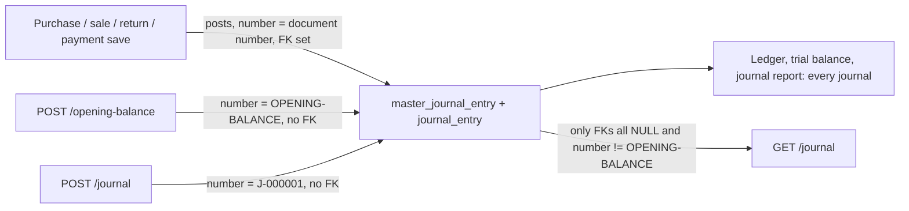

# Accounting: Chart of Accounts, Journals and Opening Balance — Backend

> Part of the Inventory System implementation guide. Read `docs/BRD.md` for the business picture and `docs/backend/backend-setup.md` for how the backend is organised.

## 1. What this is

The chart of accounts is the list of "buckets" the books are kept in: Cash, Sales, Purchase, VAT Payable, each vendor, each customer, and so on. A user maintains it on the Chart of Accounts page. Every purchase, sale, return and payment posts a journal into these accounts automatically; for anything else (a fuel bill paid in cash, a bank charge, a transfer between cash and bank) the user types a **manual journal entry**. The **opening balance** is one special journal that holds the balances the business started with.

**Double entry in one paragraph.** Every journal moves money between accounts, and every line either *debits* or *credits* one account. A debit increases an asset or an expense and decreases a liability, equity or income; a credit does the opposite. Because money only ever moves from somewhere to somewhere, the debits of a journal always add up to the same total as its credits. That single rule ("the journal balances") is what the API enforces, and it is what makes the ledger, trial balance and all the accounting reports add up.

The account types are grouped under five headings in the `account_types` table: **Assets** (what the business owns: cash, bank, receivables, fixed assets), **Liability** (what it owes: payables, tax, loans), **Equity** (the owner's capital and retained earnings), **Income** (sales and other income) and **Expenses** (cost of goods sold and running costs).

## 2. Where the code lives

All of it is under `features/accounting/`, plus two dropdowns in `common/dropdown/`.

| File or folder | What is in it |
|---|---|
| `features/accounting/account/controllers/AccountMasterController.java` | `/accountMaster` endpoints |
| `features/accounting/account/services/AccountMasterService.java` | List, create, update, delete, account types, parent accounts |
| `features/accounting/account/entities/AccountMaster.java`, `AccountType.java` | The `account_master` and `account_types` tables |
| `features/accounting/account/repositories/AccountMasterRepository.java` | Finders by code, name, vendor, customer; the dropdown queries |
| `features/accounting/account/dtos/AccountMasterDTO.java`, `AccountTypeGroupDTO.java` | JSON shapes (`{ heading, types }` for the grouped types) |
| `features/accounting/journal/controllers/JournalEntryController.java` | `/journal` endpoints |
| `features/accounting/journal/services/JournalEntryService.java` | Manual journals: list, get, create, update, delete, balance check |
| `features/accounting/journal/services/JournalEntryExportService.java` | Excel/PDF of the list and one journal voucher |
| `features/accounting/journal/entities/MasterJournalEntry.java`, `JournalEntry.java` | The `master_journal_entry` and `journal_entry` tables (used by every feature that posts a journal) |
| `features/accounting/journal/repositories/` | `MasterJournalEntryRepository` (finders by document, by number, last manual journal), `JournalEntryRepository` |
| `features/accounting/journal/dtos/MasterJournalEntryDTO.java`, `JournalEntryDTO.java` | JSON shapes, shared with the opening balance |
| `features/accounting/opening_balance/controllers/OpeningBalanceController.java` | `/opening-balance` endpoints |
| `features/accounting/opening_balance/services/OpeningBalanceService.java` | The one opening-balance journal |
| `common/dropdown/controllers/DropdownController.java`, `services/DropdownService.java` | `/dropdown/accountMaster/…` and `/dropdown/paymentModes` |
| `common/util/SpecificationBuilder.java` | Builds the list filters; takes the set of "exact match" fields |
| `common/exception/GlobalExceptionHandler.java` | Turns a SQLite foreign-key failure into a **409** |

## 3. Data

See `backend/database.sql`.

**`account_types`**: the fixed list of types, seeded once.

| Column | Meaning |
|---|---|
| `heading` | `Assets`, `Liability`, `Equity`, `Income` or `Expenses` |
| `name` | The type, e.g. `Cash & Cash Equivalents`, `Payables`, `Direct Income` |

**`account_master`**: one row per account.

| Column | Meaning |
|---|---|
| `account_code` | Optional short code, unique when given (`C-001`) |
| `account_name` | Required |
| `account_type` | The *name* of an `account_types` row, stored as text (no foreign key) |
| `parent_id`, `parent_account_name` | Optional parent account; `0` and `null` mean none. The name is stored again so lists need no join |
| `is_active` | Inactive accounts are left out of the "active" dropdowns |
| `deletable` | `0` on the accounts the system needs (Cash, Sales, VAT Purchase…) |
| `is_system_generated` | `1` on the seeded accounts; only these can be picked as a parent |
| `vendor_id`, `customer_id` | Set on the account that belongs to a vendor or customer (unique: one account each). Vendor and customer saving creates and renames it |
| `remarks` | Free text |

The seed data holds 24 system accounts (`deletable = 0`, `is_system_generated = 1`), among them `Cash In Hand` → `Cash` and `Petty Cash`, `Sales` → `VAT Sales` and `VAT Free Sales`, `Purchase` → `VAT Purchase` and `VAT Free Purchase`, `Tax Payable` → `Tax`, `Trader Payable` (the parent of every vendor account) and `Trade Receivables` (the parent of every customer account). Saving a vendor creates its account with type `Payables` under `Trader Payable`; a customer gets `Receivables` under `Trade Receivables` (see `features/purchase/vendor/services/VendorService.java` and `features/sales/customer/services/CustomerService.java`).

**`master_journal_entry`**: one row per journal, whoever posted it.

| Column | Meaning |
|---|---|
| `date` | `YYYY-MM-DD` text |
| `system_entry_no` | Unique. A manual journal gets `\|J-000001`; a journal posted by a document reuses that document's number (`\|PE-000001`); the opening balance is the fixed text `OPENING-BALANCE` |
| `remarks` | Free text |
| `master_purchase_entry_id`, `master_sales_entry_id`, `master_purchase_return_id`, `master_sales_return_id`, `master_payment_id` | Exactly one is set on a journal a document posted; all five are `NULL` on a manual journal and on the opening balance |

The entity maps these five as `@ManyToOne` rather than `@OneToOne` on purpose: a one-to-one would add a `UNIQUE` constraint to the column, and SQLite cannot `ALTER TABLE ADD` a unique column, which broke Hibernate's schema update.

**`journal_entry`**: one row per line.

| Column | Meaning |
|---|---|
| `master_journal_entry_id` | The journal |
| `account_master_id` | The account debited or credited (foreign key) |
| `debit_amount`, `credit_amount` | One of them is normally 0 |
| `narration` | Line text; the ledger report shows this |

## 4. API

Full request and response shapes: `backend/endpoints.md` sections 4 (dropdowns), 8 (chart of accounts) and 13 (journals and opening balance).

| Method | Path | What it does | Permission |
|---|---|---|---|
| `GET` | `/accountMaster` | Paged list; `accountType` filter matches the whole name | `ViewAccountMaster` |
| `GET` | `/accountMaster/{id}` | One account | `ViewAccountMaster` |
| `GET` | `/accountMaster/getAccountTypes` | Types grouped by heading | `ViewAccountMaster` |
| `GET` | `/accountMaster/getParentAccount/{accountTypeName}` | Possible parents of that type (`{ id, name }`) | `ViewAccountMaster` |
| `POST` | `/accountMaster` | Create | `CreateAccountMaster` |
| `PUT` | `/accountMaster/{id}` | Update | `EditAccountMaster` |
| `DELETE` | `/accountMaster/{id}` | Delete | `DeleteAccountMaster` |
| `GET` | `/journal/generateNumber` | Next manual journal number as plain text | `CreateJournalEntry` |
| `GET` | `/journal` | Paged list of **manual** journals, each with its `journalEntries` | `ViewJournalEntries` |
| `GET` | `/journal/{id}` | One manual journal | `ViewJournalEntries` |
| `POST` | `/journal` | Create | `CreateJournalEntry` |
| `PUT` | `/journal/{id}` | Update | `EditJournalEntry` |
| `DELETE` | `/journal/{id}` | Delete | `DeleteJournalEntry` |
| `GET` | `/journal/export/{format}` | The list's journals, one row per line, as `excel` or `pdf` | `ViewJournalEntries` |
| `GET` | `/journal/{id}/export/{format}` | One journal as a PDF voucher or Excel sheet | `ViewJournalEntries` |
| `GET` | `/opening-balance` | The opening balance (an empty shape when not set) | `ViewOpeningBalance` |
| `POST` | `/opening-balance` | Save it, replacing the old one | `CreateOpeningBalance` |
| `GET` | `/dropdown/accountMaster/{type}/{partyType}/{status}` | Accounts for select boxes | login only |
| `GET` | `/dropdown/paymentModes` | Active `Cash & Cash Equivalents` accounts | login only |

Request fields that matter:

- Account: `account_code`, `account_name`, `account_type`, `parent_id` (`0` = none), `parent_account_name`, `is_active`, `deletable`, `remarks`. JSON is snake_case; the response adds `is_system_generated`.
- Journal and opening balance share one body: `date`, `remarks` and the line list **`journalEntries`** (camelCase, like every line list), each line `account_master_id`, `debit_amount`, `credit_amount`, `narration`. Responses add `system_entry_no`, line `id`, `master_journal_entry_id` and `account_master_name`.
- Dropdown path parts: `type` = `party` / `nonparty` / `all`; `partyType` = `vendor` / `customer` / `all`; `status` = `active` / `all`. Anything else counts as `all`.

Every save returns the usual `{ success, message, post_data_id }` envelope; `post_data_id` is the record id.

## 5. How it works

### 5.1 Listing and filtering accounts

**Idea.** The list is the generic paged query every list uses (`QueryParamUtil` for `pageIndex`, `pageSize`, `sort`; `SpecificationBuilder` turns the other parameters into "contains" conditions). The one twist is `accountType`: types come from a fixed list, and a "contains" match on `Payables` would also return `Other Payables` and `Statutory Payables`. So the service builds its `SpecificationBuilder` with `Set.of("accountType")` as the exact-match fields, and that filter becomes `lower(account_type) = lower(value)`.

```
list_accounts(params):
  pageable = pageIndex / pageSize / sort from params
  filters  = params minus the reserved ones (pageIndex, pageSize, sort, calendar) and blanks
  spec     = for each filter: exact equal for accountType, "contains" for everything else
  return repository.findAll(spec, pageable) mapped to AccountMasterDTO
```

### 5.2 Account types and parent accounts

**Idea.** The form shows the types grouped under their heading, and lets the user pick a parent of the same type. `getAccountTypes` reads all `account_types` rows and groups them by `heading` into a `LinkedHashMap`, so the headings come out in seed order (Assets, Liability, Equity, Income, Expenses). `getParentAccount` runs the repository query `findDropdownByAccountType`: accounts of that type that are **active and system generated**. User-made accounts and vendor/customer accounts are never offered as parents; the hierarchy stays the seeded one.

### 5.3 Creating and updating an account

**Idea.** Few rules: a code, when given, must be unique; a name and a type are required. The server stores `parent_account_name` as the client sends it rather than looking it up, so the web app must send it along with `parent_id`. `is_system_generated` is forced to `false` on create and is never changed by an update, so a user can never turn one of their accounts into a "system" one.

```
create_account(dto):
  if a row has this account_code                 -> 409 "Duplicate Account Code"
  if account_name blank                          -> 400 "Account Name cannot be null or blank"
  if account_type blank                          -> 400 "Account Type cannot be null or blank"
  copy name, code, type, parent_id, parent_account_name, remarks, is_active, deletable
  is_system_generated := false
  save

update_account(id, dto):
  load                                           -> 404 "AccountMaster not found"
  if another row has this account_code           -> 409 "Duplicate Account Code"
  same blank checks as create
  copy the same fields (is_system_generated untouched)
  save
```

**Rules checked**

- Duplicate `account_code` → **409** `"Duplicate Account Code"` (the check runs before the blank checks).
- Blank name → **400** `"Account Name cannot be null or blank"`; blank type → **400** `"Account Type cannot be null or blank"`.
- The type is not checked against `account_types`; any text is accepted.

### 5.4 Deleting an account

**Idea.** Three kinds of account must survive: the ones the posting code needs by name (`deletable = 0`), the ones that belong to a vendor or customer (their save code looks the account up by `vendor_id` / `customer_id` and would fail), and any account a journal line points at (the books would lose a side of a journal). The first two are checked in the service; the third is left to the database: `journal_entry.account_master_id` is a foreign key, SQLite refuses the delete with `FOREIGN KEY constraint failed`, and `GlobalExceptionHandler` turns that into a **409**.

```
delete_account(id):
  load                                           -> 404 "AccountMaster not found"
  if deletable == false                          -> 400 "Selected Account cannot be deleted"
  if vendor or customer is set                   -> 400 "Selected Account belongs to a vendor or customer; delete them instead"
  repository.deleteById(id)
    (a journal line still points here)           -> 409 "This record is still used by other records, so it cannot be deleted"
```

### 5.5 Which journals are "manual"

**Idea.** All journals live in the same two tables, because the ledger and trial balance must see every one of them. But a journal posted by a purchase is a *copy* of that purchase: it is deleted and re-posted every time the purchase is saved, so editing it by hand would be undone by the next save. The journal page therefore shows and changes only journals typed in by hand. A journal is manual when all five document columns are `NULL` **and** its number is not `OPENING-BALANCE`. `JournalEntryService` keeps that as one `Specification` (`MANUAL_ONLY`) and ANDs it onto every list query; `findManualJournal(id)` applies the same test to a single record before any get, update or delete.



**Rules checked** (`findManualJournal`, used by get, update and delete)

- Unknown id → **404** `"Journal Entry with Given Id not found"`.
- Any document column set → **400** `"This journal was posted by a purchase, sale, return or payment; change that document instead"`.
- Number is `OPENING-BALANCE` → **400** `"This journal is the opening balance; change it from the opening balance"`.

### 5.6 Creating a manual journal

**Idea.** Validate the double-entry rule first, then write the master row and its lines. The number comes from the `Journal Entry` row of `document_numbering` (prefix `|J-`, 6 digits). `DocumentNumberingService.generateJournalNumber` takes the last number from `findTopByOrderByIdDescJournal`, a query that skips document-posted journals and the opening balance: their numbers belong to other sequences, so looking at the latest `master_journal_entry` row would give nonsense. Line narrations are stored exactly as sent; the API does not fill a blank one (the web app sends the journal's remarks for a blank narration, because the ledger shows line narrations).

```
create_journal(dto):                                 -- one transaction
  validate_balanced(dto.journalEntries)              -> see rules
  master = new (date, remarks, number = next "Journal Entry" number)
  save master
  for each line:
      account = load account_master_id              -> 404 "Account not found"
      save line (account, debit_amount, credit_amount, narration, master id)
  return master

validate_balanced(lines):
  no lines                                           -> 400 "Journal requires at least one account line"
  for each line: a missing side counts as 0
      debit < 0 or credit < 0                        -> 400 "Debit and credit amounts cannot be negative"
  total debit == 0                                   -> 400 "Journal total cannot be zero"
  |total debit - total credit| > 0.001               -> 400 "Journal debits and credits must be equal"
```

**Rules checked**: the four messages above, all **400**. The 0.001 slack absorbs floating-point noise in sums of doubles. Only the *total* must balance; one line may carry both a debit and a credit, the API does not forbid it.

### 5.7 Editing and deleting a manual journal

**Idea.** Lines are not matched by id. An update deletes every existing line and inserts the lines sent, inside one transaction; the number and id of the journal stay. This is the simplest correct behaviour for a document whose lines have no side effects (no stock, no due invoice). Delete removes the lines and then the master.

```
update_journal(id, dto):                             -- one transaction
  validate_balanced(dto.journalEntries)
  master = find_manual_journal(id)                   -> 404 / 400, see 5.5
  master.date, remarks := dto's
  delete all lines of master
  insert the lines sent (account lookup -> 404 "Account not found")

delete_journal(id):                                  -- one transaction
  master = find_manual_journal(id)
  delete its lines, then the master
```

### 5.8 Export and print

`JournalEntryExportService` reuses the service's list with paging switched off (`QueryParamUtil.allRows`), so a file has every manual journal the filters match, in the list's sort. `/journal/export/{format}` writes one row per **line** (Journal Number, Date, Remarks, Account, Narration, Debit, Credit; the two amounts are totalled). `/journal/{id}/export/{format}` is a "Journal Voucher": the number and date, the lines with totals, and the remarks. It reads the journal through `getJournalEntryById`, so a document-posted journal cannot be printed from here either. The common export code (letterhead, `calendar`, Excel vs PDF) is described in section 18 of `endpoints.md`.

### 5.9 The opening balance

**Idea.** The balances a business starts with are themselves a journal: debit the assets you hold, credit the liabilities and capital. Instead of a table of its own, the opening balance is one `master_journal_entry` with the well-known number `OPENING-BALANCE` (`OpeningBalanceService.OPENING_BALANCE_ENTRY_NO`) and no document column set. Because the ledger treats it as any other journal, the opening balance report figures fall out for free. There is only ever one; saving again replaces it completely.

```
get_opening_balance():
  entry = find by system_entry_no "OPENING-BALANCE"
  none -> an empty DTO whose system_entry_no is "OPENING-BALANCE"
  else -> the journal with its lines

save_opening_balance(dto):                           -- one transaction
  no lines                                           -> 400 "Opening balance requires at least one account line"
  for each line: null debit/credit := 0
      debit < 0 or credit < 0                        -> 400 "Debit and credit amounts cannot be negative"
  |total debit - total credit| > 0.001               -> 400 "Opening balance debits and credits must be equal"
  existing = find by number
  if existing: delete its lines, delete it, FLUSH
  master = new (date, number "OPENING-BALANCE", remarks or "Opening Balance" when blank)
  save master
  for each line:
      account = load                                 -> 404 "Account not found"
      save line (narration or "Opening Balance" when null)
```

**Why the flush.** Ids are database identities, so `save` on a new master runs the `INSERT` immediately, and `system_entry_no` is unique. Without `flush()` Hibernate could still be holding the old row's `DELETE` in its queue when the `INSERT` for the same number runs, and the database would refuse it. Flushing pushes the delete through first.

**Rules checked**: the three messages above, all **400**. Unlike a journal, a total of zero is accepted. `ViewOpeningBalance` reads, `CreateOpeningBalance` saves (there is no edit or delete permission: saving *is* editing).

### 5.10 The two account dropdowns

**Idea.** Forms need `{ id, name }` lists without a specific permission. `DropdownService.getAccountMasterDropdown` turns the three path parts into nullable parameters and runs one JPQL query (`findFilteredDropdown`) where each `NULL` parameter switches its condition off:

```
type:      party -> true (vendor or customer set), nonparty -> false (neither set), else null
partyType: vendor -> "Vendor", customer -> "Customer", else null
status:    active -> true, else null
```

`getPaymentModeDropdown` is `findActiveDropdownByAccountType("Cash & Cash Equivalents")`, ordered by name: the accounts money can be paid from or into (Cash, Petty Cash, any bank account the user adds with that type). The payments feature uses it for `payment_mode_id`.

## 6. Design decisions and gotchas

- **One journal store for everything.** Documents post into the same tables as manual journals; what tells them apart is the five foreign-key columns and the `OPENING-BALANCE` number. Keep that test in one place (`MANUAL_ONLY` and `findManualJournal`) and reuse it in the number generator's query, or manual numbers will jump.
- **Exact match for `accountType`.** Pass the set of exact fields to `SpecificationBuilder`; every other list uses the default "contains" builder.
- **`parent_account_name` is trusted from the client.** The server neither looks it up nor checks that `parent_id` exists or has the same type.
- **`deletable` is a request field.** A user with `CreateAccountMaster` can create an account with `deletable: false` and then never delete it. Only `is_system_generated` is protected.
- **A journal line with both sides empty is stored as `NULL`, not 0.** `validateBalanced` treats a missing amount as 0 for the check but saves the line as sent. The opening balance normalises both sides to `0.0` before saving. Reports must cope with `NULL` amounts (or you normalise in the journal too).
- **Delete order matters.** Both delete paths remove the lines first; the master row has a foreign key from `journal_entry`, so deleting it first would fail with the 409 above.
- **No "manual" flag on the account side.** An account used by any journal line, posted or manual, cannot be deleted; there is no soft delete. Make it inactive instead.
- The API never recomputes or checks account *balances*: a credit to Cash larger than the cash held is accepted.

## 7. Build it yourself: order of work

1. Create `account_types` and seed the 18 types under the five headings; create `account_master` with the unique `vendor_id` / `customer_id` columns and seed the system accounts with `deletable = 0`, `is_system_generated = 1`.
2. Write `AccountMaster` and `AccountType` entities, `AccountMasterRepository` (`existsByAccountCode`, `existsByAccountCodeAndIdNot`, `findByAccountName`, `findByVendorId`, `findByCustomerId`, the two dropdown queries) and `AccountTypeRepository`.
3. Write `AccountMasterDTO` (snake_case via `@JsonProperty`) and `AccountTypeGroupDTO`.
4. Write `AccountMasterService` with `SpecificationBuilder<>(Set.of("accountType"))`, then the controller with `@RequiresOperation("ViewAccountMaster")` and the three change operations. Try: create a bank account, filter `?accountType=Payables`, delete `Cash` and expect `"Selected Account cannot be deleted"`.
5. Make vendor and customer saving create and rename their account (type `Payables` under `Trader Payable`; `Receivables` under `Trade Receivables`).
6. Create `master_journal_entry` (five nullable document columns, unique `system_entry_no`) and `journal_entry`; entities with `@ManyToOne` document links and a cascaded `@OneToMany` line list; repositories with `findBySystemEntryNo`, `findByMasterPaymentId` and friends, and `findTopByOrderByIdDescJournal`.
7. Add a `Journal Entry` row to `document_numbering` (`|J-`, 6 digits) and `generateJournalNumber` in `DocumentNumberingService`.
8. Write `JournalEntryService`: `MANUAL_ONLY`, `validateBalanced`, `findManualJournal`, create/update/delete under `@Transactional`; then the controller. Try: post the fuel example from `endpoints.md` section 13, then an unbalanced one and expect `"Journal debits and credits must be equal"`.
9. Write `OpeningBalanceService` with the `OPENING-BALANCE` constant, the delete-flush-insert sequence and the `"Opening Balance"` defaults; then its controller with `ViewOpeningBalance` / `CreateOpeningBalance`. Try saving twice and check only one journal with that number exists.
10. Add the two dropdowns to `DropdownService` and `DropdownController`.
11. Add `JournalEntryExportService` and the two export endpoints once the common export code exists.
12. Check the ledger and trial balance reports include the opening balance and the manual journal.
