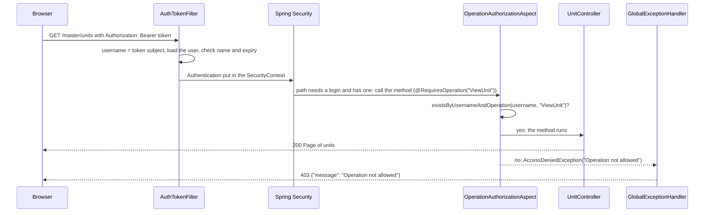

# Auth and security — Backend

> Part of the Inventory System implementation guide. Read `docs/BRD.md` for the business picture and `docs/backend/backend-setup.md` for how the backend is organised.

## 1. What this is

A user logs in with a username and password and gets a JWT (a signed login token the browser sends on every request). Every other request carries that token; the server reads the username from it, and before a controller method runs it checks that the user's role holds the operation the method needs (`ViewUnit`, `CreatePurchaseEntry`, ...). Five wrong passwords lock an account for an hour. A signed-in user can change their own password. This document covers the Spring Security setup, the login, the token, the per-request filter, the permission check, the lock and the change-password rules.

## 2. Where the code lives

| File | What is in it |
|---|---|
| `security/WebSecurityConfig.java` | Which paths are open, stateless sessions, CORS, where the token filter sits |
| `security/AuthTokenFilter.java` | Reads `Authorization: Bearer <token>` on every request and signs the user in for that request |
| `security/JwtUtil.java` | Builds and parses tokens (HS256, subject = username, 1 hour) |
| `security/AuthEntryPoint.java` | The 401 JSON answer for a request with no login |
| `security/RequiresOperation.java`, `security/OperationAuthorizationAspect.java` | The `@RequiresOperation("ViewX")` annotation and the AOP check behind it |
| `security/ApplicationConfiguration.java` | `UserDetailsService`, `BCryptPasswordEncoder`, `AuthenticationManager` and `DaoAuthenticationProvider` beans |
| `features/auth/controllers/AuthController.java` | `POST /login`, `PUT /change-password`, `GET /getUserRoleOperations` |
| `features/auth/services/AuthService.java` | Login rules, the lock, change password, the operations list; `STRONG_PASSWORD` |
| `features/auth/dtos/` | `LoginRequest`, `LoginResponse`, `ChangePasswordRequest` |
| `features/user/entities/User.java` | The user, which implements Spring's `UserDetails` |
| `features/user/repositories/UserRepository.java` | `findByUsername`, `existsByUsernameAndOperation` (the permission query) |
| `common/exception/GlobalExceptionHandler.java` | Maps the auth exceptions to 401 / 403 (common doc) |
| `src/main/resources/application.properties` | `jwt.secret-key`, `jwt.expiration`, `auth.maxFailedAttempts`, `auth.lockTimeDurationMs` |

## 3. Data

The login reads and updates the `user` table (`database.sql`); the permission check joins it to the role tables (users and roles doc).

| Table.column | Used for |
|---|---|
| `user.username` | Unique; the login name and the token's subject |
| `user.password` | BCrypt hash; never returned by the API |
| `user.is_active` | `0` refuses a login with 403 |
| `user.account_non_locked`, `user.failed_attempt`, `user.lock_time` | The lock: whether locked, how many wrong passwords, and since when |
| `user.role_id` → `role.id` | The user's one role |
| `role_operation.role_id`, `role_operation.operation_id` → `operation.name` | What the role may do; `existsByUsernameAndOperation` walks user → role → operations |

Settings:

| Property | Value | Meaning |
|---|---|---|
| `jwt.secret-key` | a 64-character hex string | The signing key; `JwtUtil` decodes the text as Base64 and builds an HMAC key from the bytes |
| `jwt.expiration` | `3600000` | Token life in milliseconds (1 hour) |
| `auth.maxFailedAttempts` | `5` | Wrong passwords before the lock |
| `auth.lockTimeDurationMs` | `3600000` | How long the lock lasts (1 hour) |

## 4. API

| Method | Path | What it does | Permission needed |
|---|---|---|---|
| `POST` | `/login` | `{ "username", "password" }` → `{ "token": "..." }` | none (open) |
| `GET` | `/getUserRoleOperations` | The signed-in user: `id`, `username`, `name`, `role_id`, `role_name`, `image_url`, `master_modules`, `modules`, `operations` | a login |
| `PUT` | `/change-password` | `{ "current_password", "new_password" }` → the usual success body, `Password changed successfully`, `post_data_id` = the user's id | a login |

Sections 1 and 2 of `endpoints.md` show the full bodies. Open without any login: `POST /login`, `GET /configurations`, `/ws/**` (the socket handshake checks `?token=` itself) and the Swagger paths. Everything else needs a valid token, and most controller methods also need an operation.

## 5. How it works

### 5.1 The security setup

**Idea.** There are no sessions and no cookies: each request proves who it is with the token, so the server keeps nothing between requests (`SessionCreationPolicy.STATELESS`), and CSRF protection is off because it guards cookie-based logins. The project's own filter runs before Spring's `UsernamePasswordAuthenticationFilter` and does the only authentication there is.

`WebSecurityConfig`:

```
cors:  any origin pattern, any method, any header, credentials allowed, Content-Disposition exposed
       ("*" is not allowed in allowedOrigins when credentials are on, so origin patterns echo the caller's
        origin back; the exposed header lets the web app read the file name of an Excel or PDF download)
csrf:  off
authorize: /login, GET /configurations, /ws/**, /v3/api-docs/**, /swagger-ui/**, /swagger-ui.html -> permitAll
           anything else -> authenticated
no login where one is needed -> AuthEntryPoint writes 401 JSON:
           {"success": false, "message": "Please log in to access this resource.", "errorCode": 401, ...}
session: STATELESS
authenticationProvider: DaoAuthenticationProvider (UserDetailsService + BCrypt)
addFilterBefore(AuthTokenFilter, UsernamePasswordAuthenticationFilter)
```

`ApplicationConfiguration` wires the beans: the `UserDetailsService` is `userRepository.findByUsername(...)` or `UsernameNotFoundException("User not found")`; a `BCryptPasswordEncoder`; the `AuthenticationManager` from Spring's `AuthenticationConfiguration`. `User` itself implements `UserDetails`, so the entity is what Spring loads; its `getAuthorities()` returns an empty list because the project never uses Spring's role or authority checks (see 5.4).

### 5.2 Logging in

**Idea.** `AuthService.authenticate` wraps Spring's password check in its own checks, so it can refuse inactive and locked accounts with their own messages and count wrong passwords on the user row. The user is loaded first, which is what makes the counting possible.

```
POST /login {username, password}:
  user = findByUsername(username)               -> 401 "Username or Password is Incorrect."   (same text as a wrong password)
  user not active                               -> 403 "User account is inactive."
  ensure_unlocked(user)                         -> 403 "Account is locked. Try again later."   (see 5.5)
  try   AuthenticationManager.authenticate(username, password)   -- BCrypt compare through DaoAuthenticationProvider
  catch anything: record_failed_attempt(user)   -> 401 "Username or Password is Incorrect."
  clear failed attempts (0, unlocked, no lock time); save
  controller: token = JwtUtil.generateToken(user)              -> 200 {"token": "<jwt>"}
```

**Rules checked**

- Unknown username and wrong password give the same 401 message, so a caller cannot tell which it was. An unknown username counts no attempt (there is no row to count on).
- `is_active = 0`: 403 `User account is inactive.`, before the password is looked at and without counting an attempt.
- Locked: 403 `Account is locked. Try again later.`
- A wrong password adds one failed attempt; the fifth locks the account (5.5).

### 5.3 The token (`JwtUtil`)

```
generateToken(user):
  claims: subject = username, issuedAt = now, expiration = now + jwt.expiration (1 h)
  signed HS256 with the key from jwt.secret-key
extractUsername(token):  parse with the key (signature and expiry are checked while parsing), read the subject
isTokenValid(token, userDetails):  subject equals the loaded username AND the expiry is after now
```

The token carries nothing but the username and two times: no role, no operations. That is deliberate (5.4 and section 6).

### 5.4 Every other request: filter, then permission check

**Idea.** Two separate steps. The filter answers "who is this?" by putting an `Authentication` in Spring's `SecurityContext`; the aspect answers "may they do this?" by asking the database for the operation named on the controller method. The web app makes the same decision from `/getUserRoleOperations` to show or hide menus and buttons, but the server decides for real on every call.



`AuthTokenFilter` is a `OncePerRequestFilter`, skipped for `/login`:

```
header = Authorization
no header, or not starting with "Bearer "  -> continue with no login
                                              (Spring answers 401 through AuthEntryPoint if the path needs one)
try:
  username = JwtUtil.extractUsername(token)          -- throws for a bad signature or an expired token
  username present and nothing authenticated yet:
      details = UserDetailsService.loadUserByUsername(username)   -- UsernameNotFoundException if the user is gone
      isTokenValid(token, details)?
          put UsernamePasswordAuthenticationToken(details, no credentials, no authorities) in the context
  continue the chain
catch any exception: HandlerExceptionResolver.resolveException(...)
                     -- so GlobalExceptionHandler answers in the normal JSON shape instead of a servlet error page
```

What the caller sees: no token on a protected path → 401 `Please log in to access this resource.`; expired token → 403 `The JWT token has expired` (`ExpiredJwtException` is mapped); a token with a bad signature or garbage → the catch-all handler, 500 with the JJWT message; a valid token for a user deleted since → 500 `User not found`. The web app ends the session on a 401 or on any error whose message mentions the JWT, which covers all of these.

`OperationAuthorizationAspect` is an `@Aspect` with `@Before("@annotation(requires)")`, so it runs before every method carrying `@RequiresOperation`:

```
auth = the SecurityContext's authentication
no auth, blank name, or "anonymousUser"          -> AccessDeniedException "Operation not allowed"   (403)
for each operation in the annotation's value:
    userRepository.existsByUsernameAndOperation(auth.getName(), operation)?  return (allowed)
none matched                                      -> AccessDeniedException "Operation not allowed"   (403)
```

The annotation takes a list (`String[] value()`) and the user needs **at least one** of them: payments use `@RequiresOperation({"ViewVendorPayment", "ViewCustomerPayment"})`. The check is one JPQL statement in `UserRepository`:

```
SELECT COUNT(o) > 0 FROM User u JOIN u.role r JOIN r.operations o
WHERE u.username = :username AND o.name = :operationName
```

### 5.5 Account locking

**Idea.** Nothing runs on a timer. Wrong passwords are counted on the user row; the fifth sets `account_non_locked = 0` and `lock_time = now`; the next attempt after an hour clears it. Login and change-password share the same three helpers.

```
ensure_unlocked(user):
  account_non_locked? return
  lock_time set and now - lock_time >= auth.lockTimeDurationMs?  clear failed attempts; save; return   -- the lock has run out
  otherwise                                        -> 403 "Account is locked. Try again later."
record_failed_attempt(user):
  failed_attempt += 1
  failed_attempt >= auth.maxFailedAttempts?  account_non_locked = false, lock_time = now
  save
clear_failed_attempts(user):  failed_attempt = 0, account_non_locked = true, lock_time = null
```

`User.isAccountNonLocked()` is also one of Spring's `UserDetails` flags, so `DaoAuthenticationProvider` would refuse a locked user on its own; `ensure_unlocked` runs first so the caller gets the project's message rather than Spring's, and so an expired lock is lifted.

### 5.6 Changing your own password

**Idea.** The endpoint needs only a login; the username comes from the security context, so a user can change nobody's password but their own. A wrong current password counts towards the lock exactly like a failed login, so a stolen session cannot be used to guess it. The session stays signed in: the token is untouched.

```
PUT /change-password {current_password, new_password}:
  user = findByUsername(context username)              -> 404 "User not found"
  either value null or empty                           -> 400 "Current password and new password are required"
  ensure_unlocked(user)                                -> 403 "Account is locked. Try again later."
  BCrypt matches(current, stored hash)? no: record_failed_attempt
                                                       -> 400 "Current password is incorrect"
  new not strong                                       -> 400 "New password must be at least 8 characters with upper and lower case letters, a number and a symbol"
  new equals current                                   -> 400 "New password must be different from the current password"
  password = BCrypt(new); clear failed attempts; save  -> 200 "Password changed successfully", post_data_id = user id
```

Strong means it matches `STRONG_PASSWORD`, the same rule the web app's password checklist shows:

```
^(?=.*[a-z])(?=.*[A-Z])(?=.*\d)(?=.*[^A-Za-z0-9]).{8,}$
```

Only this endpoint enforces it; an administrator creating or editing a user through `/users` may set any password.

### 5.7 Who am I (`GET /getUserRoleOperations`)

The controller reads the `Authorization` header itself and takes the username from the token (403 `Missing or invalid Authorization header` or `Invalid token` if it cannot, although the filter and the `authenticated` rule have normally refused such a request already). The service builds `UserRoleOperationsDTO`: `id`, `username`, `name` (the full name), `image_url`, and, when the user has a role, `role_id`, `role_name` and three de-duplicated lists in first-seen order taken from the role's operations: `master_modules` (`Masters`, `Purchase`, ...), `modules` (`Category`, `PurchaseEntry`, ...) and `operations` (`ViewCategory`, ...). A user without a role gets the three lists empty.

## 6. Design decisions and gotchas

- **Permissions live in the database, not in the token.** Every annotated call runs one `EXISTS` query. The gain: editing a role takes effect on the user's next request without a new login, so the web app only has to call `refreshUser()` to redraw its menus.
- **The token names the username.** Renaming yourself makes your own token point at nobody: the filter answers 500 `User not found` until you log in again.
- **Deactivating a user does not end their session.** The filter checks only the subject and the expiry, not `is_active`; an inactive user keeps working until the token expires (at most an hour). Only new logins are refused.
- **Only the expired case gets a clean status.** Forged, truncated or re-signed tokens fall through to the 500 catch-all with JJWT's message. The web app treats any message that mentions the JWT as a logout.
- `getAuthorities()` is empty and `hasRole` / `hasAuthority` are never used; `@RequiresOperation` is the only authorization there is.
- The attempt counter is shared by `/login` and `/change-password`; a successful login or password change resets it. The lock clears lazily on the first attempt after the hour, not at the hour; nothing lifts it earlier except editing the row.
- CORS accepts every origin, with credentials; tighten `setAllowedOriginPatterns` for a real deployment. The secret key sits in `application.properties`, checked into the repository.
- `GET /configurations` is open without a login, so company settings can be read before anyone signs in; everything under `/uploads/**` is not.

## 7. Build it yourself: order of work

1. Add `spring-boot-starter-security`, `spring-boot-starter-aop` and the three `jjwt` artifacts; put `jwt.*` and `auth.*` in `application.properties`.
2. Make `User` implement `UserDetails` (username, password, `accountNonLocked`, empty authorities); add `findByUsername` to the repository.
3. `ApplicationConfiguration`: `UserDetailsService`, `BCryptPasswordEncoder`, `AuthenticationManager`, `DaoAuthenticationProvider`.
4. `JwtUtil`: generate and parse; test a round trip.
5. `AuthService.authenticate` with the inactive, lock and counter rules; `AuthController.login`; curl it and keep the token.
6. `AuthEntryPoint` and `WebSecurityConfig` (open paths, stateless, CORS, filter order); confirm a bare `GET /products` answers 401 JSON.
7. `AuthTokenFilter`; confirm the token now reaches a controller.
8. `RequiresOperation`, `OperationAuthorizationAspect` and the `existsByUsernameAndOperation` query; annotate a controller and test with a role that lacks the operation (403).
9. `getUserRoleOperations`, then `changePassword` with `STRONG_PASSWORD`.
10. Map `BadCredentialsException`, `AccountLockException`, `AccessDeniedException` and `ExpiredJwtException` in `GlobalExceptionHandler`.
