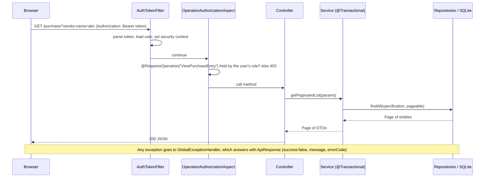

# Backend — Setup and Project Structure

> Part of the Inventory System implementation guide. Read `docs/BRD.md` first for the business picture. This document explains how the API server is put together and in what order to build it. Each feature then has its own document in a sub-folder of `docs/backend/`.

## 1. What the backend is

A **Spring Boot** application (Java) that exposes a REST API (JSON over HTTP), keeps all data in one **SQLite** database file, and enforces every business rule. The web app is only a client of this API; anything that must be true (stock never below zero, journals balanced, permissions) is checked here.

| Piece | Choice | Why |
|---|---|---|
| Language / runtime | Java 25 | Modern Java, long-term support |
| Framework | Spring Boot 3.4 (Web, Data JPA, Security, WebSocket, AOP) | Batteries included: HTTP, database access, login, sockets |
| Database | SQLite through `sqlite-jdbc`, with Hibernate's community SQLite dialect | A single file; nothing to install; easy backups |
| Database access | JPA / Hibernate entities and Spring Data repositories | Repositories give paging, sorting and filtering for free |
| Login | JWT (signed tokens) with the `jjwt` library; BCrypt password hashes | Stateless: the token carries the username, no server session |
| API docs | springdoc OpenAPI (Swagger UI) | Try every endpoint in the browser |
| Files | Apache POI (Excel), OpenPDF (PDF) | Server-built exports and prints |
| Boilerplate | Lombok | Getters and setters without the noise |
| Packaging | WAR with embedded Tomcat (runs with `java -jar`) | Also deployable to an external servlet container |

## 2. Tools to install

- **JDK 25**. Maven is not needed: the project ships the Maven wrapper (`mvnw`, `mvnw.cmd`).
- **sqlite3** command-line tool, to create the database file from `database.sql`.
- Optionally **Docker** to run it in a container.

## 3. Creating the project from scratch

1. Generate a Spring Boot 3.4 project (start.spring.io or your IDE) with Java 25, packaging **War**, group `com.sandipsky`, artifact `inventory_system`. Add these dependencies to `pom.xml`:

| Dependency | Purpose |
|---|---|
| `spring-boot-starter-web` | REST controllers |
| `spring-boot-starter-data-jpa` | Entities and repositories |
| `spring-boot-starter-security` | Login, password hashing, request security |
| `spring-boot-starter-websocket` | The notification socket |
| `spring-boot-starter-aop` | The `@RequiresOperation` permission check |
| `org.xerial:sqlite-jdbc` | SQLite driver |
| `org.hibernate.orm:hibernate-community-dialects` | SQLite dialect for Hibernate |
| `io.jsonwebtoken:jjwt-api`, `jjwt-impl`, `jjwt-jackson` | JWT creation and parsing |
| `org.springdoc:springdoc-openapi-starter-webmvc-ui` | Swagger UI |
| `org.apache.poi:poi-ooxml` | Excel files |
| `com.github.librepdf:openpdf` | PDF files |
| `org.projectlombok:lombok` | Getters/setters |
| `spring-boot-starter-tomcat` (provided) | Embedded server for the WAR |

2. Write `src/main/resources/application.properties`:

| Property | Value | Meaning |
|---|---|---|
| `spring.datasource.url` | `jdbc:sqlite:inventory_system.db` | The database file, relative to where the app runs |
| `spring.datasource.driver-class-name` | `org.sqlite.JDBC` | |
| `spring.datasource.hikari.connection-init-sql` | `PRAGMA foreign_keys = ON` | SQLite ignores foreign keys unless each connection turns them on. Set here so it also applies when Docker replaces the URL |
| `spring.jpa.properties.hibernate.dialect` | `org.hibernate.community.dialect.SQLiteDialect` | |
| `spring.jpa.hibernate.ddl-auto` | `update` | Hibernate adds missing columns, but the real schema comes from `database.sql` |
| `jwt.secret-key` | a long random hex string | Signs the tokens. Override in real deployments (`JWT_SECRET_KEY`) |
| `jwt.expiration` | `3600000` | Token life in milliseconds (1 hour) |
| `auth.maxFailedAttempts` | `5` | Wrong passwords before the account locks |
| `auth.lockTimeDurationMs` | `3600000` | Lock length (1 hour) |
| `file.upload-dir` | `uploads/` | Where profile pictures are stored |
| `spring.servlet.multipart.max-file-size` / `max-request-size` | `10MB` / `15MB` | Upload limits |
| `springdoc.swagger-ui.path` | `/swagger-ui.html` | |

3. Write `database.sql`: every `CREATE TABLE`, the `updated_at` triggers, and the starting data (see BRD section 10). Then `reset.sh` deletes and recreates `inventory_system.db` from it:

```
rm -f inventory_system.db
sqlite3 inventory_system.db ".read database.sql"
```

4. On first start a `CommandLineRunner` (`common/config/DataInitializer.java`) creates the `admin` user with the Admin role if it does not exist, and adds the `low_stock_quantity` setting to databases created before it existed.

5. Run with `./mvnw spring-boot:run` (or `run.sh`). The API is at `http://localhost:8080`, Swagger at `/swagger-ui.html`. Log in with `POST /login` (`admin` / `Admin@123`), then send `Authorization: Bearer <token>` on every request. `endpoints.md` shows every call with example bodies.

## 4. Folder structure

Everything lives under `src/main/java/com/sandipsky/inventory_system/`:

```
inventory_system/
├── SpringBootInventorySystemApplication.java   main class
├── ServletInitializer.java                     lets the WAR run in an external Tomcat
├── security/                                   login token, request filter, permission aspect
│   ├── WebSecurityConfig.java                  which paths are open, CORS, stateless sessions
│   ├── AuthTokenFilter.java                    reads "Authorization: Bearer ..." on every request
│   ├── JwtUtil.java                            builds and checks tokens
│   ├── AuthEntryPoint.java                     the 401 JSON answer
│   ├── RequiresOperation.java                  @RequiresOperation("ViewProduct") annotation
│   ├── OperationAuthorizationAspect.java       checks it before the controller method runs
│   └── ApplicationConfiguration.java           password encoder, user lookup, auth manager
├── common/                                     shared by every feature
│   ├── config/                                 DataInitializer, OpenApiConfig, WebConfig (uploads), WebSocketConfig
│   ├── dto/ApiResponse.java                    the {success, message, errorCode, timestamp, post_data_id} answer
│   ├── exception/                              BadRequest, Duplicate, NotFound, AccessDenied, AccountLock + GlobalExceptionHandler
│   ├── util/                                   SpecificationBuilder (filters), QueryParamUtil (paging/sort), LineItemUtil,
│   │                                           MoneyUtil, ReportDateUtil, BsDateUtil, ResponseUtil
│   ├── dropdown/                               GET /dropdown/... short {id, name} lists
│   └── export/                                 ExportTable, PrintDocument, ExcelFile, PdfFile, ExportService
└── features/                                   one folder per business area, one sub-folder per feature
    ├── auth/                                   login, change password, "who am I"
    ├── masters/{unit,category,packing,taxtype}/
    ├── product/
    ├── purchase/{vendor,purchase_entry,purchase_return}/
    ├── sales/{customer,sales_entry,sales_return}/
    ├── inventory/{opening_stock,stock_adjustment,stock_edit}/
    ├── accounting/{account,journal,opening_balance,payment}/
    ├── reports/{purchase,purchase_return,sales,sales_return,inventory,accounting,export}/
    ├── dashboard/
    ├── notification/                           + socket/
    ├── user/  and  role_operations/
    └── settings/{configuration,document_numbering}/
```

Every feature folder has the same five sub-folders:

| Sub-folder | Holds | Naming |
|---|---|---|
| `controllers/` | One `@RestController` per resource: maps HTTP paths to service calls, nothing else | `UnitController` |
| `dtos/` | The JSON shapes sent and received (`@JsonProperty("snake_case")` on every field) | `UnitDTO`, `MasterPurchaseEntryDTO`, `PurchaseEntryDTO` (a line) |
| `entities/` | JPA entities mapped to the tables | `Unit`, `MasterPurchaseEntry` (header), `PurchaseEntry` (line) |
| `repositories/` | Spring Data interfaces (`JpaRepository` + `JpaSpecificationExecutor` for filtered lists) | `UnitRepository` |
| `services/` | The business logic; every write is one `@Transactional` method | `UnitService`, plus `UnitExportService` where the feature has files |

Document features name the header entity `Master…` and the line entity after the document (`MasterSalesEntry` / `SalesEntry`). Document headers carry `system_entry_no`; lines carry `product_id` and `batch_id`.

## 5. How a request travels



Conventions every feature follows (the `common` document explains each in depth):

- **Lists** are paged: `pageIndex`, `pageSize`, `sort=field:asc`, plus any entity field as a "contains" filter (`vendor.name=abc`, `isActive=1`) and `fromDate`/`toDate` on `date`. The controller takes `@RequestParam Map<String,String> params`; the service turns it into a `Pageable` and a `Specification` with `QueryParamUtil` and `SpecificationBuilder`.
- **Writes** (create, update, delete, cancel) answer `ApiResponse` with `post_data_id` = the record's id and a message like `"Unit Added successfully"`.
- **Errors**: throw `BadRequestException` (400), `DuplicateResourceException` (409), `ResourceNotFoundException` (404), `AccessDeniedException` (403); `GlobalExceptionHandler` turns them into the same JSON shape. A SQLite foreign-key failure on DELETE becomes 409 "This record is still used by other records, so it cannot be deleted".
- **Permissions**: every controller method carries `@RequiresOperation("…")` (one or several; any one suffices). Endpoints that need only a login have none.
- **Documents** get their number from `DocumentNumberingService` inside the save, post their journal through the journal repositories, and call `NotificationService.notifyActivity` at the end; stock alerts need no call because a JPA listener watches batch quantities.
- **JSON naming**: snake_case fields; the only camelCase names are the line lists (`purchaseEntries`, `journalEntries`, `paymentDetails`, ...). Purchases call the tax `tax`, sales `total_tax`. Booleans may come back twice (`is_active` and `active`), a side effect of Lombok's `isActive()` getter next to the `@JsonProperty("is_active")` field; clients send `is_active`.

## 6. Running with Docker

`Dockerfile` has two stages: the first builds the WAR with the Maven wrapper and builds a **seed database** by running `database.sql` through `sqlite3`; the second copies the WAR, the seed and `docker-entrypoint.sh` into a JRE image. On first start the entrypoint copies the seed to `/app/data/inventory_system.db` if there is no database yet, then runs `java -jar app.war`. `docker-compose.yml` maps port 8080 and keeps the database and uploads in the named volumes `inventory-data` and `inventory-uploads`. Environment variables override properties: `SPRING_DATASOURCE_URL`, `FILE_UPLOAD_DIR`, `JWT_SECRET_KEY`.

## 7. Order to build the backend from scratch

Build it in this order; each step is testable with curl or Swagger before the next:

1. **Skeleton**: project, `application.properties`, `database.sql`, `reset.sh`, main class. Run it, see it start.
2. **Common**: `ApiResponse`, `ResponseUtil`, the exception classes and `GlobalExceptionHandler`, `QueryParamUtil`, `SpecificationBuilder`. (`docs/backend/common/`)
3. **Security and auth**: entities `User`, `Role`, `Operation`; `JwtUtil`, `AuthTokenFilter`, `WebSecurityConfig`, `AuthEntryPoint`, `ApplicationConfiguration`; `AuthService` with login, locking, `getUserRoleOperations`; `@RequiresOperation` + aspect; `DataInitializer` for the admin user. (`docs/backend/auth-security/`, `docs/backend/users-roles/`)
4. **Masters**: the four small CRUD features; they set the pattern for every list and form. (`docs/backend/masters/`)
5. **Settings**: configuration and document numbering, because documents need numbers. (`docs/backend/settings/`)
6. **Products** with batches (`product_stock`) and `ProductStockService`. (`docs/backend/products/`)
7. **Parties** with their automatic accounts, which needs **the chart of accounts** first. (`docs/backend/accounting/`, `docs/backend/parties/`)
8. **Purchases**: the first document feature, with stock movement, journal posting and amount due. Then **purchase returns**. (`docs/backend/purchase/`)
9. **Sales** and **sales returns**, with cancel instead of edit/delete. (`docs/backend/sales/`)
10. **Inventory**: opening stock, stock adjustment, stock edit. (`docs/backend/inventory/`)
11. **Journals, opening balance, payments, payment adjustment**. (`docs/backend/accounting/`, `docs/backend/payments/`)
12. **Dropdowns** as features need them (`common/dropdown/`).
13. **Reports** and the **dashboard**. (`docs/backend/reports/`, `docs/backend/dashboard/`)
14. **Notifications** with the WebSocket and the low-stock listener. (`docs/backend/notifications/`)
15. **Export and print** for every list, document and report. (`docs/backend/export-print/`)
16. **Docker** packaging.

## 8. Feature documents

| Document | Covers |
|---|---|
| `common/common.md` | Responses, errors, paging/filter/sort, money, line checks, BS dates, dropdowns, startup |
| `auth-security/auth-security.md` | Login, tokens, the filter, permission checks, locking, change password |
| `users-roles/users-roles.md` | Users with pictures, roles and the operation matrix |
| `masters/masters.md` | Units, categories, packings, tax types |
| `products/products.md` | Products, bonus rules, batches, stock info |
| `parties/parties.md` | Vendors and customers with their accounts |
| `purchase/purchase.md` | Purchase entry and purchase return |
| `sales/sales.md` | Sales entry and sales return, cancelling |
| `inventory/inventory.md` | Opening stock, stock adjustment, stock edit |
| `accounting/accounting.md` | Chart of accounts, journals, opening balance |
| `payments/payments.md` | Payments, settlement, amounts due, payment adjustment |
| `reports/reports.md` | Every report |
| `dashboard/dashboard.md` | Every dashboard figure |
| `notifications/notifications.md` | Notifications, the socket, low stock alerts |
| `export-print/export-print.md` | Excel and PDF building |
| `settings/settings.md` | Configuration and document numbering |
