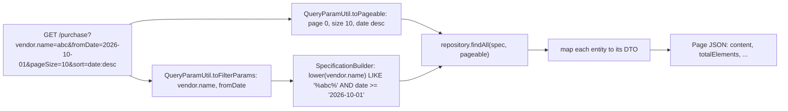

# Common building blocks — Backend

> Part of the Inventory System implementation guide. Read `docs/BRD.md` for the business picture and `docs/backend/backend-setup.md` for how the backend is organised.

## 1. What this is

Every feature of the API (masters, products, purchases, sales, accounting, reports, users) is built the same way from one small set of shared pieces under `common/`: one response shape for every save and every error, one exception handler that turns exceptions into HTTP statuses, one parser for the paging, sorting and filter query string, one builder that turns those filters into a JPA query, a few helpers for line items, money and dates, and the `/dropdown` endpoints every form fills its select boxes from. This document describes those pieces and the feature layout they support, so the other backend documents can take them for granted.

## 2. Where the code lives

All paths are under `backend/src/main/java/com/sandipsky/inventory_system/` unless they start with `src/`.

| File or folder | What is in it |
|---|---|
| `SpringBootInventorySystemApplication.java` | The Spring Boot entry point. `ServletInitializer.java` next to it lets the same app be deployed as a WAR. |
| `common/dto/ApiResponse.java`, `common/util/ResponseUtil.java` | The `{success, message, errorCode, timestamp, post_data_id}` object every save, delete and error answers with |
| `common/exception/` | `BadRequestException`, `DuplicateResourceException`, `ResourceNotFoundException`, `AccessDeniedException`, `AccountLockException`, and `GlobalExceptionHandler`, which maps each to a status |
| `common/util/QueryParamUtil.java` | Reads `pageIndex`, `pageSize`, `sort` from the query string; separates the filter params; `allRows` for exports |
| `common/util/SpecificationBuilder.java` | Turns the filter params into a JPA `Specification` (the WHERE clause) |
| `common/util/LineItemUtil.java` | The line checks shared by purchases, sales, returns and stock adjustments |
| `common/util/MoneyUtil.java` | Rounding to paisa and comparing amounts with tolerance |
| `common/util/ReportDateUtil.java` | Validates the `dateType` of reports (`AD` only) |
| `common/util/BsDateUtil.java` | AD to BS (Bikram Sambat) date conversion for printed files |
| `common/dropdown/` | `DropdownController`, `DropdownService`, `DropdownDTO`: the `{id, name}` lists (section 4 of `endpoints.md`) |
| `common/config/OpenApiConfig.java` | Swagger UI setup and the paging parameters it shows for list endpoints |
| `common/config/WebConfig.java` | Serves uploaded files at `/uploads/**` |
| `common/config/WebSocketConfig.java` | Registers the notification socket at `/ws/notifications` (owned by the notifications doc) |
| `common/config/DataInitializer.java` | Creates the `admin` user and the low stock setting on first start |
| `common/export/` | Excel and PDF building (owned by the print and export doc) |
| `src/main/resources/application.properties` | Database, JWT, lock, upload and Swagger settings |

## 3. Database and startup

### 3.1 Settings that matter (`application.properties`)

| Property | Value | Why |
|---|---|---|
| `spring.datasource.url` | `jdbc:sqlite:inventory_system.db` | One SQLite file in the backend folder. `./reset.sh` recreates it from `database.sql`. |
| `spring.datasource.hikari.connection-init-sql` | `PRAGMA foreign_keys = ON` | SQLite ignores foreign keys unless each connection switches them on. It is set here, not in the URL, so it still applies when Docker replaces the URL through `SPRING_DATASOURCE_URL`. |
| `spring.jpa.properties.hibernate.dialect` | `org.hibernate.community.dialect.SQLiteDialect` | SQLite support comes from `hibernate-community-dialects` |
| `spring.jpa.hibernate.ddl-auto` | `update` | Hibernate adds tables and columns the entities need but the file lacks. It never drops or alters anything, so `database.sql` stays the real schema: its triggers (`created_at` / `updated_at`) and seed rows exist only when the file was created from it. |
| `file.upload-dir` | `uploads/` | Where profile pictures go; `WebConfig` serves this folder. Multipart limits: 10MB per file, 15MB per request. |
| `jwt.*`, `auth.*` | | Token secret and expiry, failed-attempt limit and lock time: see the auth doc |
| `springdoc.swagger-ui.path` | `/swagger-ui.html` | Swagger, with operations and tags sorted alphabetically |

### 3.2 First start (`DataInitializer`)

`database.sql` seeds every operation and the `Admin` role (id 1, every operation) but no user, because a password must be hashed by the app. `DataInitializer` is a `CommandLineRunner` that runs once the context is up:

```
on start:
  no user named "admin" and no user with email "admin@admin.com"?
      build a UserDTO: username admin, password Admin@123, full name Admin, gender Other,
                       contact 0000000000, remarks "Admin User", active,
                       role = the role named "Admin" if there is one
      UserService.saveUser(dto, no image)            -- hashes the password like any other user
  no configuration named "low_stock_quantity"?       -- databases made before low stock alerts lack it
      insert it with label "Low Stock Quantity" and value "10"
```

## 4. The API contract

### 4.1 What a save, delete or error returns

`ApiResponse` is the body of every create, update, delete, cancel and adjust, and of every error:

| JSON field | Java field | Meaning |
|---|---|---|
| `success` | `success` | `true` from `ResponseUtil.success`, `false` from `ResponseUtil.error` |
| `message` | `message` | The human message, e.g. `Unit Added successfully`, or the error |
| `post_data_id` | `data` (renamed with `@JsonProperty`) | The id of the record created, updated or deleted; `0` on errors |
| `errorCode` | `errorCode` | `0` on success, otherwise the same number as the HTTP status |
| `timestamp` | `timestamp` | `System.currentTimeMillis()` |

Controllers declare `ResponseEntity<ApiResponse<Unit>>`, but the type parameter is decoration: the body never contains the entity, only its id. Reads (`GET`) return the DTO or the Spring `Page` directly, not wrapped.

### 4.2 Which exception becomes which status

`GlobalExceptionHandler` is a `@RestControllerAdvice`. Spring picks the most specific `@ExceptionHandler`, so the catch-all runs only when nothing else matches.

| Thrown | Status | Message |
|---|---|---|
| `BadRequestException` (a broken business rule: bad input, not enough stock, ...) | 400 | the exception's message |
| `HttpMessageNotReadableException` (no body, or not JSON) | 400 | `Request body is missing or is not valid JSON` |
| `MethodArgumentTypeMismatchException` (text where an id was expected) | 400 | `Invalid value for '<param>'` |
| `BadCredentialsException` | 401 | the message (`Username or Password is Incorrect.`) |
| `AccountLockException` | 403 | the message |
| `AccessDeniedException` (the project's own, in `common/exception`) | 403 | the message, or `You are not authorized to access this resource` when blank |
| `ExpiredJwtException` | 403 | `The JWT token has expired` |
| `ResourceNotFoundException` | 404 | the message (`Unit not found`) |
| `DuplicateResourceException` | 409 | the message (`Unit with the same name already exists`) |
| any exception whose cause chain contains `FOREIGN KEY constraint failed` | 409 | on `DELETE`: `This record is still used by other records, so it cannot be deleted`; otherwise `This change would break a link between records` |
| any Spring `ErrorResponse` (unknown path or file 404, wrong method 405, missing multipart part 400, ...) | its own status | the exception's message |
| anything else | 500 | the exception's message |

The foreign key case is checked first inside the catch-all, walking `getCause()` down the chain, because SQLite's error arrives wrapped in different Spring and Hibernate types depending on whether it surfaced at flush or at commit. The web app shows whatever is in `message`, so messages are written for users, not developers.

### 4.3 Dropdowns

The one set of endpoints `common/` owns. They are not paged and need only a login: there is no `@RequiresOperation` on them, because nearly every form uses them.

| Path | Returns |
|---|---|
| `GET /dropdown/units/{status}`, `/category/{status}`, `/packings/{status}`, `/taxtypes/{status}` | Masters |
| `GET /dropdown/vendor/{status}`, `/customer/{status}` | Parties |
| `GET /dropdown/users/{status}` (`name` is the username), `/roles/{status}` | Users and roles |
| `GET /dropdown/products/{serviceType}/{type}/{status}` | `serviceType` = `inventory` / `service` / `all`; `type` = `purchasable` / `sellable` / `all` |
| `GET /dropdown/accountMaster/{type}/{partyType}/{status}` | `type` = `party` (linked to a vendor or customer) / `nonparty` / `all`; `partyType` = `vendor` / `customer` / `all` |
| `GET /dropdown/paymentModes` | Active accounts of type `Cash & Cash Equivalents`, by name |
| `GET /dropdown/purchase/{vendorId}` | The vendor's purchases, newest first; `name` is the number (`\|PE-000001`) |
| `GET /dropdown/sales/{customerId}` | The customer's sales that are not cancelled, newest first |

Each answers a list of `DropdownDTO` (`id`, `name`). See 5.6 for the status idea.

## 5. How it works

### 5.1 The feature layout and a typical controller

Every feature is a package under `features/` with the same five folders:

| Folder | Holds | Example (`features/masters/unit`) |
|---|---|---|
| `controllers/` | One `@RestController` per resource, `@RequestMapping("/master/units")` | `UnitController` |
| `dtos/` | What the API sends and receives | `UnitDTO` |
| `entities/` | JPA entities, one per table | `Unit` (`@Table(name = "unit")`) |
| `repositories/` | `JpaRepository<Unit, Integer>` plus `JpaSpecificationExecutor<Unit>` for filtered lists, with the `existsBy...` and dropdown queries | `UnitRepository` |
| `services/` | The rules, the mapping between DTO and entity, and (for documents) an `...ExportService` | `UnitService` |

A controller method is thin: a permission annotation, the parameters, and a call into the service.

```
@GetMapping()  @RequiresOperation("ViewUnit")
Page<UnitDTO> list(@RequestParam Map<String, String> params)  -> service.getPaginatedUnitsList(params)

@PostMapping() @RequiresOperation("CreateUnit")
create(@RequestBody UnitDTO dto)  -> entity = service.saveUnit(dto)
                                  -> 200 ResponseUtil.success(entity.getId(), "Unit Added successfully")
```

The `Map<String, String>` catches every query parameter, so a list endpoint declares no filter list. The service does the same three lines everywhere:

```
list(params):
  pageable = QueryParamUtil.toPageable(params)
  spec     = specBuilder.buildSpecification(QueryParamUtil.toFilterParams(params))
  return repository.findAll(spec, pageable).map(this::mapToDTO)   -- Spring's Page JSON: content, totalElements, totalPages, ...
```

`@RequiresOperation` is checked by an aspect before the method runs (auth doc). The names follow one pattern: `View…`, `Create…`, `Edit…`, `Delete…` (sales and sales returns have `Cancel…` instead of edit and delete). Document controllers add `GET /generateNumber` (gated on `Create…`) and `GET /export/{format}`, `GET /print`, `GET /{id}/export/{format}` (gated on `View…`).

### 5.2 JSON naming

- Fields are snake_case. Some DTOs (`UnitDTO`, `UserDTO`, ...) get it from `@JsonNaming(PropertyNamingStrategies.SnakeCaseStrategy.class)`, so `fullName` becomes `full_name` by itself; the others name each field with `@JsonProperty("cost_price")`.
- Line-item lists stay camelCase (`purchaseEntries`, `salesEntries`, `journalEntries`, ...) because those Java fields carry no annotation and their DTOs have no naming strategy. Purchases call the tax `tax` and sales `total_tax`: the two DTOs chose different `@JsonProperty` names.
- **`is_active` and `active` both appear in responses.** The field is `private boolean isActive` with `@JsonProperty("is_active")`. Lombok names its getter `isActive()` and its setter `setActive()`; Jackson derives a property called `active` from that getter, and the annotated field adds a second property called `is_active`. Both carry the same value. On input either works; the web app sends `is_active`. Entities carry the same annotation (`Unit`, `Role`), but entities are never serialised (the `ApiResponse` holds only the id), so there it has no effect.
- Dates are `YYYY-MM-DD` strings stored as text, which is what makes the date filters below work with plain comparison.

### 5.3 Paging, sorting and filtering

**Idea.** The client sends ordinary query parameters. Three are reserved for paging and sorting, one (`calendar`) is read only by exports, and every other one is treated as a filter on an entity field. Nothing is declared per feature, so a new column is filterable the moment the entity has it.



`QueryParamUtil`:

```
toPageable(params):
  pageIndex = int or 0, pageSize = int or 25          (unparsable values fall back to the default)
  sort = "field:asc,other:desc": split on ",", each part on ":"; missing direction = asc;
         every order ignores case; nothing given = unsorted
toFilterParams(params):
  drop pageIndex, pageSize, sort, calendar and every blank value; keep the rest in order
allRows(params):
  a copy with pageIndex = 0 and pageSize = Integer.MAX_VALUE   -- exports: every matching row
```

`SpecificationBuilder<T>` turns the filters into one `AND` of predicates:

```
for each (key, value):
  key == fromDate  -> date >= value             (the entity's `date` column, compared as text)
  key == toDate    -> date <= value
  otherwise:
     path = key split on "." and walked from the root    ("vendor.name" -> root.get("vendor").get("name"))
     text = lower(path as String)
     key in exactFields ? text == lower(value) : text LIKE "%" + lower(value) + "%"
  the path lookup throws IllegalArgumentException (no such attribute)?
     print "Skipping unknown filter field: <key>" and skip it
```

Consequences worth knowing, all following from "cast the column to text and look for the value inside it":

- **`isActive=1`, not `true`.** SQLite stores a boolean as `1` / `0`, so the text of the column is `1` or `0`; `true` is contained in neither and returns an empty list.
- **`category.id=1` also matches 10, 11, 21, ...** because `"10"` contains `"1"`. Filter linked records by name (`category.name=bev`), which is what the web app does.
- Filter names are the entity's camelCase field names (`transactionType`), not the JSON names. A wrong name is skipped silently: the caller gets every record, not an error. The same field names drive `sort`.
- A service can pass a set of exact-match fields for values picked from a fixed list: `AccountMasterService` builds `new SpecificationBuilder<>(Set.of("accountType"))`, so `accountType=Asset` does not also match `Fixed Asset`.
- Only lists of dated documents have a `date` column; on the others `fromDate` is skipped like any unknown field.

### 5.4 Line items (`LineItemUtil`)

Used by the purchase, purchase return, sales, sales return and stock adjustment services before anything is saved:

```
validateLines(lines, quantity of a line):
  no lines                       -> 400 "Add at least one product"
  any quantity null or <= 0      -> 400 "Quantity must be greater than zero"
rejectDuplicateBatches(lines, key of a line, description of a line):
  a key seen twice               -> 400 "<description> is entered on more than one line"
batchKey(batchNo): the trimmed text, blank meaning the default batch
```

A zero or negative quantity would move stock the wrong way. Two lines for the same batch would have to be combined, and silently picking one line's prices would change the document's own value, so the rule is to refuse.

### 5.5 Money (`MoneyUtil`)

Amounts are `double`, so sums pick up binary noise (`1130.10 - 1000.05` is `130.04999999999995`). `round2(value)` rounds a stored result to paisa (`Math.round(value * 100) / 100.0`); `exceeds(amount, limit)` is true only when `amount - limit > 0.005`, half a paisa of slack. Payments use `exceeds` to check that settlements do not go over the amount paid; the dashboard rounds every figure it sums.

### 5.6 Dropdowns (`DropdownService`)

**Idea.** One repository query per entity takes nullable flags, and a `null` flag switches that condition off, so the same query serves `active` and `all`:

```
WHERE (:isActive IS NULL OR u.isActive = :isActive)
```

The service maps the path words to flags: `status` = `active` gives `true`; anything else (by convention `all`) gives `null`. For products, `serviceType` `service` gives `isServiceItem = true`, `inventory` gives `false`, anything else no condition; `type` `purchasable` or `sellable` sets that one flag. For accounts, `party` means the account is linked to a vendor or a customer and `nonparty` to neither; `partyType` narrows to vendor or customer accounts. `paymentModes` lists active accounts of type `Cash & Cash Equivalents` ordered by name. The purchase and sales dropdowns are different: they take a party id and return that party's documents newest first (`ORDER BY id DESC`) with the document number as `name`; the sales one leaves out cancelled invoices, since nothing can be returned against them.

### 5.7 Dates (`ReportDateUtil`, `BsDateUtil`)

Reports take an optional `dateType`. `validateDateType` accepts blank or `AD`, answers 400 `BS dates are not supported yet. Use dateType=AD` for `BS` (reserved for later and refused rather than returning wrong data) and 400 `dateType must be either AD or BS` for anything else.

Printed and exported files can show Bikram Sambat dates (`calendar=BS`). `BsDateUtil.toBs(adDate)` converts without any library:

```
toBs("2026-11-03"):
  days = days from 1943-04-14 (which is BS 2000-01-01) to the date;  negative -> null
  walk MONTH_DAYS, one row of 12 month lengths per BS year from 2000 to 2090:
     days < length of this month ? answer "<year>-<month>-<days + 1>" : days -= length
  past the end of the table -> null
```

The month table is the same one the web app's date pickers (Lumen) use, so a printed date matches the screen. Input longer than 10 characters is cut to the date part first; unreadable input gives `null`.

### 5.8 Swagger, uploads, the socket

- `OpenApiConfig` titles the API, declares a `bearerAuth` HTTP bearer (JWT) scheme and applies it to every operation, so **Authorize** in Swagger UI takes the token from `POST /login`. Because list endpoints take a `Map`, springdoc would show one opaque object; an `OperationCustomizer` replaces that parameter, on every handler method that has a `Map` parameter, with `pageIndex` (default 0), `pageSize` (25), `sort` (example `name:asc`) and a free-form exploded `filters` object whose keys become individual query params. The Swagger paths (`/v3/api-docs/**`, `/swagger-ui/**`, `/swagger-ui.html`) are open in the security config.
- `WebConfig` maps `/uploads/**` to `file:<file.upload-dir>`, so a picture saved at `uploads/users/<uuid>.png` is served at `/uploads/users/<uuid>.png`. The mapping sits behind the security filter like everything else, so the browser must send the auth header (the web app uses `<app-user-avatar>`, never a plain ``).
- `WebSocketConfig` registers `NotificationSocketHandler` at `/ws/notifications` with `SocketAuthInterceptor` (the JWT arrives as `?token=`) from any origin; the notifications doc owns it.

## 6. Design decisions and gotchas

- **One body for every write.** A client never needs to know a feature's shape to show "saved" or an error: read `success`, `message`, `post_data_id`.
- **Filters are generic on purpose.** The price is the text-matching surprises in 5.3; the web app works around them (booleans as `1` / `0`, linked records by name).
- **Foreign keys have only been enforced since the PRAGMA was added.** A database file older than that, or one Hibernate created on its own, lacks the seed rows and triggers; when behaviour differs from the 409 rules above, recreate it with `./reset.sh`.
- **Unmapped exceptions leak their message as a 500**, including JPA ones such as a null in a `nullable = false` column. Add a check that throws `BadRequestException` rather than relying on the database.
- An unknown `sort` field is not skipped like a filter: Spring Data rejects it, which surfaces as a 500.
- `allRows` sets `pageSize` to `Integer.MAX_VALUE`, so an export of a huge table loads it whole.
- The reserved `calendar` parameter filters nothing; only the export code reads it.

## 7. Build it yourself: order of work

1. A Spring Boot project with `spring-boot-starter-web`, `data-jpa`, `security`, `aop`, `websocket`, `sqlite-jdbc`, `hibernate-community-dialects`, `lombok`, `springdoc-openapi-starter-webmvc-ui`, the three `jjwt` artifacts, `poi-ooxml` and `openpdf`.
2. `application.properties`: datasource URL, the `PRAGMA foreign_keys = ON` init SQL, the SQLite dialect, `ddl-auto=update`. Create the database file from `database.sql`.
3. `ApiResponse` and `ResponseUtil`.
4. The five exception classes and `GlobalExceptionHandler`; check an unknown path still answers 404 through the `ErrorResponse` passthrough.
5. `QueryParamUtil` and `SpecificationBuilder`.
6. The first feature (units) in the five-folder layout; curl the list with a filter, a sort and `pageSize`.
7. `DropdownController` and `DropdownService` with the nullable-flag queries in each repository.
8. `LineItemUtil` and `MoneyUtil` when the documents and payments arrive; `ReportDateUtil` and `BsDateUtil` with the reports and the exports.
9. `OpenApiConfig` and `WebConfig`; `DataInitializer` last, since it needs `UserService` and the configuration repository.
