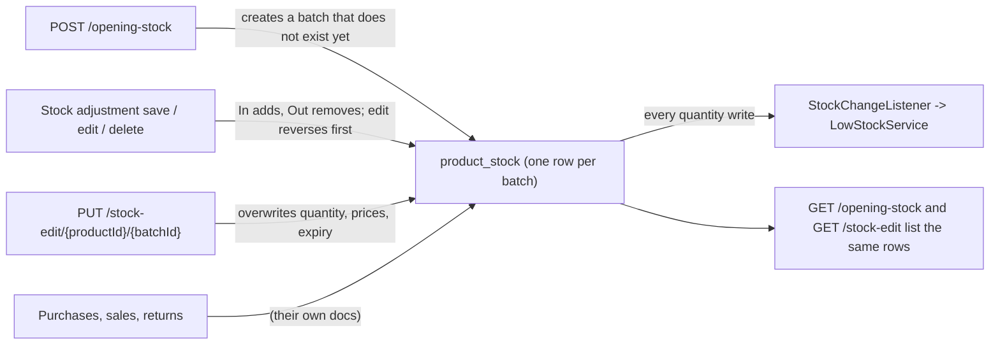

# Inventory: Opening Stock, Stock Adjustment and Stock Edit — Backend

> Part of the Inventory System implementation guide. Read `docs/BRD.md` for the business picture and `docs/backend/backend-setup.md` for how the backend is organised.

## 1. What this is

Stock is kept per **product batch**: a row in `product_stock` with a batch number, expiry date, quantity and prices. Purchases add to batches and sales take from them. These three features change batches without a purchase or sale:

- **Opening stock** sets the quantity a batch starts with when the business begins using the system.
- **Stock adjustment** is a numbered document that moves stock `In` or `Out` of batches after a count, breakage or loss, with a reason per line. It can be edited and deleted, and the stock follows.
- **Stock edit** overwrites one batch's quantity, prices and expiry directly, leaving no record of the change.

## 2. Where the code lives

Package `features/inventory/`, with the batch table and its helpers in `features/product/`.

| File | What is in it |
|---|---|
| `opening_stock/controllers/OpeningStockController.java` | `/opening-stock` endpoints |
| `opening_stock/services/OpeningStockService.java` | List of batches; create a batch's opening stock |
| `opening_stock/services/OpeningStockExportService.java` | The list as a file |
| `opening_stock/dtos/OpeningStockDTO.java` | JSON shape |
| `stock_adjustment/controllers/StockAdjustmentController.java` | `/stock-adjustment` endpoints |
| `stock_adjustment/services/StockAdjustmentService.java` | List, get, create, update, delete; `applyAdjustment`, `reverseAdjustment`, `changeStock` |
| `stock_adjustment/services/StockAdjustmentExportService.java` | The list and one adjustment as files |
| `stock_adjustment/entities/MasterStockAdjustment.java`, `StockAdjustmentEntry.java` | The two tables |
| `stock_adjustment/repositories/` | `MasterStockAdjustmentRepository` (`findTopByOrderByIdDesc`), `StockAdjustmentEntryRepository` (`findByMasterStockAdjustmentId`) |
| `stock_adjustment/dtos/MasterStockAdjustmentDTO.java`, `StockAdjustmentEntryDTO.java` | JSON shapes |
| `stock_edit/controllers/StockEditController.java` | `/stock-edit` endpoints |
| `stock_edit/services/StockEditService.java` | List, get one batch, overwrite it |
| `stock_edit/services/StockEditExportService.java` | The list as a file |
| `stock_edit/dtos/StockEditDTO.java` | JSON shape (same fields as opening stock) |
| `features/product/entities/ProductStock.java` | The `product_stock` entity; registers `StockChangeListener` |
| `features/product/repositories/ProductStockRepository.java` | `findByProductIdAndBatchNo`, `findByProductIdAndBatchNoIsNull`, `sumQuantityByProductId` |
| `features/product/services/ProductStockService.java` | `findOrCreateBatch`, `findBatch`, `lineBatch`, `batchId`: the batch rules every stock-moving feature shares |
| `common/util/LineItemUtil.java` | `validateLines`, `rejectDuplicateBatches` |
| `features/notification/services/StockChangeListener.java` | Sees every write to a batch quantity (low-stock alerts) |

## 3. Data

See `backend/database.sql`.

**`product_stock`**: one row per batch of a product. Opening stock and stock edit have no table of their own; they read and write this one.

| Column | Meaning |
|---|---|
| `product_id` | The product (foreign key) |
| `batch_no` | Text; `NULL` is the product's **default batch**. `UNIQUE (product_id, batch_no)` |
| `expiry_date` | `YYYY-MM-DD` text or `NULL` |
| `quantity` | Current stock of this batch |
| `cost_price`, `selling_price`, `mrp` | Prices of this batch |

How a batch is addressed in the API (`ProductStockService.batchId`): the default batch is always `batch_id` **0**, every other batch is its row id. So `0` in a request means "the product's row with a `NULL` batch number", and it may not exist yet.

**`master_stock_adjustment`**: one row per adjustment document.

| Column | Meaning |
|---|---|
| `date` | `YYYY-MM-DD` text |
| `system_entry_no` | Unique, `\|SA-000001`, from the `Stock Adjustment` numbering (`\|SA-`, 6 digits) |
| `remarks` | Free text |

**`stock_adjustment_entry`**: one row per line.

| Column | Meaning |
|---|---|
| `master_stock_adjustment_id` | The document |
| `product_id` | The product |
| `batch_id` | The `product_stock` row the line moved (foreign key); lines saved before batches existed have `NULL` and moved the default batch |
| `adjustment_type` | `In` (adds) or `Out` (removes) |
| `quantity` | Always positive; the type gives the direction |
| `reason` | Free text per line |

## 4. API

Full shapes: `backend/endpoints.md` section 9 (and 18 for files).

| Method | Path | What it does | Permission |
|---|---|---|---|
| `GET` | `/opening-stock` | Paged list: every batch with its current quantity (`?product.name=coca`) | `ViewOpeningStock` |
| `POST` | `/opening-stock` | Set a batch's opening stock | `CreateOpeningStock` |
| `GET` | `/opening-stock/export/{format}` | The list as `excel` or `pdf` | `ViewOpeningStock` |
| `GET` | `/stock-adjustment/generateNumber` | Next number as plain text | `CreateStockAdjustment` |
| `GET` | `/stock-adjustment` | Paged list (header rows only; `fromDate`/`toDate`, `remarks=`) | `ViewStockAdjustment` |
| `GET` | `/stock-adjustment/{id}` | One adjustment with `stockAdjustmentEntries` | `ViewStockAdjustment` |
| `POST` | `/stock-adjustment` | Create | `CreateStockAdjustment` |
| `PUT` | `/stock-adjustment/{id}` | Update | `EditStockAdjustment` |
| `DELETE` | `/stock-adjustment/{id}` | Delete (stock is put back) | `DeleteStockAdjustment` |
| `GET` | `/stock-adjustment/export/{format}` | The list as a file | `ViewStockAdjustment` |
| `GET` | `/stock-adjustment/{id}/export/{format}` | One adjustment with its lines | `ViewStockAdjustment` |
| `GET` | `/stock-edit` | Paged list, same rows as opening stock | `ViewStockEdit` |
| `GET` | `/stock-edit/{productId}/{batchId}` | One batch (`0` = default batch) | `ViewStockEdit` |
| `PUT` | `/stock-edit/{productId}/{batchId}` | Overwrite quantity, prices, expiry | `EditStockEdit` |
| `GET` | `/stock-edit/export/{format}` | The list as a file | `ViewStockEdit` |

Request fields that matter (snake_case):

- Opening stock and stock edit: `product_id` (opening stock only), `batch_no` (opening stock only; blank = default batch), `expiry_date`, `quantity`, `cost_price`, `selling_price`, `mrp`. Responses add `batch_id`, `product_name`.
- Stock adjustment: `date`, `remarks`, and the line list **`stockAdjustmentEntries`** (camelCase), each `product_id`, `batch_id` (omit or `0` for the default batch), `adjustment_type` (`In` / `Out`), `quantity`, `reason`, and on update the line `id` (`0` or missing = a new line). Responses add `system_entry_no`, `product_name`, `batch_no`.

## 5. How it works



### 5.1 Listing batches (opening stock and stock edit)

**Idea.** There is no opening-stock record to list, so both pages list `product_stock` itself: one row per batch with its *current* quantity, which is also what the user wants to see when checking what was set. Both services run the generic paged query (`QueryParamUtil` + `SpecificationBuilder<ProductStock>`) over the batch table; filters use entity field names, so `product.name=coca` works and `fromDate`/`toDate` do nothing (a batch has no `date`). Each row is mapped to the DTO with `batch_id` from `batchId()` (0 for the default batch).

### 5.2 Setting opening stock

**Idea.** Opening stock "initialises" a batch the product does not have yet. The service asks `ProductStockService.findOrCreateBatch` for the batch named by `batch_no` (blank → the default batch); that helper returns the existing row, or a new unsaved one with id 0 and quantity 0. An existing row means stock was already set (by opening stock, a purchase or a sales return), and the right tool for changing it is a stock adjustment or stock edit, so the request is refused with a **409**. Prices are stored on the batch only; unlike a purchase, opening stock does not touch the product's own price fields, and it posts no journal.

```
save_opening_stock(dto):                                   -- one transaction
  product = load product_id                                -> 404 "Product not found"
  batch = find_or_create_batch(product, batch_no, expiry = null)
  if batch.id != 0 (it already exists)                     -> 409 "Stock already exists for this product batch. Use Stock Adjustment or Stock Edit instead."
  batch.expiry_date := dto.expiry_date
  quantity null or < 0                                     -> 400 "Opening quantity cannot be negative"
  batch.quantity, cost_price, selling_price, mrp := dto's
  save batch                                               (the listener sees 0 -> quantity)
```

**Rules checked**: the three messages above (404, 409, 400). A quantity of 0 is accepted. The expiry date is passed to `findOrCreateBatch` as `null` and set afterwards, so the helper's "batch already has another expiry date" check never applies here; it cannot, since the batch is new.

### 5.3 Stock adjustment: listing and reading one

The list returns header rows only (`id`, `date`, `system_entry_no`, `remarks`) through the generic paged query, with `fromDate`/`toDate` on `date`. `GET /stock-adjustment/{id}` (**404** `"Stock Adjustment with Given Id not found"`) adds the lines, each with `product_name`, `batch_id` and `batch_no` taken from the linked batch row.

### 5.4 Creating a stock adjustment

**Idea.** A document with lines, like a purchase, but with no party, no money and no journal: its only effect is on batch quantities. Validation uses the shared `LineItemUtil` (at least one line, every quantity positive) and the shared duplicate-batch rule, keyed here by product, batch **and** type, so one batch may legitimately appear once as `In` and once as `Out`. Lines pick an existing batch by `batch_id` (`ProductStockService.findBatch`); an adjustment never creates a batch, because a batch with no stock history has nothing to adjust. The number comes from the `Stock Adjustment` numbering.

```
save_adjustment(dto):                                      -- one transaction
  validate lines:
      none                                                 -> 400 "Add at least one product"
      any quantity null or <= 0                            -> 400 "Quantity must be greater than zero"
  reject duplicates on (product_id, batch_id, adjustment_type)
                                                           -> 400 "<product> batch <no> is entered on more than one line"
                                                              or "<product> (default batch) is entered on more than one line"
  master = new (date, remarks, number = next "Stock Adjustment" number)   -> "|SA-000004"
  save master
  for each line:
      product = load                                       -> 404 "Product not found"
      batch = find_batch(product, batch_id):
          0        -> the product's default batch, or null if it has none
          other    -> load                                 -> 404 "Batch not found"
                      belongs to another product           -> 400 "Batch does not belong to <product>"
      apply_adjustment(batch, type, quantity)              -> see below
      save line (master id, type, quantity, reason, product, batch)
  notify after commit, type stock_adjustment, INFO, "Stock adjustment added",
         "SA-000004, 3 lines: Damaged in transit."   (or "SA-000004, 1 line." when remarks are blank)

apply_adjustment(batch, type, quantity):
  quantity null or <= 0                                    -> 400 "Adjustment quantity must be greater than zero"
  "In"  -> change_stock(batch, +quantity)
  "Out" -> change_stock(batch, -quantity)
  else                                                     -> 400 "Adjustment type must be either In or Out"

change_stock(batch, delta):
  batch is null                                            -> 400 "Product has no stock yet. Add opening stock or a purchase first"
  batch.quantity + delta < 0                               -> 400 "Not enough Quantity In Stock"
  batch.quantity += delta; save                            (the listener records the change)
```

**Rules checked**: all the **400**/**404** messages above. `adjustment_type` is compared exactly (`In`, `Out`; not `in` or `IN`). The notification goes to users whose role holds `ViewStockAdjustment`, skipping whoever saved.

### 5.5 Editing a stock adjustment

**Idea.** Lines are matched by `id`. Every line's old effect must be undone before its new one is applied, otherwise changing `Out 5` to `Out 7` would take 12. The service reverses and deletes the lines that are no longer sent, then for each sent line with an id it reverses that line's previous effect and applies the new values; a line with id 0 is new. Reversal uses `ProductStockService.lineBatch`, which falls back to the product's default batch for old lines with no `batch_id` (**404** `"Product Stock not found"` if there is none). The number is kept; no notification is sent.

```
update_adjustment(id, dto):                                -- one transaction
  validate lines and duplicates as in 5.4
  master = load                                            -> 404 "Stock Adjustment with Given Id not found"
  master.date, remarks := dto's; save
  for each existing line whose id is not among the sent ids:
      reverse_adjustment(line's batch, type, quantity); delete line
  for each sent line:
      id != 0 -> load                                      -> 404 "Stock Adjustment Entry not found"
                 reverse_adjustment(its batch, its old type, its old quantity)
      id == 0 -> new line
      product, batch, apply_adjustment(...) as in 5.4
      save line

reverse_adjustment(batch, type, quantity):
  "In"  -> change_stock(batch, -quantity)                  (can fail with "Not enough Quantity In Stock" if that stock was sold since)
  else  -> change_stock(batch, +quantity)
```

Reversal and re-application happen line by line, so an `Out 5` edited to `Out 7` on a batch holding 6 works: 5 comes back, then 7 goes out.

### 5.6 Deleting a stock adjustment

```
delete_adjustment(id):                                     -- one transaction
  master = load                                            -> 404 "Stock Adjustment with Given Id not found"
  for each line: reverse_adjustment(...); delete line       ("Not enough Quantity In Stock" possible when reversing an In)
  delete master
  notify WARN "Stock adjustment deleted", same message as create
```

### 5.7 Stock edit

**Idea.** A direct correction of one batch's stored figures, with no document and no history: the fix for a typo in a price or expiry date, or a count the user trusts more than the books. The batch is found by `productId` + `batchId` with the same `findBatch` rule as adjustments (`0` = default batch). The service sets every field from the request; it does not touch the product's own price fields or any other table.

```
get_batch(productId, batchId):
  product = load                                           -> 404 "Product not found"
  batch = find_batch(product, batchId)                     -> 404 "Batch not found" / 400 "Batch does not belong to <product>"
  batch is null (no default batch)                         -> 404 "Product Stock not found"

update_batch(productId, batchId, dto):                     -- one transaction
  batch = get_batch(...)
  quantity null or < 0                                     -> 400 "Stock quantity cannot be negative"
  batch.expiry_date, quantity, cost_price, selling_price, mrp := dto's (all overwritten, a missing one becomes null)
  save
```

**Rules checked**: the messages above. Nothing stops setting a quantity lower than what open documents assume; stock edit is deliberately a blunt tool, which is why the API guide says to prefer an adjustment.

### 5.8 Low-stock alerts

Every write to a batch's `quantity`, from any of these services or from a purchase or sale, goes through `features/notification/services/StockChangeListener.java` (a JPA entity listener on `ProductStock`), which hands the change to `LowStockService` so that, after the transaction commits, products whose stock fell are checked against the `low_stock_quantity` setting; the notifications doc owns the details. Opening stock and stock edit send no activity notification of their own.

### 5.9 Export

All three lists export through the generic table export with paging switched off (`QueryParamUtil.allRows`), so a file holds every row the filters match in the list's sort. Opening stock and stock edit write Product, Batch, Expiry Date, In Stock, Cost Price, Selling Price, MRP. The adjustment list writes Adjustment Number, Date, Remarks; `/stock-adjustment/{id}/export/{format}` prints one adjustment with its lines (Product, Code, Unit, Batch No., Expiry Date, Type as `Stock In` / `Stock Out`, Quantity, Reason) and the remarks. Section 18 of `endpoints.md` covers the letterhead, `calendar` and formats.

## 6. Design decisions and gotchas

- **No opening-stock table.** An opening quantity is just the first write to a batch. The trade-off: the list cannot show "what was entered as opening stock" once purchases and sales have moved the batch; it shows current stock. If you need the history, add a table instead of changing this.
- **Batch id 0 is the default batch.** A product's no-batch row is addressed as `0` everywhere so clients never need its row id; the service resolves it with `findByProductIdAndBatchNoIsNull`. It may not exist yet, which is why adjustments and stock edit answer `"Product has no stock yet…"` / `"Product Stock not found"` rather than creating it.
- **Adjustments never create batches** and never post a journal; stock value changes from adjustments are not in the books.
- **Reverse before re-apply** on edit and delete is what makes an adjustment safely editable. Reversing an `In` can fail if the stock has since been sold; that failure rolls the whole update back, so the document is never half-changed.
- **Duplicate check key includes the type.** Two `Out` lines for the same batch are refused; an `In` and an `Out` for the same batch are allowed.
- **Stock edit overwrites all five fields**, so a client must send every one of them; a missing price becomes `NULL`.
- **Old lines without `batch_id`** (from before batches existed) are treated as the default batch by `lineBatch`. Keep that fallback if you migrate data.
- **Filters are silently ignored when unknown.** `fromDate` on the batch lists does nothing; `product.name` works because it is an entity path.

## 7. Build it yourself: order of work

1. Create `product_stock` with `UNIQUE (product_id, batch_no)`; write `ProductStock`, `ProductStockRepository` (`findByProductIdAndBatchNo`, `findByProductIdAndBatchNoIsNull`) and `ProductStockService` (`findOrCreateBatch`, `findBatch` with the id-0 rule, `lineBatch`, `batchId`). Purchases and sales will share these.
2. Write `OpeningStockDTO`, `OpeningStockService` (list over `product_stock`, `saveOpeningStock` with the 409) and `OpeningStockController` (`ViewOpeningStock`, `CreateOpeningStock`). Try: post opening stock for a product twice and expect the 409.
3. Create `master_stock_adjustment` and `stock_adjustment_entry`; add the `Stock Adjustment` row to `document_numbering` (`|SA-`, 6 digits) and `generateStockAdjustmentNumber`.
4. Write the two entities (cascaded `@OneToMany` lines; `@ManyToOne` product and batch), repositories and DTOs (camelCase `stockAdjustmentEntries`).
5. Add `LineItemUtil.validateLines` and `rejectDuplicateBatches` if purchases have not already.
6. Write `StockAdjustmentService`: `changeStock`, `applyAdjustment`, `reverseAdjustment`, then create, update (reverse then re-apply) and delete under `@Transactional`; then the controller with the five operations. Try: `Out` more than the batch holds and expect `"Not enough Quantity In Stock"`; edit a line's quantity and check the batch moved by the difference.
7. Write `StockEditDTO`, `StockEditService` (`findBatch` by product and batch id, `updateProductStock`) and `StockEditController` (`ViewStockEdit`, `EditStockEdit`). Try `PUT /stock-edit/{productId}/0`.
8. Register `StockChangeListener` on `ProductStock` with `@EntityListeners` once the notification feature exists, and check a stock-out adjustment below the `low_stock_quantity` setting raises an alert.
9. Add the `notifyActivity` calls on adjustment create and delete.
10. Add the three export services and the file endpoints once the common export code exists.
