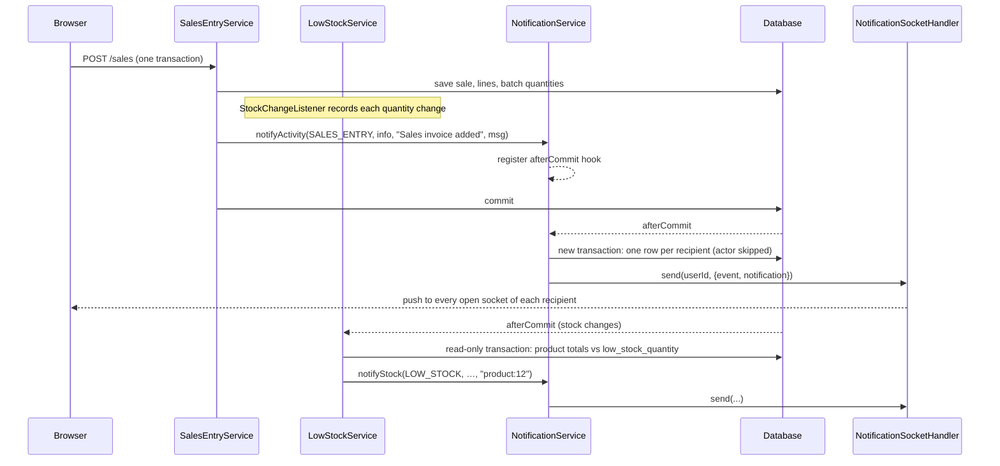

# Notifications — Backend

> Part of the Inventory System implementation guide. Read `docs/BRD.md` for the business picture and `docs/backend/backend-setup.md` for how the backend is organised.

## 1. What this is

When someone adds, cancels or deletes a document, the other users who are allowed to see that kind of document get a short notice ("Sales invoice added — SI-000001 to Gadget Retailers, Rs. 200.00."), and when a save leaves a product's stock at or below the configured low-stock quantity, everyone who looks after stock gets a warning. Each user has their own copy, so reading and clearing are personal. The header bell loads the list over REST and receives new ones live over a WebSocket (a two-way connection the browser keeps open) served by the API itself, on the same port. A notification is sent only after the save that caused it has committed; a failed save tells nobody.

## 2. Where the code lives

Package `features/notification/`, plus two files in `common/config` and `security`.

| File | What is in it |
|---|---|
| `entities/Notification.java` | One row per recipient: type, severity, title, message, actor, `refKey`, read flag, `createdAt` |
| `dtos/NotificationDTO.java` | What the list and the socket send (snake_case; `read` is exposed as `is_read`) |
| `repositories/NotificationRepository.java` | Newest-first page, find-mine, find-unread-by-`refKey`, mark-all-read, delete-mine |
| `services/NotificationType.java` | Enum of the nine `type` codes and the View operation a role needs to receive each |
| `services/NotificationService.java` | `notifyActivity` (document notices, after commit, actor skipped), `notifyStock`, `deliver`, the REST operations, the message helpers |
| `services/LowStockService.java` | Collects stock changes per transaction, checks the `low_stock_quantity` setting after commit |
| `services/StockChangeListener.java` | JPA entity listener on `ProductStock`: reports every change of a batch's quantity |
| `socket/SocketAuthInterceptor.java` | Checks the `?token=` JWT on the WebSocket handshake |
| `socket/NotificationSocketHandler.java` | Keeps open sockets per user and pushes messages to them |
| `controllers/NotificationController.java` | `GET`, `PUT …/read`, `PUT …/{id}/read`, `DELETE` |
| `common/config/WebSocketConfig.java` | Registers the handler at `/ws/notifications` with the interceptor |
| `security/WebSecurityConfig.java` | `/ws/**` is `permitAll`: the token in the query string is what authenticates |
| `features/product/entities/ProductStock.java` | Carries `@EntityListeners(StockChangeListener.class)` and a `@Transient savedQuantity` |

The document services (`PurchaseEntryService`, `SalesEntryService`, `PaymentService`, `StockAdjustmentService`, the two return services) call `notificationService.notifyActivity(...)` inside their save, cancel and delete methods.

## 3. Data

| Table | Columns |
|---|---|
| `notification` | `id`, `user_id` → `user.id` (`ON DELETE CASCADE`), `type` (a `NotificationType` code), `severity` (`info`/`warn`/`error`), `title`, `message`, `actor` (who did it; null on stock alerts), `ref_key` (`product:<id>` on stock alerts), `is_read` (default 0), `created_at` (ISO-8601 UTC text to the second, so it sorts as text). Index `notification_user_created (user_id, created_at)` |
| `configuration` | The row `low_stock_quantity` (seeded `10`); blank turns stock alerts off |
| `user`, `role`, `role_operation`, `operation` | Who is active and which View operations their role holds |
| `product`, `product_stock` | `is_active`, `is_service_item`, `unit_id`; every batch's `quantity`, added up per product |

## 4. API

Section 16 of `backend/endpoints.md` has the shapes. None of these needs an operation, only a login: they only ever touch the caller's own rows.

| Method | Path | What it does | Response |
|---|---|---|---|
| GET | `/notifications` | Your 50 newest, newest first (`created_at` desc, then `id` desc) | list of `{ id, type, severity, title, message, actor, is_read, created_at }` |
| PUT | `/notifications/{id}/read` | Mark one of yours read | `"Notification marked as read"`, `post_data_id` = its id; **404** `"Notification not found"` if it isn't yours |
| PUT | `/notifications/read` | Mark all yours read | `"Notifications marked as read"`, `post_data_id` = how many changed |
| DELETE | `/notifications` | Delete all yours | `"Notifications cleared"`, `post_data_id` = how many |
| WebSocket | `/ws/notifications?token=<jwt>` | Live push, server to client only | messages `{ "event": "notification", "notification": { …same shape… } }` |

The nine types and who receives them:

| `type` | Sent by | Recipients: active users whose role holds |
|---|---|---|
| `purchase_entry` | purchase added (`info`) / deleted (`warn`) | `ViewPurchaseEntry` |
| `purchase_return` | return added / deleted | `ViewPurchaseReturn` |
| `sales_entry` | sale added / cancelled | `ViewSalesEntries` |
| `sales_return` | sales return added / cancelled | `ViewSalesReturns` |
| `vendor_payment`, `customer_payment` | payment added / deleted (`NotificationType.payment(partyType)` picks one) | `ViewVendorPayment` / `ViewCustomerPayment` |
| `stock_adjustment` | adjustment added / deleted | `ViewStockAdjustment` |
| `low_stock` (`warn`), `out_of_stock` (`error`) | a save lowered a product's stock | `ViewStockEdit` |

## 5. How it works

### 5.1 The flow in one picture



### 5.2 Document notifications: `notifyActivity`

**Idea.** The document service already knows what happened and to whom, so it hands over a type, a severity, a title and a message and goes on. Sending must wait until the transaction commits, otherwise a save that later fails would have told everyone about a document that doesn't exist. And the user who made the change already knows, so they are skipped and named as `actor` instead.

```
notifyActivity(type, severity, title, message):          -- called inside the document's transaction
  actor     = current user (from the security context; 404 "User not found" if missing)
  actorName = actor.full_name, or the username when blank
  afterCommit( deliver(type, severity, title, message, actorName, refKey = null, skip = actor.id) )

afterCommit(action):
  if no transaction synchronization is active: run action now
  else register a TransactionSynchronization whose afterCommit() runs action

deliver(type, severity, title, message, actor, refKey, skipUserId):
  now = Instant.now() truncated to seconds, as ISO text
  in a NEW transaction (PROPAGATION_REQUIRES_NEW):
      for user in userRepository.findActiveByOperation(type.operation()):   -- is_active AND role holds the operation
          if user.id == skipUserId: continue
          row = refKey == null ? null : repository.findFirstByUserIdAndRefKeyAndIsReadFalse(user.id, refKey)
          if row == null: row = new Notification(user_id = user.id, ref_key = refKey)
          row.type = type.code; row.severity; row.title; row.message; row.actor; row.created_at = now
          save row
  for each saved row: socketHandler.send(row.user_id, { event: "notification", notification: dto(row) })
  any RuntimeException: log a warning and stop        -- sending never fails the save that caused it
```

Why a *new* transaction: after a commit the finished transaction's resources are still bound to the thread, so writing in the hook needs its own transaction.

The message is built by small helpers in `NotificationService` so every feature reads the same:

| Helper | Result |
|---|---|
| `documentMessage(systemEntryNo, party, total)` | `"PE-000012 from Himalayan Distributors, Rs. 45,000.00."` |
| `docNo("\|PE-000001")` | `"PE-000001"`; `"2082-83\|PE-000005"` → `"2082-83 \| PE-000005"` (split on `\|`, blanks dropped, joined with `" \| "`) |
| `amount(123456.5)` | `"Rs. 1,23,456.50"` (Indian grouping, like the web app's amount pipe) |
| `quantity(8.0)` | `"8"`; `2.50` → `"2.5"` |

The titles and messages each service sends:

| Service | Title (severity) | Message |
|---|---|---|
| Purchase entry | `Purchase entry added` (info), `Purchase entry deleted` (warn) | `documentMessage(no, "from <vendor>", grand_total)` |
| Purchase return | `Purchase return added`, `Purchase return deleted` | `"to <vendor>"` |
| Sales entry | `Sales invoice added`, `Sales invoice cancelled` | `"to <customer>"`; a cancel appends `" Reason: <cancel_remarks>"` when given |
| Sales return | `Sales return added`, `Sales return cancelled` | `"from <customer>"`, same `Reason:` suffix |
| Payment | `Payment sent` (vendor) / `Payment received` (customer), `Payment deleted` | `"to <vendor>"` / `"from <customer>"`, the payment amount |
| Stock adjustment | `Stock adjustment added`, `Stock adjustment deleted` | `"SA-000004, 3 lines: Damaged in transit."` or `"SA-000004, 1 line."` |

**Editing a document sends nothing**: only add, cancel and delete call `notifyActivity`.

### 5.3 Stock alerts: listener, accumulation, after-commit check

**Idea.** Many services change stock (sales, returns, adjustments, stock edits, purchase edits and deletes), so instead of each one remembering to check, a JPA entity listener on `ProductStock` sees *every* write to a batch's quantity. Each write reports its change; the changes add up per product for the length of the transaction; after the commit the product's total is compared with the setting. A rolled-back save alerts nobody, and only saves that *lower* stock can alert.

```
StockChangeListener (registered with @EntityListeners on ProductStock):
  @PostLoad               batch.savedQuantity = batch.quantity            -- remember what the DB had
  @PostPersist/@PostUpdate
      before = batch.savedQuantity or 0; after = batch.quantity or 0
      batch.savedQuantity = batch.quantity
      if after != before and batch.product != null:
          lowStockService.recordChange(product.id, after - before)

LowStockService.recordChange(productId, change):
  if no transaction synchronization is active: ignore
  changes = the StockChanges synchronization already registered on this transaction, or register a new one
  changes.byProduct[productId] += change                                   -- net change per product

StockChanges.afterCommit():   -> alert(byProduct)

alert(changes):
  in a NEW read-only transaction: alerts = stockAlerts(changes)
  for each alert: notificationService.notifyStock(alert.type, alert.title, alert.message, "product:" + productId)
  any RuntimeException: log a warning

stockAlerts(changes):
  threshold = threshold(configuration "low_stock_quantity")     -- null when blank, not a number, negative or infinite
  if threshold == null: return []                                -- alerts are off
  for each (productId, change) with change < 0:                  -- only products whose stock fell
      product = find; skip if missing, is_service_item, or not is_active
      total = SUM(quantity) of every batch of the product
      if total <= 0:          OUT_OF_STOCK, "Out of stock", "<name> has no stock left."
      else if total <= threshold:
                              LOW_STOCK, "Low stock",
                              "<name> is down to <qty> <unit>, at or below the low stock quantity of <threshold>."
      else: nothing

notifyStock(type, title, message, refKey):
  severity = OUT_OF_STOCK ? "error" : "warn"
  deliver(type, severity, title, message, actor = null, refKey, skipUserId = null)   -- everyone with ViewStockEdit, actor included
```

The `refKey` is what makes an unread alert **update instead of repeat**: `deliver` looks for the recipient's unread notification with the same `ref_key` and overwrites its type, message and `created_at` (same `id`), so a product that keeps falling produces one live notice per user, not a pile. Once the user reads it, the next fall adds a new row.

Two small traps the code handles: `LowStockService` is injected `@Lazy` into the listener because Hibernate asks for the listener while the repositories are still being built; and `savedQuantity` is `@Transient` so it is never stored.

### 5.4 The socket

**Idea.** Browsers can't put a header on a WebSocket, so the JWT travels in the query string and is checked once, at the handshake. After that the server only pushes; it never reads client messages. Each user may have several tabs, so sessions are kept as a set per user id.

```
WebSocketConfig:  @EnableWebSocket; registry.addHandler(handler, "/ws/notifications")
                  .addInterceptors(SocketAuthInterceptor).setAllowedOriginPatterns("*")

SocketAuthInterceptor.beforeHandshake(request, response, attributes):
  token = query param "token"
  if token present:
      user = userRepository.findByUsername(jwtUtil.extractUsername(token))
      if user != null and jwtUtil.isTokenValid(token, user):         -- same username, not expired
          attributes.userId    = user.id
          attributes.expiresAt = the token's exp claim as an Instant
          return true (accept)
  (a JwtException or IllegalArgumentException falls through)
  response.status = 401; return false

NotificationSocketHandler:
  sessionsByUser: ConcurrentHashMap<userId, Set<WebSocketSession>>
  afterConnectionEstablished: wrap the session in ConcurrentWebSocketSessionDecorator (10 s send limit, 512 KB buffer)
                              and add it under attributes.userId
  afterConnectionClosed / handleTransportError: remove it
  send(userId, message):
      text = JSON of message
      for each session of the user:
          if attributes.expiresAt is before now: close with CloseStatus(4401, "Token expired"), remove
          else if open: sendMessage(text)
          IOException or IllegalStateException: remove
```

The decorator matters because saves from several requests can push to one socket at the same time; it queues the writes. Nothing sent while a socket is closed is replayed, which is why the client reloads `GET /notifications` each time its socket opens.

**Rules checked**

- missing, invalid or expired token on the handshake → HTTP **401**, no socket
- token expired after the socket opened → the next push closes it with code **4401** `"Token expired"`

### 5.5 Listing, reading and clearing

**Idea.** Every operation is scoped to `currentUser()` (the username in the security context looked up in `user`), so one user can never read or clear another's rows; that is why no `@RequiresOperation` is needed.

```
getNotifications():   findByUserIdOrderByCreatedAtDescIdDesc(me, PageRequest.of(0, 50))   -- FEED_SIZE = 50
markRead(id):         findByIdAndUserId(id, me) or 404 "Notification not found"; is_read = true; save   (transaction)
markAllRead():        UPDATE Notification SET isRead = true WHERE userId = me AND isRead = false  -> count
clear():              DELETE FROM Notification WHERE userId = me                                 -> count
```

## 6. Design decisions and gotchas

- **One row per recipient**, not one row with a recipient list: read and clear are per user, and the socket push is per user, so the model matches the use. The `user_id` foreign key cascades on delete.
- **After commit, in a new transaction, never throwing.** A notification is a side effect; a save must not fail or roll back because the notice couldn't be stored or pushed. `deliver` catches `RuntimeException` and logs.
- **The actor is skipped on document notices but not on stock alerts.** You know what you just saved; you may not know it emptied a shelf.
- **Edits don't notify.** They would be noisy and the document number hasn't changed; adds, cancels and deletes are the events that matter to others.
- **Net change per transaction.** A stock adjustment that takes 5 from one batch and adds 10 to another nets +5 and never alerts; only a product whose total fell is checked.
- **The threshold is a setting, not `min_stock`.** `low_stock_quantity` is one company-wide number; blank, negative or non-numeric switches alerts off. (The dashboard's `stock-alerts` card uses the product's own `min_stock`; the two are independent.)
- **`ref_key` dedupes only unread alerts.** Read ones are history and stay.
- **Recipients are active users only** (`findActiveByOperation`), and permission is checked at send time against the role, so changing a role changes who hears next.
- **`created_at` is text** (`Instant` truncated to seconds) so SQLite sorts it correctly and the client can parse it as UTC.
- **`/ws/**` is open in Spring Security** because the handshake has no `Authorization` header; the interceptor is the guard.
- **Nothing is replayed.** The socket is a hint to refresh, not a reliable queue; the REST list is the source of truth.

## 7. Build it yourself: order of work

1. Add the `notification` table and index to `database.sql`; make sure `configuration` has a `low_stock_quantity` row.
2. Write the `Notification` entity and `NotificationDTO` (snake_case; expose the read flag as `is_read` from a field named `read`).
3. Write `NotificationRepository` with the five methods above (two are `@Modifying` JPQL updates).
4. Write `NotificationType` with code and operation per type, and `UserRepository.findActiveByOperation`.
5. Write `NotificationService`: the REST methods first, then `afterCommit`, `deliver` with a `TransactionTemplate` set to `PROPAGATION_REQUIRES_NEW`, `notifyActivity`, `notifyStock`, and the message helpers.
6. Add `NotificationController` under `/notifications` with no operation annotations.
7. Add the socket: `SocketAuthInterceptor`, `NotificationSocketHandler`, `WebSocketConfig`, and `.requestMatchers("/ws/**").permitAll()` in the security config. Test with a browser console `new WebSocket("ws://localhost:8080/ws/notifications?token=…")`.
8. Call `notifyActivity` from each document service's add, cancel and delete (after the save, inside the transaction) with the titles from 5.2.
9. Add `savedQuantity` to `ProductStock`, write `StockChangeListener` and `LowStockService`, and register the listener with `@EntityListeners`.
10. Try it: set `low_stock_quantity` to a large number, sell one unit of a product, and watch two messages arrive on the socket of a second user (`sales_entry` and `low_stock`); sell again before reading and confirm the `low_stock` message carries the same `id`.
