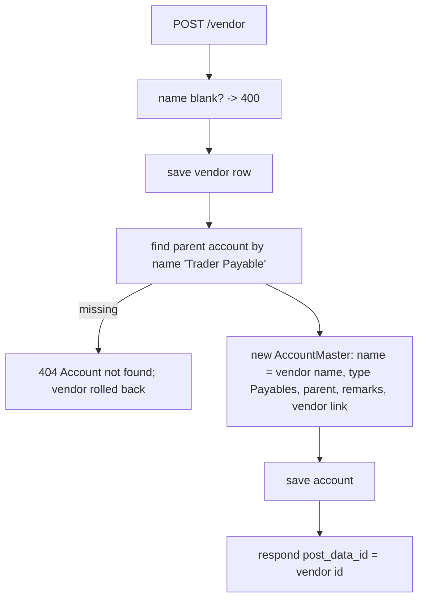

# Vendors and Customers — Backend

> Part of the Inventory System implementation guide. Read `docs/BRD.md` for the business picture and `docs/backend/backend-setup.md` for how the backend is organised.

## 1. What this is

Vendors are who the company buys from; customers are who it sells to. Both are a name with contact details (registration number, phone, address, email, remarks) and an active flag. The one thing that makes them more than a lookup list: **every vendor or customer owns a ledger account** in the chart of accounts. Credit purchases, credit sales, returns and payments post to that account, and the ledger, payable and receivable reports read it. The system creates that account when the party is created, keeps its name in step, and removes it when the party is deleted.

Vendors and customers are two identical copies of the same code, in two tables, with two sets of permissions, differing only in which side of the books their account sits on. This document describes vendors and notes the customer differences.

## 2. Where the code lives

| File | What is in it |
|---|---|
| `features/purchase/vendor/controllers/VendorController.java` | `/vendor` endpoints, each with `@RequiresOperation` |
| `features/purchase/vendor/services/VendorService.java` | Validation, list, and the account creation / rename / delete that goes with each save |
| `features/purchase/vendor/entities/Vendor.java` | `vendor` table |
| `features/purchase/vendor/dtos/VendorDTO.java` | Request/response shape |
| `features/purchase/vendor/repositories/VendorRepository.java` | `JpaRepository` + `JpaSpecificationExecutor`, the dropdown query |
| `features/sales/customer/controllers/CustomerController.java`, `services/CustomerService.java`, `entities/Customer.java`, `dtos/CustomerDTO.java`, `repositories/CustomerRepository.java` | The same five files for customers, under `/customer` |
| `features/accounting/account/entities/AccountMaster.java` | The account entity the party services create; `@OneToOne` links `vendor` and `customer` |
| `features/accounting/account/repositories/AccountMasterRepository.java` | `findByAccountName` (the parent lookup), `findByVendorId`, `findByCustomerId` |
| `common/dropdown/services/DropdownService.java` | `getVendorDropdown(status)`, `getCustomerDropdown(status)`, and the account dropdown |

## 3. Data

From `backend/database.sql`:

**`vendor`** and **`customer`** (same columns):

| Column | Meaning |
|---|---|
| `id` | `INTEGER PRIMARY KEY AUTOINCREMENT` |
| `name` | `TEXT NOT NULL`. **Not unique**: nothing in the table or the service stops two vendors with one name |
| `registration_number`, `contact`, `address`, `email`, `remarks` | Free text |
| `is_active` | `INTEGER DEFAULT 1` |
| `created_at`, `updated_at` | Trigger-maintained, not mapped |

**`account_master`**, the columns the party services set:

| Column | Vendor account | Customer account |
|---|---|---|
| `account_name` | the vendor's name | the customer's name |
| `account_type` | `Payables` (an `account_types` row under heading Liability) | `Receivables` (heading Assets) |
| `parent_id`, `parent_account_name` | the seeded account **`Trader Payable`** (id 18) | the seeded account **`Trade Receivables`** (id 23) |
| `remarks` | `For purchase entry purpose` | `For sales entry purpose` |
| `vendor_id` / `customer_id` | `vendor_id` → `vendor(id)`, `UNIQUE` | `customer_id` → `customer(id)`, `UNIQUE` |
| `is_active`, `deletable`, `is_system_generated`, `account_code` | entity defaults: `1`, `1`, `0`, `NULL` | same |

The `UNIQUE` on `vendor_id` / `customer_id` is what makes "one account per party" true at the database level.

Who points at a party: `master_purchase_entry.vendor_id`, `master_purchase_return.vendor_id`, `master_payment.vendor_id`; `master_sales_entry.customer_id`, `master_sales_return.customer_id`, `master_payment.customer_id`. Who points at the account: `journal_entry.account_master_id` (every posted line). These foreign keys block the delete.

## 4. API

| | Base path | Permissions |
|---|---|---|
| Vendors | `/vendor` | `ViewVendor`, `CreateVendor`, `EditVendor`, `DeleteVendor` |
| Customers | `/customer` | `ViewCustomer`, `CreateCustomer`, `EditCustomer`, `DeleteCustomer` |

| Method | Path | What it does | Permission |
|---|---|---|---|
| `GET` | `/vendor` | Paged list with the shared filters (`?name=abc`, `?isActive=1`) | `ViewVendor` |
| `GET` | `/vendor/{id}` | One vendor | `ViewVendor` |
| `POST` | `/vendor` | Create the vendor **and its account**; `"Vendor Added successfully"` | `CreateVendor` |
| `PUT` | `/vendor/{id}` | Update the vendor and rename its account; `"Vendor Updated successfully"` | `EditVendor` |
| `DELETE` | `/vendor/{id}` | Delete the vendor and its account; `"Vendor Deleted successfully"` | `DeleteVendor` |
| `GET` | `/dropdown/vendor/{status}` | `{id, name}` of vendors (`active` or all) | any logged-in user |
| `GET` | `/dropdown/customer/{status}` | Same for customers | any logged-in user |
| `GET` | `/dropdown/accountMaster/party/vendor/{status}` | The vendor **accounts** (ids are account ids) | any logged-in user |

The controller method is annotated with `@RequiresOperation("ViewVendor")` and so on. Full shapes: `backend/endpoints.md` section 7 (parties) and section 4 (dropdowns).

Request body:

```
{ "name", "registration_number", "contact", "address", "email", "remarks", "is_active" }
```

The DTO is not snake-cased as a whole: only `registration_number` and `is_active` are renamed with `@JsonProperty`; the other names are single words anyway. Responses carry `active` next to `is_active` (the Lombok getter quirk described in the masters doc). **Send every text field**, as an empty string when blank: the mapping calls `.trim()` on each one without a null check, so an omitted field makes the save fail with a 500.

## 5. How it works

### 5.1 Listing and getting one

The list uses the shared `SpecificationBuilder` filters and `QueryParamUtil` paging: `QueryParamUtil.toPageable(params)` for `pageIndex` / `pageSize` / `sort`, every other param a "contains" filter on an entity field (`name`, `contact`, `email`, `address`, `registrationNumber`, `isActive=1`). `GET /vendor/{id}` answers **404** `"Vendor not found"` (`"Customer not found"`).

### 5.2 Creating a party and its account

**Idea.** The books need one account per party, under a fixed group, before the first credit document or payment can be posted. Making the party service create it means the user never has to pick or remember an account, and the balance sheet always finds every vendor under `Trader Payable` and every customer under `Trade Receivables`. Both inserts run in one transaction (`@Transactional`), so a vendor never exists without its account.



**Steps.**

```
create(dto):                                        -- one transaction
  if name null or blank            -> 400 "Vendor name cannot be null or blank"
  vendor = new Vendor; copy name, registration_number, contact, email, address, remarks (all trimmed), is_active
  saved = repository.save(vendor)
  account = new AccountMaster
      accountName = saved.name
      vendor      = saved                           -- customers: customer = saved
      accountType = "Payables"                      -- customers: "Receivables"
      parent      = accountMasterRepository.findByAccountName("Trader Payable")   -- customers: "Trade Receivables"
                                   -> 404 "Account not found"  (whole transaction rolls back)
      parentId = parent.id; parentAccountName = parent.accountName
      remarks  = "For purchase entry purpose"       -- customers: "For sales entry purpose"
      (defaults) isActive = true, deletable = true, isSystemGenerated = false, accountCode = null
  accountMasterRepository.save(account)
  respond with saved.id
```

**Rules checked.**

- Blank name → **400** `"Vendor name cannot be null or blank"` / `"Customer name cannot be null or blank"`.
- Parent account missing → **404** `"Account not found"` (only if someone renamed or deleted the seeded group account).
- There is **no duplicate-name check**. `VendorRepository.existsByName` exists but is never called.

### 5.3 Updating

**Idea.** The account's name must follow the party's name, since documents and reports show the account name. The update therefore re-applies the whole account recipe (name, type, parent, remarks), which also repairs an account someone edited by hand in the chart of accounts.

**Steps.**

```
update(id, dto):                                    -- one transaction
  existing = findById(id)          -> 404 "Vendor not found"
  if name null or blank            -> 400 "Vendor name cannot be null or blank"
  copy all fields onto existing (trimmed)
  account = accountMasterRepository.findByVendorId(id)   -> 404 "Account not found"
  account.accountName = existing.name
  account.accountType = "Payables"; parent = "Trader Payable" again; remarks = "For purchase entry purpose"
  save account; save vendor; respond with id
```

What the update does **not** touch: the account's `is_active`. Setting a vendor inactive hides it from `/dropdown/vendor/active` but its account stays active, still listed in account dropdowns and still usable on a manual journal. The account's `deletable`, `is_system_generated` and `account_code` are left alone too.

### 5.4 Deleting

**Idea.** The account points at the vendor (`vendor_id`), so it has to go first; both deletes share one transaction. No "is it used?" query is written: if a purchase, return or payment names the vendor, or a journal line names the account, SQLite refuses, the transaction rolls back, and `GlobalExceptionHandler` turns the `FOREIGN KEY constraint failed` error into a 409.

**Steps.**

```
delete(id):                                         -- one transaction
  vendor = findById(id)            -> 404 "Vendor not found"
  accountMasterRepository.findByVendorId(id).ifPresent(delete)    -- first: it points at the vendor
  repository.delete(vendor)
  -- any document or journal line still using either:
  --   409 "This record is still used by other records, so it cannot be deleted"; nothing removed
```

The chart-of-accounts API refuses to delete a party account on its own: `DELETE /accountMaster/{id}` on one answers **400** `"Selected Account belongs to a vendor or customer; delete them instead"`. The party is the only way in.

### 5.5 Where the account is used

Documents look the account up by the party, never by name:

| Caller | How |
|---|---|
| Purchase entry / purchase return journal | `transaction_type` = `Cash` posts to the account named `Cash`; otherwise `findByVendorId(vendor)` → the vendor's account (404 `"Account not found"` if missing) |
| Sales entry / sales return journal | same with `findByCustomerId(customer)` |
| Payment journal | `type` = `Vendor` → `findByVendorId`, else `findByCustomerId` |
| Ledger, payable and receivable reports | read journal lines by account |

### 5.6 Dropdowns

```
GET /dropdown/vendor/{status}:   isActive = status equalsIgnoreCase "active" ? true : null
   SELECT new DropdownDTO(v.id, v.name) FROM Vendor v WHERE (:isActive IS NULL OR v.isActive = :isActive)
GET /dropdown/customer/{status}: the same on Customer
```

No `ORDER BY`; rows come in id order. Both need only a login, since every purchase, sales and payment form uses them. The account dropdown `/dropdown/accountMaster/{type}/{partyType}/{status}` (`party` / `nonparty` / `all`, `vendor` / `customer` / `all`) lists the **accounts** linked to parties; its ids are `account_master` ids.

## 6. Design decisions and gotchas

- **Two tables, not one "party" table with a type.** A company can be both a vendor and a customer; keeping them apart gives each its own account under the right group (payable vs receivable), its own permissions, and its own document foreign keys. The cost is two copies of the code.
- **The parent is found by name.** `findByAccountName("Trader Payable")` and `("Trade Receivables")` rely on the seeded accounts keeping those exact names. Rename one in the chart of accounts and every vendor (or customer) create and update fails with 404 `"Account not found"`. `findByAccountName` returns a single `Optional`, so a second account with the same name would also break it (names are not unique in `account_master`).
- **Names are not unique.** Two vendors called `ABC` get two accounts called `ABC`; reports show the name only. Add `existsByName` checks if you want the masters' behaviour.
- **Deactivating a party does not deactivate its account.** If that matters, set the account's `is_active` from the party's in the update.
- **Null text fields crash the save.** Every text field is trimmed without a null check (`dto.getContact().trim()`), so a body missing `contact`, `address`, `email`, `remarks` or `registration_number` fails with a 500 `NullPointerException` rather than a 400. Send empty strings, or add null-safe trimming when you rebuild.
- **The transaction annotation is `jakarta.transaction.Transactional`** here (products use Spring's). Both roll back on a runtime exception; either works.
- **Delete order matters.** Deleting the vendor first would fail on `account_master.vendor_id` every time, since the account always exists.
- **Account defaults come from the entity**, not the DTO: `deletable = true` and `is_system_generated = false`, so a party account looks like a user-made account in the chart, except for the vendor/customer link that the account delete checks.

## 7. Build it yourself: order of work

1. **Tables**: `vendor` and `customer` (section 3); in `account_master`, add `vendor_id INTEGER DEFAULT NULL UNIQUE` and `customer_id INTEGER DEFAULT NULL UNIQUE` with foreign keys. Seed the two group accounts `Trader Payable` (type `Payables`) and `Trade Receivables` (type `Receivables`).
2. **Entities**: `Vendor`, `Customer`; give `AccountMaster` lazy `@OneToOne` links `vendor` and `customer` on those columns.
3. **Repositories**: `VendorRepository` / `CustomerRepository` with the dropdown JPQL; `AccountMasterRepository` with `findByAccountName`, `findByVendorId`, `findByCustomerId`.
4. **DTOs**: the seven fields with `@JsonProperty("registration_number")` and `@JsonProperty("is_active")`.
5. **Services**: `saveVendor` (vendor + account in one `@Transactional`), `getPaginatedVendorsList`, `getVendorById`, `updateVendor` (rename the account), `deleteVendor` (account first). Copy for customers with `Receivables` / `Trade Receivables` / `For sales entry purpose`.
6. **Controllers** at `/vendor` and `/customer` with `@RequiresOperation("ViewVendor")`, `"CreateVendor"`, `"EditVendor"`, `"DeleteVendor"` (and the customer ones); add the operations to the seed and the Admin role.
7. **Dropdowns**: `getVendorDropdown` / `getCustomerDropdown` in `DropdownService`, routes `/dropdown/vendor/{status}` and `/dropdown/customer/{status}`.
8. **Try it**: `POST /vendor`, then `GET /dropdown/accountMaster/party/vendor/active` and see the new account; `PUT` with a new name and check the account was renamed; record a credit purchase for the vendor, `DELETE /vendor/{id}` and expect the 409; delete the purchase, delete the vendor, and confirm the account is gone.
