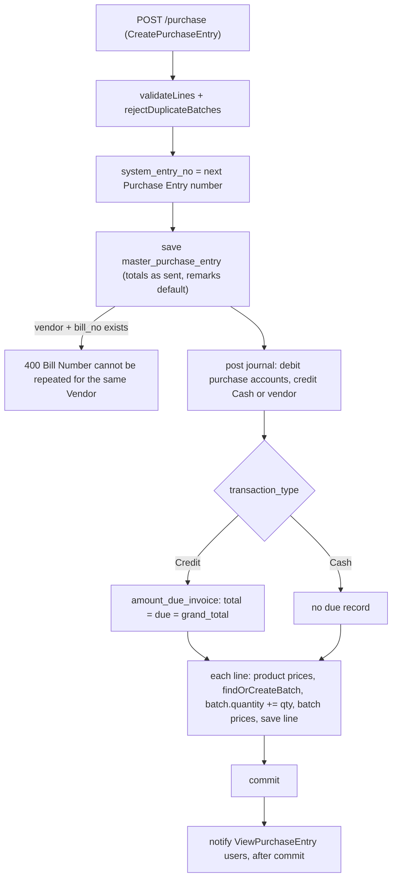

# Purchases and Purchase Returns — Backend

> Part of the Inventory System implementation guide. Read `docs/BRD.md` for the business picture and `docs/backend/backend-setup.md` for how the backend is organised.

## 1. What this is

A **purchase entry** records goods bought from a vendor: the vendor's bill, the products with their batches, quantities and prices, and the totals. Saving one puts the quantities into stock batch by batch, sets the product's and the batch's prices from the lines, posts the accounting journal (so the purchase shows in the ledger and the trial balance) and, for a credit purchase, records what is now owed to the vendor so a payment can settle it later.

A **purchase return** is the opposite document: goods sent back to the vendor. It takes the quantities out of the batches they sit in, posts the mirror-image journal and may name the purchase the goods came in on. Both documents can be edited and deleted; the service reverses the earlier stock movement and journal before applying the new version.

## 2. Where the code lives

Package `features/purchase/` under `backend/src/main/java/com/sandipsky/inventory_system/`.

| File or folder | What is in it |
|---|---|
| `purchase_entry/controllers/PurchaseEntryController.java` | The `/purchase` endpoints, each with its `@RequiresOperation` |
| `purchase_entry/services/PurchaseEntryService.java` | List, get one, create, update, delete; the journal posting, the due-invoice upkeep and the stock movements |
| `purchase_entry/services/PurchaseEntryExportService.java` | The list as an `ExportTable`; one purchase or a date range as `PrintDocument`s |
| `purchase_entry/dtos/MasterPurchaseEntryDTO.java`, `PurchaseEntryDTO.java` | JSON shape of the document and of one line (`@JsonProperty` gives the snake_case names) |
| `purchase_entry/entities/MasterPurchaseEntry.java`, `PurchaseEntry.java` | Tables `master_purchase_entry` and `purchase_entry` |
| `purchase_entry/repositories/` | `MasterPurchaseEntryRepository` (paging with specifications, `findTopByOrderByIdDesc`, `findDropdownByVendor`); `PurchaseEntryRepository` (`findByMasterPurchaseEntryId`) |
| `purchase_return/…` | The same five kinds of file for `/purchase-return`: `PurchaseReturnService`, `PurchaseReturnExportService`, `MasterPurchaseReturn`, `PurchaseReturnEntry`, DTOs, repositories |
| `common/util/LineItemUtil.java` | `validateLines`, `rejectDuplicateBatches`, `batchKey`, shared by every document with lines |
| `features/product/services/ProductStockService.java` | `findOrCreateBatch`, `findBatch`, `lineBatch`, `batchId`: how a line is tied to a stock batch |
| `features/settings/document_numbering/services/DocumentNumberingService.java` | `generatePurchaseNumber`, `generatePurchaseReturnNumber` |
| `features/accounting/journal/entities/MasterJournalEntry.java`, `JournalEntry.java` | The journal a document posts |
| `features/accounting/payment/entities/AmountDueInvoice.java` | What a credit purchase leaves owing |
| `features/notification/services/NotificationService.java` | `notifyActivity`, `documentMessage` |
| `common/dropdown/` | `GET /dropdown/purchase/{vendorId}` |
| `common/exception/GlobalExceptionHandler.java` | Maps exceptions to statuses: `BadRequestException` 400, `ResourceNotFoundException` 404, a foreign-key failure on DELETE 409 |

## 3. Data

All tables are in `backend/database.sql`. Dates are `YYYY-MM-DD` text; money and quantities are `REAL`.

| Table | Important columns | Links |
|---|---|---|
| `master_purchase_entry` | `date`, `bill_date`, `system_entry_no` (unique, like `\|PE-000001`), `bill_no`, `transaction_type` (`Cash` or `Credit`), `sub_total`, `discount`, `discount_type`, `non_taxable_amount`, `taxable_amount`, `total_tax`, `rounded`, `rounding`, `grand_total`, `remarks`, `vendor_id` | `vendor_id → vendor.id`; `UNIQUE (vendor_id, bill_no)` |
| `purchase_entry` | `master_purchase_entry_id`, `quantity`, `cost_price`, `selling_price`, `mrp`, `product_id`, `batch_id` | one line; `batch_id → product_stock.id` is the batch the line moved stock in |
| `master_purchase_return` | the same header columns without `bill_date`, plus `ref_purchase_id` | `ref_purchase_id → master_purchase_entry.id`; this foreign key is what blocks deleting a referenced purchase |
| `purchase_return_entry` | like `purchase_entry`, keyed by `master_purchase_return_id` | |
| `product_stock` | `product_id`, `batch_no` (NULL = the product's default batch), `expiry_date`, `quantity`, `cost_price`, `selling_price`, `mrp` | `UNIQUE (product_id, batch_no)`; every stock movement is an update of `quantity` here |
| `master_journal_entry` | `date`, `system_entry_no` (unique), `remarks`, `master_purchase_entry_id`, `master_purchase_return_id` (plus the sales and payment columns) | one journal per document, found again through its document column |
| `journal_entry` | `master_journal_entry_id`, `account_master_id`, `debit_amount`, `credit_amount`, `narration` | the journal's lines |
| `amount_due_invoice` | `invoice_number` (unique), `total_invoice_amount`, `due_amount`, `paid_amount` | keyed by the document number only; vendor payments settle it |
| `document_numbering` | `name` (`Purchase Entry`, `Purchase Return`), `prefix` (`\|PE-`, `\|PR-`), `body_length` 6, `start_no`, `end_no` | |
| `account_master` | `account_name`, `vendor_id` | the journal finds accounts by name (`VAT Purchase`, …) or by `vendor_id` (the vendor's own payable account, created with the vendor under `Trader Payable`) |

## 4. API

| Method | Path | What it does | Permission needed |
|---|---|---|---|
| GET | `/purchase/generateNumber` | Preview the next number, as plain text | `CreatePurchaseEntry` |
| GET | `/purchase` | Paged list, without lines | `ViewPurchaseEntry` |
| GET | `/purchase/{id}` | One purchase with its lines | `ViewPurchaseEntry` |
| POST | `/purchase` | Create | `CreatePurchaseEntry` |
| PUT | `/purchase/{id}` | Replace the whole document | `EditPurchaseEntry` |
| DELETE | `/purchase/{id}` | Delete; stock is taken back out | `DeletePurchaseEntry` |
| GET | `/purchase/export/{format}` | The filtered list as `excel` or `pdf` | `ViewPurchaseEntry` |
| GET | `/purchase/{id}/export/{format}` | One invoice as PDF, or its lines as Excel | `ViewPurchaseEntry` |
| GET | `/purchase/print?fromDate=&toDate=` | Every purchase of the range in one PDF | `ViewPurchaseEntry` |
| (same nine) | `/purchase-return…` | The same operations for returns | `ViewPurchaseReturn`, `CreatePurchaseReturn`, `EditPurchaseReturn`, `DeletePurchaseReturn` |
| GET | `/dropdown/purchase/{vendorId}` | The vendor's purchases, for the Ref. Purchase picker | any login |

The full request and response shapes are in `backend/endpoints.md`, section 10. What matters:

- Header fields: `date`, `bill_date` (purchase only), `bill_no`, `transaction_type`, `vendor_id`, `discount_type`, `discount`, `sub_total`, `non_taxable_amount`, `taxable_amount`, **`tax`** (the JSON name of the `totalTax` field; sales call the same thing `total_tax`), `rounded`, `rounding`, `grand_total`, `remarks`. A return adds `ref_purchase_id` (nullable).
- Lines go in the camelCase list **`purchaseEntries`** or **`purchaseReturnEntries`**: `id` (0 or absent for a new line), `product_id`, `quantity`, `cost_price`, `selling_price`, `mrp`. A purchase line **types** `batch_no` and `expiry_date`; a return line **picks** `batch_id` (0 = the default batch).
- Read back, a line also carries `product_name`, `batch_id`, `batch_no` (and `expiry_date` on purchases); a return carries `ref_purchase_no`. A `system_entry_no` in a request body is ignored: the server numbers the document itself.
- Every save answers `{ success, message, post_data_id }`, where `post_data_id` is the document id.

## 5. How it works

### 5.1 Common ground

These rules and helpers are the same for both documents (and for sales, see `docs/backend/sales/sales.md`).

- **Totals are stored as sent.** The server never recomputes `sub_total`, the discount split, `tax` or `grand_total`; it stores what the browser's `calculateInvoice` worked out and posts the journal from those numbers. One place owns the arithmetic the user sees. The server checks only what must hold for stock and the books.
- **Line checks** (`LineItemUtil`). `validateLines`: the list must have at least one line, 400 `"Add at least one product"`, and every `quantity` must be above zero, 400 `"Quantity must be greater than zero"` (a zero or negative quantity would move stock the wrong way). `rejectDuplicateBatches`: each product batch may appear on one line only, 400 `"<product> batch <no> is entered on more than one line"` or `"<product> (default batch) is entered on more than one line"`. Why: two lines for one batch would have to be merged, and silently taking one line's prices would change the document's own value.
- **Batches** (`ProductStockService`). Stock is one `product_stock` row per product and `batch_no`; a NULL `batch_no` is the product's **default batch**, which the API always addresses as `batch_id` 0 (`batchId()`), every other batch by its row id. Why 0: the default row may not exist yet, and 0 can be sent before anything is stocked. `findOrCreateBatch(product, batch_no, expiry)` (goods coming in): trims the number, blank means the default batch, an unknown number gives a new unsaved row with quantity 0. A batch keeps its expiry date: a blank one leaves it alone, a different one is 400 `"Batch <no> of <product> already has expiry date <date>"` (correct a wrong date through Stock Edit). `findBatch(product, batch_id)` (goods going out): 0 finds the default batch (null when the product has none yet), otherwise the row, 404 `"Batch not found"`, which must belong to the product, 400 `"Batch does not belong to <product>"`. `lineBatch(batch, product)` gives a saved line's batch, falling back to the default batch for lines saved before batches existed (404 `"Product Stock not found"` when there is none).
- **Document numbers.** `generatePurchaseNumber()` reads the `Purchase Entry` row of `document_numbering`, takes the newest purchase (`findTopByOrderByIdDesc`), strips the prefix, adds one (or uses `start_no` when there is none) and pads to `body_length`: `|PE-000007`. Beyond `end_no` it throws `IllegalStateException` (a 500). `GET /purchase/generateNumber` previews the same value; the save computes it again.
- **Remarks default.** Blank remarks become `"Purchased Goods from <vendor>"` (returns: `"Returned Goods to <vendor>"`). The remark is copied to the journal and to every journal line's `narration`, which is what the ledger shows.
- **The journal shell.** `createJournalEntries` first calls `deleteJournalEntries` (delete the lines, delete the master, then `flush()`), then inserts a `master_journal_entry` with the document's date, remarks and **the document's own `system_entry_no`**, linked back through `master_purchase_entry_id` or `master_purchase_return_id`. Why the flush: `master_journal_entry.system_entry_no` is UNIQUE; ids are IDENTITY, so Hibernate runs the INSERT the moment `save()` is called, but a `delete()` only waits in the session until the next flush. Without the explicit flush the new row would hit the database while the old one is still there and fail the unique constraint. Why the same number: ledger lines then show the document's number with nothing to map.
- **Transactions.** `saveMasterPurchaseEntry`, `updateMasterPurchaseEntry` and `deleteMasterPurchaseEntry` (and the return's three) are each one `@Transactional` method. Any failure, a rule, a missing account, a constraint, rolls back everything in it, stock already moved included. List and get-one are plain reads.
- **Notifications.** `notifyActivity(type, severity, title, message)` registers an after-commit action: once the transaction commits, a notification row is stored for every active user whose role holds the type's View operation (`ViewPurchaseEntry` or `ViewPurchaseReturn`), skipping the user who made the change, and pushed to their open sockets. `documentMessage(no, party, total)` builds `"PE-000012 from Himalayan Distributors, Rs. 45,000.00."`. Add and delete notify; edit does not. Stock alerts need no call: `StockChangeListener` on `ProductStock` sees every quantity write.

### 5.2 Purchase entry: listing and filtering

**Idea.** One generic path serves every list: `QueryParamUtil` turns the query string into paging and filters, `SpecificationBuilder` turns the filters into a JPA specification. The rows are mapped to DTOs without their lines.

```
list_purchases(params):
  pageable = pageIndex (default 0), pageSize (default 25),
             sort "field:asc,other:desc" (entity field names, case-insensitive order)
  filters  = every other param except pageIndex, pageSize, sort, calendar; blank values dropped
  spec     = for each filter:
               fromDate -> date >= value            toDate -> date <= value   (text compare works for YYYY-MM-DD)
               other    -> lower(field as text) LIKE %value%   (a dotted name joins: vendor.name)
               unknown field -> skipped, not an error
  page = repository.findAll(spec, pageable)
  map each row to the header DTO (with vendor_id, vendor_name), no lines
```

**Rules checked:** none. An unknown filter name is silently ignored, so a typo returns every row. `transactionType=credit` matches `Credit` because the match is "contains", case-insensitive.

### 5.3 Purchase entry: get one

```
get_purchase(id):
  master = by id                                                  -> 404 "Purchase Entry with Given Id not found"
  dto = header fields + vendor_id, vendor_name
  for each line: id, quantity, cost_price, selling_price, mrp, product_id, product_name
     if the line has a batch: batch_id = batchId(batch)           (0 when its batch_no is NULL, else the row id)
                              batch_no, expiry_date from the batch
```

Why `batch_id` is derived rather than read from the column: the line stores the real `product_stock` row id, but the API's convention is 0 for the default batch, so the translation happens on the way out. A default-batch line reads back as `batch_id: 0, batch_no: null`.

### 5.4 Purchase entry: creating

**Idea.** Validate, number, save the header, post the books, then move the stock line by line. The books come before the lines so a missing account fails fast; the order does not matter for correctness because everything is one transaction.



```
save_purchase(dto):                                              -- one @Transactional method
  validateLines(dto.purchaseEntries)                             -> 400 "Add at least one product" / "Quantity must be greater than zero"
  rejectDuplicateBatches, key = (product_id, trimmed batch_no)   -> 400 "<product> batch <no> is entered on more than one line"
  master = new MasterPurchaseEntry
  master.system_entry_no = generatePurchaseNumber()               e.g. "|PE-000007"
  copy date, bill_date, bill_no, transaction_type, discount_type,
       sub_total, discount, non_taxable_amount, taxable_amount, tax, rounded, rounding, grand_total   AS SENT
  master.vendor = vendor by vendor_id                             -> 404 "Vendor not found"
  master.remarks = dto.remarks, or "Purchased Goods from <vendor>" when blank
  save master; if the database error names unique_party_bill_no  -> 400 "Bill Number cannot be repeated for the same Vendor"
  post_journal(master)                                            -> 5.5
  maintain_due_invoice(master)                                    -> 5.6
  for each line:
      product = by product_id                                     -> 404 "Product not found"
      product.cost_price, selling_price, mrp := the line's        (the latest purchase sets the product's prices)
      save product
      batch = findOrCreateBatch(product, line.batch_no, line.expiry_date)   -> 400 "Batch … already has expiry date …"
      batch.quantity += line.quantity
      batch.cost_price, selling_price, mrp := the line's
      save batch; save line (product, batch, quantity, prices)
  notifyActivity(PURCHASE_ENTRY, info, "Purchase entry added",
                 "PE-000007 from <vendor>, Rs. 5,424.00.")        -- runs after commit
  return master                                                   -- controller: "Purchase Added successfully", post_data_id = id
```

**Rules checked**

- At least one line, every quantity above zero: 400, messages above.
- A product batch once per document: 400 `"… is entered on more than one line"`.
- `vendor_id` must exist: 404 `"Vendor not found"`; each `product_id`: 404 `"Product not found"`.
- `bill_no` unique per vendor: 400 `"Bill Number cannot be repeated for the same Vendor"` (enforced by the database constraint, see section 6).
- A typed `expiry_date` must match the batch's: 400 `"Batch <no> of <product> already has expiry date <date>"`.
- Every account the journal needs must exist: 404 `"Account not found"`.
- Missing permission: 403 `"Operation not allowed"`.

### 5.5 Purchase entry: posting the journal

**Idea.** A purchase is an expense (debit the purchase accounts and the tax we can claim) paid either now (credit `Cash`) or later (credit the vendor's payable account). Accounts are found by name, except the vendor's, found by `vendor_id`. Each line's narration is the document's remarks.

| Account (`account_name`) | Side | Amount | Posted only when |
|---|---|---|---|
| `VAT Free Purchase` | debit | `non_taxable_amount` | `non_taxable_amount > 0` |
| `VAT Purchase` | debit | `taxable_amount` | `taxable_amount > 0` |
| `Tax` | debit | `total_tax` | `taxable_amount > 0` (same branch) |
| `Adjustment` | debit `rounding` if positive, credit `-rounding` if negative | `rounding` | `rounding != 0` |
| `Cash` when `transaction_type` is exactly `Cash`, else the account whose `vendor_id` is the vendor | credit | `grand_total` | always |

It balances because the browser computed `grand_total = non_taxable_amount + taxable_amount + tax + rounding`. The server does not check that (see section 6). A missing account is 404 `"Account not found"` and rolls the save back. The vendor's account exists because `VendorService` creates one (type `Payables`, parent `Trader Payable`) whenever a vendor is saved.

### 5.6 Purchase entry: keeping the amount due in step

**Idea.** A credit purchase leaves a debt. `amount_due_invoice` holds it under the document's number so the payment screen can list and settle it. The same method runs on create and on update, so it must also handle a purchase switching between Cash and Credit, and a total changing after part has been paid.

```
maintain_due_invoice(master):
  due = amount_due_invoice where invoice_number = master.system_entry_no   (may be none)
  if transaction_type == "Cash":
      if due exists:
          if due.paid_amount > 0                                  -> 400 "Payments already recorded against this invoice"
          delete due                                              (a credit purchase turned into a cash one)
      return
  if none: due = new, invoice_number = system_entry_no
  if due.paid_amount > master.grand_total                         -> 400 "Invoice total cannot be less than the amount already paid"
  due.total_invoice_amount = grand_total
  due.due_amount = grand_total - due.paid_amount
  save due
```

On create `paid_amount` is 0, so `due_amount = grand_total`. The comparison is exactly `"Cash"`: any other value counts as credit.

### 5.7 Purchase entry: editing

**Idea.** The client sends the whole document again. Lines are matched by `id`: a sent line with an id updates that line, one without an id is new, and any saved line not sent is removed. Stock is moved by the difference, and the journal is deleted and re-posted rather than patched, because which lines it has depends on the new amounts and on Cash or Credit.

```
update_purchase(id, dto):                                        -- one @Transactional method
  validateLines, rejectDuplicateBatches                           (as in create)
  master = by id                                                  -> 404 "Purchase Entry with Given Id not found"
  overwrite the header fields, vendor, remarks default; system_entry_no is kept
  save master                                                     -> 400 "Bill Number cannot be repeated for the same Vendor"
  for each saved line whose id is not among the sent ids:
      removeFromBatch(lineBatch(line.batch, line.product), line.quantity)   -> 400 "Product Stock is Already Used"
      delete line
  for each sent line:
      if line.id != 0: entry = by id                              -> 404 "Purchase Entry not found"
                       previousBatch = lineBatch(entry.batch, entry.product); previousQty = entry.quantity
      else:            entry = new; previousBatch = none; previousQty = 0
      entry.quantity, prices := the line's; product prices := the line's; save product
      target = findOrCreateBatch(product, line.batch_no, line.expiry_date)
      if previousBatch is the same row as target: target.quantity -= previousQty         (only the difference is applied)
      else if previousBatch exists:               removeFromBatch(previousBatch, previousQty)  -> 400 "Product Stock is Already Used"
      if target.quantity + line.quantity < 0                      -> 400 "Product Stock is Already Used"
      target.quantity += line.quantity; target prices := the line's; save target
      entry.batch = target; save entry
  post_journal(master)                                            (deletes the old journal, flushes, re-posts)
  maintain_due_invoice(master)                                    -> 5.6: Credit to Cash with payments, or a total below what is paid, fail here
  (no notification)
```

**Rules checked**

- Everything create checks, plus: 404 `"Purchase Entry with Given Id not found"`, 404 `"Purchase Entry not found"` for a sent line id that does not exist.
- `"Product Stock is Already Used"` (400) whenever taking the old quantity back out would push a batch below zero: the goods have been sold or returned since. Reducing a quantity inside the same batch only needs the *difference* to be available; moving a line to another `batch_no` needs the whole old quantity still in the old batch.
- `"Payments already recorded against this invoice"` (400) when switching a paid credit purchase to Cash; `"Invoice total cannot be less than the amount already paid"` (400) when lowering the total under what the vendor has already been paid.

### 5.8 Purchase entry: deleting

```
delete_purchase(id):                                             -- one @Transactional method
  master = by id                                                  -> 404 "Purchase Entry with Given Id not found"
  for each line: removeFromBatch(lineBatch(line.batch, line.product), line.quantity)   -> 400 "Product Stock is Already Used"
                 delete line
  delete journal (lines, master, flush)
  remove due invoice: if it exists and paid_amount > 0             -> 400 "Payments already recorded against this invoice"
                      else delete it
  delete master                                                   -> 409 "This record is still used by other records, so it cannot be deleted"
                                                                     when a purchase return's ref_purchase_id points at it
  notifyActivity(PURCHASE_ENTRY, warn, "Purchase entry deleted", "PE-000007 from <vendor>, Rs. 5,424.00.")
```

**Rules checked:** the three above. The 409 is not a query in the service: `PRAGMA foreign_keys = ON` makes SQLite refuse the delete, and `GlobalExceptionHandler` turns any `FOREIGN KEY constraint failed` on a DELETE into that 409. The stock already taken out is rolled back with the transaction, and the after-commit notification never fires.

### 5.9 Purchase return: list, get one, Ref. Purchase dropdown

The list and get-one use the same machinery on `MasterPurchaseReturn`. The DTO adds `ref_purchase_id` and `ref_purchase_no` (both null when there is none); a line reads back with `batch_id` (through `batchId`) and `batch_no`, no expiry.

```
GET /dropdown/purchase/{vendorId}:                                (a login is enough; dropdowns have no operation)
  SELECT id, system_entry_no FROM master_purchase_entry WHERE vendor_id = ? ORDER BY id DESC
  -> [ { "id": 7, "name": "|PE-000007" }, … ]
```

The browser uses it to copy the purchase's lines into a new return; the server only checks that the referenced purchase is the vendor's.

### 5.10 Purchase return: creating

**Idea.** Same validation family, but the goods go *out*, so each line picks an existing batch and the batch must hold enough. Prices on the batch and the product are left alone: a return does not say what the goods are worth now.

```
save_purchase_return(dto):                                       -- one @Transactional method
  validateLines(dto.purchaseReturnEntries)
  rejectDuplicateBatches, key = (product_id, batch_id)           -> 400 "<product> batch <no> is entered on more than one line" / "… (default batch) …"
  master = new; system_entry_no = generatePurchaseReturnNumber()  e.g. "|PR-000003"
  copy date, bill_no, transaction_type, discount_type and the totals AS SENT
  master.vendor = by vendor_id                                    -> 404 "Vendor not found"
  master.ref_purchase = none when ref_purchase_id is null or 0
                        else the purchase by id                   -> 404 "Reference purchase not found"
                        whose vendor must be this vendor          -> 400 "Reference purchase belongs to another vendor"
  master.remarks = dto.remarks, or "Returned Goods to <vendor>"
  save master                                                     (no bill-number uniqueness on returns)
  for each line:
      product = by product_id                                     -> 404 "Product not found"
      batch = findBatch(product, line.batch_id)                   -> 404 "Batch not found" / 400 "Batch does not belong to <product>"
      if batch is none (no default batch yet) or batch.quantity - line.quantity < 0
                                                                  -> 400 "Not enough Quantity In Stock"
      batch.quantity -= line.quantity; save batch                 (batch and product prices untouched)
      save line (product, batch, quantity, prices as sent)
  post_return_journal(master)                                     -> 5.11
  (no amount-due record is created or changed)
  notifyActivity(PURCHASE_RETURN, info, "Purchase return added", "PR-000003 to <vendor>, Rs. 226.00.")
```

**Rules checked:** the line checks; 404 `"Vendor not found"`, `"Product not found"`, `"Batch not found"`, `"Reference purchase not found"`; 400 `"Batch does not belong to <product>"`, `"Not enough Quantity In Stock"`, `"Reference purchase belongs to another vendor"`; 404 `"Account not found"`. The quantities are not compared with the referenced purchase: a return may take out any quantity the batch holds.

### 5.11 Purchase return: the journal

The mirror of 5.5, debit and credit swapped: returning goods cancels part of the purchase cost and reduces what we owe the vendor (or brings cash back).

| Account | Side | Amount | Posted only when |
|---|---|---|---|
| `VAT Free Purchase` | credit | `non_taxable_amount` | `non_taxable_amount > 0` |
| `VAT Purchase` | credit | `taxable_amount` | `taxable_amount > 0` |
| `Tax` | credit | `total_tax` | `taxable_amount > 0` |
| `Adjustment` | credit `rounding` if positive, debit `-rounding` if negative | `rounding` | `rounding != 0` |
| `Cash` for `Cash`, else the vendor's account | debit | `grand_total` | always |

The journal carries the return's `|PR-…` number and links back through `master_purchase_return_id`.

### 5.12 Purchase return: editing and deleting

**Idea.** A return line may move to another batch, so the simplest correct rule is "undo the old line, then apply the new one". Putting stock back never fails; taking it out may.

```
update_purchase_return(id, dto):                                 -- one @Transactional method
  validateLines, rejectDuplicateBatches
  master = by id                                                  -> 404 "Purchase Return with Given Id not found"
  overwrite header, vendor, ref purchase (same checks as create), remarks default; save
  for each saved line not among the sent ids:
      add its quantity back to lineBatch(line.batch, line.product)   (the goods stay with us after all)
      delete line
  for each sent line:
      if line.id != 0: entry = by id                              -> 404 "Purchase Return Entry not found"
                       add entry.quantity back to lineBatch(entry.batch, entry.product)   (reverse the old return first)
      else:            entry = new
      product = by product_id; batch = findBatch(product, line.batch_id)
      take line.quantity out of batch                             -> 400 "Not enough Quantity In Stock"
      set quantity, prices, product, batch; save entry
  post_return_journal(master)                                     (delete, flush, re-post)
  (no notification)

delete_purchase_return(id):                                      -- one @Transactional method
  master = by id                                                  -> 404 "Purchase Return with Given Id not found"
  for each line: add its quantity back to lineBatch(…); delete line
  delete journal; delete master
  notifyActivity(PURCHASE_RETURN, warn, "Purchase return deleted", "PR-000003 to <vendor>, Rs. 226.00.")
```

### 5.13 Export and print

**Idea.** The web app never builds a file. The export service describes *what* to print (an `ExportTable` with typed columns, or a `PrintDocument` with party block, header fields, lines, summary and remarks) and `common/export/ExportService` renders it as Excel or PDF under the company letterhead, with dates in the `calendar` param's calendar (else the `calendar_type` setting).

```
GET /purchase/export/{format}       list(params): the list query with paging switched off (pageIndex 0, pageSize MAX), in the sent sort
                                    ExportTable "Purchases": Purchase Number, Posting Date, Vendor Name, Bill Number, Bill Date,
                                    Transaction Type, Gross Amount, Discount, Tax Amount, Net Amount (the four amounts are totalled)
                                    file purchases-<today>.xlsx or .pdf
GET /purchase/{id}/export/{format}  PrintDocument "Purchase Invoice": Vendor, Address, Contact, PAN/VAT No.; Purchase No., Date,
                                    Bill No., Bill Date, Transaction Type; lines Product, Code, Unit, Batch No., Expiry Date, Tax,
                                    Qty, Rate (cost price), MRP, SP, Amount; Sub Total … Grand Total; Remarks
                                    file PE-000007.pdf or .xlsx; 404 "Purchase Entry with Given Id not found"
GET /purchase/print?fromDate&toDate every purchase the filters match, sorted by date then id, one page each
                                    file purchase-invoices-<today>.pdf; 404 "No purchases in this period"
```

Returns work the same: table `Purchase Returns` with a `Ref. Purchase` column, document `Purchase Return` (lines without the SP column), files `purchase-returns-<today>`, 404 `"No purchase returns in this period"`. The `Discount` column is `max(sub_total − taxable_amount − non_taxable_amount, 0)` rounded to 2 places, because the stored `discount` is what the user typed (a percent or an amount). An unknown format is 400 `"Export format must be excel or pdf"`. The `document` and `documents` methods are `@Transactional(readOnly = true)` so the lazily loaded lines can be read.

## 6. Design decisions and gotchas

- **The browser computes, the server stores.** Document journals are posted from the sent totals and are *not* balance-checked (only manual journals get `"Journal debits and credits must be equal"`). Inconsistent totals from a client produce an unbalanced journal. The `Tax` line is posted only inside the `taxable_amount > 0` branch.
- **Delete and re-post, with a flush.** Editing the journal in place would mean diffing lines whose existence depends on the amounts and on Cash/Credit. Replacing it is always right; the `flush()` in `deleteJournalEntries` is what makes re-using the document's `system_entry_no` safe (5.1).
- **Bill-number uniqueness is a database constraint**, so two concurrent saves cannot both slip through. The friendly 400 depends on the constraint's name `unique_party_bill_no` appearing in the error text. The entity declares that name, but `database.sql` creates the constraint unnamed (`UNIQUE (vendor_id, bill_no)`), in which case SQLite reports the column names instead and the error falls through to the general handler as a 500. When you build it, name the constraint, or match on the column names.
- **Document numbers come from the last row, not a counter.** Two saves at the same instant can compute the same number; the UNIQUE column then fails one of them. Deleting the newest purchase makes its number the next one handed out.
- **Prices.** A purchase overwrites the product's and the batch's `cost_price`, `selling_price` and `mrp` with the line's: the latest purchase defines the prices. A purchase return touches no prices.
- **"Product Stock is Already Used" is the only guard on history.** There is no per-document stock ledger; the service just refuses to drive a batch below zero. An edit succeeds as long as the batch has enough left, even if what is left came from another purchase.
- **Returns and the amount due.** A purchase return does not change the original purchase's `amount_due_invoice`; it reaches the books only through the journal, where the vendor's account is debited. Settling that against the open invoice is a payment-side matter.
- **Cash/Credit is an exact string.** `"Cash"` posts to the `Cash` account and keeps no due record; any other value (including `cash`) posts to the vendor's account and creates one.
- **Deleting a referenced purchase** is refused by the foreign key, not by a check, and only after the lines and stock have been processed; the rollback undoes them.
- **Edits are silent.** Only add and delete send notifications; low-stock alerts come from the batch quantity listener regardless.
- `getMasterPurchaseEntryById` walks the lazy `purchaseEntries` outside a transaction. That works because Spring Boot keeps the JPA session open for the request (`spring.jpa.open-in-view` is left at its default); keep that in mind if you switch it off.

## 7. Build it yourself: order of work

1. **Tables** in `database.sql`: `master_purchase_entry` (with a *named* unique constraint on `vendor_id, bill_no`), `purchase_entry`, `master_purchase_return` (with `ref_purchase_id`), `purchase_return_entry`. Make sure `product_stock`, `master_journal_entry` (with the two document columns), `journal_entry`, `amount_due_invoice` and `document_numbering` rows `Purchase Entry` (`|PE-`) and `Purchase Return` (`|PR-`) exist, and seed the accounts `Cash`, `VAT Purchase`, `VAT Free Purchase`, `Tax`, `Adjustment`, `Trader Payable`. Turn `PRAGMA foreign_keys = ON` on per connection.
2. **Entities**: `MasterPurchaseEntry` (`@OneToMany` lines joined on `masterPurchaseEntryId`, `@ManyToOne` vendor), `PurchaseEntry` (`@ManyToOne` product and batch), the two return entities with `refPurchase`. Add `masterPurchaseEntry` / `masterPurchaseReturn` to `MasterJournalEntry`.
3. **Repositories**: `JpaRepository` + `JpaSpecificationExecutor`; `findTopByOrderByIdDesc`, `findByMasterPurchaseEntryId`, `findDropdownByVendor`; on the journal repository `findByMasterPurchaseEntryId` / `findByMasterPurchaseReturnId`; on accounts `findByAccountName`, `findByVendorId`; on due invoices `findByInvoiceNumber`.
4. **DTOs** with `@JsonProperty` snake_case names, `tax` for the tax total, camelCase line lists.
5. **Shared helpers** if they do not exist yet: `LineItemUtil`, `ProductStockService` (`findOrCreateBatch`, `findBatch`, `lineBatch`, `batchId`), `DocumentNumberingService`, `NotificationService.notifyActivity`.
6. **`PurchaseEntryService`**: list and get one first, then create with `createJournalEntries` and `maintainDueInvoice`, then update (`addToBatch` with the previous batch, `removeFromBatch`), then delete. Mark the three writers `@Transactional`.
7. **`PurchaseReturnService`** the same way: `findBatch` + `removeFromStock` on the way in, `addToStock` to reverse, `refPurchase` check, the mirrored journal.
8. **Export services** and the three file endpoints each, through `ExportService.table`, `document`, `documents`.
9. **Controllers** under `/purchase` and `/purchase-return` with `@RequiresOperation` on every method; add the eight operations to the role matrix seed. Add `GET /dropdown/purchase/{vendorId}`.
10. **Try it with curl**: log in; `POST /purchase` a Credit purchase with a typed batch; `GET /products/stockInfo/{id}` to see the batch; check the vendor's ledger and `/reports/accounting/payable`; `PUT` it with a line removed; `POST /purchase-return` against it with that `batch_id`; `DELETE /purchase/{id}` and expect the 409; delete the return, then the purchase, and confirm the stock is back to zero.
