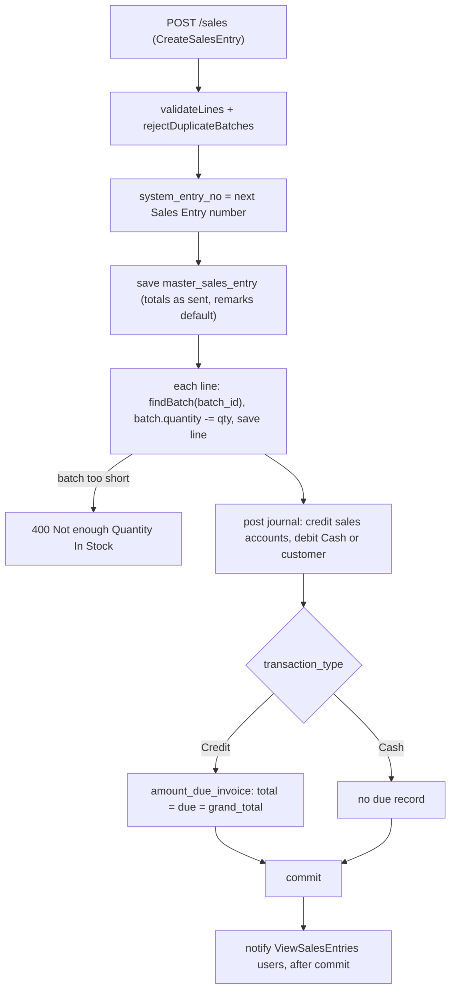

# Sales and Sales Returns — Backend

> Part of the Inventory System implementation guide. Read `docs/BRD.md` for the business picture and `docs/backend/backend-setup.md` for how the backend is organised.

## 1. What this is

A **sales entry** (an invoice) records goods sold to a customer: the products with the batch each one is sold from, quantities, prices and totals. Saving one takes the quantities out of those batches, posts the accounting journal (income and tax credited, cash or the customer debited) and, for a credit sale, records what the customer now owes so a payment can settle it later.

A **sales return** is a customer bringing goods back: the quantities go back into stock, the mirror-image journal is posted, and the return may name the invoice the goods were sold on. Neither document is ever edited or deleted. An invoice that was wrong is **cancelled**: its stock and books are reversed, it is marked cancelled with a reason, and it stays on file with its lines.

## 2. Where the code lives

Package `features/sales/` under `backend/src/main/java/com/sandipsky/inventory_system/`.

| File or folder | What is in it |
|---|---|
| `sales_entry/controllers/SalesEntryController.java` | The `/sales` endpoints with their `@RequiresOperation` |
| `sales_entry/services/SalesEntryService.java` | List, get one, create, cancel; journal posting, due-invoice upkeep, stock movements |
| `sales_entry/services/SalesEntryExportService.java` | The list as an `ExportTable`, one invoice or a date range as `PrintDocument`s, cancelled ones marked |
| `sales_entry/dtos/MasterSalesEntryDTO.java`, `SalesEntryDTO.java` | JSON shape of the invoice and of one line |
| `sales_entry/entities/MasterSalesEntry.java`, `SalesEntry.java` | Tables `master_sales_entry` and `sales_entry` |
| `sales_entry/repositories/` | `MasterSalesEntryRepository` (specifications, `findTopByOrderByIdDesc`, `findDropdownByCustomer`); `SalesEntryRepository` |
| `sales_return/…` | The same five kinds of file for `/sales-return`: `SalesReturnService`, `SalesReturnExportService`, `MasterSalesReturn`, `SalesReturnEntry`, DTOs, repositories (`existsByRefSalesIdAndIsCancelledFalse`) |
| `common/dropdown/` | `GET /dropdown/sales/{customerId}` |
| `common/util/LineItemUtil.java`, `features/product/services/ProductStockService.java` | Line checks and batch lookup, shared with purchases |
| `features/settings/document_numbering/services/DocumentNumberingService.java` | `generateSalesNumber`, `generateSalesReturnNumber` |
| `features/accounting/journal/entities/`, `features/accounting/payment/entities/AmountDueInvoice.java` | The journal a document posts; what a credit sale leaves owing |
| `features/notification/services/NotificationService.java` | `notifyActivity`, `documentMessage` |

## 3. Data

All in `backend/database.sql`. Dates are `YYYY-MM-DD` text; money and quantities are `REAL`.

| Table | Important columns | Links |
|---|---|---|
| `master_sales_entry` | `date`, `system_entry_no` (unique, like `\|SI-000001`), `transaction_type` (`Cash` or `Credit`), `sub_total`, `discount`, `discount_type`, `non_taxable_amount`, `taxable_amount`, `total_tax`, `rounded`, `rounding`, `grand_total`, `remarks`, **`is_cancelled`**, **`cancel_remarks`**, `customer_id` | `customer_id → customer.id` |
| `sales_entry` | `master_sales_entry_id`, `quantity`, `cost_price`, `selling_price`, `mrp`, `product_id`, `batch_id` | one line; `batch_id → product_stock.id` is the batch it sold from |
| `master_sales_return` | the same header columns plus `ref_sales_id` | `ref_sales_id → master_sales_entry.id` |
| `sales_return_entry` | like `sales_entry`, keyed by `master_sales_return_id` | |
| `product_stock` | `product_id`, `batch_no` (NULL = default batch), `expiry_date`, `quantity`, prices | `UNIQUE (product_id, batch_no)` |
| `master_journal_entry`, `journal_entry` | the document's journal, linked through `master_sales_entry_id` / `master_sales_return_id` | |
| `amount_due_invoice` | `invoice_number` (unique), `total_invoice_amount`, `due_amount`, `paid_amount` | keyed by the invoice number; customer payments settle it |
| `document_numbering` | rows `Sales Entry` (`\|SI-`) and `Sales Return` (`\|SR-`), `body_length` 6 | |
| `account_master` | `account_name`, `customer_id` | accounts by name (`VAT Sales`, …) or by `customer_id` (the customer's own receivable account, created with the customer under `Trade Receivables`) |

There is no bill number on sales: the invoice number *is* `system_entry_no`.

## 4. API

| Method | Path | What it does | Permission needed |
|---|---|---|---|
| GET | `/sales/generateNumber` | Preview the next invoice number | `CreateSalesEntry` |
| GET | `/sales` | Paged list, without lines | `ViewSalesEntries` |
| GET | `/sales/{id}` | One invoice with its lines | `ViewSalesEntries` |
| POST | `/sales` | Create | `CreateSalesEntry` |
| POST | `/sales/{id}` | **Cancel** (there is no PUT or DELETE) | `CancelSalesEntry` |
| GET | `/sales/export/{format}` | The filtered list as `excel` or `pdf` | `ViewSalesEntries` |
| GET | `/sales/{id}/export/{format}` | One invoice as PDF or Excel | `ViewSalesEntries` |
| GET | `/sales/print?fromDate=&toDate=` | Every invoice of the range in one PDF | `ViewSalesEntries` |
| (same eight) | `/sales-return…` | The same operations for returns | `ViewSalesReturns`, `CreateSalesReturn`, `CancelSalesReturn` |
| GET | `/dropdown/sales/{customerId}` | The customer's live invoices, for the Ref. Invoice picker | any login |

Full shapes: `backend/endpoints.md`, section 11. What matters:

- Header fields: `date`, `transaction_type`, `customer_id`, `discount_type`, `discount`, `sub_total`, `non_taxable_amount`, `taxable_amount`, **`total_tax`** (purchases call it `tax`), `rounded`, `rounding`, `grand_total`, `remarks`. A return adds `ref_sales_id` (nullable).
- Lines go in **`salesEntries`** or **`salesReturnEntries`**: `product_id`, `quantity`, `cost_price`, `selling_price`, `mrp`. A sales line **picks** `batch_id` (0 or absent = the default batch) from `GET /products/stockInfo/{id}`; a return line **types** `batch_no` and `expiry_date`, like a purchase.
- Read back, both carry `cancelled` (the JSON name Lombok gives the `isCancelled` field) and `cancel_remarks`; a line carries `product_name`, `batch_id`, `batch_no` (returns add the batch's `expiry_date`); a return carries `ref_sales_no`.
- Cancel sends `{ "cancel_remarks": "…" }`; the rest of the body is ignored.

## 5. How it works

### 5.1 Common ground

The shared helpers are described in full in `docs/backend/purchase/purchase.md`, section 5.1. In short:

- **Totals are stored as sent**; the server posts the journal from them and does not recompute or balance-check them.
- **Line checks** (`LineItemUtil`): 400 `"Add at least one product"`, 400 `"Quantity must be greater than zero"`, and one line per product batch: 400 `"<product> batch <no> is entered on more than one line"` / `"<product> (default batch) is entered on more than one line"`. Sales key the duplicate check on `(product_id, batch_id)`, sales returns on `(product_id, trimmed batch_no)`.
- **Batches** (`ProductStockService`): `batch_id` 0 is the product's default batch (NULL `batch_no`). Sales use `findBatch` (404 `"Batch not found"`, 400 `"Batch does not belong to <product>"`); sales returns use `findOrCreateBatch` (400 `"Batch <no> of <product> already has expiry date <date>"`); cancels use `lineBatch` to find the batch a saved line moved.
- **Document numbers**: `generateSalesNumber()` and `generateSalesReturnNumber()` read the `Sales Entry` and `Sales Return` numbering rows and add one to the newest document's number: `|SI-000001`, `|SR-000001`. The number in a request body is ignored.
- **Remarks default**: `"Sold Goods to <customer>"` and `"Returned Goods from <customer>"`; copied to the journal and each line's narration.
- **The journal shell**: `createJournalEntries` deletes any existing journal for the document, **flushes** (the replacement is inserted at once because ids are IDENTITY, and it re-uses the document's `system_entry_no`, which is unique on the journal table), then inserts the master journal linked through `master_sales_entry_id` / `master_sales_return_id`.
- **Transactions**: `saveMasterSalesEntry`, `cancelMasterSalesEntry`, `saveMasterSalesReturn`, `cancelMasterSalesReturn` are each one `@Transactional` method; a failure rolls back stock already moved.
- **Notifications**: `notifyActivity` runs after commit, to active users whose role holds `ViewSalesEntries` / `ViewSalesReturns`, skipping the actor. Add and cancel notify.

### 5.2 Sales: listing and get one

List: the same `QueryParamUtil` + `SpecificationBuilder` path as purchases (`pageIndex`, `pageSize`, `sort=field:asc`, `fromDate`/`toDate` on `date`, any entity field as a "contains" filter, dotted joins such as `customer.name`, unknown names ignored). Cancelled invoices are listed too; the DTO carries `cancelled` and `cancel_remarks`, so a client filters with `isCancelled=0` or `1` (booleans are stored as 0/1 and the filter is text "contains").

```
get_sale(id):
  master = by id                                                  -> 404 "Sales Entry with Given Id not found"
  dto = header fields + customer_id, customer_name, cancelled, cancel_remarks
  for each line: id, quantity, prices, product_id, product_name,
     if it has a batch: batch_id = batchId(batch) (0 for the default batch, else the row id), batch_no
```

A cancelled invoice still returns its lines: the lines are never deleted.

### 5.3 Sales: creating

**Idea.** Same validation family as a purchase, then the goods *leave* the picked batch, so the stock check comes first, line by line; the books are posted after the lines. Sales never touch product or batch prices.



```
save_sale(dto):                                                  -- one @Transactional method
  validateLines(dto.salesEntries)                                 -> 400 "Add at least one product" / "Quantity must be greater than zero"
  rejectDuplicateBatches, key = (product_id, batch_id)            -> 400 "<product> batch <no> is entered on more than one line"
  master = new MasterSalesEntry; system_entry_no = generateSalesNumber()     e.g. "|SI-000012"
  copy date, transaction_type, discount_type, sub_total, discount, non_taxable_amount,
       taxable_amount, total_tax, rounded, rounding, grand_total   AS SENT
  master.customer = by customer_id                                -> 404 "Customer not found"
  master.remarks = dto.remarks, or "Sold Goods to <customer>" when blank
  save master
  for each line:
      product = by product_id                                     -> 404 "Product not found"
      batch = findBatch(product, line.batch_id)                   -> 404 "Batch not found" / 400 "Batch does not belong to <product>"
      if batch is none (the product has no default batch yet)
         or batch.quantity - line.quantity < 0                    -> 400 "Not enough Quantity In Stock"
      batch.quantity -= line.quantity; save batch
      save line (product, batch, quantity, cost_price, selling_price, mrp as sent)
  post_journal(master)                                            -> 5.4
  maintain_due_invoice(master)                                    -> 5.5
  notifyActivity(SALES_ENTRY, info, "Sales invoice added", "SI-000012 to <customer>, Rs. 1,130.00.")   -- after commit
  return master                                                   -- controller: "Sales Added successfully", post_data_id = id
```

**Rules checked**

- The line checks above (400).
- `customer_id`, each `product_id`, a non-zero `batch_id`: 404 `"Customer not found"`, `"Product not found"`, `"Batch not found"`.
- The batch must be the line's product's: 400 `"Batch does not belong to <product>"`.
- The batch must hold the quantity: 400 `"Not enough Quantity In Stock"` (also when the default batch does not exist yet).
- Every account the journal needs: 404 `"Account not found"`. Missing permission: 403 `"Operation not allowed"`.

### 5.4 Sales: posting the journal

**Idea.** The mirror of a purchase. Income accounts are credited with what was sold, the tax account with the tax collected, and the cash or customer account is debited with what they owe us. The narration on every line is the invoice's remarks.

| Account (`account_name`) | Side | Amount | Posted only when |
|---|---|---|---|
| `VAT Free Sales` | credit | `non_taxable_amount` | `non_taxable_amount > 0` |
| `VAT Sales` | credit | `taxable_amount` | `taxable_amount > 0` |
| `Tax` | credit | `total_tax` | `taxable_amount > 0` (same branch) |
| `Adjustment` | credit `rounding` if positive, debit `-rounding` if negative | `rounding` | `rounding != 0` |
| `Cash` when `transaction_type` is exactly `Cash`, else the account whose `customer_id` is the customer | debit | `grand_total` | always |

The customer's account exists because `CustomerService` creates one (type `Receivables`, parent `Trade Receivables`) when the customer is saved. A missing account is 404 `"Account not found"` and rolls the save back.

### 5.5 Sales: the amount due

The same `maintainDueInvoice` logic as purchases, keyed by the invoice number:

```
maintain_due_invoice(master):
  due = amount_due_invoice where invoice_number = master.system_entry_no
  if transaction_type == "Cash": delete due if it exists and has no payments
                                 (paid_amount > 0 -> 400 "Payments already recorded against this invoice"); return
  create due if none; paid_amount > grand_total -> 400 "Invoice total cannot be less than the amount already paid"
  total_invoice_amount = grand_total; due_amount = grand_total - paid_amount; save
```

Since a sale is never updated, in practice only the create path runs: a Credit sale gets a due record with `due_amount = grand_total`, a Cash sale gets none. The method keeps the update-safe branches so it behaves like the purchase one.

### 5.6 Sales: cancelling instead of editing or deleting

**Idea.** An invoice is a document handed to the customer, so the system never pretends it did not exist: there is no `PUT` or `DELETE`. `POST /sales/{id}` with `cancel_remarks` reverses its effects (stock back, journal gone, debt gone) and marks it cancelled. The lines stay so the cancelled invoice still shows what it sold, the number stays used, and the reason is on record.

```
cancel_sale(id, dto):                                            -- one @Transactional method
  master = by id                                                  -> 404 "Sales Entry with Given Id not found"
  if master.is_cancelled                                          -> 400 "Sales Entry Already Cancelled"
  if a sales return with ref_sales_id = id exists and is not cancelled
                                                                  -> 400 "Cancel the sales returns made against this invoice first"
  for each line: lineBatch(line.batch, line.product).quantity += line.quantity; save   (lines are kept)
  delete journal (lines, master, flush)                           -- the sale never happened as far as the books go
  remove due invoice: exists and paid_amount > 0                   -> 400 "Payments already recorded against this invoice"
                      else delete it
  master.is_cancelled = true; master.cancel_remarks = dto.cancel_remarks; save
  notifyActivity(SALES_ENTRY, warn, "Sales invoice cancelled",
                 "SI-000012 to <customer>, Rs. 1,130.00." + " Reason: <cancel_remarks>")   -- suffix only when remarks are not blank
  controller answers "Sales Cancelled successfully"
```

**Rules checked**

- 404 `"Sales Entry with Given Id not found"`.
- 400 `"Sales Entry Already Cancelled"`: a cancel is one-way and happens once.
- 400 `"Cancel the sales returns made against this invoice first"`: a live return still points at this invoice (`existsByRefSalesIdAndIsCancelledFalse`), so the goods it brought back would be orphaned.
- 400 `"Payments already recorded against this invoice"`: a credit invoice with money received against it cannot be voided; reverse the payment first. Stock already put back is rolled back with the transaction.

### 5.7 Sales return: list, get one, Ref. Invoice dropdown

List and get-one work as for sales on `MasterSalesReturn`; the DTO adds `ref_sales_id` and `ref_sales_no` (null when none), and each line reads back with `batch_id`, `batch_no` and the batch's `expiry_date`.

```
GET /dropdown/sales/{customerId}:                                 (a login is enough)
  SELECT id, system_entry_no FROM master_sales_entry
  WHERE customer_id = ? AND is_cancelled = false ORDER BY id DESC
  -> [ { "id": 12, "name": "|SI-000012" }, … ]
```

Cancelled invoices are left out: nothing can be returned against them (5.8 refuses them anyway).

### 5.8 Sales return: creating

**Idea.** Goods come *in*, so like a purchase the line types a `batch_no`: a known number puts the goods back in that batch, an unknown one creates a batch, blank means the default batch. Prices differ from a purchase: an existing batch keeps its prices, and only a batch that never existed is priced from the return line (there is nothing else to price it from).

```
save_sales_return(dto):                                          -- one @Transactional method
  validateLines(dto.salesReturnEntries)
  rejectDuplicateBatches, key = (product_id, trimmed batch_no)    -> 400 "… is entered on more than one line"
  master = new; system_entry_no = generateSalesReturnNumber()     e.g. "|SR-000003"
  copy date, transaction_type, discount_type and the totals AS SENT
  master.customer = by customer_id                                -> 404 "Customer not found"
  master.ref_sales = none when ref_sales_id is null or 0
                     else the invoice by id                       -> 404 "Reference invoice not found"
                     whose customer must be this customer         -> 400 "Reference invoice belongs to another customer"
                     and which is not cancelled                   -> 400 "Reference invoice is cancelled"
  master.remarks = dto.remarks, or "Returned Goods from <customer>"
  save master
  for each line:
      product = by product_id                                     -> 404 "Product not found"
      batch = findOrCreateBatch(product, line.batch_no, line.expiry_date)   -> 400 "Batch … already has expiry date …"
      if batch is new (id 0): batch.cost_price, selling_price, mrp := the line's
      batch.quantity += line.quantity; save batch
      save line (product, batch, quantity, prices as sent)
  post_return_journal(master)                                     -> 5.9
  (no amount-due record)
  notifyActivity(SALES_RETURN, info, "Sales return added", "SR-000003 from <customer>, Rs. 113.00.")
```

**Rules checked:** the line checks; 404 `"Customer not found"`, `"Product not found"`, `"Reference invoice not found"`, `"Account not found"`; 400 `"Reference invoice belongs to another customer"`, `"Reference invoice is cancelled"`, `"Batch <no> of <product> already has expiry date <date>"`. Quantities are not compared with the referenced invoice.

### 5.9 Sales return: the journal

The reverse of 5.4: returned goods reduce income (debit the sales accounts and the tax) and reduce what the customer owes us, or cost us cash (credit).

| Account | Side | Amount | Posted only when |
|---|---|---|---|
| `VAT Free Sales` | debit | `non_taxable_amount` | `non_taxable_amount > 0` |
| `VAT Sales` | debit | `taxable_amount` | `taxable_amount > 0` |
| `Tax` | debit | `total_tax` | `taxable_amount > 0` |
| `Adjustment` | debit `rounding` if positive, credit `-rounding` if negative | `rounding` | `rounding != 0` |
| `Cash` for `Cash`, else the customer's account | credit | `grand_total` | always |

The journal carries the return's `|SR-…` number and links back through `master_sales_return_id`. No due record is touched: a return against a credit invoice shows in the customer's ledger, not in the invoice's `due_amount`.

### 5.10 Sales return: cancelling

```
cancel_sales_return(id, dto):                                    -- one @Transactional method
  master = by id                                                  -> 404 "Sales Return with Given Id not found"
  if master.is_cancelled                                          -> 400 "Sales Return Already Cancelled"
  for each line: batch = lineBatch(line.batch, line.product)
                 if batch.quantity - line.quantity < 0            -> 400 "Product Stock is Already Used"
                 batch.quantity -= line.quantity; save            (the goods did not come back after all; lines are kept)
  delete journal (lines, master, flush)
  master.is_cancelled = true; master.cancel_remarks = dto.cancel_remarks; save
  notifyActivity(SALES_RETURN, warn, "Sales return cancelled",
                 "SR-000003 from <customer>, Rs. 113.00." + " Reason: <cancel_remarks>")
  controller answers "Sales Return Cancelled successfully"
```

**Rules checked:** 404 `"Sales Return with Given Id not found"`; 400 `"Sales Return Already Cancelled"`; 400 `"Product Stock is Already Used"` when the returned goods have been sold again since, so the batch cannot give them back. There is no payment check: a return never had a due record.

### 5.11 Export and print

Same mechanism as purchases (`ExportService.table`, `document`, `documents`), with cancelled documents handled explicitly:

```
GET /sales/export/{format}         ExportTable "Sales": Invoice Number, Posting Date, Customer Name, Transaction Type,
                                   Status ("Cancelled" / "Active"), Gross Amount, Discount, Tax Amount, Net Amount
                                   cancelledWhen(cancelled): those rows are struck through in the PDF and left out of the totals
                                   file sales-<today>.xlsx or .pdf
GET /sales/{id}/export/{format}    PrintDocument "Sales Invoice": customer block; Invoice No., Date, Transaction Type;
                                   lines Product, Code, Unit, Batch No., Expiry Date, Tax, Qty, Rate (selling price), MRP, Amount;
                                   summary; Remarks; a cancelled invoice is stamped CANCELLED with a "Cancel Reason" field
                                   file SI-000012.pdf or .xlsx
GET /sales/print?fromDate&toDate   every matching invoice by date then id, one page each, cancelled ones included and stamped
                                   file sales-invoices-<today>.pdf; 404 "No sales in this period"
```

Returns: table `Sales Returns` with a `Ref. Invoice` column and the same Status handling, document `Sales Return`, files `sales-returns-<today>`, 404 `"No sales returns in this period"`. The `Discount` column is `max(sub_total − taxable_amount − non_taxable_amount, 0)`. The reports (`/reports/sales`, `/reports/sales-return`, section 14 of `endpoints.md`) follow the same rule: cancelled documents are listed, marked, and left out of the totals; the reports doc covers them.

## 6. Design decisions and gotchas

- **Cancel, never delete.** Deleting would leave a hole in the invoice sequence and erase what was handed to the customer. Cancelling reverses stock, journal and debt, keeps the lines and records the reason; a cancelled document is then read-only for good (`"Sales Entry Already Cancelled"`). Because there is no edit, the "Product Stock is Already Used" family of problems only arises when cancelling a *return*.
- **Order of guards on cancel.** The sales-return check comes before any change; the payment check comes after stock has been put back and the journal deleted, but it is the same transaction, so a refused cancel changes nothing.
- **Stock before books on create.** A sale checks and moves stock first, then posts; a purchase does it the other way round. Both are one transaction, so only the first error you see differs.
- **Batch id 0.** The default batch is a row with NULL `batch_no`; it is addressed as 0 because it may not exist yet. Selling from a product with no stock row at all is `"Not enough Quantity In Stock"`, not a 404.
- **Prices are frozen on the line.** The line stores `cost_price`, `selling_price` and `mrp` as sent so later price changes do not rewrite old invoices. A sale never changes product or batch prices; a sales return prices only a brand-new batch.
- **`total_tax` vs `tax`.** Same column name in the database, different JSON name from purchases; the DTO's `@JsonProperty` is the only place that decides it.
- **`cancelled`, not `is_cancelled`, in JSON.** Lombok's getter for a `boolean isCancelled` is `isCancelled()`, which Jackson serialises as `cancelled`; the column is still `is_cancelled`, and list filters use the entity name `isCancelled`.
- **No balance check** on document journals, and the `Tax` line is posted only when `taxable_amount > 0`; inconsistent totals from a client produce an unbalanced journal.
- **`Cash` is an exact string**; anything else is treated as credit (customer account, due record).
- **A return against an invoice is only tied by `ref_sales_id`.** Nothing limits the returned quantity to what the invoice sold, and cancelling the return does not check the invoice.
- **Reference invoice rules live in `refSales`**: same customer and not cancelled; the dropdown already hides cancelled ones, the service enforces it.
- **Document numbers derive from the newest row.** Nothing is ever deleted on the sales side, so numbers are not reused; concurrent saves could still compute the same number and one would fail on the unique column.

## 7. Build it yourself: order of work

1. **Tables** in `database.sql`: `master_sales_entry` (with `is_cancelled`, `cancel_remarks`), `sales_entry`, `master_sales_return` (with `ref_sales_id`), `sales_return_entry`; `document_numbering` rows `Sales Entry` (`|SI-`) and `Sales Return` (`|SR-`); the accounts `Cash`, `VAT Sales`, `VAT Free Sales`, `Tax`, `Adjustment`, `Trade Receivables`; `master_journal_entry` columns `master_sales_entry_id` and `master_sales_return_id`.
2. **Entities**: `MasterSalesEntry` (`@OneToMany` lines on `masterSalesEntryId`, `@ManyToOne` customer, `isCancelled`, `cancelRemarks`), `SalesEntry` (product, batch), the return pair with `refSales`.
3. **Repositories**: specifications + `findTopByOrderByIdDesc`; `findDropdownByCustomer` (not cancelled, newest first); `existsByRefSalesIdAndIsCancelledFalse` on returns; journal `findByMasterSalesEntryId` / `findByMasterSalesReturnId`; accounts `findByCustomerId`.
4. **DTOs** with snake_case `@JsonProperty` names, `total_tax`, `cancel_remarks`, the camelCase line lists.
5. **Make sure the shared helpers exist**: `LineItemUtil`, `ProductStockService`, `DocumentNumberingService`, `NotificationService`, and that creating a customer creates its receivable account.
6. **`SalesEntryService`**: list, get one, create (`findBatch` + `removeFromStock`, `createJournalEntries`, `maintainDueInvoice`), then cancel (`addToStock`, `deleteJournalEntries`, `removeDueInvoice`, flags). `@Transactional` on both writers.
7. **`SalesReturnService`**: create with `findOrCreateBatch` and the new-batch pricing rule, `refSales` checks, the reversed journal; cancel with `removeFromStock`.
8. **Export services** and the three file endpoints each, with `cancelledWhen` on the tables and the `CANCELLED` stamp on documents.
9. **Controllers** under `/sales` and `/sales-return`: `POST /{id}` is the cancel; no `PUT` or `DELETE`. Add `GET /dropdown/sales/{customerId}` and the six operations to the role matrix seed.
10. **Try it with curl**: log in; purchase some stock; `GET /products/stockInfo/{id}` for a `batch_id`; `POST /sales` a Credit invoice and watch the batch quantity fall and `/reports/accounting/receivable` list it; `POST /sales-return` against it with a typed `batch_no`; try `POST /sales/{id}` and expect `"Cancel the sales returns made against this invoice first"`; cancel the return, then the sale; confirm stock, journal and due amount are back where they started and `GET /sales/{id}` still shows the lines with `"cancelled": true`.
