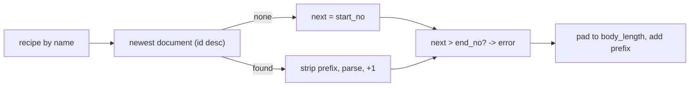

# Settings: Configuration and Document Numbering — Backend

> Part of the Inventory System implementation guide. Read `docs/BRD.md` for the business picture and `docs/backend/backend-setup.md` for how the backend is organised.

## 1. What this is

Two small features that the rest of the system reads from.

**Configuration** is the company settings: name, registration, contact details, the calendar the company works in (BS or AD), whether new invoices round their total, the fiscal year label, and the low stock quantity that triggers alerts. Each setting is one row of name + value, and the user edits the values on one page.

**Document numbering** is the recipe for the numbers every document gets when it is saved (`|PE-000001`, `|SI-000012`): a prefix, a padded body, a start and an end. The user can only read the recipes; the documents' services call this feature to generate the next number.

## 2. Where the code lives

| File | What is in it |
|---|---|
| `features/settings/configuration/controllers/ConfigurationController.java` | `GET /configurations`, `PUT /configurations/edit/{id}`, `PUT /configurations/edit` |
| `features/settings/configuration/services/ConfigurationService.java` | Read all, update one, bulk update, the low stock value check |
| `features/settings/configuration/entities/Configuration.java`, `dtos/ConfigurationDTO.java` | `configuration` table; shape `{id, name, label, value, is_editable}` |
| `features/settings/configuration/repositories/ConfigurationRepository.java` | `findByName` |
| `features/settings/document_numbering/controllers/DocumentNumberingController.java` | `GET /documentNumbering` |
| `features/settings/document_numbering/services/DocumentNumberingService.java` | The list, one `generate...Number()` per document kind, `buildNextNumber` |
| `features/settings/document_numbering/entities/DocumentNumbering.java`, `dtos/DocumentNumberingDTO.java`, `repositories/DocumentNumberingRepository.java` | `document_numbering` table, its shape, `findByName` |
| `common/config/DataInitializer.java` | On start: creates the `admin` user if missing and adds the `low_stock_quantity` setting if missing |
| `security/WebSecurityConfig.java` | Permits `GET /configurations` without a token |
| `common/export/ExportService.java` | Reads the `company_*` and `calendar_type` settings for every file's letterhead |
| `features/notification/services/LowStockService.java` | `SETTING = "low_stock_quantity"` and `threshold(value)`, the parser the validation reuses |

## 3. Data

**`configuration`** (`backend/database.sql`):

| Column | Meaning |
|---|---|
| `id` | Row id, used by the edit endpoints |
| `name` | `TEXT NOT NULL UNIQUE`: the fixed key code reads (`company_name`) |
| `label` | What the page shows (`Company Name`) |
| `value` | `TEXT`. Every setting is text: booleans are `1` / `0`, numbers are digits, blank is allowed |
| `is_editable` | `INTEGER DEFAULT 1`; the API refuses to change a row with `0`. Nothing in the API sets it; it is a database-level lock |

Seeded rows and who reads them:

| `name` | Seed value | Read by |
|---|---|---|
| `company_name`, `company_reg_type` (`PAN` / `VAT`), `company_reg`, `company_contact`, `company_address`, `company_email` | `Test Pvt. Ltd.`, `PAN`, ... | `ExportService`: the letterhead of every PDF and Excel file |
| `calendar_type` | `BS` | `ExportService`: the calendar of a file's dates when the request sends no `calendar` param (`BS` means Bikram Sambat, anything else AD). The web app does not read it: each list and report page has its own AD/BS switch (BS by default) and sends that choice as `calendar` with every Print and Export |
| `default_rounding` | `1` | Nothing reads it yet, on the server or in the web app: the document forms start with "Rounding Amount" on regardless. The settings page stores it and shows a hint describing the intended effect |
| `fiscal_year` | `2081` | Nothing reads it; shown and edited on the settings page only |
| `low_stock_quantity` | `10` | `LowStockService`: alert when a product's total stock is at or below it; blank turns alerts off |

**`document_numbering`**:

| Column | Mapped by the entity? | Meaning |
|---|---|---|
| `id`, `name` | yes | `name` is the document kind the code looks up: `Purchase Entry`, `Sales Entry`, ... |
| `prefix` | yes | Text put before the number, e.g. `|PE-` |
| `body_length` | yes | Digits in the numeric part, zero-padded (`6` → `000001`) |
| `start_no`, `end_no` | yes | First number, and the highest allowed |
| `start_date`, `end_date`, `numbering_style`, `total_length` | no | Columns that exist but nothing uses; `numbering_style` is in the DTO but always `null` |

Seeded recipes: `Purchase Entry` `|PE-`, `Purchase Return` `|PR-`, `Sales Entry` `|SI-`, `Sales Return` `|SR-`, `Stock Adjustment` `|SA-`, `Journal Entry` `|J-`, `Payment` `|P-`, all with body 6, start 1, end 999999. Three more rows (`Purchase Order` `|PO-`, `Sales Order` `|SO-`, `BDE` `|BDE-`) are seeded but no feature uses them.

Each master document table has `system_entry_no TEXT UNIQUE NOT NULL`, which is where the generated number is stored.

## 4. API

| Method | Path | What it does | Permission |
|---|---|---|---|
| `GET` | `/configurations` | Every setting | **none, no token needed** |
| `PUT` | `/configurations/edit/{id}` | Change one setting's value; `"Configuration updated successfully"`, `post_data_id` = id | `EditConfiguration` |
| `PUT` | `/configurations/edit` | Change several (a list, each with its `id`); `"Configurations updated successfully"`, `post_data_id` = 0 | `EditConfiguration` |
| `GET` | `/documentNumbering` | Every numbering recipe | `ViewDocumentNumbering` |
| `GET` | `/purchase/generateNumber` (and `/purchase-return`, `/sales`, `/sales-return`, `/payment`, `/stock-adjustment`, `/journal`) | A preview of the next number, as a plain string | that document's `Create...` operation, e.g. `CreatePurchaseEntry` |

The controller method is annotated with `@RequiresOperation("EditConfiguration")` and so on; `GET /configurations` has no annotation and `WebSecurityConfig` lists it as `permitAll` for `GET` only. Full shapes: `backend/endpoints.md` section 3.

Request body for an edit: the full row `{ "name", "label", "value", "is_editable" }` (and `id` in the list form), but **only `value` is used**; the others are ignored. There is no endpoint that edits document numbering; change the rows in the database.

## 5. How it works

### 5.1 Reading the settings

`findAll()` mapped to `{id, name, label, value, is_editable}`, in table order. The endpoint needs no token (`WebSecurityConfig` permits `GET /configurations`), so anything in this table is readable by anyone who can reach the API. Don't put secrets in it.

### 5.2 Updating one setting

**Idea.** A setting is identified by its row id; the body is a full row for convenience, but a setting's name and label are fixed, so only the value is taken. The one value with a rule is the low stock quantity, and the check reuses `LowStockService.threshold`, the same parser the alert uses, so "what the API accepts" and "what the alert understands" can't drift apart.

```
updateOne(id, dto):
  existing = findById(id)                   -> 404 "Configuration not found"
  if not existing.isEditable                -> 400 "Configuration '<name>' is not editable"
  existing.value = validValue(existing, dto.value)
  save; respond with id

validValue(setting, value):
  if setting.name == "low_stock_quantity" and value is not blank and threshold(value) == null
      -> 400 "<label> must be a number of 0 or more, or blank"      -- "Low Stock Quantity must be a number of 0 or more, or blank"
  return value                              -- stored as sent, untrimmed

threshold(value):  blank -> null (alerts off); parse as double; finite and >= 0 -> the number; else null
```

**Rules checked.** The three messages above. Any other setting accepts any text, including blank.

### 5.3 Updating several

**Idea.** The settings page saves all its fields in one request. The bulk update runs in one transaction (`@Transactional`), so either every setting changes or none does: a bad low stock value leaves the company name unchanged too.

```
bulkUpdate(list):                           -- one transaction
  for each dto:
      existing = dto.id > 0      ? findById(dto.id)     -> 404 "Configuration not found: <id>"
               : dto.name given  ? findByName(dto.name) -> 404 "Configuration not found: <name>"
               :                                        -> 404 "Configuration id or name is required"
      if not editable                                   -> 400 "Configuration '<name>' is not editable"
      existing.value = validValue(existing, dto.value)
      save
```

### 5.4 Start-up seeding

`DataInitializer` is a `CommandLineRunner`, so it runs once after the application context is ready:

```
on start:
  if no user "admin" and no user with email admin@admin.com: create admin (password Admin@123, role Admin)
  if no configuration named "low_stock_quantity":
      insert { name "low_stock_quantity", label "Low Stock Quantity", value "10" }   -- is_editable defaults to true
```

Why: the setting was added after the first databases existed. `database.sql` seeds it for new databases; the initializer adds it to old ones so the alert code can always find its row.

### 5.5 Listing the numbering recipes

`GET /documentNumbering`: `findAll()` mapped to `{id, name, prefix, body_length, start_no, end_no, numbering_style}`; `numbering_style` is never set, so it is `null`.

### 5.6 Generating the next number

**Idea.** The next number is "the last saved number plus one", formatted by the recipe. There is no counter column: the service reads the newest document of that kind (highest id), strips the prefix, parses what is left and adds one. That means nothing has to be kept in sync with the documents table, and a fresh database simply starts at `start_no`.

One public method per document kind, all the same shape:

| Method | Recipe `name` | Last number from |
|---|---|---|
| `generatePurchaseNumber()` | `Purchase Entry` | `MasterPurchaseEntryRepository.findTopByOrderByIdDesc()` |
| `generatePurchaseReturnNumber()` | `Purchase Return` | `MasterPurchaseReturnRepository.findTopByOrderByIdDesc()` |
| `generateSalesNumber()` | `Sales Entry` | `MasterSalesEntryRepository.findTopByOrderByIdDesc()` |
| `generateSalesReturnNumber()` | `Sales Return` | `MasterSalesReturnRepository.findTopByOrderByIdDesc()` |
| `generatePaymentNumber()` | `Payment` | `MasterPaymentRepository.findTopByOrderByIdDesc()` |
| `generateStockAdjustmentNumber()` | `Stock Adjustment` | `MasterStockAdjustmentRepository.findTopByOrderByIdDesc()` |
| `generateJournalNumber()` | `Journal Entry` | `MasterJournalEntryRepository.findTopByOrderByIdDescJournal()`: the newest journal **not** posted by a purchase, sale, return or payment and not the `OPENING-BALANCE` row, since those don't carry `|J-` numbers |

```
generatePurchaseNumber():
  pref = documentNumberingRepository.findByName("Purchase Entry")
             -> RuntimeException "Document numbering not found for Purchase Entry"   (a 500)
  last = newest master_purchase_entry row, or none
  return buildNextNumber(pref, last.system_entry_no or null)

buildNextNumber(pref, lastNumber):
  next = pref.start_no
  if lastNumber != null and pref.prefix != null:
      numeric = lastNumber with the prefix removed        -- "|PE-000006" -> "000006"
      next = parseInt(numeric) + 1                        -- a non-numeric remainder is ignored: next stays start_no
  if next > pref.end_no   -> IllegalStateException "Document number has exceeded the configured end number."  (a 500)
  body = next zero-padded to pref.body_length             -- String.format("%06d", 7) -> "000007"
  return (prefix or "") + body                            -- "|PE-000007"
```



**Preview and save.** Each document controller has `GET /<document>/generateNumber`, gated on the document's `Create...` operation, which calls the same method so the form can show the number before saving. The save does **not** trust that preview: the service calls `generate...Number()` again inside its own transaction and stores the result in `system_entry_no`. If someone else saved in between, the stored number is one higher than the preview. Because `system_entry_no` is `UNIQUE`, two saves that somehow compute the same number end in a database error rather than a duplicate.

**Why the leading `|`.** A document number is `<fiscal-year part>|<prefix><number>`, like `2082-83|PE-000005`. No fiscal-year part is ever set, so numbers start with `|`. The web app's `docNo` pipe and the backend's `Formats.docNo` split on `|`, drop empty parts and join with ` | ` for display, while the stored value, with the `|`, is what every API call sends and receives.

## 6. Design decisions and gotchas

- **Settings are one table of name/value rows, not columns.** Adding a setting is an `INSERT`, not a migration, and the settings page renders whatever rows come back (the web app has a field definition per known name and a plain text field for the rest).
- **`is_editable` is a lock only the database can set.** The API never changes it; flip it to `0` by hand to freeze a value.
- **Values are text.** `default_rounding` is `"1"` / `"0"`, `low_stock_quantity` is digits or blank. Readers parse; the API validates only the low stock one.
- **`calendar_type` is the only setting the server reads for behaviour** besides the letterhead and the low stock quantity, and only as the fallback calendar for exported files. Everything else about BS/AD is decided in the browser.
- **The last number is the newest row, not the highest number.** Delete the newest purchase and the next purchase reuses its number; delete an older one and the gap stays. Sales are never deleted, only cancelled, so invoice numbers stay continuous, which is one reason sales use cancel instead of delete.
- **Numbers are per kind, not per fiscal year.** With `end_no` 999999 and no year part, a recipe simply counts on forever until the end number, at which point every save of that kind fails with a 500 until the row is edited.
- **Only the prefix is stripped.** `lastNumber.replace(prefix, "")` must leave pure digits. Editing a recipe's prefix after documents exist makes the parse fail silently and the next number restarts at `start_no`, which then collides with the `UNIQUE` number. Change prefixes only on an empty kind.
- **Unchecked exceptions here are 500s.** A missing recipe row or an exhausted range throws `RuntimeException` / `IllegalStateException`, which `GlobalExceptionHandler` reports as a 500 with the message.
- **No numbering edit API** and no read of `start_date`, `end_date`, `numbering_style`, `total_length`. They are there for a future per-period numbering that was never built.

## 7. Build it yourself: order of work

1. **Tables**: `configuration` (`name UNIQUE`, `label`, `value`, `is_editable`) with the ten seed rows of section 3; `document_numbering` with the recipes, and `system_entry_no TEXT UNIQUE NOT NULL` on every master document table.
2. **Entities and repositories**: `Configuration` + `ConfigurationRepository.findByName`; `DocumentNumbering` (map only `name`, `prefix`, `body_length`, `start_no`, `end_no`) + `DocumentNumberingRepository.findByName`.
3. **DTOs**: `ConfigurationDTO` (snake case, `is_editable`), `DocumentNumberingDTO` (`numbering_style`, `body_length`, `start_no`, `end_no`).
4. **`ConfigurationService`**: `getConfigurations`, `updateConfiguration`, `bulkUpdate` (`@Transactional`), `validValue` using the low stock parser; write `LowStockService.threshold` (or a copy) first if notifications don't exist yet.
5. **`ConfigurationController`**: `GET /configurations` with no operation; the two `PUT`s with `@RequiresOperation("EditConfiguration")`. Add `.requestMatchers(HttpMethod.GET, "/configurations").permitAll()` to the security config.
6. **`DocumentNumberingService`**: `getDocumentNumberings`, `buildNextNumber`, and one `generate...Number()` per document kind as you build each document feature; each needs a `findTopByOrderByIdDesc()` on that master repository (the journal's custom query).
7. **`DocumentNumberingController`**: `GET /documentNumbering` with `@RequiresOperation("ViewDocumentNumbering")`; add `EditConfiguration` and `ViewDocumentNumbering` to the operation seed and the Admin role.
8. **`DataInitializer`**: a `CommandLineRunner` that seeds the admin user and the missing `low_stock_quantity` row.
9. **Try it**: `GET /configurations` without a token; `PUT /configurations/edit/10` with `"value": "abc"` and expect the 400; `PUT /configurations/edit` with two rows; `GET /documentNumbering`; `GET /purchase/generateNumber` → `|PE-000001`, save a purchase, call it again → `|PE-000002`.
