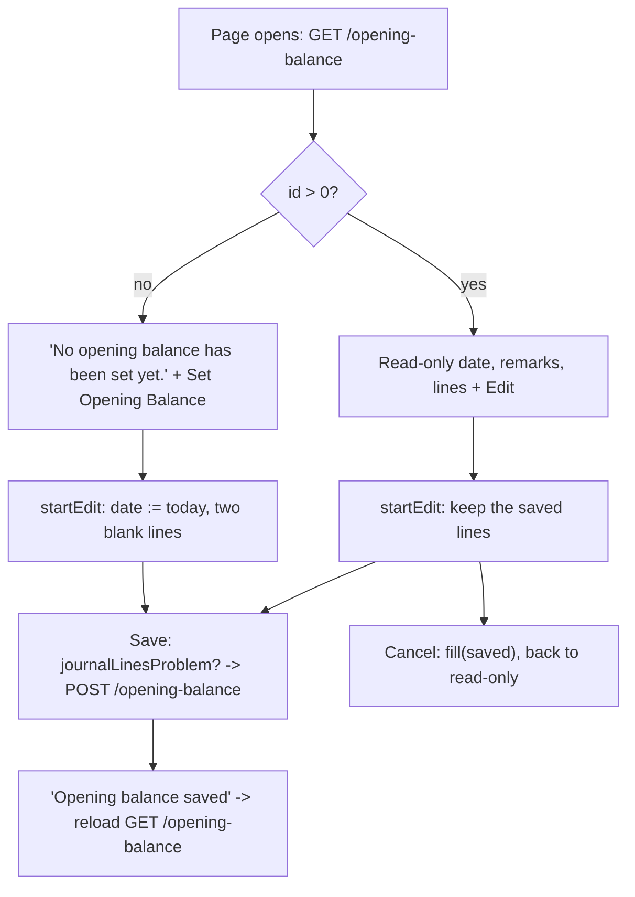

# Accounting (Chart of Accounts, Journal Entries, Opening Balance) — Frontend

> Part of the Inventory System implementation guide. Read `docs/BRD.md` for the business picture and `docs/frontend/frontend-setup.md` for how the web app is organised.

## 1. What this is

Three pages under `/accounting` that look after the books themselves rather than documents:

- **Chart of Accounts** (`/accounting/accounts`): the list of accounts money is posted to (Cash, Sales, a bank, a vendor's payable account, …). The user adds, edits and deletes the accounts they created; system accounts and the accounts that belong to a vendor or customer are shown but locked.
- **Journal Entries** (`/accounting/journal`): manual accounting entries for things that are not a purchase, sale or payment, like a fuel bill paid in cash. Each line debits *or* credits one account, and the entry must balance.
- **Opening Balance** (`/accounting/opening-balance`): the one journal that holds the balances the accounts started with. It is edited in place, and saving replaces the whole thing.

Journal Entries and Opening Balance share one lines table and one set of rules, so the user learns them once.

## 2. Where the code lives

All paths are under `frontend/src/app/features/accounting/`.

| File | What is in it |
|---|---|
| `accounting.routes.ts` | `ACCOUNTING_ROUTES`: `accounts`, `journal`, `payments`, `payment-adjustment`, `opening-balance`; each guarded by `permissionGuard` with its View operation. `''` redirects to `accounts`. No child routes: every form is a drawer. |
| `account/account.model.ts` | `Account`, `AccountPayload`, `AccountTypeGroup`, `AccountOwner` (`system` / `vendor` / `customer`), `AccountFormData`. |
| `account/account.service.ts` | `AccountService`: `list`, `types`, `parents(type)`, `create`, `update`, `delete` on `/accountMaster`. |
| `account/account-list/` | `AccountList`: the paged table, owner chips, delete. |
| `account/account-form/` | `AccountForm`: add/edit in a 400px right drawer. |
| `journal/journal.model.ts` | `Journal`, `JournalLine`, `JournalPayload`, `JournalFormMode`, `JournalFormData`. |
| `journal/journal.service.ts` | `JournalService`: `list`, `get`, `nextNumber`, `create`, `update`, `delete`, `exportList`, `exportOne` on `/journal`. |
| `journal/journal-lines.ts` | The shared line logic: `JournalLineForm`, `createJournalLine`, `journalTotals`, `journalLinesProblem`, `toJournalLines`. |
| `journal/journal-lines-table/` | `JournalLinesTable`: the Account / Narration / Debit / Credit table with its totals row. |
| `journal/journal-list/` | `JournalList`: manual journals, with date range, print and export. |
| `journal/journal-form/` | `JournalForm`: add / edit / view in the bottom drawer. |
| `opening-balance/opening-balance.service.ts` | `OpeningBalanceService`: `get`, `save` on `/opening-balance`. |
| `opening-balance/opening-balance-form/` | `OpeningBalanceForm`: the page itself (read-only until Edit). |

Shared pieces used: `LIST_PAGE_CARD`, `DateText`, `AmountTotals`, `DocNoPipe`, `AmountPipe`, `DropdownService` (`accounts(...)`), `FileDownloads`, `withMissing` (`shared/utils/options.ts`), `round2` (`shared/utils/invoice.ts`), `toIsoDate` / `fromIsoDate` / `startOfToday` (`shared/utils/date.ts`), `apiErrorMessage`. The API shapes are in `backend/endpoints.md` sections 8 (accounts) and 13 (journals and opening balance).

## 3. Screens

### 3.1 Chart of Accounts list

| Column | Shows | Sorts by (backend field) |
|---|---|---|
| S.N | Running number across pages (`01`, `02`, …) | — |
| Account Name/Code | The name (a link that opens edit when the user may edit), then the code or `No code`, plus an owner chip: **System**, **Vendor** or **Customer** | `accountName` |
| Account Type | The type, with its heading (Assets, Liability, …) underneath | `accountType` |
| Parent Account | `parent_account_name` or `-` | `parentAccountName` |
| Status | `ACTIVE` / `INACTIVE` chip | `isActive` |
| Actions | A menu with Edit and Delete | — |

Filters (`l-filter`): the search box sends `accountName`; the filter columns are Account Code (`accountCode`), Account Type (`accountType`, a select grouped by heading, built from `GET /accountMaster/getAccountTypes`), Parent Account (`parentAccountName`) and Status (`isActive`, sending `1` or `0`). Account type is the one filter the API matches on the whole name. Default sort is `id:desc`; page size 10.

Buttons and their permissions: **Add Account** needs `CreateAccountMaster`; the name link and **Edit** need `EditAccountMaster`; **Delete** needs `DeleteAccountMaster` *and* `canDeleteRow(row)` (see 4.2). The actions column is only added when the user can edit or delete.

### 3.2 Account form (400px right drawer)

Opened with `AccountFormData` (`record` to edit, none to add; `owner` when the account is a system, vendor or customer account). Title `Add Account` / `Edit Account`.

| Field | Control | Rule |
|---|---|---|
| Account Name | text | required |
| Account Code | text | required (the API treats a missing code as a duplicate of the other accounts without one) |
| Account Type | searchable select grouped by heading (`bindValue` is the type name) | required; picking another type clears the parent |
| Parent Account | clearable select of `GET /accountMaster/getParentAccount/{type}` | placeholder `Select an account type first` until a type is picked, then `No parent`; hint "Only system accounts of the same type can be a parent." |
| Remarks | textarea | optional |
| Active | toggle, default on | hint "Inactive accounts are left out of dropdowns." |

When `owner` is set, a lock note shows and the name, type and parent are disabled:

- system: "System account. The app relies on its name, type and parent, so they can't be changed."
- vendor / customer: "… account. Its name, type and parent follow the vendor and are reset whenever the vendor is saved." (same text with *customer*).

Footer: Cancel, and Add / Update (`Saving…` while the request runs).

### 3.3 Journal Entries list

| Column | Shows | Sorts by |
|---|---|---|
| S.N | running number | — |
| Journal Number | `system_entry_no` through the `docNo` pipe, a link that opens **view** | `systemEntryNo` |
| Date | `<app-date-text>` in the page's AD/BS calendar | `date` |
| Remarks | or `-` | `remarks` |
| Accounts | `Dr` the names of the debited accounts, `Cr` the credited ones | — |
| Amount | the sum of the debits (which equals the credits) | — |
| Actions | View; Edit (`EditJournalEntry`); Delete (`DeleteJournalEntry`) | — |

Title bar: search by `remarks`, a Journal No filter (`systemEntryNo`), an AD/BS segmented control, From and To dates (both default to today), **Print** and **Export**, and **Add Journal Entry** (`CreateJournalEntry`).

### 3.4 Journal form (bottom drawer)

Opened near full screen (`position: 'bottom'`, `size: 'calc(100vh - 48px)'`, `panelClass: 'drawer-sheet'`, `disableClose: true`) with `JournalFormData { mode, id?, calendar? }`. Headings: `Add Journal Entry`, `Edit Journal Entry`, `Journal Entry` (view).

- A card with the **Date** (required, defaults to today) and a **Journal Number** chip (`entryNo`: the preview from `GET /journal/generateNumber` when adding, the saved number otherwise).
- **Account Details**: an **Add Account** button and the `JournalLinesTable`.
- **Remarks** textarea ("What this entry is for").
- Footer: view mode shows Close and, with `EditJournalEntry`, **Edit** (switches the same drawer to edit); add/edit modes show Cancel and Add / Update. View mode also offers **Print** and **Export** in the header.

`JournalLinesTable` columns: S.N, Account (searchable select), Narration (placeholder `Same as remarks`), Debit, Credit (number inputs with 2 decimals) and a remove button (hidden in view mode). Under it, `AmountTotals` shows **Total Debit**, **Total Credit** and **Difference**, the last in red while it isn't zero. In view mode an unused side shows `-`.

### 3.5 Opening Balance page

Not a list: the route loads `OpeningBalanceForm` itself, a card with a header and the same lines table.

- Header subtitle: "The balances your accounts had when you started using the system", or "Saving replaces the whole opening balance" while editing.
- Read-only by default. With `CreateOpeningBalance` the header shows **Set Opening Balance** (nothing saved yet) or **Edit**. While editing it shows Cancel and Save.
- Body: "No opening balance has been set yet." when none is saved and not editing; otherwise **Date** (BS calendar), **Remarks** (placeholder `e.g. Opening balance FY 2083/84`), the **Account Balances** section with Add Account and the lines table.
- A load failure shows the message with a **Try again** button.

## 4. How it works

### 4.1 Loading the account list

**Idea.** Query state lives in signals (`filters`, `sort`, `pageIndex`, `pageSize`, `refresh`); a `computed` request feeds `toObservable` + `switchMap`, so changing any of them refetches and a stale response is dropped. The rows are only replaced when the next page arrives, so the table never flashes empty.

```
request = computed: { pageIndex, pageSize, each filter as params[field], sort: SORT_FIELDS[key]:direction or "id:desc", refresh }
on request change:
  loading := true
  GET /accountMaster?params
  ok    -> rows := page.content, total := page.totalElements, loadError := ""
  error -> rows := [], loadError := apiErrorMessage(error, "Could not load accounts.")   (shown as the table's empty text)
```

Three lookups load once, quietly (a failure just leaves the list without them): the type groups (for the headings and the type filter), and the ids of vendor and customer accounts from `GET /dropdown/accountMaster/party/vendor/all` and `.../party/customer/all`. `ownerOf(row)` is `system` when `is_system_generated`, else `vendor` / `customer` when the id is in one of those sets, else nothing.

### 4.2 Deleting an account

**Idea.** The API will delete a vendor's or customer's account, but the party still needs it, so the list hides Delete for those as well as for system accounts: `canDeleteRow = canDelete && row.deletable && !ownerOf(row)`.

```
Delete -> ConfirmDialog "Delete account?" / 'Account "<name>" will be deleted. This cannot be undone.'
  confirm -> DELETE /accountMaster/{id}
    error -> notification "Could not delete" + API message, dialog stays
    ok    -> notification "Account deleted"; if it was the last row of a page > 0, step back a page, else reload
```

API refusals the user can still hit: `"Selected Account cannot be deleted"` (system), `"Selected Account belongs to a vendor or customer; delete them instead"`, and a **409** when journal lines use the account.

### 4.3 Opening and saving the account form

**Idea.** The row is handed over in `DRAWER_DATA`, so only the lookups load: the types once, and the parent list each time the type changes (`switchMap` on the type control). Parents are tied to a type, so a type change clears `parent_id`. The saved parent may be inactive and missing from the active-only parent list; `withMissing` adds it back, but only while the type is still the saved one. An account is also filtered out of its own parents.

```
save():
  form invalid -> markAllAsTouched; warn "Missing details" / "Fill in the fields highlighted in red."
  value = form.getRawValue()                      -- raw: locked fields are disabled
  parent = parentOptions.find(parent_id)
  payload = { account_code trimmed, account_name trimmed, account_type,
              parent_id: parent.id or 0, parent_account_name: parent.name or null,
              is_active, deletable: record.deletable or true, remarks trimmed or null }
  editing ? PUT /accountMaster/{id} : POST /accountMaster
  ok    -> success "Account updated" / "Account added"; drawer closes with true; list reloads
  error -> error "Could not save" + API message; drawer stays open
```

`deletable` is sent back because the API stores it as sent: a system account must say again that it can't be deleted. API messages: `"Duplicate Account Code"` (409), `"Account Name cannot be null or blank"`, `"Account Type cannot be null or blank"`.

### 4.4 Journal lines: one debit or credit per line

**Idea.** A journal line moves money one way. Instead of validating "both filled" after the fact, typing on one side clears the other (`onDebit` / `onCredit` in the table), so the form can never show a line with both. Saved lines carry `0` on the unused side; `createJournalLine` turns that `0` into a blank (`|| null`) so the table looks the same for new and loaded lines.

`journalLinesProblem(lines)` is the one check both forms run before saving; it returns a title and message to show, or `null`:

| Condition | Title | Message |
|---|---|---|
| no lines | No accounts | Add the accounts to debit and credit. |
| a line with both sides, or neither | Check the amounts | Each line needs either a debit or a credit amount, not both. |
| `journalTotals(lines).difference !== 0` | Not balanced | Total debit and total credit must be equal. |

`journalTotals` sums each side with `round2` (to the paisa) and returns `{ debit, credit, difference: debit − credit }`; the table's totals row is computed from it. `toJournalLines(lines, fallback)` builds `journalEntries`: blank sides become `0`, and a blank narration becomes `fallback`, because the ledger report shows line narrations rather than the journal's remarks.

### 4.5 Opening the journal form (add / edit / view)

```
constructor:
  mode != add and id given -> load(id)
  else -> mode := add; add two lines (a journal debits one account and credits another at the least);
          GET /journal/generateNumber -> entryNo (a failure just leaves the chip out)

load(id): GET /journal/{id}
  ok    -> fill: entryNo := system_entry_no; savedAccounts := each line's {id, name};
           rebuild the lines FormArray from journalEntries; patch date (fromIsoDate) and remarks; markAsPristine
  error -> "Could not load the journal"; close the drawer
```

State: `form` (date, remarks, `lines` FormArray) plus a `lines` signal holding the same groups so the table re-renders on add/remove; `value` = `toSignal(form.valueChanges → getRawValue())`; `totals = computed(journalTotals(value().lines))`; `accountOptions = withMissing(active accounts from GET /dropdown/accountMaster/all/all/active, savedAccounts)` so an account that went inactive still shows its name; `readonly = mode === 'view'`; `canEdit = hasOperation('EditJournalEntry')`. View switches to edit in place with `startEdit()`.

### 4.6 Saving a journal

```
save():
  form invalid (date or an account missing) -> "Missing details"
  problem = journalLinesProblem(lines) -> warn(problem.title, problem.message); stop
  remarks = trimmed or null
  payload = { date: toIsoDate(date), remarks, journalEntries: toJournalLines(lines, remarks) }
  mode == edit ? PUT /journal/{id} : POST /journal
  ok    -> "Journal added" / "Journal updated"; close with true; list reloads
  error -> "Could not save" + API message
```

The API checks the same rules again (`"Journal requires at least one account line"`, `"Debit and credit amounts cannot be negative"`, `"Journal total cannot be zero"`, `"Journal debits and credits must be equal"`), and refuses to touch journals a document posted (`"This journal was posted by a purchase, sale, return or payment; change that document instead"`) or the opening balance (`"This journal is the opening balance; change it from the opening balance"`). `GET /journal` never lists those, so the UI can't reach them from here.

### 4.7 Deleting a journal

Delete (needs `DeleteJournalEntry`) opens a ConfirmDialog, "Delete journal entry?" / "`<number>` will be deleted and its amounts taken out of the accounts. This cannot be undone.", runs `DELETE /journal/{id}`, shows "Journal deleted", and steps back a page if that was the last row of a page beyond the first.

### 4.8 Opening balance: one record edited in place

**Idea.** There is exactly one opening balance and the API's `POST /opening-balance` replaces it, so the page behaves like the configuration page: load, show read-only, Edit, Save, reload. It reuses the journal line helpers and table unchanged; the only differences are the fallback narration and that the number is fixed (`OPENING-BALANCE`).



```
load():  GET /opening-balance -> saved := it; fill(it)            (id 0 and journalEntries null until set)
         error -> loadError (message + Try again)
startEdit(): if no date -> today; if no lines -> add two; editing := true
cancel():    fill(saved); editing := false
save():
  form invalid -> "Missing details";  journalLinesProblem -> warn and stop
  remarks = trimmed or null
  POST /opening-balance { date, remarks, journalEntries: toJournalLines(lines, remarks ?? "Opening Balance") }
  ok    -> "Opening balance saved"; editing := false; load()   -- shows it as stored (narrations filled in, new line ids)
  error -> "Could not save" + API message ("Opening balance debits and credits must be equal", …)
```

`canEdit` here is `CreateOpeningBalance` (there is no separate edit operation). `isSet = !!saved().id` picks the button label and the empty text.

### 4.9 Print and Export

- The journal list's Print (PDF) and Export (Excel) call `exportList(format, { ...query, calendar })`, where `query` is the list's filters, dates and sort without paging, so the file holds every matching journal, one row per line, with dates in the page's calendar.
- The journal form in view mode calls `exportOne(id, format, { calendar })`: a PDF voucher or an Excel sheet of the lines.
- Both go through `FileDownloads.run`, which allows one download at a time, labels the button `Printing…` / `Exporting…`, and reports a failure as a notification. The account list and the opening balance have no print or export.

## 5. Design decisions and gotchas

- **Typing on one side clears the other** rather than erroring afterwards; the "Check the amounts" rule still exists for lines loaded with both sides or with neither.
- **Blank narration becomes the remarks** (or `Opening Balance`) because the ledger report shows line narrations; without this the ledger would show empty descriptions.
- **Totals are rounded to the paisa** with `round2` before comparing, so `0.1 + 0.2` balances against `0.3`.
- **Account Code is required in the form** although `account_code` can come back `null` on seeded rows: the API's duplicate check treats a missing code as a duplicate of the accounts that have none, so a second codeless account would fail anyway.
- **Owner chips come from dropdown ids, not from the row**: the account row only says `is_system_generated`; which accounts belong to a vendor or customer is learned from the party account dropdowns (`all` status, so inactive parties count too).
- **Locked fields are disabled**, so the payload reads `getRawValue()`, not `value`, or the name would be missing.
- **`deletable` is sent on every save** because the API stores it as sent.
- The journal list's dates default to **today**; a user looking for older entries must widen the range.
- The opening balance page **reloads after saving** instead of trusting the form: the API fills in narrations and assigns line ids, and the page should show what is stored.
- Drawers use `disableClose: true`, so only the form's own buttons close them and a backdrop click never throws away edits.

## 6. Build it yourself: order of work

1. Add the `/accounting` child routes with `permissionGuard` and the View operations; add the sidebar links with the same operations.
2. Write `account.model.ts` and `AccountService` against section 8 of `endpoints.md`.
3. Build `AccountList` with the shared list card: signals → computed request → `toObservable` + `switchMap`; map column keys to backend sort fields; add the type-group and party-account lookups for headings and owner chips.
4. Build `AccountForm` in a 400px right drawer: type select grouped by heading, parent list reloaded on type change, lock note for owned accounts, `withMissing` for the saved parent.
5. Wire delete with `ConfirmDialog`, `canDeleteRow`, and the step-back-a-page rule.
6. Write `journal.model.ts`, `JournalService` (including `nextNumber`, `exportList`, `exportOne`) and `journal-lines.ts`; unit-test `journalTotals`, `journalLinesProblem`, `toJournalLines` first (see `journal-lines.spec.ts`).
7. Build `JournalLinesTable` (inputs `lines`, `accounts`, `totals`, `readonly`; output `remove`) with the clear-the-other-side handlers and `AmountTotals`.
8. Build `JournalForm` in the bottom drawer with the three modes, the number preview, `withMissing` for saved accounts, and `FileDownloads` for view-mode Print/Export.
9. Build `JournalList` with the calendar switch, date range, print/export and delete.
10. Write `OpeningBalanceService` and `OpeningBalanceForm` reusing steps 6–7: load, Edit/Cancel/Save in place, reload after save.
11. Log in as `admin`, add an account, post a balanced journal, set the opening balance, then check the ledger report shows the narrations.
