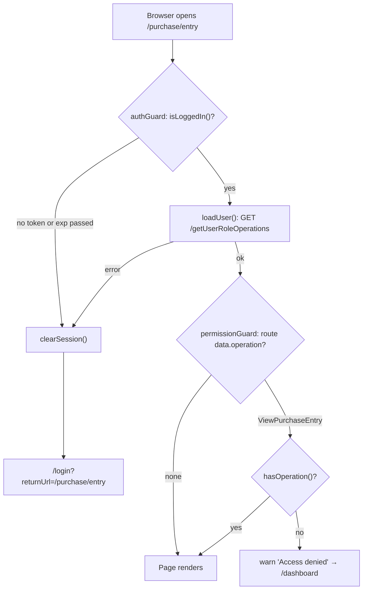

# Authentication — Frontend

> Part of the Inventory System implementation guide. Read `docs/BRD.md` for the business picture and `docs/frontend/frontend-setup.md` for how the web app is organised.

## 1. What this is

Everything the web app does to know *who* is using it and *what* they may do. The user logs in once; the app keeps the JWT (a signed login token the browser sends on every request) in `localStorage`, loads the user's permitted operations, sends the token on every API call, hides pages and buttons the role lacks, and sends the user back to the login page when the token stops working. It also holds the Change Password page, which any signed-in user may open.

## 2. Where the code lives

All of it is under `frontend/src/app/auth/`.

| File | What is in it |
|---|---|
| `auth.service.ts` | `AuthService`: the token, the signed-in user, `hasOperation`, login, logout, session expiry, avatar loading |
| `auth-guard.ts` | `authGuard`, `guestGuard`, `permissionGuard` (route guards) |
| `auth-interceptor.ts` | `authInterceptor`: adds the Bearer header, ends the session on token errors, parses Blob error bodies |
| `auth.model.ts` | `LoginRequest`, `LoginResponse`, `UserRoleOperations` (the API shape), `AuthUser` (the app shape), `ChangePasswordRequest` |
| `login/` | The `/login` page (`Login`) |
| `change-password/` | The `/change-password` page (`ChangePassword`) |
| `auth.testing.ts` | Spec helpers `testUser()` and `testToken()` |
| `../shared/utils/password.ts` | `STRONG_PASSWORD`, the new-password rule shared with the API |
| `../app.routes.ts` | Wires the guards: `''` → `Layout` with `authGuard`, `login` with `guestGuard`, `**` → `dashboard` |
| `../app.config.ts` | `provideHttpClient(withInterceptors([authInterceptor]))` |

The API side is section 2 of `backend/endpoints.md`: `POST /login`, `GET /getUserRoleOperations`, `PUT /change-password`.

## 3. What it provides

**`AuthService`** (a singleton `@Service()`):

| Member | What it does |
|---|---|
| `user` | Signal: the `AuthUser`, or `null` until loaded / after logout |
| `getToken()` | The stored token, or `null` when there is none or its `exp` has passed |
| `isLoggedIn()` | `getToken() !== null` |
| `hasOperation(name)` | Whether the role grants a backend operation such as `CreatePurchaseEntry`. Given a list, whether it grants *any* of them |
| `login(credentials)` | `POST /login`, stores the token, then loads the user |
| `loadUser()` | `GET /getUserRoleOperations` once per session; later calls reuse the result |
| `refreshUser()` | Fetches the user again (after editing your own role or account) so menus and header follow |
| `changePassword(request)` | `PUT /change-password` |
| `logout()` | Forgets the session and goes to `/login` |
| `expireSession()` | Called by the interceptor: forgets the session, warns, goes to `/login` with a `returnUrl` |
| `clearSession()` | Forgets the token and user without navigating |

**Guards** (`CanActivateFn`): `authGuard` on the shell route, `guestGuard` on `/login`, `permissionGuard` on every feature route that declares `data.operation`.

**Interceptor**: `authInterceptor`, registered once in `app.config.ts`.

**Pages**: `Login` (`/login`) and `ChangePassword` (`/change-password`, inside the shell, opened from the profile menu).

**Models**: the API answers `GET /getUserRoleOperations` with snake_case fields (`role_name`, `image_url`, `master_modules`, `operations`, …); `toAuthUser` maps them to the camelCase `AuthUser` the app uses (`fullName`, `role`, `roleId`, `masterModules`, `operations`, plus `avatarUrl` once the picture loads).

**Spec helpers** (`auth.testing.ts`): `testUser(overrides)` returns a signed-in `AuthUser` (`id: 1`, `username: 'admin'`, no operations unless you pass some), and `testToken(expiresInSeconds = 3600)` builds a fake three-part JWT whose payload carries `sub` and an `exp` that many seconds from now (negative for an expired one). The signature is the literal word `signature`; the app never verifies it, so specs can set any token into `localStorage` under `auth_token`.

## 4. How it works

### 4.1 Logging in

**Idea.** The login page is the only page outside the shell. It posts the credentials, and the service does the rest: store the token, load the user, then the page navigates to where the guard sent it from.

```
Login.submit():
  if submitting: return
  if form invalid (username or password blank): markAllAsTouched; return
  submitting = true; error = ''
  auth.login({ username, password })                   -- POST /login → { token }
      tap: setToken(token)                             -- localStorage 'auth_token' + token signal
      switchMap: loadUser()                            -- GET /getUserRoleOperations (see 4.2)
  on success: router.navigateByUrl(returnUrl())
  on error:   auth.clearSession(); error = apiErrorMessage(error, 'Unable to log in. Please try again.')
  finally:    submitting = false

returnUrl():
  url = query param 'returnUrl'
  return url if it starts with '/' and not with '//', else '/dashboard'
```

The button reads `Logging in…` while the request runs. The error shows in a red alert under the fields; it is the API's `message`, so the user sees exactly what the server decided:

| API answer | Shown |
|---|---|
| 401 `"Username or Password is Incorrect."` | that text |
| 403 `"Account is locked. Try again later."` (after 5 wrong passwords, for an hour) | that text |
| 403 `"User account is inactive."` | that text |
| Server unreachable (status 0) | `Cannot reach the server. Check that the backend is running.` (from `apiErrorMessage`) |

**Rules.** Only in-app paths are honoured as `returnUrl` (never `https://…` or `//evil`), so a crafted link cannot bounce a user off-site after login.

### 4.2 Page load → authGuard → loadUser → permissionGuard

**Idea.** On a fresh page load the app has a token but no user. The shell route's `authGuard` loads the user before any page renders; the feature route's `permissionGuard` then checks the page's operation. Both call `loadUser()`, which runs the request once and shares it, so the two guards never fetch twice.



```
authGuard(route, state):
  toLogin = UrlTree('/login', { returnUrl: state.url })
  if not auth.isLoggedIn(): auth.clearSession(); return toLogin
  return auth.loadUser() → true
         on error: auth.clearSession(); return toLogin

guestGuard():
  return auth.isLoggedIn() ? UrlTree('/dashboard') : true

permissionGuard(route):
  operation = route.data['operation']                  -- a name, a list of names, or nothing
  if none: return true                                 -- e.g. /dashboard, /change-password
  return auth.loadUser() →
      if auth.hasOperation(operation): true
      else: notification.warn('Access denied', 'Your role does not allow this page (<names joined by " or ">).')
            UrlTree('/dashboard')
      on error: UrlTree('/login')

loadUser():
  if user already set: return of(user)
  userRequest ??= fetchUser() with shareReplay(1) and finalize(userRequest = null)
  return userRequest

fetchUser():
  GET /getUserRoleOperations
  tap:  loadAvatar(dto.id, dto.image_url)              -- see 4.6
  map:  toAuthUser(dto)
  tap:  user.set(...)
```

**Why `clearSession()` in `authGuard`'s error path.** If the token exists but the API rejects it, keeping it would make `guestGuard` on `/login` see `isLoggedIn() === true` and bounce straight back to the shell: an endless loop. Dropping the token breaks it.

**Why `shareReplay(1)` and the `??=`.** The shell guard and the child guard run during the same navigation; without sharing, each would fire its own `GET /getUserRoleOperations`. The `finalize` clears the cached observable once it completes or fails so a later `loadUser()` after an error retries instead of replaying the failure.

### 4.3 Checking permissions

`hasOperation` reads a `computed` `Set` of the user's `operations`. With a string it checks membership; with a list it returns true if any one is granted. The list form exists for pages that two roles share: Payments is open to `ViewVendorPayment` *or* `ViewCustomerPayment`, and the Reports link to any report's View operation. Routes put the same value in `data.operation`, sidebar links in `operation`, and buttons call `hasOperation('Create…')` / `'Edit…'` / `'Delete…'` through small `computed` signals (`canCreate`, `canEdit`, `canDelete`).

### 4.4 Sending the token and ending the session

**Idea.** One interceptor adds the header everywhere, so no service thinks about it. The same interceptor is the only place that decides "the session is over", because it sees every failure.

```
authInterceptor(req, next):
  if req.url is not under environment.apiUrl, or is exactly <apiUrl>/login: pass through untouched
  token = auth.getToken()
  request = token ? req with header 'Authorization: Bearer <token>' : req
  return next(request) with catchError(error):
      if error is HttpErrorResponse and error.error is a Blob:
          error = withJsonBody(error)                  -- read the Blob as text, JSON.parse, rebuild the response
                                                       -- (unchanged if the body is not JSON)
      if error is HttpErrorResponse and isSessionError(error): auth.expireSession()
      rethrow error

isSessionError(error):
  status 401                                            → true   (no / bad token: "Please log in to access this resource.")
  message matches /jwt|token|authorization header/i     → true   (403 "The JWT token has expired", 500 "JWT signature does not match…")
  otherwise                                             → false  (403 "Operation not allowed" is a permission error for the caller)
```

**Why parse Blob bodies.** Print and Export call the API with `responseType: 'blob'`. When such a request fails, Angular hands back the error body as a Blob too, so neither `isSessionError` nor the page's `apiErrorMessage(error)` could read `message`. The interceptor rebuilds the `HttpErrorResponse` with the parsed JSON so both work for file downloads exactly as for JSON calls.

### 4.5 Token expiry

`getToken()` refuses a token whose `exp` claim is in the past, so the app logs itself out on the next navigation or request instead of sending a dead token and waiting for a 403. The check reads the JWT without a library:

```
isExpired(token):
  payload = second dot-separated part, with '-' → '+' and '_' → '/'   (base64url → base64)
  { exp } = JSON.parse(atob(payload))
  return exp is a number and exp * 1000 <= Date.now()
  any exception (not a JWT) → true
```

### 4.6 Loading the avatar

`image_url` is a server-relative path such as `/uploads/users/<uuid>.png`, and that endpoint needs the auth header, which an `` cannot send. So after the user loads, the service fetches the picture as a Blob through `HttpClient` (the interceptor adds the header), turns it into an object URL with `URL.createObjectURL`, and stores it as `user.avatarUrl`. It is set only if the user signal still holds the same `id` (the response may arrive after a logout). A failure is ignored: the profile menu shows a placeholder icon. `clearSession()` and `refreshUser()` call `URL.revokeObjectURL` on the previous URL so pictures don't leak.

### 4.7 Refreshing the user

After saving your own user record or your own role, call `refreshUser()`. It fetches again and replaces the `user` signal, so the sidebar, header and every `hasOperation` recompute. The token still names the old username, so renaming yourself needs a new login (the API will reject the old name).

### 4.8 Logging out and session expiry

```
logout():            clearSession(); navigate('/login')

expireSession():                                         -- from the interceptor
  if no token: return                                    -- already gone; several failures arrive at once
  clearSession()
  notification.warn('Session expired', 'Please log in again.')
  returnUrl = the navigation in progress (finalUrl ?? extractedUrl) if any, else router.url
  navigate('/login', { returnUrl }) — the param is omitted when returnUrl is '/'

clearSession():      revoke avatarUrl; localStorage.removeItem('auth_token'); token = null; user = null
```

**Why look at `currentNavigation()`.** When a fresh page load fails inside `authGuard`'s `loadUser()`, `router.url` is still `/` (nothing has rendered). The navigation object knows where the user was heading, so after logging in again they land on that page.

### 4.9 Change Password

**Idea.** The API checks the current password and the strength rule, but the page checks the same things first so the user gets instant feedback, and it adds the "type it twice" check that only the browser can do. The session stays signed in: the token is unchanged.

Fields: `Current Password`, `New Password` (with Lumen's `[showRules]` checklist), `Confirm New Password`. Buttons: `Cancel` (`Location.back()`) and `Change Password` (`Saving…` while running). A hint under the form says five wrong current passwords in a row lock the account for an hour.

State: `saving` signal; `name` computed (`fullName || username`) for the subtitle; `value` = `toSignal(form.valueChanges)`; `newPassword`, `sameAsCurrent` (new typed and equal to current) and `mismatch` (confirm typed and different from new) are `computed` from it.

```
save():
  if saving: return
  markAllAsTouched
  if form invalid or sameAsCurrent or mismatch: return     -- messages already on screen
  PUT /change-password { current_password, new_password }
  on success: notification.success('Password changed', response.message); form.reset()
  on error:   notification.error('Could not change password', apiErrorMessage(error))
```

**Rules checked.**

| Rule | Where | Message |
|---|---|---|
| All three fields required | form validators | Lumen's required marker |
| New password matches `STRONG_PASSWORD` | `Validators.pattern` | the checklist turns green; API: `"New password must be at least 8 characters with upper and lower case letters, a number and a symbol"` |
| New differs from current | `sameAsCurrent` | `Use a password different from the current one.` (API: `"New password must be different from the current password"`) |
| Confirmation equals new | `mismatch` | `The passwords don't match.` |
| Current password correct | API only | 400 `"Current password is incorrect"`, and it counts towards the lock |
| Account not locked | API only | 403 `"Account is locked. Try again later."` |

`STRONG_PASSWORD` is `/^(?=.*[a-z])(?=.*[A-Z])(?=.*\d)(?=.*[^A-Za-z0-9]).{8,}$/`: 8+ characters with a lower-case letter, an upper-case letter, a digit and a symbol. The backend `AuthService.java` compiles the same pattern, so the browser never accepts what the server would refuse.

## 5. Design decisions and gotchas

- **Token in `localStorage`, user in memory.** The token survives a reload (so the user stays signed in for the token's hour); the user and operations are refetched on every load because roles can change between visits.
- **The token is never trusted for permissions.** Operations come from `GET /getUserRoleOperations`, not from the JWT payload; the JWT is only read for `exp`.
- **`readToken()` is wrapped in try/catch** because `localStorage` can throw in private windows or when storage is blocked; the app then simply starts logged out.
- **`/login` is excluded from the interceptor** so a stale token in storage is never sent with a fresh login attempt.
- **A plain 403 is not a logout.** `"Operation not allowed"` means the role lacks a permission; the page shows it with `apiErrorMessage`. Only 401 and messages mentioning the JWT end the session.
- **`expireSession()` is idempotent.** Several requests can fail together when a token dies; the first clears the token, the rest see no token and return.
- **`guestGuard` sends signed-in users to `/dashboard`**, so bookmarking `/login` while logged in just opens the app.
- **Routes without `data.operation` are open to any login**: `/dashboard` and `/change-password`. Every feature list route declares one, with `canActivate: [permissionGuard]`.
- **The avatar is an object URL**, not the API path. Components that show other users' pictures (user list, user form) use `<app-user-avatar>` from `shared/`, which does the same Blob fetch per picture.
- **Specs**: stub `WebSocket` and `localStorage` as needed, set `auth.user.set(testUser({ operations: [...] }))` to grant permissions, and `localStorage.setItem('auth_token', testToken())` to look logged in.

## 6. Build it yourself: order of work

1. Add `apiUrl` to `environments/environment.ts` and define the models in `auth.model.ts` (copy the field names from section 2 of `endpoints.md`).
2. Write `AuthService`: token signal backed by `localStorage` (`auth_token`), `isExpired` from the JWT `exp`, `user` signal, `operations` computed Set, `hasOperation` with string or list.
3. Add `login()` (`POST /login` → store token → `loadUser()`), `loadUser()` with the `??=` + `shareReplay(1)` + `finalize` cache, `fetchUser()` mapping `UserRoleOperations` → `AuthUser`.
4. Add `clearSession()`, `logout()`, `expireSession()` (with `returnUrl` from `currentNavigation()`), `refreshUser()`, then `loadAvatar()` as a Blob → object URL.
5. Write `authInterceptor`: skip non-API and `/login` URLs, add the Bearer header, parse Blob error bodies, call `expireSession()` on `isSessionError`. Register it in `app.config.ts`.
6. Write the three guards and wire them in `app.routes.ts` (`authGuard` on the shell, `guestGuard` on `/login`); put `data.operation` + `permissionGuard` on every feature route.
7. Build the `Login` page: two Lumen inputs with `(enter)`, `submitting` and `error` signals, the safe `returnUrl()`.
8. Build the `ChangePassword` page under the shell: three password inputs, `STRONG_PASSWORD` in `shared/utils/password.ts`, the `sameAsCurrent` / `mismatch` computeds, `PUT /change-password`.
9. Add `auth.testing.ts` (`testUser`, `testToken`) and specs for the service (expiry, `hasOperation` list form), the guards (redirects, the clear-token loop fix) and the interceptor (header, 401, Blob body).
10. Try it: log in as `admin` / `Admin@123`, reload the page (still signed in), set a token with a past `exp` in DevTools (bounced to `/login?returnUrl=…`), open a page your role lacks (warning + `/dashboard`).
