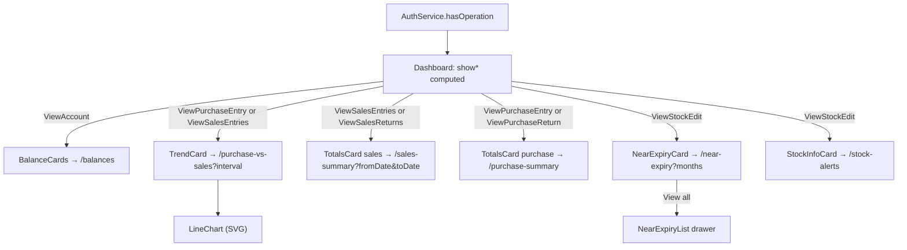

# Dashboard — Frontend

> Part of the Inventory System implementation guide. Read `docs/BRD.md` for the business picture and `docs/frontend/frontend-setup.md` for how the web app is organised.

## 1. What this is

The dashboard is the landing page after login (`/dashboard`, where `/` and unknown paths redirect). It shows the cash balance and what is owed each way, a purchase-against-sales trend, sales and purchase totals over the last few months, the batches about to expire, and the products running low. Every number is summed by the API (section 15 of `endpoints.md`); the page lays the figures out, draws two small SVG charts, and hides whatever the user's role may not see.

## 2. Where the code lives

All under `frontend/src/app/features/dashboard/` unless noted.

| File | What is in it |
|---|---|
| `dashboard.ts` / `.html` | `Dashboard`: the grid, and which cards show for this role |
| `dashboard.model.ts` | The response types (`BalanceSummary`, `PurchaseVsSales`, `SalesSummary`, `PurchaseSummary`, `NearExpiryBatch`, `StockAlerts`, …), `DateRange`, `MONTH_OPTIONS` |
| `dashboard.service.ts` | `DashboardService`: one method per `/dashboard/…` endpoint |
| `figures.ts` | `TREND_INTERVALS`, `pointLabels`, `lastMonths`, `percentChange` |
| `balance-cards/` | `BalanceCards`: cash balance, payables and receivables with the weekly change |
| `trend-card/` | `TrendCard`: Purchase vs Sales by day, week or month |
| `line-chart/` | `LineChart`: the hand-drawn SVG line chart (`niceStep`, `smoothPath`) |
| `totals-card/` | `TotalsCard`: Sales Summary or Purchase Summary tiles (`kind` input) |
| `near-expiry-card/` | `NearExpiryCard`: a ring of expiring batches (`donutSlices`) |
| `near-expiry-list/` | `NearExpiryList`: every expiring batch, in a right drawer |
| `stock-info-card/` | `StockInfoCard`: Minimum Stock / Zero Quantity tabs |
| `dashboard-card.scss` | Card styling shared by every card (title, subtitle, badge tones, error text) |
| `src/styles/colors.scss` | `--chart-1` … `--chart-5`, the series colours |
| `shared/components/date-text/` | `<app-date-text>`: expiry dates, in the BS calendar by default |
| `shared/utils/batch.ts` | `batchName`, `isExpired` |

### API used (section 15 of `backend/endpoints.md`)

| Service method | Endpoint | Permission | Card |
|---|---|---|---|
| `balances()` | `GET /dashboard/balances` | `ViewAccount` | BalanceCards |
| `purchaseVsSales(interval)` | `GET /dashboard/purchase-vs-sales?interval=daily\|weekly\|monthly` | `ViewPurchaseEntry` or `ViewSalesEntries` | TrendCard |
| `salesSummary(range)` | `GET /dashboard/sales-summary?fromDate&toDate` | `ViewSalesEntries` or `ViewSalesReturns` | TotalsCard `kind="sales"` |
| `purchaseSummary(range)` | `GET /dashboard/purchase-summary?fromDate&toDate` | `ViewPurchaseEntry` or `ViewPurchaseReturn` | TotalsCard `kind="purchase"` |
| `nearExpiry(months)` | `GET /dashboard/near-expiry?months` | `ViewStockEdit` | NearExpiryCard |
| `stockAlerts()` | `GET /dashboard/stock-alerts` | `ViewStockEdit` | StockInfoCard |

Inside an endpoint that covers two document kinds, a figure the role may not view comes back `null` (`purchase` without `ViewPurchaseEntry`, `total_sales_return` without `ViewSalesReturns`, `net_sales` without both). Cancelled sales and sales returns count for nothing.

## 3. Screens

The page has no toolbar. Layout, top to bottom:

| Area | Cards | Shown when (`Dashboard` computed) |
|---|---|---|
| `top` → `main` | BalanceCards, TrendCard | `showBalances` = `hasOperation('ViewAccount')`; `showTrend` = any of `ViewPurchaseEntry`, `ViewSalesEntries` |
| `top` → `side` | TotalsCard sales, TotalsCard purchase | `showSales` = any of `ViewSalesEntries`, `ViewSalesReturns`; `showPurchases` = any of `ViewPurchaseEntry`, `ViewPurchaseReturn` |
| `bottom` | NearExpiryCard, StockInfoCard | `showStock` = `ViewStockEdit` (both cards) |

`top` gets class `split` only when both `hasMain` and `hasSide` are true, so a role with one side gets the full width. With nothing at all the page says "Your role has no reports to show here. Use the menu to open the pages you can work with."

### 3.1 Balance cards

Two cards. "Balance Summary" shows `Rs. <cash_balance>` (a skeleton while loading, `-` on error). The second lists Outstanding Payables and Outstanding Receivables, each with the amount and a `+N%` / `-N%` "vs last week" badge with an up, down or flat arrow. The badge is coloured by whether the move is good news: a rise in receivables is `good`, a rise in payables is `bad` (`riseIsGood` per item); a rounded change of 0 is `flat`.

### 3.2 Trend card ("Purchase vs Sales")

A legend (only the lines the role may see), an interval `l-select` (Daily / Weekly / Monthly, default Monthly) and the `LineChart`. Purchase is drawn in `var(--chart-1)`, Sales in `var(--accent)`. Hovering or focusing the chart shows a crosshair, the point's label on the axis, and a tooltip with the period title and each line's amount; arrow keys, Home and End move it. When every value is zero the chart shows "No purchases or sales in this period." over the empty grid.

### 3.3 Totals cards

Title (Sales Summary / Purchase Summary), a period `l-select` from `MONTH_OPTIONS` (1, 3, 6, 12 months; default 6) and the tiles:

| `kind` | Tile | Field | Needs every one of |
|---|---|---|---|
| sales | Total Sales | `total_sales` | `ViewSalesEntries` |
| sales | Total Sales Return | `total_sales_return` | `ViewSalesReturns` |
| sales | Net Sales | `net_sales` | `ViewSalesEntries`, `ViewSalesReturns` |
| purchase | Total Purchase | `total_purchase` | `ViewPurchaseEntry` |
| purchase | Total Purchase Return | `total_purchase_return` | `ViewPurchaseReturn` |

A tile whose figure is `null` shows a skeleton instead of a number.

### 3.4 Near expiry card

A period select (the same `MONTH_OPTIONS`, default 6), a "View all" button, and a ring: the first five batches each get a slice in `--chart-1` … `--chart-5`; any further batches are merged into one grey slice (`--text-quaternary`) named "N more batches". The ring's middle shows the batch count, or the hovered slice's quantity and name. A legend beside it lists each slice: quantity, name, and `<batch> · Exp <date>` or `<batch> · Expired <date>` in red, with "Expiring later" for the merged slice. Empty state: "No batches in stock expire within N months." View all opens `NearExpiryList` in a 560px right drawer with a plain table (S.N, Product, Batch, Expiry Date, In Stock).

### 3.5 Stock information card

A segmented control with two tabs over one table:

| Tab | Rows | Columns | Empty text |
|---|---|---|---|
| Minimum Stock (`low`) | `minimum_stock` | Product Name, Min. Stock, Quantity | "No product is at or below its minimum stock." |
| Zero Quantity (`zero`) | `zero_quantity` | Product Name, Quantity | "Every product has stock." |

## 4. How it works

### 4.1 Deciding what to show

**Idea.** Permissions are checked twice on purpose. The page checks the card's endpoint permission so a forbidden endpoint is never even called (it would be a 403 and an error card). Inside a card, each tile or line checks its own permission so a `null` figure is never rendered as `0`; the API's `null` is the safety net for a client that gets this wrong.

```
Dashboard:    show<Card> = auth.hasOperation(<the endpoint's operations>)        -- a list means any
TotalsCard:   tiles = config.tiles.filter(tile => tile.operations.every(hasOperation))
TrendCard:    lines = LINES.filter(line => hasOperation(line.operation))
```

### 4.2 Loading a card

Every card follows the list-page pattern: a `computed` request from its control signals, `toObservable` + `switchMap`, a `{ result, error }` pair so the subscription never dies, and `apiErrorMessage` for the text. Cards with no controls (`BalanceCards`, `StockInfoCard`) subscribe once in the constructor with `takeUntilDestroyed()`.

```
TotalsCard:
  request = computed({ kind: kind(), range: lastMonths(months()) })
  -> switchMap: kind === 'sales' ? salesSummary(range) : purchaseSummary(range)   (catch 'Could not load the totals.')
  -> totals = result;  figures = tiles.map(tile => { ...tile, value: totals?.[tile.field] ?? null })

TrendCard:
  request = computed({ interval: interval(), lines: lines() })
  -> switchMap: purchaseVsSales(interval)                                          (catch 'Could not load purchases and sales.')
       labels = points.map(point => pointLabels(interval, point))
       chart  = { labels: labels.label, titles: labels.title,
                  series: lines.map(line => ({ name, color, values: points.map(p => p[line.key] ?? 0) })) }
  -> if chart: chart.set(chart)      -- the old chart stays, faded by class `loading`, while the next interval loads

NearExpiryCard:
  toObservable(months) -> switchMap nearExpiry(months)                              (catch 'Could not load stock.')
  -> if batches: batches.set(batches)   -- `null` until first loaded, so the skeleton shows only once

BalanceCards: balances() once -> summary; error -> loadError ('Could not load account balances.')
StockInfoCard: stockAlerts() once -> alerts, loaded = true; rows = tab === 'low' ? minimum_stock : zero_quantity
```

### 4.3 Periods and labels (`figures.ts`)

**The server owns the trend periods.** `interval=daily` is the last 30 days, `weekly` the last 12 weeks (Sunday to Saturday), `monthly` the last 12 months, oldest first and ending with the period holding today. The card only labels the points: `pointLabels(interval, point)` returns an axis label and a tooltip title from `from_date` / `to_date`:

| Interval | Axis label | Tooltip title |
|---|---|---|
| monthly | `Mar` | `March 2026` |
| weekly | `12 Mar` | `12 Mar – 18 Mar 2026` |
| daily | `12 Mar` | `Thu, 12 Mar 2026` |

Month names are a fixed three-letter table because `en-GB` would print `Sept`.

**The summaries take a date range** the card computes with `lastMonths(months)`: from the 1st of the month `months − 1` months ago to today, as `YYYY-MM-DD` via `toIsoDate`. Six months on 3 Nov 2026 is `2026-06-01` to `2026-11-03`. "Today" here is the browser's date; the trend's "today" is the server's.

**Weekly change** uses `percentChange(now, before) = (now − before) / |before| × 100`, or `null` when `before` is within 0.005 of zero, in which case no badge is shown rather than an infinite percent.

### 4.4 The line chart (`LineChart`)

**Idea.** Lumen has no charts, so the chart is an SVG the component computes from its inputs (`labels`, `titles`, `series`, plus `label` and `emptyText`), sized to its host with a `ResizeObserver` set up in `afterNextRender` (so it never runs where there is no DOM). Give the host a height in the card's SCSS.

```
yTicks    : max = largest value (at least 0); step = niceStep(max, 5); ticks 0, step, …, up to ≥ max
            niceStep picks 1, 2, 2.5, 5 or 10 × 10ⁿ; an all-zero chart still gets a 1000 step so the grid looks like money
xs        : evenly spaced from MARGIN.left (48) to width − MARGIN.right (16); a single point sits in the middle
y(value)  : plotBottom − value / topTick × plot height
lines     : for each series, smoothPath(points)   -- monotone cubic, as d3's curveMonotoneX: no overshoot, so never below zero
axisLabels: every k-th label, counted back from the latest so the newest always shows;
            k = ceil(count / labels that fit at LABEL_WIDTH 44px)
ticks     : y values formatted compactly in en-IN (`50K`, `1.2L`)
hover     : active index -> crosshair x, a dot on each line, a tooltip (flipped left past 60% of the width)
```

Pointer moves snap `active` to the nearest x; focus starts at the latest point; `ArrowLeft` / `ArrowRight` / `Home` / `End` move it. A visually hidden `<table>` repeats every value so screen readers get the data.

### 4.5 The expiry ring (`donutSlices`)

Each slice is a dashed circle stroke: `stroke-dasharray = "<length> <circumference>"`, `stroke-dashoffset = -start`, in a group rotated −90° so the first slice starts at the top. `donutSlices(values)` shares the circumference minus one gap per slice (`STROKE 14 + GAP 3`, because round caps extend half the stroke past each end) in proportion to the values, with a minimum of 0.01 so a tiny batch still draws as a dot. One batch takes the whole ring. Hovering a slice or its legend entry dims the others and swaps the centre text.

`NearExpiryList` gets the card's batches in `DRAWER_DATA` (`{ batches, months }`), so it loads nothing. Its `rowKey` is `${product_id}-${batch_id}` because a batch id is unique only within its product.

### 4.6 Calendars

The trend chart's months are AD: labels come from `fromIsoDate(point.from_date)` and an English month table, and the API's periods are AD months anyway. Expiry dates in the near-expiry card and drawer go through `<app-date-text>`, whose default calendar is `bs`, so the same page shows AD on the chart and BS on the batches. `isExpired` compares `YYYY-MM-DD` strings against today, so it is calendar-free.



## 5. Design decisions and gotchas

- **Sum on the server.** The cards never fetch documents and add them up; each endpoint returns a handful of numbers, cancelled sales already excluded. The dashboard therefore agrees with the reports by construction.
- **One component per card, each owning its request.** A failing card shows its own error line; the others still load. There is no page-level loading state.
- **`null` means "not allowed", `0` means "nothing".** Tiles and lines are filtered by permission so the two are never confused on screen; `?? 0` on a line's values only ever applies to a line the role can see.
- **The old chart stays while the next interval loads** (class `loading` fades it) instead of unmounting, so the layout doesn't jump.
- **Charts are hand-drawn SVG** because Lumen ships none and a charting library would add a lot to the initial bundle for two small charts. Colours are the `--chart-*` tokens from `styles/colors.scss`, except the Sales line, which uses `var(--accent)`.
- **Only five named slices.** Beyond that a ring becomes unreadable; the rest are summed into one grey slice and "View all" shows the full table.
- **The summary range is the browser's today; the trend's is the server's.** Normally the same day; across a midnight or time-zone difference they can differ by one.
- **The route needs no operation.** Any login may open `/dashboard`; the page decides what to render, and a role with nothing gets a friendly message instead of a 403.

## 6. Build it yourself: order of work

1. Write `dashboard.model.ts` from section 15 and `DashboardService` with the six methods.
2. Write `figures.ts` with tests: `pointLabels` per interval, `lastMonths` (first of the month `months − 1` back), `percentChange` with a zero base.
3. Build `LineChart` as a pure function of its inputs: `niceStep`, `smoothPath`, the computed ticks, xs, paths and axis-label thinning; then the hover / keyboard state and the sr-only table.
4. Build the cards: `BalanceCards`, `TotalsCard` (with the `kind` input and tile config), `TrendCard` (lines to series), `NearExpiryCard` (`donutSlices`, legend, drawer) with `NearExpiryList`, and `StockInfoCard` (tabs).
5. Build `Dashboard`: the `show*` computeds from `hasOperation`, the `split` layout, the empty message. Route it at `/dashboard` with no operation.
6. Try it with `admin`, then with a role that has only `ViewSalesEntries`: the trend shows one line, the sales card one tile, and everything else is gone.
