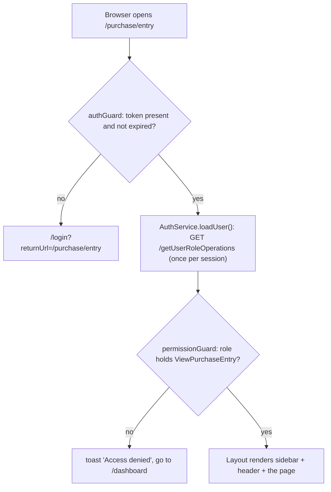
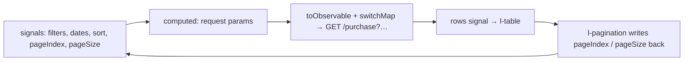

# Frontend — Setup and Project Structure

> Part of the Inventory System implementation guide. Read `docs/BRD.md` first for the business picture. This document explains how the web app is put together and in what order to build it. Each feature then has its own document in a sub-folder of `docs/frontend/`.

## 1. What the frontend is

An **Angular** single-page web app that people use in the browser. It talks to the API server over HTTP (JSON) with a login token, draws every screen with the **Lumen UI** component library, and leaves all business rules to the server. What it does own: the look of every page, form validation before sending, the arithmetic of document totals (so the user sees the same numbers that get stored), and the calendar shown on screen (AD or BS).

| Piece | Choice | Why |
|---|---|---|
| Framework | Angular 22, standalone components, signals, `OnPush` change detection | Current Angular style; no NgModules; fast rendering |
| UI library | `@lumen-ui/angular` 0.1.0, installed from the local file `lumen-ui-angular-0.1.0.tgz` | Buttons, inputs, selects, date inputs (AD/BS), tables, pagination, drawers, dialogs, notifications, icons |
| Styling | SCSS; `styles/colors.scss` holds the colour variables; nested plain class names | Simple, readable stylesheets |
| HTTP | `HttpClient` with one functional interceptor that adds the token | One place for auth |
| Tests | Vitest (`npx ng test --watch=false`) | Fast unit tests; the specs stub HTTP and the WebSocket |
| Build | Angular CLI (`npm start`, `npx ng build`) | |

Lumen's API lives in `node_modules/@lumen-ui/angular/types/lumen-ui-angular.d.ts`. The components used most: `l-button`, `l-text-input`, `l-number-input`, `l-select`, `l-date-input`, `l-textarea`, `l-checkbox`, `l-radio`, `l-toggle`, `l-table` (with cell templates), `l-pagination`, `l-card`, `l-tabs`, `l-icon`, `l-breadcrumb`, `l-file-upload`, `l-password-input`, and the services `DrawerService`, `ModalService`, `NotificationService`, `SpinnerService`.

## 2. Tools to install

- **Node.js 24 (LTS)** with npm.
- The Angular CLI comes with the project (`npx ng …`), no global install needed.

## 3. Creating the project from scratch

1. `npx @angular/cli@22 new inventory-system --style=scss --routing` (standalone components and Vitest are the defaults in Angular 22).
2. Copy `lumen-ui-angular-0.1.0.tgz` into the project and `npm install ./lumen-ui-angular-0.1.0.tgz`.
3. `src/environments/environment.ts` exports `apiUrl: 'http://localhost:8080'` (no trailing slash). Every service builds its URLs from it.
4. `src/styles.scss` imports `styles/colors.scss`, `styles/utils.scss` and Lumen's form styles, sets the body font (Fira Sans, 14px) and the global drawer-sheet and print rules.
5. `src/main.ts` bootstraps `App` with `app.config.ts`, which provides the router and `HttpClient` with the `authInterceptor`.
6. `npm start` serves it at `http://localhost:4200` with live reload.

## 4. Folder structure

```
src/
├── main.ts, index.html, styles.scss
├── environments/environment.ts            apiUrl
├── styles/colors.scss, utils.scss         CSS variables (accent, status, chart colours, text, backgrounds)
└── app/
    ├── app.ts / app.html                  <router-outlet> only
    ├── app.config.ts                      providers: router, HttpClient + authInterceptor
    ├── app.routes.ts                      the route tree (below)
    ├── auth/                              AuthService, guards, interceptor, login page, change-password page, spec helpers
    ├── layout/                            the shell around every page
    │   ├── layout.ts                      sidebar + header + <router-outlet>
    │   ├── sidebar/                       menu from sidebar.data.ts; links hidden without their operation
    │   └── header/                        breadcrumb, printer button (range-print/), notification-menu/ (bell + live feed), profile-menu/
    ├── features/<module>/                 one folder per menu area
    │   ├── <module>.routes.ts             lazy routes with data.operation + permissionGuard
    │   ├── <module>.model.ts              TypeScript shapes of the API's JSON
    │   ├── <module>.service.ts            one service per API resource
    │   └── <feature>/<feature>-list/      + <feature>-form/   components
    └── shared/
        ├── components/                    list-page-card, invoice-summary-card, summary-card, amount-totals, party-details-card,
        │                                  date-text, calculator, user-avatar, cancel-dialog
        ├── services/                      dropdown, product, product-lookup, breadcrumb, file, file-downloads
        ├── pipes/                         amount, docNo
        ├── utils/                         invoice (totals), date, batch, options, file, api-error, password
        ├── models/                        api, invoice, product
        └── styles/                        document-form.scss, document-list.scss, summary-card.scss
```

The feature folders: `masters/` (one list + one form for units, categories, packings, tax types), `product/`, `party/` (one list + one form for vendors and customers), `purchase/` (purchase-entry, purchase-return), `sales/` (sales-entry, sales-return), `inventory/` (opening-stock, stock-adjustment, stock-edit), `accounting/` (account, journal, opening-balance, payment, payment-adjustment), `report/` (reports page, report-view, ledger-report), `dashboard/` (one component per card, line-chart), `user-roles/` (user, role), `settings/` (configuration, document-numbering).

## 5. How the app is wired

**Routes** (`app.routes.ts`): the empty path loads `Layout` behind `authGuard`; its children are lazy feature route files (`/dashboard`, `/purchase`, `/sales`, `/inventory`, `/accounting`, `/products`, `/masters`, `/reports`, `/user-roles`, `/settings`, `/change-password`). `/login` sits outside the layout behind `guestGuard`. Anything else redirects to the dashboard. Each child route carries `data: { breadcrumb: '…' }` for the header, and feature routes add `data: { operation: 'ViewPurchaseEntry' }` with `canActivate: [permissionGuard]`.



**Login and permissions**: `AuthService` keeps the token in `localStorage`, loads the user's operations once, and answers `hasOperation('…')` (a name or a list; any one grants). The sidebar hides links whose operation the role lacks; pages gate buttons the same way (`Create…`, `Edit…`, `Delete…`, `Cancel…`). The interceptor adds `Authorization: Bearer <token>` to every API call and ends the session on 401 or on any error whose message mentions the token.

**Talking to the API**: one service per resource (`PurchaseEntryService`, `VendorService`, …), building URLs from `environment.apiUrl`. JSON fields are snake_case; line lists are camelCase. Dates travel as `YYYY-MM-DD` strings and are converted with `shared/utils/date.ts` (never `new Date('YYYY-MM-DD')`, which parses as UTC and can shift the day). Failures are shown with Lumen's `NotificationService` and `apiErrorMessage(error)`, which reads the API's `message`.

## 6. The two page patterns

Almost every feature is a **list page** and a **form in a drawer**. The `shared` document describes both in detail; in short:

**List page** (`<app-list-page-card>` with title, body and footer slots): the query state (filters, dates, sort, page index, page size) lives in signals; a `computed` builds the request parameters; `toObservable` + `switchMap` turn each change into one API call, so rows stay on screen while the next page loads. `l-table` with `[serverSort]` maps column keys to API sort fields; `l-pagination` binds the page signals. Print and Export buttons call the resource service's `exportList(format, params)` through `FileDownloads`.



**Form in a drawer**: Add, Edit and View open the same component with `DrawerService.open(Form, { position: 'bottom', panelClass: 'drawer-sheet', disableClose: true, data: { mode, id } })`; the component reads `DRAWER_DATA`. Small forms (masters, accounts, opening stock, stock edit) use a right drawer of 350px or 400px with the row itself passed in. Lumen inputs take `[viewMode]`, so the same template serves read-only view; the View form's Edit button switches to edit in place. Document forms (purchase, sales, returns, journals, payments, stock adjustments) keep their lines in a typed `FormArray` rendered by `l-table` cell templates, compute totals with `calculateInvoice`, and list `ProductLookup` in their own `providers` so each form fetches product details and batches once.

## 7. Conventions

- **Lumen for everything.** Never a native `<button>`: use `<l-button>` and restyle its inner element with `.myclass ::ng-deep .btn { … }`.
- **Nested SCSS with short plain class names**, never BEM; modifiers are extra classes (`.item.active`).
- Standalone components, `ChangeDetectionStrategy.OnPush`, signals, `inject()`, `@Service()` for services, selector prefix `app-`.
- Document numbers come back as `|PE-000001`; show them through the `docNo` pipe, send them back raw.
- The server stores the totals it is sent: compute them with `calculateInvoice`; `discount` holds what the user typed (percent or amount, per `discount_type`).
- Dropdowns come from `DropdownService` (active records); when editing a saved document, merge its own vendor/products into the options with `withMissing` so inactive ones still show a label.
- Show dates with `<app-date-text>`, passing the page's AD/BS switch as its `calendar` (BS by default); send the same `calendar` with every Print and Export so the file matches the screen. Never build a file or call `window.print()` in the browser: the API builds every file.

## 8. Commands and checks

| Command | What it does |
|---|---|
| `npm install` | Install dependencies (first time) |
| `npm start` | Dev server at http://localhost:4200 |
| `npx ng build` | Production build to `dist/` |
| `npx ng test --watch=false` | Run the Vitest specs |

Known notes: `src/app/app.spec.ts › "should render title"` is a stale scaffold test that fails; ignore it. The initial bundle is over the 500 kB warning budget because Lumen ships as one module file.

To look at a page you need a real login, so a bare headless-Chrome screenshot only reaches `/login`; drive Chrome over the DevTools protocol (log in through the form, then navigate) when you want screenshots.

## 9. Order to build the frontend from scratch

1. **Scaffold**: project, Lumen, `environment.ts`, global styles, colours.
2. **Auth**: `AuthService`, `authInterceptor`, `authGuard` / `guestGuard` / `permissionGuard`, the login page. (`docs/frontend/auth/`)
3. **Layout**: shell, sidebar from `sidebar.data.ts` with operation-based hiding, header with breadcrumb and profile menu. (`docs/frontend/layout/`)
4. **Shared toolkit**: `list-page-card`, `date.ts`, `api-error.ts`, `DropdownService`, `FileService` + `FileDownloads`, pipes. (`docs/frontend/shared/`)
5. **Masters**: the simplest list + right-drawer form; proves the list pattern and the drawer pattern. (`docs/frontend/masters/`)
6. **Parties** (config-driven list + form) and **Products** (bigger form with a bonus FormArray). (`docs/frontend/parties/`, `docs/frontend/products/`)
7. **Purchase entry**: the first document form; `calculateInvoice`, `InvoiceSummaryCard`, `ProductLookup`, batches typed. Then **purchase return** with batch picking and the reference purchase. (`docs/frontend/purchase/`)
8. **Sales** and **sales return** with the cancel dialog. (`docs/frontend/sales/`)
9. **Inventory** pages. (`docs/frontend/inventory/`)
10. **Accounting**: chart of accounts, journal lines table, journal form, opening balance. (`docs/frontend/accounting/`)
11. **Payments** with invoice settlement, and payment adjustments. (`docs/frontend/payments/`)
12. **Reports** page, `ReportView`, ledger. (`docs/frontend/reports/`)
13. **Dashboard** cards and the SVG line chart. (`docs/frontend/dashboard/`)
14. **Users and roles** with the permission matrix; **Settings**. (`docs/frontend/user-roles/`, `docs/frontend/settings/`)
15. **Notifications**: the bell and the live feed. (`docs/frontend/layout/`)
16. **Print and Export** buttons everywhere, then **Range Print** in the header.
17. **Change Password** page.

## 10. Feature documents

| Document | Covers |
|---|---|
| `auth/auth.md` | Token, guards, interceptor, login, change password |
| `layout/layout.md` | Shell, sidebar, header, notification bell and live feed, range print, profile menu |
| `shared/shared.md` | Shared components, services, utilities, the list and drawer patterns, totals arithmetic |
| `masters/masters.md` | Units, categories, packings, tax types |
| `products/products.md` | Product list and form |
| `parties/parties.md` | Vendors and customers |
| `purchase/purchase.md` | Purchase entry and purchase return pages |
| `sales/sales.md` | Sales entry and sales return pages, cancelling |
| `inventory/inventory.md` | Opening stock, stock adjustment, stock edit |
| `accounting/accounting.md` | Chart of accounts, journal entries, opening balance |
| `payments/payments.md` | Payments, settlement, payment adjustments |
| `reports/reports.md` | Reports page, report view, ledger |
| `dashboard/dashboard.md` | Dashboard cards and chart |
| `user-roles/user-roles.md` | Users and roles |
| `settings/settings.md` | Configuration and document numbering |
