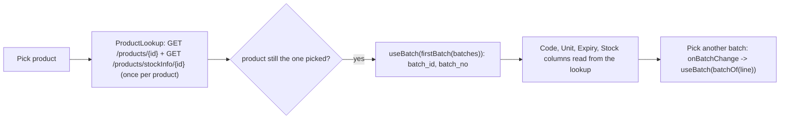

# Inventory (Opening Stock, Stock Adjustment, Stock Edit) — Frontend

> Part of the Inventory System implementation guide. Read `docs/BRD.md` for the business picture and `docs/frontend/frontend-setup.md` for how the web app is organised.

## 1. What this is

Three pages under `/inventory` that change stock without a purchase or sale:

- **Opening Stock** (`/inventory/opening-stock`): the stock already on hand when the business starts using the system. The user adds one product batch at a time; a batch can get opening stock only once.
- **Stock Adjustment** (`/inventory/stock-adjustment`): a numbered document (`|SA-000001`) with lines that move stock **In** or **Out** of product batches after a count, breakage or loss. It can be edited and deleted; the API reverses the earlier changes first.
- **Stock Edit** (`/inventory/stock-edit`): overwrites one batch's quantity, prices and expiry date directly, with no document and no history. It is the blunt tool; the page says so.

Stock is tracked per **product batch**. A product's default batch has `batch_id` 0 and no number; other batches have a `batch_no` and may have an expiry date.

## 2. Where the code lives

All paths are under `frontend/src/app/features/inventory/`.

| File | What is in it |
|---|---|
| `inventory.routes.ts` | `INVENTORY_ROUTES`: `opening-stock` (`ViewOpeningStock`), `stock-adjustment` (`ViewStockAdjustment`), `stock-edit` (`ViewStockEdit`), each with `permissionGuard`; `''` redirects to `opening-stock`. No child routes: forms are drawers. |
| `inventory.model.ts` | `StockBatch`, `OpeningStockPayload`, `OpeningStockFormData`, `StockEditPayload`, `StockEditFormData`, `AdjustmentType`, `ADJUSTMENT_TYPES`, `StockAdjustmentFormMode`, `StockAdjustmentFormData`, `StockAdjustmentLine`, `StockAdjustment`, `StockAdjustmentPayload`. |
| `opening-stock.service.ts` | `OpeningStockService`: `list`, `create`, `exportList` on `/opening-stock`. |
| `stock-adjustment.service.ts` | `StockAdjustmentService`: `list`, `get`, `nextNumber`, `create`, `update`, `delete`, `exportList`, `exportOne` on `/stock-adjustment`. |
| `stock-edit.service.ts` | `StockEditService`: `list`, `update(productId, batchId, payload)`, `exportList` on `/stock-edit`. |
| `opening-stock/opening-stock-list/`, `opening-stock-form/` | `OpeningStockList` and the add-only `OpeningStockForm` (400px right drawer). |
| `stock-adjustment/stock-adjustment-list/`, `stock-adjustment-form/` | `StockAdjustmentList` and `StockAdjustmentForm` (bottom drawer, add / edit / view). |
| `stock-edit/stock-edit-list/`, `stock-edit-form/` | `StockEditList` and `StockEditForm` (400px right drawer). |

Shared pieces: `LIST_PAGE_CARD`, `DateText`, `DocNoPipe`, `AmountPipe`, `DropdownService.products('inventory')`, `ProductService` (`get`, `stockInfo`), `ProductLookup` (`shared/services/product-lookup.ts`: details and batches of the lines' products, fetched once each), `shared/utils/batch.ts` (`batchName`, `isExpired`, `batchOptions`, `firstBatch`), `BatchStock` and `Product` from `shared/models/product.model.ts`, `FileDownloads`, `withMissing`, the date utils, `apiErrorMessage`. API shapes: `backend/endpoints.md` section 9; batches: `GET /products/stockInfo/{id}` in section 6.

## 3. Screens

### 3.1 Opening Stock list and Stock Edit list

Both page over the same rows: every product batch with its current stock (`StockBatch`: `id`, `product_id`, `product_name`, `batch_id`, `batch_no`, `expiry_date`, `quantity`, `cost_price`, `selling_price`, `mrp`). The API keeps no separate opening-stock record, so the opening stock page shows current quantities too.

| Column | Shows | Sorts by |
|---|---|---|
| S.N | running number | — |
| Product | `product_name` (on Stock Edit a link that opens the form when the user may edit) | `product.name` |
| Batch | `batchName(batch_no)`: the number, or `Default batch` | `batchNo` |
| Expiry Date | `<app-date-text>` in the page calendar, styled `expired` when `isExpired` | `expiryDate` |
| In Stock | `quantity`, bold | `quantity` |
| Cost Price / Selling Price / MRP | amounts | `costPrice` / `sellingPrice` / `mrp` |
| Actions (Stock Edit only, with `EditStockEdit`) | an **Edit** button | — |

Title bar: search by `product.name`, a Batch No filter (`batchNo`), an AD/BS switch, **Print** and **Export**. Opening Stock adds **Add Opening Stock** (`CreateOpeningStock`) and has no row actions. Default sort: Opening Stock `id:desc` (newest batch first); Stock Edit `product.name:asc,id:asc` so a product's batches stay together in the order they were added. Empty text "No stock found for these filters."

### 3.2 Opening stock form (400px right drawer)

Title `Add Opening Stock`, note "Each batch gets opening stock once. To change it later, use Stock Adjustment or Stock Edit."

| Field | Control | Rule |
|---|---|---|
| Product | searchable select of `GET /dropdown/products/inventory/all/active` | required; picking one fills in its prices |
| Batch No. | text | optional; hint "Leave the batch blank for the product's default batch." |
| Expiry Date | clearable date input in the list's calendar | optional |
| Quantity | number, 3 decimals | required, min 0 |
| Cost Price | number, 2 decimals | required, min 0 |
| Selling Price, MRP | number, 2 decimals | optional, min 0 (sent as 0 when blank) |

Footer: Cancel, Add (`Saving…`). There is no edit, view or delete.

### 3.3 Stock Adjustment list

| Column | Shows | Sorts by |
|---|---|---|
| S.N | running number | — |
| Adjustment Number | `system_entry_no` via `docNo`, a link to **view** | `systemEntryNo` |
| Date | `<app-date-text>` | `date` |
| Remarks | or `-` | `remarks` |
| Actions | View; Edit (`EditStockAdjustment`); Delete (`DeleteStockAdjustment`) | — |

Title bar: search by `remarks`, Adjustment No filter (`systemEntryNo`), AD/BS, From / To (default today), Print, Export, **Add Stock Adjustment** (`CreateStockAdjustment`). The list rows carry no lines (`stockAdjustmentEntries` is `null`); the form loads them.

### 3.4 Stock adjustment form (bottom drawer)

Opened with `StockAdjustmentFormData { mode, id?, calendar? }` the same way as the journal form (`position: 'bottom'`, `size: 'calc(100vh - 48px)'`, `panelClass: 'drawer-sheet'`, `disableClose: true`). Headings `Add Stock Adjustment`, `Edit Stock Adjustment`, `Stock Adjustment`.

- Card: **Date** (required, default today) and an **Adjustment Number** chip (`entryNo`: preview from `GET /stock-adjustment/generateNumber` when adding, the saved number otherwise).
- **Product Details** with **Add Product** and the lines table:

| Column | Control / value |
|---|---|
| S.N | running number |
| Product | searchable select (`productOptions`); required |
| Code, Unit | from the looked-up product (`productOf(line)`), `-` until known |
| Batch | select of the product's batches labelled `B1 · 15 in stock` (`batchOptions`); required; view mode shows `batchLabel` |
| Expiry Date | the picked batch's `expiry_date` |
| Stock | the batch's `available_quantity` (edit modes only) |
| Type | select `Stock In` / `Stock Out` (`adjustment_type` `In` / `Out`), coloured by choice; required |
| Quantity | number, 3 decimals; required, min 0.001 |
| Reason | text, e.g. `Broken in transit`; optional |
| remove | trash button (edit modes only) |

- **Remarks** textarea (`e.g. Monthly stock count`).
- Footer: view → Close and Edit (`EditStockAdjustment`); add/edit → Cancel and Add / Update. View mode has Print and Export in the header. There is no totals or summary card: an adjustment has no amounts.

### 3.5 Stock edit form (400px right drawer)

Title `Edit Stock`, a warning note "Stock edit sets the figures directly and keeps no history. For a counted difference, breakage or loss, record a stock adjustment instead.", then the Product and Batch as read-only text, and:

| Field | Rule |
|---|---|
| Quantity (3 decimals) | required, min 0; hint `<current quantity> in stock now.` |
| Expiry Date (clearable) | optional; clearing sends `null` |
| Cost Price | required, min 0 |
| Selling Price, MRP | optional, min 0 (0 when blank) |

Footer: Cancel, Update.

## 4. How it works

### 4.1 Loading the lists

**Idea.** All three lists use the standard pattern: query state in signals, a `computed` request, `toObservable` + `switchMap`, rows replaced only when the next page lands. `query` (filters and sort, no paging) is shared with the export so the file matches the screen.

```
query   = each filter as params[field] + sort: SORT_FIELDS[key]:direction or the page default
request = { ...query, pageIndex, pageSize } + refresh      (adjustment list also adds fromDate / toDate)
GET /opening-stock | /stock-adjustment | /stock-edit ? request
ok    -> rows := content, total := totalElements
error -> rows := []; empty text := apiErrorMessage(error, "Could not load opening stock." | "… stock adjustments." | "… stock.")
```

### 4.2 Adding opening stock

**Idea.** Opening stock is a one-shot record per batch, so the form only adds. The picked product's prices are copied in as a starting point (the user may still change them), through `ProductService.get`; if that fails (for example the role can't view products) the prices simply stay as typed.

```
onProductChange(productId):
  GET /products/{id}  -> if the product is still the one picked: patch cost_price, selling_price, mrp
save():
  form invalid -> "Missing details" / "Fill in the fields highlighted in red."
  payload = { product_id, batch_no: trimmed or null, expiry_date: toIsoDate or null,
              quantity, cost_price, selling_price or 0, mrp or 0 }
  POST /opening-stock
  ok    -> "Opening stock added"; close(true); list reloads
  error -> "Could not save" + API message; drawer stays open
```

A blank `batch_no` means the product's default batch (`batch_id` 0). API rules: a batch that already has stock answers **409** `"Stock already exists for this product batch. Use Stock Adjustment or Stock Edit instead."`; `"Opening quantity cannot be negative"`; `"Product not found"`.

### 4.3 Opening the stock adjustment form

```
constructor:
  mode != add and id -> load(id)
  else -> mode := add; one empty line; GET /stock-adjustment/generateNumber -> entryNo (failure: no chip)

load(id):
  GET /stock-adjustment/{id}
  then loadLineProducts(lines)          -- forkJoin(lookup.loadProducts(ids), lookup.loadBatches(ids)), before filling,
                                        -- so code, unit, expiry and stock show with the lines
  fill: entryNo := system_entry_no; savedProducts := each line's {product_id, product_name};
        rebuild the lines FormArray with createLine(line) (keeping each line's id); patch date, remarks; markAsPristine
  error -> "Could not load the stock adjustment"; close
```

State: `form` (date, remarks, `lines` FormArray of `LineForm` groups: `id`, `product_id`, `batch_id`, `batch_no` (shown in view, not sent), `adjustment_type`, `quantity`, `reason`), a `lines` signal mirroring the groups so the table re-renders; `productOptions = withMissing(active inventory products, savedProducts)`; `batchOptions = computed Map<product id, DropdownItem[]>` built from `ProductLookup.batches()` with `batchOptions()`; `lineColumns` drops `stock` and `actions` in view mode; `canEdit = hasOperation('EditStockAdjustment')`. `ProductLookup` and `FileDownloads` are in the component's own `providers`, so each open form has fresh caches.

### 4.4 Picking a product and a batch

**Idea.** Stock adjustments pick a `batch_id` from `GET /products/stockInfo/{id}` (they never type a batch number, because a batch that doesn't exist can't be adjusted). On picking a product the form fetches its details and batches once and pre-selects the batch goods would leave first: the earliest expiry among those in stock.



```
onProductChange(line, productId): loadLineProducts([{product_id}]) -> if line.product_id is still productId:
                                  useBatch(line, firstBatch(batches of productId))
firstBatch(batches): among those with available_quantity > 0, the earliest expiry_date (no date sorts last); else the first batch
useBatch(line, batch): patch batch_id := batch.batch_id or 0, batch_no := batch.batch_no or null   -- no stock info: the default batch
```

### 4.5 Saving a stock adjustment

```
save():
  no lines       -> "No products" / "Add at least one product to the adjustment."
  form invalid   -> "Missing details" / "Fill in the fields highlighted in red."   (product, batch, type or quantity missing)
  payload = { date: toIsoDate(date), remarks: trimmed or null,
              stockAdjustmentEntries: lines -> { id (saved lines only), product_id, batch_id, adjustment_type, quantity, reason trimmed or null } }
  mode == edit ? PUT /stock-adjustment/{id} : POST /stock-adjustment
  ok    -> "Stock adjustment added" / "Stock adjustment updated"; close(true); list reloads
  error -> "Could not save" + API message
```

**Rules shown by the form**: the two warnings above; `quantity` must be at least 0.001 and `adjustment_type` must be picked (a line without a direction is never posted).

**Rules the API adds** (surfaced through `apiErrorMessage`): `"Adjustment quantity must be greater than zero"`, `"Adjustment type must be either In or Out"`, `"Product has no stock yet. Add opening stock or a purchase first"`, `"Not enough Quantity In Stock"`. The form does **not** check stock itself: the Stock column is informative, and on edit the API reverses the earlier lines before re-applying, so the real available quantity differs from what the column shows.

Lines keep their `id` so an update edits them instead of replacing them.

### 4.6 Deleting a stock adjustment

Delete (`DeleteStockAdjustment`) confirms with "Delete stock adjustment?" / "`<number>` will be deleted and its stock changes reversed. This cannot be undone.", runs `DELETE /stock-adjustment/{id}`, shows "Stock adjustment deleted", and steps back a page when the last row of a later page goes.

### 4.7 Editing stock directly

**Idea.** The list row already holds everything the form shows, so it is handed over in `DRAWER_DATA` (`StockEditFormData { batch, calendar }`) and nothing loads. The batch is addressed by `product_id` and `batch_id`, not by the row's own `id`, because the API's path is `PUT /stock-edit/{productId}/{batchId}` and `0` is the default batch.

```
form starts from the row: quantity, expiry_date (fromIsoDate), cost_price, selling_price, mrp
save():
  form invalid -> "Missing details"
  payload = { quantity, cost_price, selling_price or 0, mrp or 0, expiry_date: toIsoDate or null }
  PUT /stock-edit/{batch.product_id}/{batch.batch_id}
  ok    -> "Stock updated"; close(true); list reloads
  error -> "Could not save" + API message ("Stock quantity cannot be negative", "Product Stock not found", "Product not found")
```

A `NO_BATCH` placeholder stands in when the form renders without drawer data (tests).

### 4.8 Print and Export

- Each list's Print (PDF) and Export (Excel) call its service's `exportList(format, { ...query, calendar })`: `/opening-stock/export/{format}`, `/stock-adjustment/export/{format}` (with the date range) and `/stock-edit/export/{format}`, every matching row with dates in the page's calendar.
- The stock adjustment form in view mode calls `exportOne(id, format, { calendar })` → `/stock-adjustment/{id}/export/{format}`: the document with its lines.
- All go through `FileDownloads.run` (one download at a time; the button reads `Printing…` / `Exporting…`; a failure becomes a notification). Opening stock and stock edit have no per-record print.

## 5. Design decisions and gotchas

- **Opening stock has no record of its own.** The list is the stock list; adding opening stock to a batch that already exists is a 409, and the note on the form points the user to Stock Adjustment or Stock Edit.
- **Default batch is id 0** and has no number. `batchName` shows it as `Default batch`; a blank Batch No. on opening stock targets it; `useBatch` falls back to it when a product has no stock info.
- **Two different pickers**: purchases type a `batch_no` (new numbers create batches); adjustments pick a `batch_id` because they can only touch stock that exists.
- **`firstBatch` prefers the earliest expiry in stock**, the batch that should leave first, and treats "no expiry" as last. For `In` adjustments the user may well pick another batch.
- **The form never checks stock**: the Stock column is a hint; the API is the judge, and on edit it reverses the earlier lines first, so the number on screen isn't the real limit anyway.
- **Line ids are sent back on update** so the API edits lines rather than deleting and recreating them.
- **Product and batch lookups happen before `fill`** on load, otherwise the Code/Unit/Expiry cells would render `-` and then jump.
- **The Stock Edit list sorts by product then id** so a product's batches sit together; the opening stock list sorts newest first so the row just added is on top.
- `ProductLookup` is **per form instance** (`providers`), not a singleton: a cache that outlived the drawer would show stale stock on the next open.
- Expiry dates are shown in the page's AD/BS calendar but always sent as `YYYY-MM-DD` through `toIsoDate`.
- The stock adjustment list defaults its dates to **today**; widen the range to see older documents.

## 6. Build it yourself: order of work

1. Routes under `/inventory` with `permissionGuard` and the three View operations; sidebar links with the same.
2. `inventory.model.ts` from section 9 of `endpoints.md`, plus `StockBatch` for the two stock lists.
3. The three services; note `StockEditService.update(productId, batchId, …)` and the `export` methods through `FileService`.
4. `OpeningStockList` and `StockEditList` with the shared list card and the `SORT_FIELDS` map (`product.name`, `batchNo`, …); the Stock Edit default sort and its permission-gated actions column.
5. `OpeningStockForm` (right drawer): product dropdown, price copy on pick, nullable batch and expiry, the 409 shown as a notification.
6. `StockEditForm` (right drawer): start from the row in `DRAWER_DATA`, `PUT` by product and batch id, clearable expiry.
7. `StockAdjustmentList` with the date range, print/export and delete.
8. `StockAdjustmentForm` (bottom drawer): the `LineForm` groups, `ProductLookup` in `providers`, `batchOptions` map, `onProductChange` → `firstBatch`, the two save warnings, line ids on update, view-mode Print/Export.
9. Try it: add opening stock for a product (default batch and batch `B1`), post an `Out` adjustment larger than the stock and read the API's refusal, edit it to a valid quantity, then overwrite the batch in Stock Edit and confirm the lists agree.
