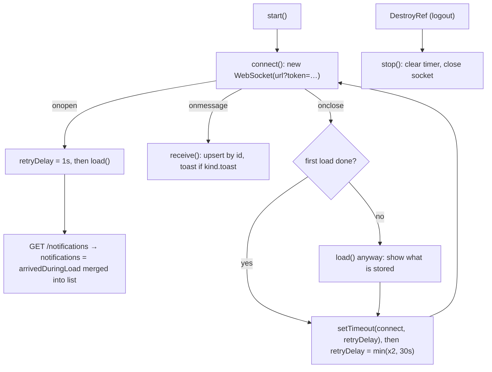

# Layout: shell, sidebar and header — Frontend

> Part of the Inventory System implementation guide. Read `docs/BRD.md` for the business picture and `docs/frontend/frontend-setup.md` for how the web app is organised.

## 1. What this is

The frame every signed-in page sits in: a collapsible sidebar menu on the left, a header on top (breadcrumb, calculator, notification bell, Range Print button, profile menu) and the page itself in a scrolling area under the header. The menu shows only the pages the user's role may open, the bell keeps the user's notifications live over a WebSocket, and Range Print downloads every document of a period as one PDF.

## 2. Where the code lives

All of it is under `frontend/src/app/layout/`.

| File or folder | What is in it |
|---|---|
| `layout.ts` / `.html` / `.scss` | `Layout`: `<app-sidebar>` + `<app-header>` + `<router-outlet>`; the route `''` renders it behind `authGuard` |
| `sidebar/sidebar.ts` / `.html` / `.scss` | `Sidebar`: the menu, permission filtering, search, collapse |
| `sidebar/sidebar.data.ts` | `SIDEBAR_SECTIONS` (the whole menu) and `SIDEBAR_FOOTER_ITEMS` |
| `sidebar/sidebar.model.ts` | `SidebarLink`, `SidebarItem`, `SidebarSection` |
| `sidebar/sidebar-item/` | `SidebarItem`: one link or one group with children; active and expanded state |
| `header/header.ts` / `.html` | `Header`: breadcrumb, calculator, bell, printer button, profile menu |
| `header/range-print/` | `RangePrint` (the printer button's drawer) and `range-print.model.ts` (`RANGE_PRINT_OPTIONS`) |
| `header/notification-menu/` | `NotificationMenu` (the bell), `notification-feed.ts` (`NotificationFeed`: list + socket), `notification.model.ts` (`AppNotification`, `NOTIFICATION_KINDS`), `notification-feed.testing.ts` (`FakeSocket`) |
| `header/profile-menu/` | `ProfileMenu`: avatar, name and role, Change Password, Logout |
| `../shared/services/breadcrumb.service.ts` | `BreadcrumbService`, which the header reads |
| `../shared/components/calculator/` | `Calculator`, opened by the header in a modal |

API side: section 16 of `backend/endpoints.md` (notifications and the socket) and section 18 (range print: `GET /<document>/print`).

## 3. What it provides

| Piece | Gives the app |
|---|---|
| `Layout` | The fixed shell: sidebar at its own width, header that stays put, page content scrolling inside `.content` (so list cards can fill the height). In print media the sidebar and header are hidden |
| `Sidebar` | The menu from `SIDEBAR_SECTIONS`, filtered by `AuthService.hasOperation`, searchable, collapsible (220px → 64px) |
| `Header` | `title()` and `crumbs()` from `BreadcrumbService`; `openCalculator()`; `canRangePrint()` and `openRangePrint()` |
| `RangePrint` | A 350px right drawer: From / To dates, Document Type, Print |
| `NotificationMenu` + `NotificationFeed` | The bell with an unread badge, the list, mark read / mark all read / clear all, live updates and toasts |
| `ProfileMenu` | Who is signed in, their role, and the two account actions |

## 4. How it works

### 4.1 The shell

`layout.html` is three elements: `<app-sidebar class="sidebar">`, then a `.main` column holding `<app-header class="header">` and `<main class="content"><router-outlet /></main>`. `layout.scss` makes `.layout` a 100vh flex row, `.sidebar` fixed-size, `.main` a flex column with `.content` taking the rest and `overflow: auto`. The header therefore never scrolls away, and a list page can use `height: 100%` for a page-high card. `@media print` turns the layout into a plain block with the sidebar and header hidden.

### 4.2 The sidebar menu

**Idea.** The menu is data, not markup. `sidebar.data.ts` mirrors the backend `operation` table (its `master_module` → `module` grouping) as two sections, `Main Menu` and `Setup`; each link carries the backend `View…` operation that opens its page, the same value the route's `data.operation` holds. A role that lacks the operation never sees the link, and a group whose links all vanish disappears too.

Model (`sidebar.model.ts`):

| Type | Fields |
|---|---|
| `SidebarLink` | `label`, `route`, `operation?` (a name or a list; any one grants it), `icon?` |
| `SidebarItem` | a `SidebarLink` with a required `icon`, `masterModule?` (the backend `operation.master_module`, informational only: nothing reads it) and `children?: SidebarLink[]` |
| `SidebarSection` | `title`, `items: SidebarItem[]` |

The menu: Dashboard (no operation); Purchase → Purchase Entry (`ViewPurchaseEntry`), Purchase Return (`ViewPurchaseReturn`), Vendors (`ViewVendor`); Sales → Sales Entry (`ViewSalesEntries`), Sales Return (`ViewSalesReturns`), Customers (`ViewCustomer`); Inventory → Opening Stock (`ViewOpeningStock`), Stock Adjustment (`ViewStockAdjustment`), Stock Edit (`ViewStockEdit`); Accounting → Chart of Accounts (`ViewAccountMaster`), Journal Entries (`ViewJournalEntries`), Payments (`['ViewVendorPayment', 'ViewCustomerPayment']`), Payment Adjustments (`ViewPaymentAdjustment`), Opening Balance (`ViewOpeningBalance`). Setup: Products (`ViewProduct`, a plain link), Master Data → Categories, Units, Packings, Tax Types (`ViewCategory`, `ViewUnit`, `ViewPacking`, `ViewTaxType`), User & Roles → Users, Roles (`ViewUser`, `ViewRole`), Reports (a list of nine operations, equal to `REPORT_OPERATIONS` of the reports feature; a spec keeps them in sync), Settings → Configuration, Document Numbering (`ViewConfiguration`, `ViewDocumentNumbering`). `SIDEBAR_FOOTER_ITEMS` holds one link, User Manual → `/user-manual`.

State in `Sidebar`: `collapsed` and `search` signals; `searching` computed; `sections` computed (permission filter); `filteredSections` computed (search filter on top).

```
sections():
  allowed(operation) = no operation, or auth.hasOperation(operation)
  for each section: keep items where
      item without children: allowed(item.operation)
      item with children:    the children that are allowed; drop the group if none are left
  drop sections with no items

filteredSections():
  query = search trimmed, lower-cased; if empty return sections()
  for each section: keep an item whose label contains the query (with all its children),
                    else keep it with only the children whose labels contain the query
  drop empty sections; the template shows: No menu items match "<query>"
```

Collapsed: the aside shrinks from 220px to 64px, the full logo (`abis.svg`) is swapped for the mark (`abis-a.svg`), the search box is hidden, and every item shows its label as a Lumen tooltip on the right (`lTooltip`). While a search is typed, every group is forced open (`forceOpen`).

`SidebarItem` (one row) keeps the current URL in a signal fed by the router's `NavigationEnd` events (`urlAfterRedirects`, starting with `router.url`):

```
hasChildren  = item has children
groupActive  = hasChildren and (url == item.route or url starts with item.route + '/')
expanded     = forceOpen ? true : manuallyExpanded ?? groupActive     -- manuallyExpanded is null until clicked
toggle()     = manuallyExpanded = !expanded
```

A group shows `.active` only while it is active *and* closed (open groups highlight the child instead, through `routerLinkActive="active"`); `.open` rotates the caret. A child without an icon shows the first letter of its label.

### 4.3 The header

`Header` reads `title` and `items` from `BreadcrumbService` into `<l-breadcrumb>`, then a row of actions: a calculator button (`ModalService.open(Calculator, { width: '256px', animation: 'fade' })`), `<app-notification-menu>`, the printer button (only when `canRangePrint()`: some `RANGE_PRINT_OPTIONS` entry's operation is granted), and `<app-profile-menu>`. `openRangePrint()` is `DrawerService.open(RangePrint, { position: 'right', size: '350px' })`.

**Breadcrumbs** come from route data. Every route segment that declares `data.breadcrumb` (or `title`) adds a crumb: `app.routes.ts` gives `Purchase`, the feature routes give `Purchase Entry`, so the trail reads Home › Purchase › Purchase Entry and the title is the last label. `BreadcrumbService.build()` walks the route snapshot from the root, accumulates the URL for each crumb's link, merges a parent and its `''` child that share a label, and removes the link from the last crumb. `set(items)` or `setTitle(label)` overrides the trail (e.g. to show a record's name) until the next `NavigationEnd` clears it. `HOME_CRUMB` is `{ label: 'Home', link: '/dashboard' }`.

### 4.4 Range Print

**Idea.** Printing a month of invoices one by one is tedious; the API already prints a range as one PDF (`GET /<document>/print?fromDate=&toDate=`), so the header offers it from anywhere. The drawer only lists the document kinds the role may view, because the API would answer 403 for the rest.

`RANGE_PRINT_OPTIONS` (`range-print.model.ts`): `purchase` → Purchase (`ViewPurchaseEntry`), `sales` → Sales (`ViewSalesEntries`), `purchase-return` → Purchase Return (`ViewPurchaseReturn`), `sales-return` → Sales Return (`ViewSalesReturns`), `payment` → Payment (`['ViewVendorPayment', 'ViewCustomerPayment']`). The `value` is the resource's API path.

State: `options` (the entries whose operation `hasOperation` grants), `calendar` (`'bs'`, follows the date inputs' AD/BS switch), `fromDate` and `toDate` (both `startOfToday()`), `document` (the first option), `ready` computed (all three set). `FileDownloads` is in the component's `providers`, so `downloads.running()` labels the button `Printing…` and disables it.

```
print():
  if not (document and from and to): return
  params = { fromDate: toIsoDate(from), toDate: toIsoDate(to), calendar }
  file = by document:
      'purchase'        → PurchaseService.printRange(params)          -- GET /purchase/print
      'sales'           → SalesService.printRange(params)
      'purchase-return' → PurchaseReturnService.printRange(params)
      'sales-return'    → SalesReturnService.printRange(params)
      'payment'         → types = PARTY_TYPES the role may view (VIEW_PAYMENT_OPERATIONS)
                          if exactly one: params.type = that type       -- as on the payments page
                          PaymentService.printRange(params)
  downloads.run('pdf', file.pipe(tap(close the drawer)))
```

The From input's `max` is the To date and the To input's `min` is the From date, so the range can't be inverted. An empty period is the API's 404 (`"No sales in this period"`), which `FileDownloads` shows as a `Print failed` notification; the drawer stays open. The hint under the fields says each document prints on its own page, oldest first, with cancelled sales and sales returns marked.

### 4.5 The notification bell

**Idea.** The list (`GET /notifications`) is the truth and the socket is only a hint that it changed. Every time the socket opens, the list is reloaded, so nothing sent while the browser was offline or the tab asleep is missed; the socket's own messages just update the list in place between reloads. The feed is not a singleton: `NotificationMenu` lists `NotificationFeed` in its `providers`, so it is destroyed with the shell on logout, and `DestroyRef.onDestroy` closes the socket.

`NotificationMenu` calls `feed.start()` in its constructor and exposes `notifications`, `unreadCount` (a `computed` count of `!is_read`) and `isEmpty`. The trigger button carries `[lBadge]="unreadCount()"`. The panel: a head with `Notifications`, `N new` and `Mark all read` (disabled when nothing is unread); an empty state (`You're all caught up`); otherwise one row per notification with the kind's icon tinted by `severity`, the `title`, `message`, `actor · time ago`, and an unread dot; a foot with `Clear all`. The menu has `closeOnItemClick` off so marking read doesn't close it.

```
open(notification):
  if not is_read: feed.markRead(id)
  route = notificationKind(notification).route
  if route: close the menu; router.navigateByUrl(route)

timeAgo(created_at): 'Just now' | '<m>m ago' | '<h>h ago' | 'Yesterday' | '<d>d ago'
```

`NOTIFICATION_KINDS` maps the backend `type` to an icon and the page a row opens:

| `type` | Icon | Route | Toast |
|---|---|---|---|
| `purchase_entry` | `cart_add` | `/purchase/entry` | |
| `purchase_return` | `cart_return` | `/purchase/return` | |
| `sales_entry` | `receipt` | `/sales/entry` | |
| `sales_return` | `undo` | `/sales/return` | |
| `vendor_payment`, `customer_payment` | `money` | `/accounting/payments` | |
| `stock_adjustment` | `refresh` | `/inventory/stock-adjustment` | |
| `low_stock` | `warning` | `/inventory/stock-edit` | yes |
| `out_of_stock` | `error` | `/inventory/stock-edit` | yes |

An unknown type gets `OTHER_KIND` (`notification` icon, no route, so the row only marks itself read).

### 4.6 The live feed

Constants: `FEED_SIZE = 50` (the API's page; the live list is trimmed to it too), `RETRY_FIRST_MS = 1000`, `RETRY_LAST_MS = 30000`. `SOCKET_URL` is `environment.apiUrl` with `http` → `ws` (so `https` becomes `wss`) plus `/ws/notifications`; the token goes in the query string because browsers can't set headers on a WebSocket.



```
connect():
  if not started, or auth.getToken() is null (expired): return     -- no reconnect loop after logout
  socket = new WebSocket(SOCKET_URL + '?token=' + encodeURIComponent(token))
  onopen:    retryDelay = 1s; load()
  onmessage: receive(data)
  onclose:   if this socket is no longer the current one: return     -- a stale socket closing late
             socket = null
             if never loaded: load()
             retryTimer = setTimeout(connect, retryDelay); retryDelay = min(retryDelay * 2, 30s)

load():
  cancel a reload in flight; arrivedDuringLoad = []
  GET /notifications → loaded = true; notifications = list with every arrivedDuringLoad item upserted on top
  on error: keep what is shown (the next reconnect retries)

receive(data):
  message = JSON.parse(data); ignore anything whose event != 'notification'
  arrivedDuringLoad.push(n); notifications = upsert(notifications, n)
  if notificationKind(n).toast:
      dismiss the toast previously shown for this id
      show toast.error(title, message) when severity == 'error', else toast.warn

upsert(list, n) = [n, ...list without id n].slice(0, 50)

markRead(id):   list updated at once (is_read = true); PUT /notifications/{id}/read
markAllRead():  all is_read = true;                     PUT /notifications/read
clear():        list = [];                              DELETE /notifications
  each: on error → toast.error('Could not mark it read' | 'Could not mark them read' | 'Could not clear them', apiErrorMessage); load()
```

**Why upsert by id.** The API updates an *unread* stock alert instead of adding another (same `id`, new `message`), so a pushed notification whose id is already listed replaces that row and moves it to the top; its earlier toast is dismissed so the user sees one toast per product, not a pile.

**Why `arrivedDuringLoad`.** A message can arrive between sending `GET /notifications` and receiving its answer. Without the buffer the answer would overwrite the newer row; with it, the buffered rows are re-applied on top of the fresh list.

**Specs** stub the browser's socket with `FakeSocket` from `notification-feed.testing.ts` (`vi.stubGlobal('WebSocket', FakeSocket)`): it records every instance (`FakeSocket.instances`, `FakeSocket.last`), exposes `onopen` / `onmessage` / `onclose` for the test to call, flags `closed`, and `push(notification)` plays a server message. `testNotification(overrides)` builds a row.

### 4.7 The profile menu

A Lumen `<l-menu mode="right">` whose trigger shows `<l-avatar>` with `AuthService.user().avatarUrl` (the object URL the auth service loaded; see the auth doc) or a placeholder `user` icon when there is none. The panel repeats the avatar with `name` (`fullName || username || 'Account'`) and `role` (`role || 'No role assigned'`), then two full-width ghost buttons: `Change Password` → `router.navigate(['/change-password'])` and `Logout` → `AuthService.logout()`.

## 5. Design decisions and gotchas

- **One source for "may I open this page".** The sidebar link's `operation`, the route's `data.operation` and the dashboard cards all name the same backend operation, so a role change hides the link and blocks the URL together. Payments and Reports use the list form (any one grants).
- **A group's `route` is only a prefix** (`/purchase`); nothing routes there. It is used for `groupActive` and as the `track` key.
- **Search forces groups open but never changes `manuallyExpanded`**, so clearing the search restores what the user had opened.
- **The socket is created with the raw token in the URL**; `getToken()` returns `null` once `exp` has passed, so an expired session stops reconnecting instead of hammering the server with 401 handshakes. When the token expires while a socket is open, the server closes it with code 4401 on the next message; the feed then backs off and `connect()` returns early.
- **Reads and clears are optimistic**: the list changes before the request answers, and a failure reloads the stored state.
- **Toasts are for stock alerts only** (`toast: true` on `low_stock` and `out_of_stock`); document notifications just add a row and bump the badge.
- **The bell's rows navigate with `navigateByUrl`** to the list page of that kind, not to the record: the API's message names the document and the user searches for it there.
- **Range Print's payment `type`** is added only when the role may view exactly one party type; with both, the API prints both.
- **The profile menu uses `<l-avatar>` directly** with the URL from `AuthService`, while other users' pictures go through `<app-user-avatar>` (the shared component with its own Blob fetch).
- **Printing a page with the browser** (`Ctrl+P`) hides the sidebar and header through the `@media print` rules, but the app never calls `window.print()`: Print buttons download API-built PDFs.

## 6. Build it yourself: order of work

1. `Layout`: the three-part template and the flex CSS (`height: 100vh`, content `overflow: auto`). Route `''` → `Layout` with `authGuard` and the feature children in `app.routes.ts`, each with `data.breadcrumb`.
2. `sidebar.model.ts`, then `sidebar.data.ts` with every link's `View…` operation copied from the backend `operation` table.
3. `Sidebar`: `sections` computed from `AuthService.hasOperation`, `filteredSections` for the search, `collapsed` with the 64px style and tooltips.
4. `SidebarItem`: the URL signal from `NavigationEnd`, `groupActive`, `manuallyExpanded`, `expanded`, `forceOpen`; `routerLinkActive` on links.
5. `BreadcrumbService` (`shared/services`): walk the snapshot tree, merge duplicate labels, unlink the last crumb, `set()` / `setTitle()` overrides.
6. `Header` with `<l-breadcrumb>`, the calculator modal and the profile menu (`ProfileMenu` reading `AuthService.user`).
7. `notification.model.ts` with `NOTIFICATION_KINDS`; `NotificationFeed` (`@Service({ autoProvided: false })`): `load()`, `connect()` with the backoff, `receive()` with `upsert` and toasts, `markRead` / `markAllRead` / `clear`; `stop()` from `DestroyRef`.
8. `NotificationMenu` with `providers: [NotificationFeed]`, the badge, rows and actions; `FakeSocket` and specs (reload on open, replace by id, backoff, close on destroy).
9. `range-print.model.ts`, `RangePrint` with `FileDownloads` in `providers` and the per-document `printRange` switch; the header's printer button behind `canRangePrint()`.
10. Try it: log in with a limited role (links disappear, printer button hides when no document kind is viewable), save a sale in another browser (bell badge rises live), reload the API while the app is open (the feed reconnects and reloads), print a range with no documents (`Print failed` notification).
