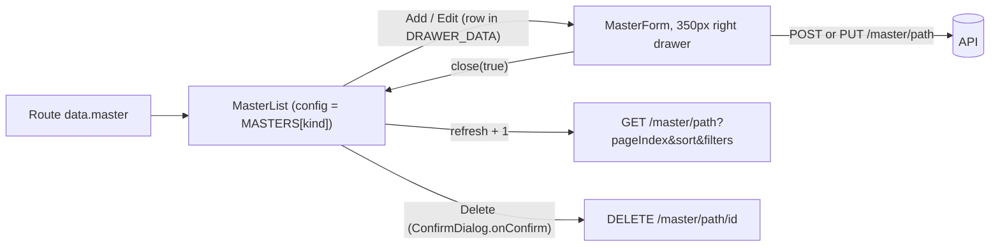

# Master Data (Units, Categories, Packings, Tax Types) — Frontend

> Part of the Inventory System implementation guide. Read `docs/BRD.md` for the business picture and `docs/frontend/frontend-setup.md` for how the web app is organised.

## 1. What this is

The four simple masters are the lookup lists the rest of the app picks from: a product has a category, a unit and a packing, and a tax type with a rate. Each record is just a name, an active flag and (for tax types) a `tax_rate`. The user keeps these lists tidy from the Master Data menu: search, add, rename, switch off the ones no longer in use, delete the ones never used.

The four pages are the same page. One list component and one form component serve all of them; the route says which master is open through a small config table, `MASTERS`. Add and edit happen in a narrow drawer on the right; there is no view mode and no page of its own for a record.

## 2. Where the code lives

All under `frontend/src/app/features/masters/` unless noted.

| File | What is in it |
|---|---|
| `masters.model.ts` | `MasterKind` (`category`, `unit`, `packing`, `taxType`), `MasterConfig`, the `MASTERS` table, `MasterRecord`, `MasterPayload`, `MasterFormData` |
| `masters.routes.ts` | `MASTER_ROUTES`: one route per master, all loading `MasterList` with `data.master` set |
| `masters.service.ts` | `MastersService`: list, create, update, delete against `/master/<path>` |
| `master-list/` | `MasterList`: the shared list page (search, status filter, sort, paging, row menu) |
| `master-form/` | `MasterForm`: the shared add/edit form, opened in a 350px right drawer |
| `shared/components/list-page-card/` | `app-list-page-card` with its title / body / footer slots, used by every list page |
| `shared/utils/api-error.ts` | `apiErrorMessage(error, fallback)`: the backend `message` for notifications |
| `layout/sidebar/sidebar.data.ts` | The Master Data menu: four links, each carrying its `View…` operation |

### The `MASTERS` config

| Kind | `path` (under `/master`) | `singular` / `plural` | `operation` | `hasRate` | Page route |
|---|---|---|---|---|---|
| `category` | `categorys` (the API spells it this way) | Category / Categories | `Category` | – | `/masters/categories` |
| `unit` | `units` | Unit / Units | `Unit` | – | `/masters/units` |
| `packing` | `packings` | Packing / Packings | `Packing` | – | `/masters/packings` |
| `taxType` | `taxtypes` | Tax Type / Tax Types | `TaxType` | yes | `/masters/tax-types` |

`operation` is the stem of the backend permission names: `View` + `Category` = `ViewCategory`, and likewise `CreateCategory`, `EditCategory`, `DeleteCategory`. `icon` is only for the sidebar. `/masters` alone redirects to `categories`.

Each route is built by a `masterRoute(path, kind)` helper: `data: { breadcrumb: plural, operation: 'View<operation>', master: kind }`, `canActivate: [permissionGuard]`, and a lazy `loadComponent` of `MasterList`. The list reads `kind` from `ActivatedRoute.snapshot.data['master']` and keeps `config = MASTERS[kind]`.

### API used (section 5 of `backend/endpoints.md`)

| Method | Path | Used by | Permission |
|---|---|---|---|
| `GET` | `/master/<path>?pageIndex&pageSize&sort&name&isActive` | list | `View<operation>` |
| `POST` | `/master/<path>` | add | `Create<operation>` |
| `PUT` | `/master/<path>/{id}` | edit | `Edit<operation>` |
| `DELETE` | `/master/<path>/{id}` | delete | `Delete<operation>` |

`GET /master/<path>/{id}` exists but the web app never calls it: the row to edit is already on screen. The body of create and update is `{ name, is_active }`, plus `tax_rate` for tax types (`MasterPayload`). Names must be unique (409 `"Category with the same name already exists"`).

## 3. Screens

### 3.1 List page (`MasterList`)

The page is the shared `app-list-page-card`: filters and the Add button in the title slot, the table in the body, the pager in the footer.

| Column | Key | Notes |
|---|---|---|
| S.N | `sn` | Running number across pages, two digits: `serial(index)` = `pageIndex × pageSize + index + 1` |
| Name | `name` | Sortable. A ghost-button link that opens the edit form when the user has `Edit…`; plain text otherwise |
| Tax Rate | `tax_rate` | Tax types only (`config.hasRate`). Sortable, right-aligned, shown as `13%` |
| Status | `is_active` | Sortable. A chip: `ACTIVE` (success) or `INACTIVE` (default) |
| (actions) | `actions` | Only when the user has `Edit…` or `Delete…`: an `l-menu` with Edit and Delete items, each gated on its own |

`columns` is a `computed` because two of them depend on the config and on the permissions.

Filters (`l-filter`): a search box on `name` (`searchBy="name"`) and one Status select, `isActive`, whose options are `{ id: '1', name: 'Active' }` and `{ id: '0', name: 'Inactive' }`. Those literal `1` / `0` values are deliberate: the API filters by "contains" on the stored text and stores booleans as 1/0, so `isActive=true` would match nothing.

Sorting is server-side (`[serverSort]="true"`). Table keys are mapped to entity field names through `SORT_FIELDS` (`tax_rate` → `taxRate`, `is_active` → `isActive`); `name` passes through. With no sort the list sends `id:desc`, newest first.

| Button | Gate |
|---|---|
| Add `<Singular>` (title slot) | `canCreate` = `hasOperation('Create<operation>')` |
| Name link, Edit menu item | `canEdit` = `hasOperation('Edit<operation>')` |
| Delete menu item | `canDelete` = `hasOperation('Delete<operation>')` |

Empty text: the load error if there is one, else `No <plural> found for these filters.`

### 3.2 Form (`MasterForm`, right drawer, 350px)

| Field | Control | Rules |
|---|---|---|
| Name | `l-text-input`, placeholder `Enter <singular> name`; the Enter key saves | required |
| Tax Rate | `l-number-input`, placeholder `e.g. 13`, suffix `%`, 2 decimals | tax types only; required, 0 to 100 |
| Active | `l-toggle`, hint "Inactive `<plural>` are left out of dropdowns." | defaults to on |

Header: an icon badge (`add` or `edit`), the title `Add <Singular>` / `Edit <Singular>` with a one-line subtitle, and a close button. Footer: Cancel, and a primary button reading `Add`, `Update` or `Saving…`, disabled while saving.

There is no view mode and no line-item table: a master is three fields, so the row itself is the form's data.

## 4. How it works

### 4.1 Loading the list

**Idea.** Every piece of query state is a signal (`filters`, `sort`, `pageIndex`, `pageSize`, plus a private `refresh` counter). One `computed` turns them into the request parameters; `toObservable` of that computed feeds a `switchMap` to the service. Changing any input re-runs the request, and a stale response is dropped by `switchMap`. The rows are not cleared while loading, so the table never flashes empty between pages.

**Steps.**

```
request = computed:
  params = { pageIndex, pageSize }
  for each filter in filters(): params[filter.field] = filter.value      -- e.g. name=bev, isActive=1
  params.sort = sort ? `${SORT_FIELDS[sort.key] ?? sort.key}:${direction}` : 'id:desc'
  return { params, refresh: refresh() }                                   -- refresh is read so bumping it re-queries

toObservable(request)
  -> tap: loading = true
  -> switchMap: mastersService.list(kind, params)
       map   -> { page, error: '' }
       catch -> { page: null, error: apiErrorMessage(e, 'Could not load <plural>.') }
  -> subscribe: loading = false; loadError = error; rows = page.content ?? []; total = page.totalElements ?? 0
```

A filter change (`onFilterChange`) and a sort change (`resetPage`) both set `pageIndex` to 0, so the user never lands on a page that no longer exists.

### 4.2 Opening the form (add / edit)

**Idea.** The form never loads anything. Add opens it with only the `kind`; edit passes the table row too. That is why the drawer is small and instant, and why `GET /master/<path>/{id}` is unused.

```
openForm(record?):
  ref = drawer.open(MasterForm, { data: { kind, record }, position: 'right', size: '350px' })
  ref.afterClosed().subscribe(saved => if saved then reload())

MasterForm constructor:
  kind    = DRAWER_DATA.kind ?? 'category'
  record  = DRAWER_DATA.record                      -- undefined when adding
  editing = record !== undefined
  form = { name: record?.name ?? '' (required),
           tax_rate: record?.tax_rate ?? null (required, min 0, max 100),
           is_active: record?.is_active ?? true }
  if not config.hasRate: form.controls.tax_rate.disable()   -- a disabled control is skipped by validation
```

Disabling `tax_rate` instead of leaving it out keeps one form group for all four masters; Angular ignores disabled controls when computing `form.invalid`, so a category never fails on a rate it doesn't have.

### 4.3 Saving

```
save():
  if saving: return
  if form.invalid: markAllAsTouched; warn 'Missing details' / 'Fill in the fields highlighted in red.'; return
  value   = form.getRawValue()
  payload = { name: value.name.trim(), is_active: value.is_active }
  if config.hasRate: payload.tax_rate = value.tax_rate ?? 0
  request = record ? update(kind, record.id, payload) : create(kind, payload)
  saving = true; finalize -> saving = false
  next : success '<Singular> updated' | '<Singular> added' with response.message; drawerRef.close(true)
  error: notification.error('Could not save', apiErrorMessage(error))
```

The drawer closes with `true` only after a successful save; the list then bumps `refresh` and re-queries the current page, so a renamed row shows its new name in the right sort position.

**Rules.** Shown by the form: the required / range validators (red fields plus the 'Missing details' toast). Shown from the API through `apiErrorMessage`: 409 `"<Master> with the same name already exists"`, 400 for a blank name, 404 `"<Master> not found"`, 403 `"Operation not allowed"`.

### 4.4 Deleting

**Idea.** Lumen's `ConfirmDialog` runs the delete itself through `onConfirm`, which returns the HTTP observable. The dialog shows a loading state while it runs and closes with `true` only on success; on failure it stays open and the error is shown as a notification, so the user can retry or cancel.

```
remove(row):
  modal.open(ConfirmDialog, { width: '420px', data: {
      title: 'Delete <singular>?',
      message: '<Singular> "<name>" will be deleted. This cannot be undone.',
      confirmText: 'Delete', confirmVariant: 'danger',
      onConfirm: () => mastersService.delete(kind, row.id)
                         .pipe(tap error -> notification.error('Could not delete', apiErrorMessage(error))) } })
  afterClosed(deleted):
    if not deleted: return
    success '<Singular> deleted' / '"<name>" was deleted.'
    if rows().length === 1 and pageIndex() > 0: pageIndex -= 1      -- last row of a later page: step back
    else reload()
```

The API refuses to delete a master that products still use: 409 `"This record is still used by other records, so it cannot be deleted"`. That message reaches the user unchanged.

### 4.5 Print / Export

None. Section 18 of `endpoints.md` lists no export for `/master/...`, so these pages have no Print or Export buttons.



## 5. Design decisions and gotchas

- **One component, four pages.** The differences between the masters are data, not behaviour, so they live in `MASTERS` and the route's `data.master`. A fifth master is a config row and a route, not a new component.
- **The row is the form's data.** Nothing is fetched when editing. The drawback: if someone else changed the record since the list loaded, the form shows stale values and the save overwrites theirs. Acceptable for lookup lists.
- **`categorys`.** The API path is misspelled; keep it in the config and never "fix" it in a URL.
- **`isActive=1` / `0`.** Filters are "contains" on stored text. Every list with a status filter uses the same convention.
- **Sort keys need mapping.** The table uses JSON names (`tax_rate`), the API sorts on entity fields (`taxRate`). An unknown sort field is a server error while an unknown filter is silently ignored, so both `SORT_FIELDS` and the filter `formcontrolName`s must be right.
- **`tax_rate` is disabled, not removed,** for the three masters without one. `getRawValue()` would include it, which is why the payload only adds it when `config.hasRate`.
- **No optimistic updates.** After a save or delete the page re-queries. Simpler, and ordering and totals stay correct.
- **The actions column appears only with a permission.** Otherwise a read-only user would see an empty column.
- **Inactive records still show in these lists**, just not in dropdowns (`DropdownService` returns active ones), hence the toggle hint.

## 6. Build it yourself: order of work

1. Write `masters.model.ts`: `MasterKind`, `MasterConfig`, the `MASTERS` table (paths, labels, operation stems, `hasRate`), `MasterRecord`, `MasterPayload`, `MasterFormData`.
2. Write `MastersService` with `list`, `create`, `update`, `delete`, building the URL from `environment.apiUrl` + `/master/` + `MASTERS[kind].path`.
3. Build `MasterList` on `app-list-page-card`: the query signals, the `computed` request, `toObservable` + `switchMap`, the columns (conditional Tax Rate and actions), the `isActive` 1/0 filter, `SORT_FIELDS`.
4. Build `MasterForm`: inject `DRAWER_DATA` and `DrawerRef` (both optional, so specs can create it bare), the three-control form, disable `tax_rate` when `!hasRate`, `save()` / `close()`.
5. Wire `openForm` (right drawer, 350px) and `remove` (ConfirmDialog with `onConfirm`) in the list; reload on `afterClosed(true)`.
6. Add `masters.routes.ts` with `masterRoute()` per kind and the redirect, mount it at `/masters` in `app.routes.ts`, and add the four sidebar links with their `View…` operations.
7. Try it: log in as `admin`, open `/masters/tax-types`, add `VAT 13%`, filter Inactive, sort by Tax Rate, then delete a category a product uses and read the 409.
