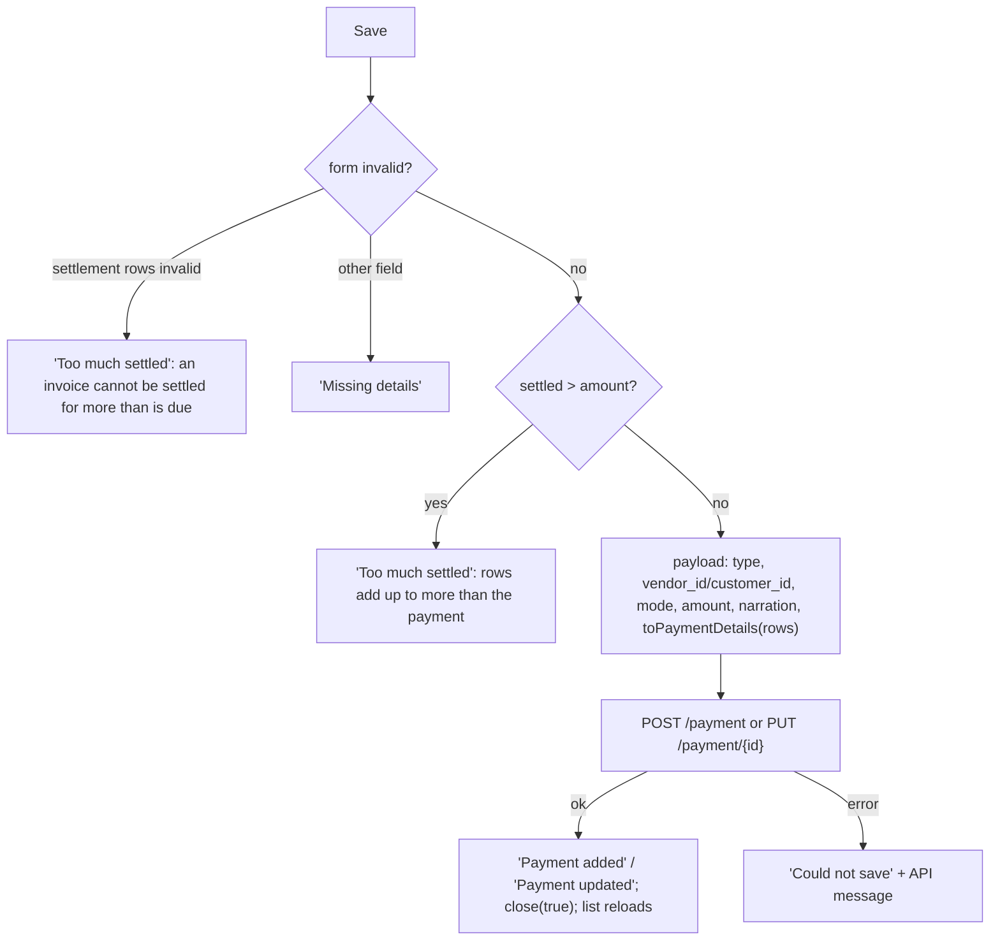

# Payments and Payment Adjustments — Frontend

> Part of the Inventory System implementation guide. Read `docs/BRD.md` for the business picture and `docs/frontend/frontend-setup.md` for how the web app is organised.

## 1. What this is

**Payments** (`/accounting/payments`) record money paid to a vendor or received from a customer. The form lists the party's invoices with money due (credit purchases for a vendor, credit sales for a customer) and lets the user type what this payment settles of each, or spread the amount oldest-first with one click. Whatever is not settled stays as an **unadjusted amount**, an advance.

**Payment Adjustments** (`/accounting/payment-adjustment`) list the payments that still have an unadjusted amount and let the user apply it to the party's invoices later, for example a payment received before the invoice existed.

Vendor and customer payments are one list and one form; a "party type" picks which side the money goes.

## 2. Where the code lives

All paths are under `frontend/src/app/features/accounting/`.

| File | What is in it |
|---|---|
| `accounting.routes.ts` | `payments` (operation `['ViewVendorPayment', 'ViewCustomerPayment']`: either lets the user in) and `payment-adjustment` (`ViewPaymentAdjustment`), both through `permissionGuard`. |
| `payment/payment.model.ts` | `PartyType`, `PARTY_TYPES`, `PAYMENT_DIRECTIONS` (`Send` → `Vendor`, `Receive` → `Customer`), `VIEW_PAYMENT_OPERATIONS`, `PaymentFormMode`, `PaymentFormData`, `PaymentAdjustmentFormData`, `PaymentDetail`, `Payment`, `PaymentPayload`, `OutstandingInvoice`. |
| `payment/payment.service.ts` | `PaymentService`: `list`, `get`, `nextNumber`, `create`, `update`, `delete`, `outstanding(type, partyId)`, `unadjusted(params)`, `adjust(paymentId, details)`, `exportList`, `exportOne`, `printRange`, `exportUnadjusted`. |
| `payment/settlement.ts` | `SettlementRow`, `settlementRows`, `settledRows`, `settledTotal`, `autoSettle`, `toPaymentDetails`. |
| `payment/invoice-settlement/` | `InvoiceSettlement`: the invoices table with one amount input per row. |
| `payment/payment-list/` | `PaymentList`. |
| `payment/payment-form/` | `PaymentForm`: add / edit / view in the bottom drawer. |
| `payment-adjustment/payment-adjustment-list/` | `PaymentAdjustmentList`. |
| `payment-adjustment/payment-adjustment-form/` | `PaymentAdjustmentForm`: the Adjust drawer. |

Shared pieces: `LIST_PAGE_CARD`, `SummaryCard` (`SummaryItem { label, value, net?, error? }`), `DateText`, `DocNoPipe`, `AmountPipe`, `DropdownService` (`vendors`, `customers`, `paymentModes`), `FileDownloads`, `withMissing`, `round2`, the date utils, `apiErrorMessage`. API shapes: `backend/endpoints.md` section 12.

## 3. Screens

### 3.1 Payments list

| Column | Shows | Sorts by |
|---|---|---|
| S.N | running number | — |
| Payment Number | `system_entry_no` via `docNo`, a link to **view** | `systemEntryNo` |
| Date | `<app-date-text>` in the page calendar | `date` |
| Party Type | `VENDOR` / `CUSTOMER` chip | `type` |
| Party Name | `vendor_name` or `customer_name` by `type` | — |
| Payment Mode | `payment_mode_name` | `paymentMode.accountName` |
| Amount | bold | `amount` |
| Unadjusted | highlighted when > 0 | `unadjustedAmount` |
| Actions | View; Edit (`EditPayment`); Delete (`DeletePayment`) | — |

Title bar: search by `partyName` (the API matches vendor and customer names alike), filters Payment No (`systemEntryNo`), Payment Mode (`paymentMode.accountName`), Narration (`narration`); a **Party Type** select (`All Parties`, clearable) shown only when the user may view both kinds; AD/BS switch; From / To dates (default today); **Print**, **Export**; **Add Payment** (`CreatePayment`). Default sort `id:desc`, page size 10.

### 3.2 Payment form (bottom drawer)

Opened with `PaymentFormData { mode, id?, partyTypes?, calendar? }` (`position: 'bottom'`, `size: 'calc(100vh - 48px)'`, `panelClass: 'drawer-sheet'`, `disableClose: true`). Headings `Add Payment`, `Edit Payment`, `Payment`.

| Section | Field | Control | Rule |
|---|---|---|---|
| Top card | Party Type | select of `partyTypes` (`Vendor` / `Customer`) | required; only the types the user may view |
| | Date | date input in the list's calendar | required, default today |
| | Payment Number | read-only chip/text (`entryNo`) | preview of the next number when adding |
| | Vendor / Customer | searchable select, label is the type | required; cleared when the type changes |
| Payment Details | Payment Type | radios `Send` / `Receive` | **the same `type` control** as Party Type under another label |
| | Transaction Type | select of `GET /dropdown/paymentModes` (Cash, banks) | required; new payments default to the account named `Cash` |
| | Amount | number, 2 decimals | required, min 0.01 |
| Payment Send/Receive Details | **Settle Oldest First** button, `InvoiceSettlement` table, `SummaryCard` | | |

The invoices table columns: S.N, Invoice Date, Invoice Number (`docNo`), Invoice Amount, Amount Due (hidden in view mode, since it has moved on), and **Paid** (a number input, or the bold value in view mode). Empty text: "Pick a party to see their invoices with money due." → "No invoices due. The whole amount stays unadjusted." → in view mode "This payment does not settle any invoice yet."

Summary card: **Total Adjusted Paid Amount** (what the rows settle; red when more than the amount), **Unadjusted Amount** (amount − settled), **Total Payment Amount** (the bottom line).

There is **no narration field**: the API writes one (`Payment received from Ram Traders`). Footer: view → Close and Edit (`EditPayment`); add/edit → Cancel and Add / Update. View mode offers **Print** (PDF voucher or receipt) and **Export** (Excel) in the header.

### 3.3 Payment Adjustments list

Same rows as the payments list (the API's `GET /payment-adjustment` returns payments with an unadjusted amount), with these differences: a **Settled** column (`total_adjusted_paid_amount`, sort `totalAdjustedPaidAmount`), the payment mode shown under the party name, the Party Type select always shown, From / To **open by default** (money left over from any day can still be adjusted), no Add, no Edit/Delete, and an **Adjust** button per row (plus the number link) gated on `CreatePaymentAdjustment`. Empty text "No payments with an unadjusted amount." Print/Export call `/payment-adjustment/export/{format}`.

### 3.4 Adjust drawer

`PaymentAdjustmentForm` opens in the same bottom drawer with `{ payment, calendar }` (the list row; nothing loads but the invoices). It shows the payment as a definition list (Payment Number, Date, the party under its type, Payment Mode, Amount, Settled So Far, Narration when any), then **Invoices Due** with Settle Oldest First, the `InvoiceSettlement` table (amount header **Adjust Now**, empty text `No invoices due from <party>.`) and a summary: **Unadjusted Amount**, **Adjusting Now** (red when too much), **Left Unadjusted**. Footer: Cancel and **Adjust** (`Adjusting…`; disabled while loading or with no rows).

## 4. How it works

### 4.1 Loading the lists and the one-type rule

**Idea.** Both lists use the standard signal → computed request → `toObservable` + `switchMap` loop. The payments list adds `partyTypes = PARTY_TYPES filtered by hasOperation(VIEW_PAYMENT_OPERATIONS[type])`. When only one type is allowed, the select is not rendered and `type` is fixed to that one; otherwise `type` is the select's pick (`null` = both). `type` goes out as the `type` query parameter, so a role that can view only vendor payments never receives customer ones, and the form it opens gets `partyTypes` with that one entry.

```
query  = filters + type (if any) + fromDate/toDate (toIsoDate) + sort (SORT_FIELDS or "id:desc")   -- no paging; also used by export
request = { ...query, pageIndex, pageSize } + refresh
GET /payment?request   (adjustment list: GET /payment-adjustment)
ok -> rows, total;  error -> empty text = apiErrorMessage(error, "Could not load payments.")
```

### 4.2 Settlement rows (`settlement.ts`)

**Idea.** The outstanding reports say what is due *now*, which already has the edited payment's own settlements taken off. To edit a payment, those settlements must count as available again, otherwise the user could not even re-save the same amounts. An invoice this payment settled in full is no longer outstanding at all, so it comes from the saved details alone.

```
settlementRows(outstanding, saved = []):
  own = saved details grouped by invoice_number, paid_amount summed   -- an adjusted payment can name an invoice twice
  rows = for each outstanding invoice:
           paid = own[invoice].paid_amount or 0; remove it from own
           row(invoice, due = round2(invoice.due_amount + paid), paid)
  for each detail left in own:                                       -- settled in full, no longer outstanding
           rows += row(detail, due = detail.paid_amount, paid = detail.paid_amount)
  sort by invoice_date, then invoice_number                          -- oldest first
row(...): paid is a FormControl(paid or null) with validators min(0) and max(due)
settledRows(saved) = settlementRows([], saved)                        -- view mode
settledTotal(rows) = round2(sum of paid values)
toPaymentDetails(rows) = rows with paid > 0 -> { invoice_number, invoice_date, total_invoice_amount,
                                                 due_amount: round2(due − paid), paid_amount: paid }
```

`PaymentService.outstanding(type, partyId)` reads `GET /reports/accounting/payable` (vendors) or `/receivable` (customers) and keeps the rows whose `party_id` matches, since the reports cover every party.

### 4.3 Settle Oldest First (`autoSettle`)

```
autoSettle(rows, amount):
  left = round2(max(amount, 0))
  for row in rows:                       -- rows are already oldest first
      paid = round2(min(row.due_amount, left))
      row.paid := paid, or blank when 0
      left = round2(left − paid)
```

Each invoice is settled in full while the money lasts; the first one it can't cover gets the remainder; the rest are cleared. Running it again with a smaller amount therefore *un-settles* later rows. The payment form runs it with the typed amount (warning "No amount" / "Enter the payment amount first." when it is 0); the Adjust drawer runs it with `payment.unadjusted_amount`.

### 4.4 Opening the payment form

```
constructor:
  type.valueChanges:
      setValue(type, emitEvent false)       -- the select and the radios share the control; write the pick to both
      if type != pickedType: pickedType := type; party_id := null      -- vendors and customers are different lists
  rows pipeline on computed { type, partyId, readonly, saved }:
      own = saved.paymentDetails if saved has this type and party, else []
      readonly        -> rows := settledRows(own)                      -- view shows only what it settled
      no party        -> rows := []
      else            -> invoicesLoading; GET outstanding(type, partyId) -> settlementRows(invoices, own)
                         error -> "Could not load the invoices due"; rows := settlementRows([], own)
      setRows: rebuild the `settlement` FormArray from the rows' paid controls (so validity counts with the form)
  mode != add and id -> load(id): GET /payment/{id} -> fill
                        error -> "Could not load the payment"; close
  else -> mode := add; GET /payment/generateNumber -> entryNo
fill(payment): entryNo, saved := payment, pickedType := payment.type (so the party is not cleared),
               patch type, party_id (vendor_id or customer_id), date, payment_mode_id, amount; markAsPristine
```

Other state: `vendorList` / `customerList` load only for allowed types; `modeList` loads payment modes and, in add mode with nothing picked, sets the one named `cash`. `partyOptions = withMissing(list for the type, the saved party if same type)` and `modeOptions = withMissing(modes, saved mode)` keep inactive records labelled. `value = toSignal(form.valueChanges → getRawValue())`; `settled = settledTotal(rows())` (recomputed on every value change); `summary` derives from `amount` and `settled`. Switching view → edit (`startEdit`) flips `readonly`, which makes the pipeline fetch the invoices due.

### 4.5 Saving a payment



```
payload = { date: toIsoDate(date), type,
            vendor_id:   type == Vendor   ? party_id : 0,
            customer_id: type == Customer ? party_id : 0,
            payment_mode_id, amount,
            narration: same party as saved ? saved.narration : "",   -- blank: the API writes one for the party
            paymentDetails: toPaymentDetails(rows) }
```

**Rules shown by the form**

| When | Title | Message |
|---|---|---|
| a row's paid > its due (validator `max`) | Too much settled | An invoice cannot be settled for more than is due on it. |
| type, party, date, mode or amount missing / amount < 0.01 | Missing details | Fill in the fields highlighted in red. |
| `settled > amount` | Too much settled | The invoices settled add up to more than the payment amount. |
| Settle Oldest First with amount ≤ 0 | No amount | Enter the payment amount first. |

API rules behind them (shown through `apiErrorMessage`): `"Payment type must be either Vendor or Customer"`, `"Payment amount must be greater than zero"`, `"Paid amount for an invoice must be greater than zero"`, `"Paid amount exceeds due amount for invoice <no>"`, `"Adjusted amount cannot exceed the payment amount"`, `"Due Invoice not found: <no>"`, `"Payment Mode Account not found"`. On update the API first takes back everything the payment settled (adjustments included), then applies the details sent, which is why the form sends every invoice the payment should still settle.

### 4.6 Deleting a payment

Delete (`DeletePayment`) confirms with "Delete payment?" / "`<number>` from `<party>` will be deleted, and the invoices it settled become due again. This cannot be undone.", runs `DELETE /payment/{id}`, shows "Payment deleted", and steps back a page when the last row of a later page goes.

### 4.7 Adjusting a payment

**Idea.** Adjustment only *adds* settlements out of the unadjusted amount; it never takes any back (editing the payment does that). So the drawer starts from `settlementRows(invoices)` with nothing pre-filled and compares against `payment.unadjusted_amount`, not `amount`.

```
constructor: GET outstanding(payment.type, vendor_id or customer_id)
             -> rows := settlementRows(invoices); push each paid control into `amounts` (FormArray)
             error -> "Could not load the invoices due"; rows := []
adjusting = settledTotal(rows)   (recomputed on amounts.valueChanges)
save():
  amounts invalid         -> "Too much settled" / "An invoice cannot be settled for more than is due on it."
  details = toPaymentDetails(rows); none -> "Nothing to adjust" / "Enter the amount to settle on at least one invoice."
  adjusting > unadjusted  -> "Too much settled" / "The invoices settled add up to more than the unadjusted amount."
  POST /payment-adjustment/{payment.id} with the details list
  ok    -> "Payment adjusted"; close(true); the list reloads (a fully adjusted payment drops out; step back a page if it was the last row)
  error -> "Could not adjust" + API message ("No invoice adjustments were provided",
           "Adjusted amount cannot exceed the unadjusted amount of the payment", "Paid amount exceeds due amount for invoice <no>")
```

### 4.8 Print and Export

- Lists: `exportList(format, { ...query, calendar })` → `/payment/export/{format}`; the adjustment list uses `exportUnadjusted` → `/payment-adjustment/export/{format}`. The query carries `type` when one is picked, so the file keeps to one kind.
- The form in view mode: `exportOne(id, format, { calendar })` → `/payment/{id}/export/{format}`, a voucher (vendor) or receipt (customer) as PDF, or the settled invoices as Excel.
- `printRange(params)` → `/payment/print?fromDate=&toDate=&type=` is used by the header's Range Print drawer, not by these pages.
- All go through `FileDownloads.run` (one at a time, `Printing…` / `Exporting…`, failures as notifications).

## 5. Design decisions and gotchas

- **Party Type and Payment Type are one control.** The API ties direction to party type (`Vendor` = money out, `Customer` = money in), so `Send` / `Receive` are just `PAYMENT_DIRECTIONS` labels over the same `type` control. Angular does not propagate a pick from one bound control to the other, hence the `setValue(..., { emitEvent: false })` write-back.
- **Clearing the party on a type change** is keyed on `pickedType`, not on every `valueChanges`, so loading a saved payment (which patches `type` too) keeps its party.
- **View mode never calls the outstanding reports**: it shows `settledRows(saved details)`, and the Amount Due column is hidden because the figure has moved on. Switching to Edit triggers the fetch.
- **Saved settlements count as available again** (`due + own paid`), mirroring the API's reverse-then-reapply on update. A payment adjusted later can list the same invoice twice in `paymentDetails`; `savedByInvoice` merges them.
- **The narration is kept only while the party stays the same**; a new party gets a blank, and the API writes a fresh one.
- **Rounding**: every sum goes through `round2`, since the API compares to the paisa.
- The row `paid` controls are pushed into a `FormArray` on the form (`settlement` / `amounts`) only so their validity and changes flow into `form.invalid` and `valueChanges`; they are created by `settlement.ts`, not by the form builder.
- The payments list's dates default to **today**, the adjustment list's to **open**.
- Adjustment can't undo; the form's Edit can. Tell users to edit the payment to take a settlement back.

## 6. Build it yourself: order of work

1. Routes and sidebar entries: `payments` with the two View operations (list), `payment-adjustment` with `ViewPaymentAdjustment`.
2. `payment.model.ts`: the constants (`PARTY_TYPES`, `PAYMENT_DIRECTIONS`, `VIEW_PAYMENT_OPERATIONS`) and the API shapes from section 12.
3. `PaymentService`, including `outstanding` (report + client-side `party_id` filter), `unadjusted`, `adjust` and the three file methods.
4. `settlement.ts` with unit tests for `settlementRows` (merging saved details, fully settled invoices, sorting), `autoSettle`, `toPaymentDetails` (see `settlement.spec.ts`).
5. `InvoiceSettlement`: columns, `readonly` hides Amount Due, `amountHeader` input.
6. `PaymentForm`: the shared `type` control with write-back, the rows pipeline on `{ type, partyId, readonly, saved }`, default Cash mode, summary card, save rules, view-mode Print/Export.
7. `PaymentList`: `partyTypes` from permissions, the hidden select for one-type roles, `type` in the query, delete.
8. `PaymentAdjustmentList` (open date range, Settled column, Adjust button) and `PaymentAdjustmentForm` (rows from outstanding only, compare against `unadjusted_amount`).
9. Try it: add a credit sale, receive 1500 against a 1130 invoice, see 370 unadjusted, add another sale, adjust the 370 onto it, then edit the first payment and watch its settlements come back as available.
