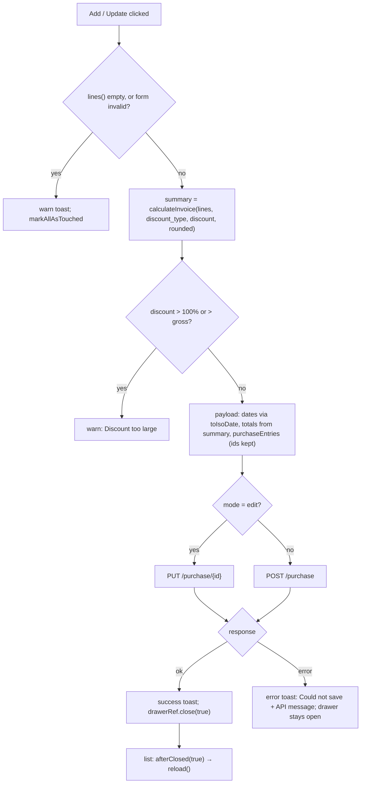

# Purchase Entry and Purchase Return — Frontend

> Part of the Inventory System implementation guide. Read `docs/BRD.md` for the business picture and `docs/frontend/frontend-setup.md` for how the web app is organised.

## 1. What this is

Two pages under the Purchase menu. **Purchase Entry** (`/purchase/entry`) records a vendor's bill: which products came in, into which batch, at what prices, and whether it was paid in cash or on credit. **Purchase Return** (`/purchase/return`) records goods sent back to a vendor, taken out of a batch that is in stock. Each page is a list; add, edit and view all open the same form in a bottom drawer. The browser works out every total (gross, discount, taxable, tax, rounding, net) and sends them; the server stores them as sent, moves the stock and posts the journal.

The two pages are built the same way. Section 3 and 4 describe the purchase entry in full and then say what the return does differently.

## 2. Where the code lives

All paths are under `frontend/src/app/`.

| File | What is in it |
|---|---|
| `features/purchase/purchase.routes.ts` | `PURCHASE_ROUTES`: `entry`, `return`, the vendors page (`partyRoute('vendors', 'vendor')`), `''` redirects to `entry`. Each route has `data.operation` and `canActivate: [permissionGuard]` |
| `features/purchase/purchase.model.ts` | `Purchase`, `PurchaseLine`, `PurchasePayload`, `PurchaseReturn`, `PurchaseReturnLine`, `PurchaseReturnPayload`, `Vendor`, `PurchaseFormMode` (`add`/`edit`/`view`), `PurchaseFormData` (what the drawer gets) |
| `features/purchase/purchase.service.ts` | `PurchaseService`: `list`, `get`, `nextNumber`, `create`, `update`, `delete`, `vendor(id)`, `exportList`, `exportOne`, `printRange` on `/purchase` |
| `features/purchase/purchase-return.service.ts` | `PurchaseReturnService`: the same calls on `/purchase-return` (no `vendor`) |
| `features/purchase/purchase-entry/purchase-entry-list/` | `PurchaseEntryList` |
| `features/purchase/purchase-entry/purchase-entry-form/` | `PurchaseEntryForm` |
| `features/purchase/purchase-return/purchase-return-list/` | `PurchaseReturnList` |
| `features/purchase/purchase-return/purchase-return-form/` | `PurchaseReturnForm` |
| `shared/components/list-page-card/` | `LIST_PAGE_CARD`: the card with a toolbar (`app-list-card-title`), a scrolling body and a pager footer |
| `shared/components/invoice-summary-card/` | `InvoiceSummaryCard`: the totals box with the discount type and discount inputs |
| `shared/components/party-details-card/` | `PartyDetailsCard`: registration number, address, contact and the document number chip |
| Lumen `ConfirmDialog` (`@lumen-ui/angular`) | Delete confirmation; `onConfirm` returns the request, the dialog stays open on error |
| `shared/utils/invoice.ts` | `round2`, `lineAmount`, `calculateInvoice` |
| `shared/utils/batch.ts` | `batchName`, `batchOptions`, `firstBatch`, `isExpired` |
| `shared/utils/options.ts` | `withMissing`, `docNoOptions` |
| `shared/utils/date.ts`, `shared/utils/api-error.ts` | `toIsoDate`, `fromIsoDate`, `startOfToday`; `apiErrorMessage` |
| `shared/services/product-lookup.ts` | `ProductLookup`: product details and batches of the lines, fetched once per form |
| `shared/services/dropdown.service.ts` | `DropdownService`: `vendors()`, `products('inventory', 'purchasable')`, `purchases(vendorId)` |
| `shared/services/file-downloads.ts`, `file.service.ts` | `FileDownloads` (one download at a time, button label) and `FileService.download` (GET a blob, save it under the `Content-Disposition` name) |
| `shared/pipes/doc-no.pipe.ts`, `amount.pipe.ts` | `docNo` (`\|PE-000001` → `PE-000001`), `amount` (two decimals, grouped) |
| `shared/styles/document-list.scss`, `document-form.scss` | The one stylesheet each list and each document form uses (`.form-drawer` with `.head`, `.body`, `.fields`, `.lines`, `.foot`) |
| `features/party/party.service.ts` | `PartyService.get('vendor', id)`: the return form's vendor details |

## 3. Screens

### 3.1 Purchase entry list

Route `/purchase/entry`, needs `ViewPurchaseEntry`. The sidebar link carries the same operation.

**Toolbar** (left to right): `l-filter` whose search box filters on `vendor.name` and whose extra filters are Bill No (`billNo`), Entry No (`systemEntryNo`) and Transaction Type (`transactionType`, a select with `Cash` / `Credit`); an AD/BS segmented control (`calendar`, default `bs`); From and To date inputs (both default to today, `fromDate` cannot pass `toDate`); then on the right Print, Export and, with `CreatePurchaseEntry`, **Add Purchase Invoice**.

**Columns** (key → sort field sent to the API, from `SORT_FIELDS`):

| Column | Key | Sort field | Shows |
|---|---|---|---|
| S.N | `sn` | — | running number across pages, two digits (`01`) |
| Purchase Number | `system_entry_no` | `systemEntryNo` | ghost button through `docNo`; click opens view |
| Posting Date | `date` | `date` | `<app-date-text>` in the chosen calendar |
| Vendor Name | `vendor_name` | `vendor.name` | |
| Bill Number/Date | `bill_no` | `billNo` | bill number over the bill date (`N/A` when none) |
| Transaction Type | `transaction_type` | `transactionType` | chip, `premium` for Credit, `success` for Cash |
| Gross/Discount Amt. | `sub_total` | not sortable | `sub_total` over the derived discount amount |
| Tax Amt. | `tax` | `totalTax` | |
| Net Amt. | `grand_total` | `grandTotal` | bold |
| actions | `actions` | — | `l-menu`: View; Edit with `EditPurchaseEntry`; Delete with `DeletePurchaseEntry` |

The discount amount is not stored: `discount` holds what the user typed (a percent or an amount). The list derives it as `max(round2(sub_total − taxable_amount − non_taxable_amount), 0)`.

**Footer**: `l-pagination` bound to `pageIndex` (0-based) and `pageSize` (default 10).

### 3.2 Purchase entry form (bottom drawer)

Opened by `DrawerService.open(PurchaseEntryForm, { data: { mode, id, calendar }, position: 'bottom', size: 'calc(100vh - 48px)', panelClass: 'drawer-sheet', disableClose: true })`. `disableClose` means a backdrop click never throws away edits; only the form's own buttons close it. The form reads `DRAWER_DATA` optionally, so it also renders inline in tests and then defaults to `add`.

Header: an icon badge, title and subtitle from `HEADINGS[mode]` (`Add Purchase Invoice` / `Edit Purchase Invoice` / `Purchase Invoice`), and on the right Print and Export (view mode only) and a close X.

**Header fields** (first card), each a Lumen input with `[viewMode]="readonly()"`, so view mode shows the same template as text with a label:

| Control | Input | Rule |
|---|---|---|
| `vendor_id` | `l-select`, searchable, `vendorOptions()` | required |
| `date` | `l-date-input` in the list's calendar | required, defaults to today |
| `bill_no` | `l-text-input` | required |
| `bill_date` | `l-date-input` | required |
| `transaction_type` | `l-select` of `TRANSACTION_TYPES` (`Cash` / `Credit`) | required |
| `rounded` | `l-toggle` "Rounding Amount" | default on |

Beside them, `PartyDetailsCard` titled "Vendor & Purchase Details" shows the picked vendor's registration number, address and contact and a "Purchase Number" chip with `entryNo()`.

**Lines** (second card): "Product Details" with an **Add Product** button (hidden in view), an `l-table` over `lines()` with one cell template per column, and the `InvoiceSummaryCard` under it.

| Column | Cell | Control / rule |
|---|---|---|
| S.N | `serial(index)` | |
| Product | `l-select`, searchable, `productOptions()` | `product_id` required; `(change)` → `onProductChange` |
| Code, Unit | text from `productOf(row)` (`code`, `unit_name`) or `-` | read from `ProductLookup` |
| Batch No. | `l-text-input` | `batch_no`, free text; blank = default batch |
| Expiry Date | `l-date-input` | `expiry_date`, optional |
| Tax | `taxLabel(row)`: `13%` or `-` | the product's `tax_rate` |
| Quantity | `l-number-input`, 3 decimals | required, min 0.001 |
| Rate | `l-number-input`, 2 decimals | `cost_price`, required, min 0 |
| MRP, SP | `l-number-input` | `mrp`, `selling_price`, min 0 |
| Amount | `amountOf(row)` through `amount` | quantity × rate |
| actions | trash button → `removeLine` | column dropped in view mode |

**Summary card** (`InvoiceSummaryCard`): Gross Amount, Discount Type (`Percentage` / `Flat`, the form's own `discount_type` control), Discount (%) or Discount Amount (the form's `discount` control; label and suffix follow the type), Non Taxable Amount, Rounding, Taxable Amount, Tax, Net Amount, and a hint "Discount of X on the gross amount." when a percent is in use. Then a Remarks textarea.

**Footer**: in view mode Close and, with `EditPurchaseEntry`, **Edit** (switches to edit in place); otherwise Cancel and **Add** / **Update** (`Saving…` while the request runs).

### 3.3 Purchase return list

Route `/purchase/return`, needs `ViewPurchaseReturn`. Same toolbar and table, with these differences: the extra filters are Bill No, Return No (`systemEntryNo`), Ref. Purchase (`refPurchase.systemEntryNo`) and Transaction Type; the columns are Return Number, Posting Date, Vendor Name, Bill Number (number only, `-` when blank), **Ref. Purchase** (`ref_purchase_no` through `docNo`, sort field `refPurchase.systemEntryNo`), Transaction Type, Gross/Discount, Tax, Net, actions. Add is **Add Purchase Return** with `CreatePurchaseReturn`; Edit and Delete need `EditPurchaseReturn` / `DeletePurchaseReturn`.

### 3.4 Purchase return form (bottom drawer)

Same drawer and layout as the entry form, with:

- Header fields: `vendor_id` (required; changing it clears the reference), **Ref. Purchase** (`ref_purchase_id`, optional, clearable, searchable, options `refOptions()`; shows `-` in view mode when none), `date`, `bill_no` (**optional**), `transaction_type`, `rounded`. No bill date. The details card is "Vendor & Return Details" with a "Return Number" chip; the vendor comes from `PartyService.get('vendor', id)`.
- Line columns: S.N, Product, Code, Unit, **Batch** (`l-select` of `batchItems(row)`, labelled like `B1 · 15 in stock`; in view mode the text is `batchLabel(row)`, i.e. the saved `batch_no` or `Default batch`), **Expiry Date** (text, from the picked batch), **Stock** (the batch's `available_quantity`), Tax, Quantity, Rate (`cost_price`), MRP (text only), Amount, actions. `Stock` and `actions` are `EDIT_ONLY_COLUMNS`, dropped in view mode.
- The lines table shows its loading state while a reference purchase is being copied (`copying()`), and the Add/Update button is disabled meanwhile.
- Headings: `Add Purchase Return` ("Record goods sent back to a vendor"), `Edit Purchase Return`, `Purchase Return`.

## 4. How it works

### 4.1 Loading the list

**Idea.** Every piece of query state is a signal; one `computed` builds the request, and `toObservable` + `switchMap` turns each change into one HTTP call, cancelling the one before. Rows are kept until the next page arrives, so the table never flashes empty. The same `query()` (without paging) feeds the export, so the file has exactly what the filters show.

State: `calendar`, `fromDate`, `toDate`, `filters` (`FilterChange[]` from `l-filter`), `sort` (`TableSort | null`), `pageIndex`, `pageSize`, `refresh` (a counter bumped to refetch), and the results `rows`, `total`, `loading`, `loadError`. `query` is computed from the first five; `request` adds `pageIndex`, `pageSize` and `refresh`. `emptyText` is `loadError()` or `No purchases found for these filters.`

```
query():
  params[filter.field] = filter.value       for each filter      -- backend camelCase names
  params.fromDate / toDate = toIsoDate(...)  when set
  params.sort = sort ? `${SORT_FIELDS[key] ?? key}:${direction}` : 'id:desc'

on request change:
  loading = true
  GET /purchase?{query + pageIndex + pageSize}
  ok    -> rows = page.content, total = page.totalElements, loadError = ''
  error -> rows = [], total = 0, loadError = apiErrorMessage(error, 'Could not load purchases.')
  loading = false
```

A filter change, a date change or a sort change calls `resetPage()` (`pageIndex = 0`) so the user is never left on a page that no longer exists.

### 4.2 Opening the form (add / edit / view)

**Idea.** One component serves all three modes. `mode` is a signal because view can turn into edit without reopening. `readonly` is `mode() === 'view'` and drives every `[viewMode]`, the line columns and the footer.

```
constructor:
  if mode != 'add' and id given:
      load(id)
  else:
      mode = 'add'; addLine()                       -- one empty line to start
      GET /purchase/generateNumber -> entryNo       -- a preview; errors are ignored (entryNo stays null)

load(id):
  loading = true
  GET /purchase/{id}
  then ProductLookup.loadProducts(every line's product_id)   -- details first, so tax and totals
  then fill(purchase)                                         --   are right as soon as lines show
  error -> notification 'Could not load the purchase' + API message, close drawer
  finally loading = false

fill(purchase):
  entryNo = system_entry_no
  savedVendor = [{ vendor_id, vendor_name }]; savedProducts = one item per line
  rebuild the lines FormArray from purchaseEntries (clear + push, emitEvent false), lines signal = the groups
  patch header: date/bill_date via fromIsoDate, discount_type ?? 'Flat', discount || null, remarks ?? ''
  markAsPristine
```

The dropdowns list **active** vendors (`GET /dropdown/vendor/active`) and active purchasable inventory products (`GET /dropdown/products/inventory/purchasable/active`). A saved purchase may name a vendor or product that is now inactive, so `vendorOptions` = `withMissing(vendorList, savedVendor)` and `productOptions` = `withMissing(productList, savedProducts)`: the saved choice is appended when the dropdown no longer lists it, so the select still shows a label. A dropdown that fails shows `Could not load vendors` / `Could not load products` and leaves an empty list.

`vendor` is a signal from `vendor_id.valueChanges` (`startWith` the current value, `distinctUntilChanged`, `switchMap` to `GET /vendor/{id}`, errors become `null`), so the details card follows the select.

### 4.3 Line items and totals

**Idea.** Lines are a typed `FormArray<LineForm>` so validation and `getRawValue()` work as for any reactive form; a parallel `lines` **signal** holds the same groups so the `OnPush` table re-renders when one is added or removed. The totals are a `computed` over the form's raw value, so they follow every keystroke without manual recalculation.

```
addLine():    group = createLine(); form.lines.push(group); lines = [...lines, group]
removeLine(): index of group in form.lines; removeAt; lines = lines without it

onProductChange(line, productId):
  ProductLookup.loadProducts([productId])          -- GET /products/{id} once per product
  if the line still has that product:
      line.patch cost_price, selling_price, mrp from the product   -- its last purchase prices

summary = computed:
  value = form raw value (kept in a signal fed by form.valueChanges)
  for each line: { amount: lineAmount(quantity, cost_price), taxRate: products.get(product_id)?.tax_rate || 0 }
  calculateInvoice(lines, value.discount_type, value.discount ?? 0, value.rounded)
```

`calculateInvoice` (`shared/utils/invoice.ts`):

```
gross          = round2(sum of line amounts)
requested      = Percentage ? gross × discount / 100 : discount
discountAmount = round2(clamp(requested, 0, gross))
factor         = gross > 0 ? (gross − discountAmount) / gross : 0
for each line: part = amount × factor
    taxRate > 0 -> taxable += part; tax += part × taxRate / 100
    else        -> nonTaxable += part
round2 taxable, nonTaxable, tax
total    = round2(taxable + nonTaxable + tax)
rounding = rounded ? round2(Math.round(total) − total) : 0      -- can be negative
net      = round2(total + rounding)
```

**Why spread the discount over the lines?** The journal the server posts needs `net = taxable + nonTaxable + tax + rounding`. Spreading the discount in proportion lowers taxable and non-taxable parts alike and charges tax on the discounted taxable amount, so the figures balance the way the server books them. `round2` rounds half up to paisa after `toPrecision(15)`, because `12.935 × 100` is `1293.4999…` in binary and would otherwise round down.

`ProductLookup` is listed in the form's own `providers`, so each open drawer has its own cache: `products` (by id, from `GET /products/{id}`) and `batches` (from `GET /products/stockInfo/{id}`). `loadProducts` / `loadBatches` fetch only ids not loaded yet, in one `forkJoin`; a product the user may not view fails quietly and is skipped.

### 4.4 Picking a batch (purchase return)

**Idea.** A purchase types a `batch_no` because the goods are arriving and a new number simply creates a batch. A return must take goods out of a batch that exists and has stock, so each line **picks** a `batch_id` from the product's stock info, and the form prefills the sensible choice.

```
onProductChange(line, productId):
  loadLineProducts: forkJoin(loadProducts([id]), loadBatches([id]))
  if the line still has that product:
      useBatch(line, firstBatch(batches of product))

firstBatch(batches): among batches with available_quantity > 0, the earliest expiry_date
                     (no date sorts last); if none in stock, the first batch
useBatch(line, batch):
  prices = batch ?? product
  line.patch batch_id = batch?.batch_id ?? 0, batch_no, cost_price, selling_price, mrp from prices

onBatchChange(line): useBatch(line, batchOf(line))     -- the batch the user picked
```

`batchItems(row)` reads a computed map of `batchOptions(batches)` per product: `B1 · 15 in stock`, or `Default batch · 7 in stock` for `batch_id` 0. `batchOf(row)` finds the picked batch so the Expiry Date and Stock cells can show its `expiry_date` and `available_quantity`. The form does **not** check that quantity ≤ stock; the API answers `Not enough Quantity In Stock`.

### 4.5 Picking a reference purchase (purchase return)

**Idea.** Most returns are against one bill, so picking it should do the typing: the return takes over the purchase's bill number, terms and discount and lists every line in full from the batch it went into; the user then deletes or trims what is not going back.

The options come from `GET /dropdown/purchase/{vendorId}` (`DropdownService.purchases`), which `vendorPurchases` reloads whenever `vendor_id` changes; `docNoOptions` relabels the raw numbers through `docNo`. `refOptions` = `withMissing(vendorPurchases, savedRef)` so a loaded return still shows its reference.

```
onVendorChange():        ref_purchase_id = null     -- a purchase belongs to one vendor

onRefChange(purchaseId):
  copying = true
  GET /purchase/{purchaseId}, then loadLineProducts(its lines)
  if ref_purchase_id still equals purchase.id:        -- ignore a pick that changed while loading
      copyPurchase(purchase)
  error -> 'Could not load the purchase'
  finally copying = false

copyPurchase(purchase):
  savedProducts += the purchase's products (withMissing)
  setLines(one new line per purchaseEntries line: product_id, batch_id ?? 0, batch_no, quantity, prices; no id)
  patch bill_no, transaction_type, rounded, discount_type ?? 'Flat', discount || null
```

`setLines` clears and refills the FormArray with `emitEvent: false`, then calls `updateValueAndValidity()` once so the summary recomputes. The date, vendor and remarks are left alone.

### 4.6 Saving

**Idea.** The browser validates what it can see (required fields, at least one line, a sane discount), computes the totals once more from the current form value, maps the form to the API's shape and sends it. The server stores the totals as sent, so the payload is built from `summary()`, not from anything typed.



What is sent (`PurchasePayload`):

| Field | From |
|---|---|
| `date`, `bill_date` | `toIsoDate(Date)` → `YYYY-MM-DD` (`bill_date` null when blank) |
| `bill_no`, `remarks` | trimmed; remarks `null` when blank |
| `transaction_type`, `vendor_id`, `rounded`, `discount_type` | the controls |
| `discount` | what was typed, `0` when blank (a percent or an amount, per `discount_type`) |
| `sub_total`, `non_taxable_amount`, `taxable_amount`, `tax`, `rounding`, `grand_total` | `summary.gross`, `nonTaxable`, `taxable`, `tax`, `rounding`, `net` |
| `purchaseEntries[]` | `id` (kept on saved lines so an update edits them instead of replacing them), `product_id`, `batch_no` (trimmed or null), `expiry_date` (ISO or null), `quantity`, `cost_price`, `selling_price ?? 0`, `mrp ?? 0` |

Note the naming: snake_case fields, a camelCase line list, and purchases call the tax **`tax`** (sales call it `total_tax`).

**Rules checked before sending** (toasts from `NotificationService.warn`):

- no lines → `No products` / `Add at least one product to the invoice.` (return: `… to the return.`)
- any invalid control → `Missing details` / `Fill in the fields highlighted in red.` (after `markAllAsTouched`)
- `discount_type` Percentage and `discount > 100`, or Flat and `discount > summary.gross` → `Discount too large` / `The discount cannot be more than the gross amount.`
- a save already running, or still loading / copying → the click is ignored

On success: `Purchase added` / `Purchase updated` (return: `Purchase return added` / `… updated`) with the API's `message`, then `drawerRef.close(true)`. On failure: `Could not save` with `apiErrorMessage(error)`, which shows the backend's `message` (for instance `Coca-Cola 500ml batch B1 is entered on more than one line`, `Product Stock is Already Used`, `Reference purchase belongs to another vendor`), `Cannot reach the server…` for status 0, else `Something went wrong. Please try again.`

The return payload differs only in `purchaseReturnEntries[]` (`id`, `product_id`, **`batch_id`**, `quantity`, prices; no `batch_no` or `expiry_date`), `ref_purchase_id` (number or null) and `bill_no` sent as null when blank.

### 4.7 Deleting

**Idea.** Purchases and purchase returns are editable documents, so they can be deleted (unlike sales, which are cancelled). The list asks first with Lumen's `ConfirmDialog`, whose `onConfirm` returns the delete observable: the dialog stays open on error and closes with `true` on success.

```
remove(row):
  number = docNo(row.system_entry_no)
  ConfirmDialog 'Delete purchase?' —
      "{number} from {vendor_name} will be deleted and its stock taken back out. This cannot be undone."
      (return: 'Delete purchase return?' — "… to {vendor_name} will be deleted and its goods put back into stock. …")
  onConfirm: DELETE /purchase/{id}; error -> toast 'Could not delete' + API message
  closed with true:
      toast 'Purchase deleted' — "{number} was deleted."
      if this was the only row on a page after the first: pageIndex − 1   (the pager is never left on an empty page)
      else reload()
```

The API refuses to delete a purchase whose stock has been sold (`Product Stock is Already Used`) or that a purchase return names (409); the toast shows that message.

### 4.8 Print / Export

**Idea.** The API builds every file (section 18 of `backend/endpoints.md`); the page only asks for it. `FileDownloads` is in each page's `providers` so each page has its own "one at a time" state and button label.

- List: `download('pdf' | 'excel')` → `FileDownloads.run(format, PurchaseService.exportList(format, { ...query(), calendar }))`: `GET /purchase/export/{format}` with the filters, dates and sort of the screen (no paging) and the AD/BS choice, so the file holds every matching row with dates in the calendar on screen.
- Form (view mode): `exportOne(id, format, { calendar })` → `GET /purchase/{id}/export/{format}`: the invoice as a PDF or its lines as Excel.
- `printRange(params)` → `GET /purchase/print?fromDate=&toDate=` is used by the header's Range Print drawer, not by these pages.

`running()` is `'pdf'`, `'excel'` or `null`; both buttons are disabled while one runs and the running one reads `Printing…` / `Exporting…`. A failure becomes `Print failed` / `Export failed` with the API message (the auth interceptor turns a failed Blob body back into JSON so `apiErrorMessage` works). `FileService.download` does a `GET` with `responseType: 'blob'` and `observe: 'response'` and saves the body under the `filename` in `Content-Disposition`.

## 5. Design decisions and gotchas

- **Totals live in the browser.** The server stores and books what it is sent, so `calculateInvoice` is the one place the arithmetic happens; the summary card and the payload both read `summary()`. The list derives the discount amount the same way the server would (`sub_total − taxable − non_taxable`).
- **Typed `batch_no` versus picked `batch_id`.** Goods coming in may name a new batch (purchase); goods going out must leave an existing one (return). That is why the two forms have different line shapes and why only the return loads `stockInfo`.
- **`batch_id` 0 is the default batch.** `useBatch` falls back to 0 with the product's own prices when a product has no stock info; a blank `batch_no` on a purchase means the same batch.
- **Old records without `discount_type`** are read as `Flat` (their discount was an amount). `discount` of 0 is shown as a blank input (`|| null`).
- **Line ids matter on update.** The API removes any saved line that is not sent back; keeping `id` on each line is what makes an edit an edit.
- **Why `withMissing`.** Dropdowns list active records only. Without merging the saved vendor/products in, a view of an old purchase would show empty selects.
- **Why a `lines` signal next to the FormArray.** The component is `OnPush`; pushing into a FormArray does not change any input, so the table would not re-render. The signal is the render trigger; the FormArray is the source of values.
- **Why `disableClose`.** A near full-screen drawer is easy to click outside of; losing a half-typed invoice that way would be worse than needing the Cancel button.
- **`generateNumber` is a preview.** The number is assigned when the server saves; the preview can be stale if someone else saves first, and it needs `CreatePurchaseEntry` (failure is silent).
- **Reference copy is best-effort.** It copies `bill_no`, terms and lines, not the date or remarks, and it replaces whatever lines were typed. A reference picked while a previous one is still loading is ignored once the old response arrives.
- **Filters are "contains" on the backend's camelCase names.** `transactionType=Cash` works; `transaction_type` would be silently ignored. Sorting also uses entity names, hence `SORT_FIELDS`.
- **Dates.** `fromIsoDate` parses `YYYY-MM-DD` as local midnight; `new Date('2026-10-31')` would be UTC and shift a day. The list's calendar is passed to the form so its date inputs open in the same calendar.
- The vendor details need `ViewVendor`; a role without it sees `-` in the card (the call's error becomes `null`).

## 6. Build it yourself: order of work

1. Write `purchase.model.ts` from section 10 of `endpoints.md`: the read shapes, the payloads (`Omit` of the read-only fields), the form mode and drawer data types.
2. Write `PurchaseService` and `PurchaseReturnService`: one method per endpoint, URLs from `environment.apiUrl`, file methods through `FileService`.
3. Add `PURCHASE_ROUTES` with `data.operation` and `permissionGuard`; mount it at `/purchase` and add the sidebar links with the same operations.
4. Build `PurchaseEntryList` on `LIST_PAGE_CARD`: the query signals, the `computed` request, `toObservable` + `switchMap`, `SORT_FIELDS`, the cell templates, the permission-gated buttons.
5. Build `PurchaseEntryForm`: the header `FormGroup`, the `LineForm` FormArray with the `lines` signal, `ProductLookup` in `providers`, `onProductChange`, the `summary` computed over `calculateInvoice`, `InvoiceSummaryCard` and `PartyDetailsCard`.
6. Wire the drawer: `openForm` in the list, `DRAWER_DATA` in the form, `load`/`fill` for edit and view, `startEdit`, `close(true)` → reload.
7. Add `save()` with the three checks and the payload mapping; test with a Percentage and a Flat discount and with rounding on and off against the API's stored totals.
8. Add delete with `ConfirmDialog`, then Print/Export with `FileDownloads`.
9. Copy the list and form for returns: swap the line shape to `batch_id`, add `loadBatches`, `batchOptions`, `firstBatch`, `useBatch`, the Ref. Purchase select with `docNoOptions`, `onVendorChange` and `onRefChange`/`copyPurchase`.
10. Write specs for: one empty line and the number preview on add; pricing a picked product and the posted totals; refusing an incomplete form; view → edit → `PUT` keeping line ids; the return's first-batch prefill and reference copy.
