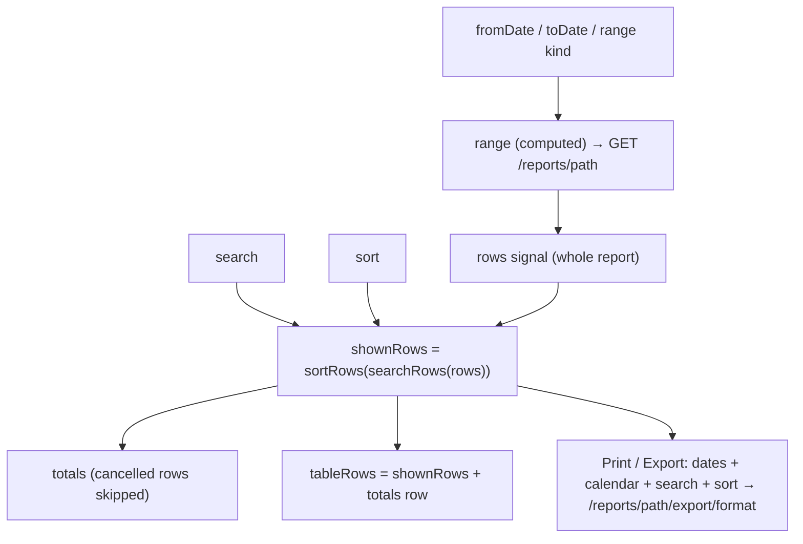

# Reports — Frontend

> Part of the Inventory System implementation guide. Read `docs/BRD.md` for the business picture and `docs/frontend/frontend-setup.md` for how the web app is organised.

## 1. What this is

Reports are read-only tables the API builds from the documents and journals: registers of purchases, sales and returns, their totals per party, product and batch, the current stock, and the accounting views (journal, ledger, trial balance, receivables, payables). The user opens `/reports`, picks a report, sets the dates, searches and sorts the rows, reads the totals, and prints a PDF or exports an Excel file of exactly what is on screen.

Every table report is the same page, `ReportView`, driven by a config entry in `REPORTS`. Only the ledger has its own page, `LedgerReport`, because it needs an account picked and shows a running balance instead of a flat table.

## 2. Where the code lives

All under `frontend/src/app/features/report/` unless noted.

| File | What is in it |
|---|---|
| `report.model.ts` | Row types, `ReportColumn`, `ReportConfig`, `discountAmount`, every report's config (`PURCHASE_REPORTS`, `PURCHASE_RETURN_REPORTS`, `SALES_REPORTS`, `SALES_RETURN_REPORTS`, `STOCK_REPORT`, `JOURNAL_REPORT`, `LEDGER_REPORT`, `TRIAL_BALANCE_REPORT`, `RECEIVABLE_REPORT`, `PAYABLE_REPORT`), the `REPORTS` map by path, `REPORT_GROUPS`, `REPORT_OPERATIONS` |
| `report.routes.ts` | `/reports` (the `Reports` page), one route per `REPORTS` key, and the ledger route |
| `report.service.ts` | `ReportService`: `rows`, `ledger`, `export`, `exportLedger` |
| `report-table.ts` | Pure functions both pages share: `cellValue`, `searchRows`, `sortRows`, `isCancelled`, `columnTotals`, `balanceSide`, `reportRange`, `startOfMonth`, `CALENDAR_OPTIONS` |
| `reports/` | `Reports`: the card page listing the reports the role may open |
| `report-view/` | `ReportView`: the shared table report page |
| `ledger-report/` | `LedgerReport`: one account's ledger |
| `report.scss` | Styles both pages share: `.void`, `.expired`, the sticky `.totalled` row, the print-only `.print-head` |
| `report.model.spec.ts` | Keeps the sidebar's operation list equal to `REPORT_OPERATIONS` and every listed report routed |
| `shared/services/file-downloads.ts` | `FileDownloads`: one Print / Export at a time; `running()` labels the button |
| `shared/components/date-text/` | `<app-date-text>`: an API date shown in the AD or BS calendar |
| `shared/utils/batch.ts` | `batchName` (`Default batch` for a blank number), `isExpired` |

### Routes

`REPORT_ROUTES` is built from the config, so a report can't be listed without a page:

| Path | Component | `data` |
|---|---|---|
| `/reports` | `Reports` | `operation: REPORT_OPERATIONS` (a list: any one of them opens the page) |
| `/reports/<path>` for every key of `REPORTS` (e.g. `purchase/vendor`) | `ReportView` | `breadcrumb: title`, `operation`, `report: path` |
| `/reports/accounting/ledger` | `LedgerReport` | `operation: 'ViewAccount'`; reads `?account=&fromDate=&toDate=` |

A report's page path **is** its API path: `/reports/purchase/vendor` reads `GET /reports/purchase/vendor`. Every route uses `permissionGuard`.

### API used (sections 14 and 18 of `backend/endpoints.md`)

| Method | Path | Used by |
|---|---|---|
| `GET` | `/reports/<path>?fromDate&toDate` | `ReportService.rows`: the whole report, not paged |
| `GET` | `/reports/accounting/ledger/{accountId}?fromDate&toDate` | `ReportService.ledger` |
| `GET` | `/reports/<path>/export/{excel or pdf}?fromDate&toDate&calendar&search&sort` | `ReportService.export` through `FileService.download` |
| `GET` | `/reports/accounting/ledger/{accountId}/export/{format}?fromDate&toDate&calendar` | `ReportService.exportLedger` |

Permissions are per report (see the tables below). The API also accepts `dateType=BS` but answers an error for it, so the pages always send AD dates and convert only what they display.

## 3. Screens

### 3.1 The Reports page (`/reports`)

One `l-card` per entry of `REPORT_GROUPS`, with an icon, title, subtitle and a list of links (`routerLink="/reports/<path>"`). `groups` is a `computed` that keeps, in each group, the reports whose `operation` passes `auth.hasOperation` (a list means any one), then drops groups left empty. With nothing left it says "Your role has no reports to open."

| Group | Reports (operation) |
|---|---|
| Purchase | Purchase Register, Purchase by Vendor, by Product, by Batch (`ViewPurchaseEntry`) |
| Purchase Return | the same four under `purchase-return` (`ViewPurchaseReturn`) |
| Sales | Sales Register, by Customer, by Product, by Batch (`ViewSalesEntries`) |
| Sales Return | the same four under `sales-return` (`ViewSalesReturns`) |
| Inventory | Stock Report (`ViewStockEdit`) |
| Accounting | Journal Report, Ledger, Trial Balance (`ViewAccount`); Accounts Receivable (`ViewCustomerPayment`, `ViewAccount` or `CreatePaymentAdjustment`); Accounts Payable (`ViewVendorPayment`, `ViewAccount` or `CreatePaymentAdjustment`) |

`REPORT_OPERATIONS` is the de-duplicated set of every operation above. The sidebar's Reports link lists the same operations by hand; `report.model.spec.ts` fails if the two ever differ, and also checks that every listed report has a route (`Object.keys(REPORTS).length + 1` listed, the `+ 1` being the ledger).

### 3.2 A table report (`ReportView`)

Title slot: a search box, an AD/BS segmented control, the date inputs the report's `range` asks for, then Print and Export. Body: the table. Footer: a row count.

| `range` | Date inputs shown | What is sent |
|---|---|---|
| `period` | From and To (`format="YYYY/MM/DD"`, each limited by the other) | `fromDate` and `toDate`; by default the 1st of this AD month (`startOfMonth()`) to today (`startOfToday()`) |
| `asOf` | one "As of" input bound to `toDate` | only `toDate` |
| `none` | nothing | nothing |

The trial balance is `asOf` because it must sum every movement from the very beginning; the stock, receivable and payable reports are `none` because they describe now.

Columns come from the config. Each `ReportColumn` has `key`, `header`, and optional `format`, `value`, `total`, `width`:

| `format` | Cell |
|---|---|
| `text` (default) | the value, or `-` |
| `amount` | two decimals through the `amount` pipe, right-aligned |
| `number` | as is (quantities, counts), right-aligned |
| `date` | `<app-date-text>` in the page's calendar; an `expiry_date` in the past gets class `expired` (red) |
| `docNo` | through the `docNo` pipe; a cancelled row adds a red `CANCELLED` chip |
| `batch` | `batchName(value)`: the batch number or `Default batch` |
| `account` | a link to the ledger of `row.account_id` over the same dates |

The table shows an `S.N` column first, then the config columns, all sortable. When any column has `total`, a totals row is appended as the last row and pinned to the bottom (`.totalled` makes the last row sticky). In it, each `total` column shows its sum and the first column without `total` (`totalLabelKey`) reads "Total".

Buttons: Print (PDF) is disabled while a download runs; Export (Excel) also when there are no rows on screen. Both read `downloads.running()` to say `Printing…` / `Exporting…`. They need no extra permission: the API checks the same View operation as the report.

Footer: `N rows`, or `N of M rows match` while searching, plus `· K cancelled, left out of the totals` when any shown row is cancelled.

### 3.3 The ledger (`LedgerReport`)

Title slot: a searchable account `l-select` (every account, active or not: their past entries still matter), the AD/BS control, From and To, Print and Export (both disabled until a ledger is loaded). The table has fixed columns: S.N, Date, Entry No, Narration, Debit, Credit, Balance. Its rows are built from the API's `Ledger`:

1. an **opening** row: narration "Opening Balance", balance `opening_balance`;
2. one **line** row per `rows[]` entry, with the running `balance`;
3. a **total** row: narration "Total", `total_debit`, `total_credit`, balance `closing_balance`.

Balances show as `abs(balance)` followed by `Dr` or `Cr` from `balanceSide` (positive is debit, negative credit, within ±0.005 nothing). A line's debit or credit cell is blank when zero. The footer reads `N entries · closing balance X Dr`, or "No account picked".

## 4. How it works

### 4.1 Report configs (`report.model.ts`)

**Idea.** A report is one API list and one table, so it is described, not coded: `ReportConfig = { title, description, path, operation, range, columns, emptyText }`. The four reports of each document kind are alike, so a `documentReports(path, name, document, party, operation, cancellable)` helper makes them, and `REPORTS` is a map from `path` to config built from every list.

Column sets worth knowing:

- `registerColumns(party)`: `date`, `system_entry_no` (docNo), `bill_no` (vendor side only), `vendor_name` / `customer_name`, `transaction_type`, then `sub_total`, `discount`, `non_taxable_amount`, `taxable_amount`, `total_tax`, `grand_total` as `amount` with `total`.
- `partyColumns(party)`: the party, `entry_count` (number, total), `sub_total`, `total_tax`, `grand_total`.
- `PRODUCT_COLUMNS` / `BATCH_COLUMNS`: `product_name`, (`batch_no` as batch, `expiry_date`), `quantity`, `amount` (total).
- `OUTSTANDING_COLUMNS`: `invoice_date`, `invoice_number` (docNo), `total_invoice_amount`, `paid_amount`, `due_amount` (all total), after a `party_name` column headed Customer or Vendor.
- `STOCK_REPORT`: `product_name`, `batch_no`, `expiry_date`, `quantity` ("In Stock"), `cost_price`, `selling_price`, `mrp`, `stock_value` (total).
- `JOURNAL_REPORT`: `date`, `system_entry_no`, `account_name`, `narration`, `debit_amount`, `credit_amount` (both total).
- `TRIAL_BALANCE_REPORT`: `account_code`, `account_name` (format `account`), `account_type`, `total_debit`, `total_credit`, `debit_balance`, `credit_balance` (all total).

The register's Discount column is the one place `value` is needed. The API's `discount` is what the user typed (a percent or an amount, per `discount_type`), so the column derives the money:

```
discountAmount(row) = max(round2(sub_total − taxable_amount − non_taxable_amount), 0)
```

`value` is honoured everywhere a cell's value is needed (display, search, sort, totals) through `cellValue(row, column)`.

### 4.2 Loading a report

**Idea.** The API returns the whole report, so there is exactly one request per set of dates. Everything else (search, sort, totals, counts) is a `computed` over the rows already in memory and costs no round trip.

```
range = computed(reportRange(config.range, fromDate(), toDate()))
        -- period: fromDate if set, toDate if set; asOf: toDate only; none: {}

toObservable(range)
  -> tap: loading = true
  -> switchMap: reportService.rows(config.path, range)
       map   -> { rows, error: '' }
       catch -> { rows: [], error: apiErrorMessage(e, 'Could not load the <title>.') }
  -> subscribe: loading = false; loadError = error; rows = rows

shownRows      = sortRows(searchRows(rows, columns, search), columns, sort)
totals         = columnTotals(shownRows, columns)
cancelledCount = shownRows.filter(isCancelled).length
tableRows      = hasTotals and shownRows.length ? [...shownRows, totals] : shownRows
emptyText      = loadError || (rows.length ? 'No rows match the search.' : config.emptyText)
```

The rows stay on screen while new dates load. The `l-table` is given `[serverSort]="true"` even though nothing is server-side: it makes the table only *show* the sort and leave the order to `shownRows`, so the totals row stays last.

### 4.3 Search, sort and totals (`report-table.ts`)

- **Search** looks only at text-like cells: `amount`, `number` and `date` columns contribute nothing; `docNo` and `batch` cells are searched as displayed (`PE-000001`, `Default batch`). Case-insensitive "contains" on the trimmed query; a blank query returns every row.
- **Sort** is on one column: blanks last, numbers by size, text with `localeCompare(…, { numeric: true, sensitivity: 'base' })` so `PE-2` sorts before `PE-10`.
- **Totals** add up each `total` column over the rows that are not cancelled (`row.is_cancelled === true`), rounded with `round2`. This mirrors the API's own per-party and per-product totals, which leave cancelled sales out.
- The sales and sales return registers list cancelled documents on purpose (the user should see them), mark them (`CANCELLED` chip; figures in class `void`, grey and struck through), and the footer says how many were left out.

### 4.4 Dates and the calendar

`fromDate` / `toDate` are `Date` objects from Lumen's date inputs; `reportRange` turns them into `YYYY-MM-DD` with `toIsoDate` (local time, never `toISOString`, which would shift the day). The AD/BS control changes only how dates are *displayed* (`[calendar]` on the inputs and on every `<app-date-text>`) and what the export file uses (the `calendar` param); the API always receives AD dates because `dateType=BS` is not supported.

### 4.5 Trial balance to ledger

An `account` column renders a `routerLink` to `/reports/accounting/ledger` with `ledgerParams(row) = { account: row.account_id, ...range }`. Because the trial balance is `asOf`, only `toDate` travels; the ledger then opens with no `fromDate` (everything from the start) and the same `toDate`, so its closing balance equals the figure the user clicked.

### 4.6 The ledger page

```
query  = ActivatedRoute.snapshot.queryParamMap
linked = query.has('account')
accountId = Number(query.get('account')) || null
fromDate  = linked ? fromIsoDate(query.get('fromDate')) : startOfMonth()   -- a link's missing date means no limit
toDate    = linked ? fromIsoDate(query.get('toDate'))   : startOfToday()

request = computed({ accountId, range: reportRange('period', fromDate, toDate) })
toObservable(request)
  -> tap: loading = accountId !== null
  -> switchMap: accountId null ? of({ ledger: null }) : reportService.ledger(accountId, range)
                (catch -> 'Could not load the ledger.')
  -> subscribe: ledger = result
tableRows = ledger ? [opening row, ...lines, total row] : []
emptyText = loadError || 'Pick an account to see its ledger.'
```

The S.N cell shows `index` (not `index + 1`) padded to two digits because the opening row occupies index 0; only `line` rows show a number and a date.

### 4.7 Print / Export

**Idea.** The file must match the screen, so the page sends not just the dates but its `search` and `sort` too; the API applies the same rules and adds the same totals row (section 18).

```
download(format):                                      -- ReportView
  params = { ...range(), calendar: calendar() }
  if search().trim(): params.search = search().trim()
  if sort(): params.sort = `${sort.key}:${sort.direction}`      -- a column key, which is the JSON field name
  downloads.run(format, reportService.export(config.path, format, params))

download(format):                                      -- LedgerReport, only with an account picked
  downloads.run(format, reportService.exportLedger(accountId, format, { ...range(), calendar }))
```

`FileDownloads` is listed in each page's `providers`, so each page has its own `running()` state. It ignores a second click while one runs and turns a failure into a `Print failed` / `Export failed` notification with the API's message. The web app never builds a file or calls `window.print()`; the `.print-head` block (title and period) exists only for the browser's own print of the page, where the toolbar is hidden.



## 5. Design decisions and gotchas

- **Config over components.** Twenty-one table reports are one component and a table of column definitions. A new report is a config entry plus a backend endpoint; the route and the Reports page follow automatically, and the spec makes the sidebar keep up.
- **Whole report, local processing.** Reports are small enough to load at once; paging them would push totals and search to the server. The trade-off is memory on a very large register.
- **Cancelled rows shown but not counted.** Hiding them would make the register disagree with the sales list; counting them would make it disagree with the ledger. Marking them and excluding them from totals keeps both honest.
- **`discount` is what was typed.** Never sum the raw `discount`; use `discountAmount`.
- **The default period is the AD calendar month** (`startOfMonth` uses the JavaScript month), even when the page displays BS. A BS-month default would need Lumen's conversion; this is a product call still to confirm.
- **`asOf` sends only `toDate`.** A trial balance with a `fromDate` would be a movement report, not a balance.
- **The ledger's query params beat the defaults.** A deep link with an account but no `fromDate` means "from the start", not "from this month".
- **`sort` in the export is a column key**, so a `value`-derived column such as `discount` is sorted in the file by the API's own derivation, not the browser's.
- **The account picker lists inactive accounts** (`accounts('all', 'all', 'all')`), unlike the forms, because history is the point.
- **`serverSort` without a server.** Without it `l-table` would re-sort the rows itself and drag the totals row into the middle.

## 6. Build it yourself: order of work

1. Write the row interfaces and `ReportColumn` / `ReportConfig` in `report.model.ts`; then `discountAmount`, the shared column sets and `documentReports()`; build `REPORTS`, `REPORT_GROUPS` and `REPORT_OPERATIONS` from them.
2. Write `report-table.ts` with unit tests: `cellValue`, `searchRows`, `sortRows`, `columnTotals` (cancelled rows out), `balanceSide`, `reportRange`, `startOfMonth`.
3. Write `ReportService`: `rows`, `ledger`, `export`, `exportLedger` through `FileService`.
4. Build `ReportView` on `app-list-page-card`: the `range` computed and request pipeline, `shownRows` / `totals` / `tableRows`, the cell templates per `format`, the toolbar for each `range` kind, the footer counts, `download()`.
5. Build `LedgerReport`: the account picker from `DropdownService.accounts('all', 'all', 'all')`, query-param initialisation, the three-kind table rows, `download()`.
6. Build the `Reports` page from `REPORT_GROUPS` filtered by `hasOperation`.
7. Write `report.routes.ts` from `REPORTS` and `LEDGER_REPORT`; mount it at `/reports`; put `REPORT_OPERATIONS`'s members on the sidebar link and add the spec that compares them.
8. Try it: open the Purchase Register for a month with a discounted purchase and check the Discount total; open the Sales Register with a cancelled sale and watch the footer; click an account in the Trial Balance and compare the ledger's closing balance.
