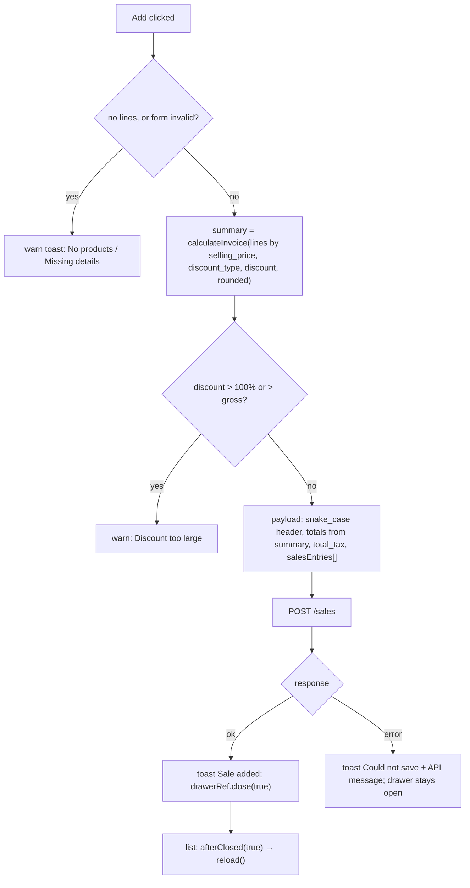

# Sales Entry and Sales Return — Frontend

> Part of the Inventory System implementation guide. Read `docs/BRD.md` for the business picture and `docs/frontend/frontend-setup.md` for how the web app is organised.

## 1. What this is

Two pages under the Sales menu. **Sales Entry** (`/sales/entry`) records an invoice to a customer: which products left, from which batch, at what price, cash or credit. **Sales Return** (`/sales/return`) records goods a customer brought back, put into a batch (typed like a purchase). Both are lists whose Add and View open the same form in a bottom drawer. The browser computes the totals with `calculateInvoice` and sends them; the server stores them, moves stock and posts the journal.

The big difference from purchases: **a saved sale or sales return is never edited or deleted**. The form has only `add` and `view` modes, and a saved document is **cancelled** with a reason instead. It stays on record, marked cancelled, with its lines.

This doc assumes you have read `docs/frontend/purchase/purchase.md`: the list mechanics, the line FormArray, `ProductLookup`, `calculateInvoice`, `withMissing`, `FileDownloads` and the drawer are the same, and only what differs is spelled out here.

## 2. Where the code lives

All paths are under `frontend/src/app/`.

| File | What is in it |
|---|---|
| `features/sales/sales.routes.ts` | `SALES_ROUTES`: `entry` (`ViewSalesEntries`), `return` (`ViewSalesReturns`), the customers page (`partyRoute('customers', 'customer')`), `''` → `entry` |
| `features/sales/sales.model.ts` | `Sale`, `SalesLine`, `SalePayload`, `SalesReturn`, `SalesReturnLine`, `SalesReturnPayload`, `SalesFormMode` (`add` / `view` only), `SalesFormData` |
| `features/sales/sales.service.ts` | `SalesService`: `list`, `get`, `nextNumber`, `create`, `cancel(id, remarks)`, `exportList`, `exportOne`, `printRange` on `/sales`. No `update`, no `delete` |
| `features/sales/sales-return.service.ts` | `SalesReturnService`: the same on `/sales-return` |
| `features/sales/sales-entry/sales-entry-list/` | `SalesEntryList` |
| `features/sales/sales-entry/sales-entry-form/` | `SalesEntryForm` |
| `features/sales/sales-return/sales-return-list/` | `SalesReturnList` |
| `features/sales/sales-return/sales-return-form/` | `SalesReturnForm` |
| `shared/components/cancel-dialog/` | `CancelDialog` + `CancelDialogData`: asks for a reason, runs `onConfirm(remarks)`, closes with `true` on success |
| `shared/utils/batch.ts`, `shared/services/product-lookup.ts` | `batchOptions`, `firstBatch`, `batchName`; the per-form product and batch cache |
| `shared/utils/options.ts` | `withMissing`, `docNoOptions` |
| `features/party/party.service.ts` | `PartyService.get('customer', id)` for the details card |
| `shared/styles/document-list.scss`, `document-form.scss` | the shared list and form styles; `.form-drawer .cancelled` is the cancelled banner |

## 3. Screens

### 3.1 Sales entry list

Route `/sales/entry`, needs `ViewSalesEntries`. The toolbar is the purchase one with the search box on `customer.name` and these extra filters: Invoice No (`systemEntryNo`), Transaction Type (`transactionType`) and **Status** (`isCancelled`, a select sending `0` = Active, `1` = Cancelled, because booleans are stored as 0/1 and filters match by "contains"). AD/BS switch and From/To dates (default today) as on purchases. On the right: Print, Export and, with `CreateSalesEntry`, **Add Sales Invoice**.

| Column | Key | Sort field | Shows |
|---|---|---|---|
| S.N | `sn` | — | running number |
| Invoice Number | `system_entry_no` | `systemEntryNo` | link → view |
| Posting Date | `date` | `date` | `<app-date-text>` |
| Customer Name | `customer_name` | `customer.name` | |
| Transaction Type | `transaction_type` | `transactionType` | chip |
| Status | `status` | `isCancelled` | chip: `CANCELLED` (`error`) or `ACTIVE` (`info`) |
| Gross/Discount Amt. | `sub_total` | — | gross over the derived discount |
| Tax Amt. | `total_tax` | `totalTax` | |
| Net Amt. | `grand_total` | `grandTotal` | bold |
| actions | `actions` | — | View; **Cancel** with `CancelSalesEntry`, only on rows not yet cancelled |

There is no Edit and no Delete anywhere. Empty text: `No sales found for these filters.`; load failure: `Could not load sales.`

### 3.2 Sales entry form (bottom drawer)

Same drawer options as purchases (`position: 'bottom'`, `size: 'calc(100vh - 48px)'`, `panelClass: 'drawer-sheet'`, `disableClose: true`, data `{ mode, id, calendar }`). `mode` is a plain property, not a signal: `view` when `data.mode === 'view'` and an id is given, else `add`. Nothing ever switches it. Headings: `Add Sales Invoice` / `Sales Invoice`.

When the loaded sale is cancelled, a banner above the form says **This invoice is cancelled.** and, when there is one, **Reason: {cancel_remarks}**.

Header fields: `customer_id` (required, searchable `customerOptions()`), `date` (required, today), `transaction_type` (required), `rounded` toggle. No bill number or bill date: this *is* the bill. `PartyDetailsCard` "Customer & Sales Details" with an "Invoice Number" chip.

Lines:

| Column | Cell | Rule |
|---|---|---|
| Product | `l-select` of sellable inventory products | `product_id` required; `(change)` → `onProductChange` |
| Code, Unit | from `productOf(row)` | |
| Batch | `l-select` of `batchItems(row)` (`B1 · 15 in stock`); view shows `batchLabel(row)` | `batch_id` required; `(change)` → `onBatchChange` |
| Expiry Date | text, the picked batch's `expiry_date` | |
| Stock | the picked batch's `available_quantity` | add mode only |
| Tax | `13%` or `-` | |
| Quantity | number, 3 decimals | required, min 0.001 |
| Rate | `selling_price`, 2 decimals | required, min 0 |
| MRP | text | |
| Amount | quantity × selling_price | |
| actions | remove | add mode only |

`cost_price` is a hidden control: the batch's cost, sent with the line so the server can book cost of goods, never shown. `ADD_ONLY_COLUMNS` (`stock`, `actions`) are dropped in view mode.

Summary card, Remarks, and the footer: in view mode **Close** and, when `canCancel()`, a danger **Cancel Invoice**; in add mode Cancel and **Add** (`Saving…`). Print and Export sit in the header in view mode.

### 3.3 Sales return list

Route `/sales/return`, needs `ViewSalesReturns`. Search on `customer.name`; filters Return No (`systemEntryNo`), **Ref. Invoice** (`refSales.systemEntryNo`), Transaction Type, Status. Columns: Return Number, Posting Date, Customer Name, **Ref. Invoice** (`ref_sales_no` through `docNo`, sort `refSales.systemEntryNo`), Transaction Type, Status, Gross/Discount, Tax Amt. (`total_tax`), Net Amt., actions (View; Cancel with `CancelSalesReturn` on active rows). Add is **Add Sales Return** with `CreateSalesReturn`.

### 3.4 Sales return form (bottom drawer)

Headings `Add Sales Return` ("Record goods a customer brought back") / `Sales Return`. Banner **This return is cancelled.** with the reason when cancelled.

Header fields: `customer_id` (required; changing it clears the reference), **Ref. Invoice** (`ref_sales_id`, optional, clearable, from `refOptions()`), `date`, `transaction_type`, `rounded`. Details card "Customer & Return Details" with a "Return Number" chip.

Lines are shaped like a **purchase** line, because the goods are coming in: Product (sellable inventory products), Code, Unit, **Batch No.** (`l-text-input`, free text), **Expiry Date** (`l-date-input`), Tax, Quantity, Rate (`selling_price`, required), **MRP** (number input, min 0), Amount, actions (hidden in view). `cost_price` is hidden and filled from the product; it prices a batch the return creates.

Footer: Close and **Cancel Return** (when `canCancel()`) in view; Cancel and **Add** in add mode (disabled while saving or copying).

## 4. How it works

### 4.1 Loading the list

Identical to the purchase list (`query` → `request` → `toObservable` + `switchMap`, default sort `id:desc`, `resetPage()` on any filter, date or sort change). The only additions are the `status` column, sorted and filtered through `isCancelled`, and the `tax` column reading `total_tax`.

### 4.2 Opening the form (add / view)

```
constructor:
  if readonly:  load(id)
  else:         addLine(); GET /sales/generateNumber -> entryNo (errors ignored)

load(id):
  loading = true
  GET /sales/{id}
  then loadLineProducts(product ids)          -- forkJoin(loadProducts, loadBatches)
  then fill(sale)
  error -> 'Could not load the sale' + API message, close drawer
  finally loading = false

fill(sale):
  entryNo = system_entry_no; cancelled = sale.cancelled; cancelRemarks = sale.cancel_remarks
  savedCustomer, savedProducts  -> merged into the options with withMissing
  rebuild lines from salesEntries; patch header (discount_type ?? 'Flat', discount || null, remarks ?? '')
  markAsPristine
```

Dropdowns: `GET /dropdown/customer/active` and `GET /dropdown/products/inventory/sellable/active` (purchases ask for `purchasable`). The customer card follows `customer_id` through `PartyService.get('customer', id)` (errors → `null`, card shows `-`).

State on the form: `loading`, `saving`, `entryNo`, `cancelled`, `cancelRemarks` signals; `lines` signal beside the FormArray; `value` (the raw form value as a signal) feeding `summary`; `batchOptions` computed from `ProductLookup.batches`; `canCancel` = view mode **and** not cancelled **and** not loading **and** `hasOperation('CancelSalesEntry')`.

### 4.3 Line items and totals

The rate of a sale is `selling_price`, so `summary` maps each line to `{ amount: lineAmount(quantity, selling_price), taxRate: product.tax_rate || 0 }` and `calculateInvoice(lines, discount_type, discount ?? 0, rounded)` does the rest, exactly as for purchases (see that doc for the formula and why the discount is spread over the lines).

### 4.4 Picking a batch (sale) / typing a batch (sales return)

**Sale.** Goods leave stock, so a line must name a batch that exists and holds enough. Same code as the purchase return:

```
onProductChange(line, productId):
  loadLineProducts([productId])                   -- GET /products/{id} + GET /products/stockInfo/{id}, once each
  if the line still has that product:
      useBatch(line, firstBatch(batches))          -- earliest expiry among batches in stock, else the first

useBatch(line, batch):
  prices = batch ?? product
  patch batch_id = batch?.batch_id ?? 0, batch_no, cost_price, selling_price, mrp from prices

onBatchChange(line): useBatch(line, batchOf(line))
```

The form shows the batch's stock but does not enforce it; the API answers `Not enough Quantity In Stock`.

**Sales return.** Goods come back in, so a line types a `batch_no` (a known number puts them back into that batch, an unknown one creates a batch, blank means the default batch) and an optional `expiry_date`. `onProductChange` only loads the product and patches `cost_price`, `selling_price`, `mrp` from it; no stock info is fetched.

### 4.5 Picking a reference invoice (sales return)

Options come from `GET /dropdown/sales/{customerId}` (`DropdownService.sales`): that customer's invoices that are **not cancelled**, newest first, relabelled through `docNoOptions`. `customerSales` reloads whenever `customer_id` changes; `refOptions` = `withMissing(customerSales, savedRef)` so a saved return still shows its reference in view mode.

```
onCustomerChange():   ref_sales_id = null          -- an invoice belongs to one customer

onRefChange(salesId):
  copying = true
  GET /sales/{salesId}, then loadProducts(its product ids)
  if ref_sales_id still equals sale.id:              -- a pick that changed while loading is ignored
      copySale(sale)
  error -> 'Could not load the invoice'
  finally copying = false

copySale(sale):
  savedProducts += the sale's products
  setLines(one line per salesEntries line: product_id, batch_no, expiry_date = null, quantity, cost_price, selling_price, mrp)
  patch transaction_type, rounded, discount_type ?? 'Flat', discount || null
```

Every line comes back at full quantity into the batch it was sold from; the user trims what did not come back. `expiry_date` is left blank on purpose: blank keeps the batch's own date, while a different date would be refused by the API. The current lines are replaced.

### 4.6 Saving



`SalePayload`:

| Field | From |
|---|---|
| `date` | `toIsoDate` → `YYYY-MM-DD` |
| `transaction_type`, `customer_id`, `rounded`, `discount_type`, `discount` (0 when blank) | the controls |
| `sub_total`, `non_taxable_amount`, `taxable_amount`, **`total_tax`**, `rounding`, `grand_total` | `summary.gross`, `nonTaxable`, `taxable`, `tax`, `rounding`, `net` |
| `remarks` | trimmed or null |
| `salesEntries[]` | `product_id`, `batch_id`, `quantity`, `cost_price ?? 0`, `selling_price`, `mrp ?? 0` — no `id`, since there is no update |

The sales return sends `ref_sales_id` and `salesReturnEntries[]` with `product_id`, `batch_no` (trimmed or null), `expiry_date` (ISO or null), `quantity`, `cost_price ?? 0`, `selling_price`, `mrp ?? 0`. Success toast `Sales return added`.

**Rules checked before sending:** no lines → `No products` / `Add at least one product to the invoice.` (return: `… to the return.`); invalid control → `Missing details` / `Fill in the fields highlighted in red.`; Percentage over 100 or Flat over the gross → `Discount too large` / `The discount cannot be more than the gross amount.`; a click while saving, loading or copying is ignored. Server refusals shown through `apiErrorMessage` include `Not enough Quantity In Stock`, `… batch B1 is entered on more than one line`, `Batch does not belong to …`, `Reference invoice belongs to another customer`, `Reference invoice is cancelled`.

### 4.7 Cancelling

**Idea.** A sale is a legal document: once issued it is not rewritten or removed, it is cancelled with a reason, and the record stays. `CancelDialog` is the shared piece: a title, a message, a required Reason textarea, and an `onConfirm(remarks)` that returns the request. Like Lumen's `ConfirmDialog`, it sets `disableClose` while the request runs, stays open on error and closes with `true` on success. It is opened from two places with the same `onConfirm`.

```
list.cancel(row)   /   form.cancelSale():
  number = docNo(system_entry_no)
  open CancelDialog, width 440px:
      title 'Cancel sales invoice?'
      message "{number} to {customer_name} will be cancelled and its stock put back. It stays on record as cancelled."
              (the form's message has no customer name)
      confirmText 'Cancel Invoice'
      onConfirm(remarks): POST /sales/{id} { cancel_remarks: remarks }
                          error -> toast 'Could not cancel' + API message (dialog stays open)
  closed with true:
      toast 'Sale cancelled' — "{number} was cancelled."
      list: reload()            form: drawerRef.close(true), and the list reloads
```

Sales return: `Cancel sales return?`, "{number} from {customer_name} will be cancelled and its goods taken back out of stock. It stays on record as cancelled.", button `Cancel Return`, `POST /sales-return/{id}`, toast `Sales return cancelled`.

Gating: the list shows Cancel only when `canCancel()` (`CancelSalesEntry` / `CancelSalesReturn`) **and** `!row.cancelled`; the form's `canCancel` adds "not loading". A cancelled document therefore has no Cancel anywhere, only its banner.

**A sale that a sales return names cannot be cancelled.** The web app does not check this itself and has no list of returns per sale. It simply sends the cancel; the API refuses with `Cancel the sales returns made against this invoice first`, and `apiErrorMessage` puts that sentence in the `Could not cancel` toast while the dialog stays open. The same path shows the other refusals: a credit sale with payments against it, a sale already cancelled, or a sales return whose goods have been sold since (`Product Stock is Already Used`, `Sales Return Already Cancelled`).

### 4.8 Print / Export

As for purchases: the list's Print/Export call `exportList(format, { ...query(), calendar })` → `GET /sales/export/{format}` (every row the filters match, cancelled ones marked and left out of the totals); the form's header buttons in view mode call `exportOne(id, format, { calendar })` → `GET /sales/{id}/export/{format}`, where a cancelled document is stamped CANCELLED with its reason. `printRange` serves the header's Range Print drawer. `FileDownloads` is in each page's `providers`.

## 5. Design decisions and gotchas

- **Cancel, not delete.** The row keeps its number, lines and totals, gains `cancelled` and `cancel_remarks`, and shows as `CANCELLED` in the list and as a banner in the form. Reports and exports leave cancelled documents out of their totals.
- **No edit means no ids on lines and no `update()`.** `SalePayload` has no `id` on lines and `SalesService` has no `update`/`delete`, so a wrong invoice is cancelled and re-entered.
- **`mode` is a constant.** With only `add` and `view` and no switch between them, `mode`, `readonly` and `lineColumns` are plain properties, unlike the purchase forms where view can turn into edit.
- **`total_tax`, not `tax`.** The API names the tax field differently on sales; the model, the list column and the payload all use `total_tax`.
- **Sales pick a batch, sales returns type one.** The rule is "goods going out pick an existing batch; goods coming in may name a new one", the same reason purchases type and purchase returns pick.
- **`cost_price` rides along unseen.** On a sale it is the batch's cost, so the server can value what was sold; on a return it prices a batch that may be created. Neither form shows it.
- **Reference copy leaves `expiry_date` blank** so a known batch keeps its own date; the API refuses a different date on an existing batch.
- **The reference list hides cancelled invoices** (the dropdown endpoint filters them), but a loaded return still shows its reference through `savedRef` even if that invoice was cancelled later.
- **The UI does not pre-check cancel rules.** It relies on the API's messages (`Cancel the sales returns made against this invoice first`, payments, stock already used). Keep `apiErrorMessage` on every cancel path or the user sees nothing.
- **Status filter values are `0` / `1`**, because the backend filters by "contains" on the stored value.

## 6. Build it yourself: order of work

1. Write `sales.model.ts` from section 11 of `endpoints.md`: `Sale` with `total_tax`, `cancelled`, `cancel_remarks`; `SalePayload` omitting the read-only fields; `SalesFormMode = 'add' | 'view'`.
2. Write `SalesService` and `SalesReturnService` with `cancel(id, remarks)` posting `{ cancel_remarks }` to `/sales/{id}`; no update or delete.
3. Build `CancelDialog` in `shared/components/cancel-dialog/`: `MODAL_DATA` with title, message, confirmText and `onConfirm(remarks)`; a required reason; `disableClose` during the request; close with `true` on success.
4. Copy the purchase list: swap columns (Status via `isCancelled`, `total_tax`), replace Edit/Delete with Cancel gated on `CancelSalesEntry && !row.cancelled`, and open `CancelDialog` from `cancel(row)`.
5. Copy the purchase return form for the sale (batch picker, `firstBatch`, `useBatch`): make `mode` a constant, drop Edit, add the cancelled banner and the footer's Cancel Invoice, compute `summary` from `selling_price`, send `total_tax` and `salesEntries`.
6. Copy the purchase entry form for the sales return (typed batch, expiry): add Ref. Invoice from `DropdownService.sales`, `onCustomerChange`, `onRefChange` / `copySale` with blank expiry dates, send `ref_sales_id` and `salesReturnEntries`.
7. Add `SALES_ROUTES` with `ViewSalesEntries` / `ViewSalesReturns` and the sidebar links; mount at `/sales`.
8. Write specs: add form starts with one line and the number preview; sells from the earliest-expiring batch; views a sale read-only and cancels it with a reason; shows a cancelled sale with its reason and no Cancel button; offers Cancel only with the permission; the return copies a reference and ignores one that changed while loading.
