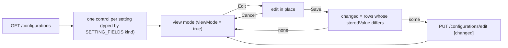

# Settings (Configuration and Document Numbering) — Frontend

> Part of the Inventory System implementation guide. Read `docs/BRD.md` for the business picture and `docs/frontend/frontend-setup.md` for how the web app is organised.

## 1. What this is

Settings has two pages. **Configuration** is the company's details (name, registration, contact, address) and a few app-wide defaults (calendar, fiscal year, rounding, the low-stock threshold), stored by the API as one text row per setting. The page shows them read-only; an Edit button turns the same fields editable in place, and Save sends only what changed, in one request. **Document Numbering** shows how each document type is numbered (`|PE-000001`, …). It is view only: the API has no endpoint to change the formats.

## 2. Where the code lives

All under `frontend/src/app/features/settings/` unless noted.

| File | What is in it |
|---|---|
| `settings.routes.ts` | `/settings/configuration` (`ViewConfiguration`) → `ConfigurationForm`; `/settings/document-numbering` (`ViewDocumentNumbering`) → `DocumentNumberingList`; `''` redirects to `configuration` |
| `configuration/configuration.model.ts` | `Configuration` (a setting row), `SETTING_SECTIONS`, `SettingKind`, `SettingField`, `SETTING_FIELDS`, `OTHER_FIELD` |
| `configuration/configuration.service.ts` | `ConfigurationService`: `list()`, `update(settings)` |
| `configuration/configuration-form/` | `ConfigurationForm`: the page (read-only, then edit in place) |
| `document-numbering/document-numbering.model.ts` | `DocumentNumbering` |
| `document-numbering/document-numbering.service.ts` | `DocumentNumberingService.list()` |
| `document-numbering/document-numbering-list/` | `DocumentNumberingList` |
| `shared/pipes/doc-no.pipe.ts` | `docNo`: drops the empty fiscal-year part before the `\|` |

### API used (section 3 of `backend/endpoints.md`)

| Method | Path | Used by | Permission |
|---|---|---|---|
| `GET` | `/configurations` | `ConfigurationService.list` | none (no token needed) |
| `PUT` | `/configurations/edit` (a list, each item with its `id`) | `ConfigurationService.update` | `EditConfiguration` |
| `PUT` | `/configurations/edit/{id}` | not used by the web app | `EditConfiguration` |
| `GET` | `/documentNumbering` | `DocumentNumberingService.list` | `ViewDocumentNumbering` |

A setting row is `{ id, name, label, value, is_editable }`; `value` is always text (`"1"`, `"BS"`, `"10"`), and the body of the bulk update is the same rows sent back with new values.

## 3. Screens

### 3.1 Configuration (`ConfigurationForm`)

One `l-card` with a header (icon, "Configuration", a subtitle that changes with the mode) and the actions: **Edit** when not editing and the user has `EditConfiguration` (disabled while loading or after a load error); **Cancel** and **Save** / `Saving…` while editing. The body groups the settings into sections from `SETTING_SECTIONS`, each a card with a two-column grid:

| Section (`key`) | Title | Subtitle |
|---|---|---|
| `company` | Company Details | Shown on documents and reports |
| `preferences` | Preferences | Defaults used across the app |
| `other` | Other Settings | Settings without a dedicated field |

`SETTING_FIELDS` maps each seeded setting `name` to how it is edited (`SettingField`: `section`, `kind`, `placeholder`, `options`, `wide`, `required`, `hint`):

| `name` (seed label) | Section | `kind` | Control and notes |
|---|---|---|---|
| `company_name` (Company Name) | company | `text` | wide, **required** |
| `company_reg_type` (Company Reg. Type) | company | `select` | `PAN` / `VAT` |
| `company_reg` (Company Reg. No.) | company | `text` | |
| `company_contact` (Company Contact) | company | `text` | |
| `company_email` (Company Email) | company | `email` | `l-email-input` checks the format |
| `company_address` (Company Address) | company | `text` | wide |
| `calendar_type` (Calendar Type) | preferences | `select` | `BS` "BS (Bikram Sambat)" / `AD` "AD (Gregorian)" |
| `fiscal_year` (Fiscal Year) | preferences | `text` | placeholder `e.g. 2082-83` |
| `default_rounding` (Default Rounding) | preferences | `toggle` | stores `1` / `0`; hint: "When on, new invoices start with Rounding Amount on, rounding the grand total to a whole amount." |
| `low_stock_quantity` (Low Stock Quantity) | preferences | `number` | shows `Off` when blank; hint: "Notify when a sale or stock change leaves a product's total stock at or below this. Leave blank to turn low stock notifications off." |
| anything else | other | `text` (`OTHER_FIELD`) | so a setting added on the server still shows |

Rows are ordered as `SETTING_FIELDS` lists them, unknown ones last; a section with no rows is not rendered. Every control binds `[viewMode]="isReadonly(row)"`, which is true outside edit mode and always for a setting whose `is_editable` is false. Toggles and numbers print their `hint` underneath.

### 3.2 Document Numbering (`DocumentNumberingList`)

A list card with a lock note ("Numbers are assigned in order when a document is saved. These formats are view only.") and a table, not paged, sorted by the table itself:

| Column | Key | Shows |
|---|---|---|
| S.N | `sn` | `01`, `02`, … |
| Document Type | `name` | sortable: `Purchase Entry`, `Sales Entry`, … |
| Prefix | `prefix` | sortable; `\|PE-` shown through `docNo` as `PE-` in a `code` style; `-` when blank |
| Digits | `body_length` | sortable; `6` |
| Number Range | `range` | `start_no – end_no` with thousands separators (`1 – 999,999`) |
| First Number | `first` | `firstNumber(row)` = `prefix` + `start_no` padded to `body_length`, through `docNo`: `PE-000001` |

Seeded types (`backend/database.sql`): Purchase Entry `|PE-`, Purchase Order `|PO-`, Purchase Return `|PR-`, Sales Entry `|SI-`, Sales Return `|SR-`, Sales Order `|SO-`, BDE `|BDE-`, Stock Adjustment `|SA-`, Journal Entry `|J-`, Payment `|P-`; all 6 digits from 1 to 999999. `numbering_style` is always `null`.

## 4. How it works

### 4.1 Loading the settings

**Idea.** The form is a `FormRecord` (`fb.record<ControlValue>({})`) built at runtime, one control per setting keyed by its `name`, because the set of settings comes from the server. Each control's value is typed for its field kind so the Lumen control gets what it expects; the conversion back to the API's text happens only when saving.

```
load():
  loading = true; loadError = ''
  GET /configurations
  for each setting:
      field   = SETTING_FIELDS[setting.name] ?? OTHER_FIELD
      control = fb.control(controlValue(setting, field), field.required ? Validators.required : null)
      if not setting.is_editable: control.disable()
      form.setControl(setting.name, control)      -- controls first: the template binds them as soon as the rows render
  settings = response
  error -> loadError = apiErrorMessage(e, 'Could not load the settings.')   (shown with a "Try again" button)

controlValue(setting, field):                     -- API text -> control value
  text = setting.value.trim()
  toggle -> text === '1' or text.toLowerCase() === 'true'
  select -> text || null
  number -> finite Number(text), or null when blank
  else   -> text

sections = computed:
  rows = settings.map(toRow) sorted by the position of name in SETTING_FIELDS (unknown last)
  SETTING_SECTIONS.map(section => its rows).filter(non-empty)

toRow(setting): label = setting.label || setting.name
                options = field.options, plus { value, label: value } when the stored value isn't among them
```

That last line keeps a stored value the dropdown doesn't know (say `calendar_type = "Nepali"`) visible and selectable instead of silently showing blank.

### 4.2 Editing in place

```
startEdit(): editing = true        -- readonly = !editing; isReadonly(row) = readonly || !row.setting.is_editable
cancel():    fill(settings()); editing = false
             -- fill: setValue(controlValue(...)) on every control, markAsPristine, markAsUntouched
```

There is no drawer and no route change: the fields that were text become inputs. `canEdit` (`hasOperation('EditConfiguration')`) only hides the Edit button; the API checks the same operation on save.

### 4.3 Saving

**Idea.** Send only what changed, compare in the API's own representation, and save it all with one `PUT /configurations/edit`, which the backend runs in one transaction. Nothing changed means Cancel.

```
save():
  if saving: return
  if form.invalid: markAllAsTouched; warn 'Missing details' / 'Fill in the fields highlighted in red.'; return
  changed = for each setting in settings():
      control = form.controls[setting.name]; skip if missing or disabled
      value = storedValue(control.value)
      skip if value === storedValue(controlValue(setting, field))       -- unchanged
      else { ...setting, value }
  if changed is empty: cancel(); return
  saving = true
  PUT /configurations/edit  changed
  next : settings = settings with the changed ones replaced; fill(settings); editing = false;
         success 'Settings saved' with response.message
  error: 'Could not save' + API message          (editing stays on so the user can fix it)

storedValue(value):                               -- control value -> API text
  boolean -> '1' | '0';  number -> String(number);  else -> trimmed text or ''
```

Comparing `storedValue` on both sides means typing `" Kathmandu "` over `"Kathmandu"` is not a change, and a toggle stored as `"true"` is saved as `"1"` only when actually flipped.

**Rules.** Client: `company_name` required. API (400, through `apiErrorMessage`): `"Configuration '<name>' is not editable"` for a locked setting (the form already disables those), and `"Low Stock Quantity must be a number of 0 or more, or blank"` for a bad threshold; 404 `"Configuration not found: <id>"`. Because the bulk update is one transaction, one bad setting saves none of them.

### 4.4 What the settings drive

| Setting | Read by |
|---|---|
| `company_name`, `company_address`, `company_contact`, `company_email`, `company_reg_type` + `company_reg` | the API's `ExportService`: the letterhead on every PDF and Excel file (section 18) |
| `calendar_type` | `ExportService`: the calendar for the dates in a file when the request has no `calendar` param. The web app's pages always send `calendar`, so this is the default for direct API calls. The web app's own date display is per page (the AD/BS controls), not this setting |
| `low_stock_quantity` | the API's `LowStockService`: after a save lowers a product's stock, a Low Stock notification goes out when its total is at or below this; blank turns the alerts off (section 16) |
| `fiscal_year`, `default_rounding` | nothing in the code reads them; they are stored and shown only (the rounding hint describes an effect no form implements yet) |

### 4.5 Document numbering

```
constructor: GET /documentNumbering -> rows; loading = false
             error -> loadError 'Could not load the document numbering.'
firstNumber(row) = (row.prefix ?? '') + String(row.start_no).padStart(row.body_length, '0')   -- e.g. '|PE-000001'
```

A document number is `prefix` + a running number padded to `body_length` digits, counting from `start_no` to `end_no`. The leading `|` separates an (empty) fiscal-year part from the rest; the `docNo` pipe splits on `|`, drops blank parts and joins with ` | `, so `|PE-000001` reads `PE-000001`. The raw value with the `|` is what every API call expects back.



## 5. Design decisions and gotchas

- **Edit in place, not a drawer.** There is exactly one set of settings; a drawer would add a step for nothing. The same `[viewMode]` trick the forms use makes the switch a boolean.
- **Only changed settings are sent.** It keeps the request small, avoids re-saving locked rows, and means a setting the API rejects is one the user touched.
- **Values are text on the server.** Toggles are `1` / `0` (with `true` accepted when reading), numbers are digits, a blank number is `''` (which is how "off" is stored for `low_stock_quantity`). Never send booleans or numbers.
- **Locked settings are disabled controls.** Disabled controls are left out of `changed` and never sent, so the API's "not editable" error should not happen from this page.
- **Unknown settings still render** under Other Settings as text, so a server-side addition is editable without a release; it just gets no hint or validation.
- **The stored value is added to a select's options** when it isn't one of them, so nothing disappears on screen.
- **`GET /configurations` needs no login**, so the login page could show the company name; this page still sits behind `ViewConfiguration`.
- **`default_rounding` and `fiscal_year` are inert.** The toggle's hint promises invoice rounding, but nothing reads the setting. Treat it as a placeholder until a form uses it.
- **Document numbering is read-only by design.** Changing a prefix mid-year would break the sequence and every printed reference; there is no endpoint, so the page offers no button.

## 6. Build it yourself: order of work

1. Write `Configuration`, `SETTING_SECTIONS`, `SettingField`, `SETTING_FIELDS` and `OTHER_FIELD` from the seed rows in `database.sql`.
2. Write `ConfigurationService` (`list`, `update` to `/configurations/edit`).
3. Build `ConfigurationForm`: the `FormRecord`, `load()` with `controlValue`, the `sections` computed with `toRow` and `fieldOrder`, the per-kind `@switch` template with `[viewMode]="isReadonly(row)"`, and `startEdit` / `cancel` / `save` with `storedValue` diffing.
4. Write `DocumentNumbering`, its service and `DocumentNumberingList` with `firstNumber` and the `docNo` pipe.
5. Add `settings.routes.ts`, mount it at `/settings`, add the sidebar links (`ViewConfiguration`, `ViewDocumentNumbering`).
6. Try it: set `low_stock_quantity` to `-1` and read the 400; blank it and save; change `company_name` and print any list to see the new letterhead.
