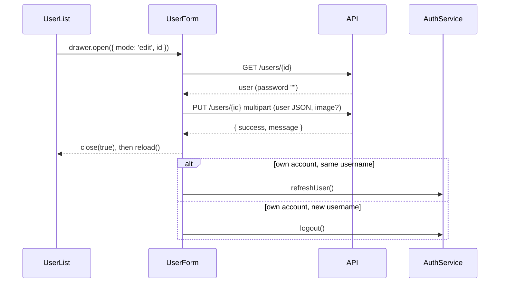

# Users and Roles — Frontend

> Part of the Inventory System implementation guide. Read `docs/BRD.md` for the business picture and `docs/frontend/frontend-setup.md` for how the web app is organised.

## 1. What this is

A role is a named set of operations (`ViewPurchaseEntry`, `CreateUser`, …); a user is a login with exactly one role. Under User & Roles an administrator creates roles by ticking a permission matrix, and creates users with their details, a profile picture and a role. Both pages follow the document-form pattern: a list, and a near full-screen bottom drawer that adds, edits or views one record. The forms also handle the awkward case of editing *yourself*: menus refresh when your own role changes, and renaming your own username logs you out because the token names the old one.

## 2. Where the code lives

All under `frontend/src/app/features/user-roles/` unless noted.

| File | What is in it |
|---|---|
| `user-roles.routes.ts` | `/user-roles/users` (`ViewUser`) → `UserList`; `/user-roles/roles` (`ViewRole`) → `RoleList`; `''` redirects to `users` |
| `user/user.model.ts` | `User`, `UserPayload`, `GENDERS`, `UserFormMode`, `UserFormData` |
| `user/user.service.ts` | `UserService`: list, get, create / update (multipart), delete, `countWithRole` |
| `user/user-list/` | `UserList` |
| `user/user-form/` | `UserForm` |
| `role/role.model.ts` | `Role`, `RoleOperation`, `RolePayload`, `OperationGroup`, `RoleFormMode`, `RoleFormData` |
| `role/role.service.ts` | `RoleService`: list, get, `operations()`, create, update, delete |
| `role/permissions.ts` | `PERMISSION_ACTIONS` and `toPermissionGroups`: the matrix layout |
| `role/role-list/` | `RoleList` |
| `role/role-form/` | `RoleForm` |
| `shared/components/user-avatar/` | `<app-user-avatar>`: a picture fetched with the auth header, or initials |
| `shared/utils/password.ts` | `STRONG_PASSWORD` |
| `shared/utils/options.ts` | `withMissing`: keeps the record's own (inactive) role in the options |
| `auth/auth.service.ts` | `user()` (with `id`, `roleId`, `operations`), `hasOperation`, `refreshUser`, `logout` |

### API used (section 17 of `backend/endpoints.md`)

| Method | Path | Used by | Permission |
|---|---|---|---|
| `GET` | `/users?pageIndex&pageSize&sort&fullName&username&email&role.name&isActive` | user list, `countWithRole` | `ViewUser` |
| `GET` | `/users/{id}` | user form (edit, view) | `ViewUser` |
| `POST` | `/users` (multipart: `user` JSON part + optional `image`) | add user | `CreateUser` |
| `PUT` | `/users/{id}` (multipart) | edit user | `EditUser` |
| `DELETE` | `/users/{id}` | delete user | `DeleteUser` |
| `GET` | `/uploads/users/<file>` (the `image_url`) | `<app-user-avatar>` | a login |
| `GET` | `/roles?pageIndex&pageSize&sort&name&description&isActive` | role list | `ViewRole` |
| `GET` | `/roles/{id}` | role form | `ViewRole` |
| `GET` | `/roles/operations/0` | role form: every operation, grouped | `ViewRole` |
| `POST` / `PUT` | `/roles`, `/roles/{id}` with `operation_ids` | role form | `CreateRole` / `EditRole` |
| `DELETE` | `/roles/{id}` | delete role | `DeleteRole` |
| `GET` | `/dropdown/roles/active`, `/dropdown/roles/all` | role picker, role filter | a login |

Naming: `full_name`, `role_id`, `is_active`, `image_url` in JSON; filters and sorts use entity names (`fullName`, `role.name`, `isActive`).

## 3. Screens

### 3.1 Users list (`UserList`)

| Column | Key | Notes |
|---|---|---|
| S.N | `sn` | running number across pages |
| Name | `full_name` | sortable (`fullName`); `<app-user-avatar>` 32px, a ghost link opening **view**, the username under it, and a `You` chip on your own row |
| Email | `email` | sortable |
| Contact | `contact` | sortable; `-` when blank |
| Role | `role_name` | sortable (`role.name`); `No role` when `null` |
| Status | `is_active` | sortable (`isActive`); ACTIVE / INACTIVE chip |
| (actions) | `actions` | menu: View (always), Edit (`EditUser`), Delete (`DeleteUser` and not yourself) |

Filters: a search on `fullName`; Username and Email (text); Role, a select of role names from `DropdownService.roles('all')` sent as `role.name`; Status as `isActive` `1` / `0`. The Role filter sends the *name* because `role.id=1` would also match ids 10, 11, … under the API's "contains" matching.

Buttons: Add User (`CreateUser`); row actions as above. `canDeleteRow(row) = canDelete && !isSelf(row)`, where `isSelf` compares `row.id` with `auth.user()?.id`.

### 3.2 User form (`UserForm`, bottom drawer)

Opened with `{ mode: 'add' | 'edit' | 'view', id? }` in `DRAWER_DATA`; `position: 'bottom'`, `size: 'calc(100vh - 48px)'`, `panelClass: 'drawer-sheet'`, `disableClose: true` so a backdrop click can't throw edits away. Every input binds `[viewMode]="readonly()"`, so view and edit are the same template.

| Section | Field | Control | Rules |
|---|---|---|---|
| Basic Details | Full Name | `l-text-input` (wide) | required |
| | Email | `l-email-input` | required; the input checks the format |
| | Contact | `l-text-input` | optional, sent as `null` when blank |
| | Gender | `l-select` of `GENDERS` (Male, Female, Other), clearable | optional |
| Login & Access | Username | `l-username-input` | required |
| | Role | `l-select` of `roleOptions()`, searchable | required; locked on your own account |
| | Password | `l-password-input`, only when not read-only | add: required and `STRONG_PASSWORD`; edit: `STRONG_PASSWORD` only, blank keeps the current one. The rule checklist shows when adding or once something is typed |
| | Remarks | `l-textarea` | optional |
| Profile Picture | avatar 72px + `l-file-upload` (button variant) | accepts `.jpg,.jpeg,.png,.gif,.webp`, max 10 MB | an unsaved pick shows as a preview |
| User Settings | Active | `l-toggle`, hint "Inactive users can't log in." | locked on your own account |

Your own account also shows a note: "This is your own account, so another user has to change its role or status. Changing the username logs you out."

Footer: in view mode Close and (with `EditUser`) Edit, which switches the same drawer to edit; otherwise Cancel and `Add` / `Update` / `Saving…`.

`STRONG_PASSWORD` is the rule the API enforces too: `/^(?=.*[a-z])(?=.*[A-Z])(?=.*\d)(?=.*[^A-Za-z0-9]).{8,}$/` (8+ characters, upper and lower case, a digit, a symbol).

### 3.3 Roles list (`RoleList`)

| Column | Key | Notes |
|---|---|---|
| S.N | `sn` | |
| Role Name | `name` | sortable; a ghost link opening view; a `Your role` chip when `row.id === auth.user()?.roleId` |
| Description | `description` | sortable; `-` when blank |
| Permissions | `permissions` | `operation_ids.length` + "permission(s)" |
| Status | `is_active` | chip |
| (actions) | `actions` | View, Edit (`EditRole`), Delete (`DeleteRole`) |

Filters: search on `name`; Description (text); Status `isActive` `1` / `0`. Add Role needs `CreateRole`.

### 3.4 Role form (`RoleForm`, bottom drawer)

Left column: Role Name (required), Description (3 rows), and an Active toggle with the hint "Inactive roles are left out of the role list when adding or editing a user." Your own role shows "This is your own role. Permissions you remove are taken from you too."

Right column, the **Permissions** card: a counter `N of M selected` (`granted` in view mode), Select all / Clear buttons (edit only), then one block per master module. Each block has a header checkbox (the whole group) with a `k/n` count and a table:

| Module | View | Create | Edit | Delete | Other |
|---|---|---|---|---|---|
| Tax Type (row checkbox) | ☐ | ☐ | ☐ | ☐ | |
| Sales Entry | ☐ | ☐ | ☐ | | ☐ Cancel |
| Payment | | ☐ | | | ☐ View Vendor Payment, ☐ View Customer Payment |

A cell is empty when the module has no such operation. In view mode every checkbox is disabled. Footer as the user form.

## 4. How it works

### 4.1 Loading the lists

Both lists use the standard pipeline: `filters`, `sort`, `pageIndex`, `pageSize` and a `refresh` counter feed a `computed` request; `toObservable` + `switchMap` call the service; `{ page, error }` lands in `rows` / `total` / `loadError` with the rows kept on screen while loading. Sort keys map through `SORT_FIELDS` (`full_name` → `fullName`, `role_name` → `role.name`, `is_active` → `isActive`); default `id:desc`. Filter and sort changes reset the page to 0. Load errors: `Could not load users.` / `Could not load roles.`

### 4.2 Opening a form

```
openForm(mode, id?):
  ref = drawer.open(UserForm | RoleForm, { data: { mode, id }, position: 'bottom',
                    size: 'calc(100vh - 48px)', panelClass: 'drawer-sheet', disableClose: true })
  ref.afterClosed().subscribe(saved => if saved then reload())

Form constructor:
  mode = DRAWER_DATA.mode ?? 'add'; id = DRAWER_DATA.id
  if mode !== 'add' and id: load(id)     -- GET /users/{id} or /roles/{id}; fill the form; markAsPristine
  else mode = 'add'
  load error: notification 'Could not load the user' / 'Could not load the role', then close()
  self (users) = mode !== 'add' and id === auth.user().id
  own  (roles) = mode !== 'add' and id === auth.user().roleId
startEdit(): mode = 'edit'       -- view switches in place; the data is already loaded
```

`UserForm` also sets the password validators once the mode is known (required + pattern for add, pattern only otherwise; Angular's `pattern` passes a blank value, which is what "blank keeps it" relies on), disables `role_id` and `is_active` when `self`, and loads the role options: `DropdownService.roles()` (active ones; a failure shows 'Could not load roles') merged with the loaded user's own role through `withMissing`, so a user on an inactive role still shows its name.

`RoleForm` loads the matrix independently of the role: `roleService.operations()` calls `GET /roles/operations/0`, role 0 being nobody, so every operation comes back with `selected: false`, and the form keeps its own `selected` set from `role.operation_ids`. `loadingGroups` is true until that answer arrives ('Loading permissions…'); a failure shows 'Could not load permissions'.

### 4.3 The permission matrix (`permissions.ts`)

**Idea.** The API groups operations by `master_module` → `module` → operations. Most operation names are `<Action><Module>`, so they fit a grid with one column per action; the rest (`CancelSalesEntry`, `ViewVendorPayment`) go in an "Other" cell with a readable label. The layout is computed from the names, not hard-coded, so a new operation on the server appears by itself.

```
PERMISSION_ACTIONS = ['View', 'Create', 'Edit', 'Delete']
toPermissionGroups(groups): for each master module -> { title, rows: modules.map(toRow), ids: every id in its rows }
toRow(module, operations):
  actions = [null, null, null, null]; extras = []
  for each operation:
    verb, subject = /^([A-Z][a-z]+)(.*)$/ on its name            -- 'ViewSalesEntries' -> 'View', 'SalesEntries'
    onModule = subject === module or subject === plural(module)   -- plural: 'y' -> 'ies', else + 's'
    column = index of verb in PERMISSION_ACTIONS
    if onModule and column >= 0 and actions[column] is empty: actions[column] = id
    else extras.push({ id, label: onModule ? verb : words(name) })  -- 'Cancel' | 'View Vendor Payment'
  return { module, label: words(module), actions, extras, ids }    -- words: 'TaxType' -> 'Tax Type'
```

The form's state is one signal, `selected: Set<number>`. `has(id)`, `allOf(ids)` and `countOf(ids)` read it; `setAll(ids, on)` is the only writer, used by a single checkbox (`[id]`), a module row (`row.ids`), a group header (`group.ids`) and Select all / Clear (`allIds`). A row or group checkbox is checked only when *all* of its ids are selected.

### 4.4 Saving a user

```
save():
  if saving or loading: return
  if form.invalid: markAllAsTouched; warn 'Missing details' / 'Fill in the fields highlighted in red.'; return
  value = form.getRawValue()                                -- includes the locked role_id / is_active
  payload = { username, full_name, email (trimmed), password as typed, gender,
              contact || null, remarks || null, is_active, role_id }
  image = picture()[0]?.file                                -- undefined keeps the current picture
  request = editing ? userService.update(id, payload, image) : userService.create(payload, image)
    -- toFormData: part 'user' = Blob(JSON, type application/json); part 'image' only when given
  next : success 'User updated' | 'User added'; drawerRef.close(true); if self: afterSavingSelf(username)
  error: 'Could not save' + API message

afterSavingSelf(username):
  if username !== record.username: info 'Username changed' / 'Log in again as "<username>".'; auth.logout()
  else auth.refreshUser()        -- header name and picture follow; a failure is ignored
```

**Rules.** Red fields for the required ones and the password pattern. A rejected picture shows "Picture not added" with "Pick a JPG, PNG, GIF or WEBP picture.", "Pick a picture of at most 10 MB." or "Pick a single picture.". From the API: 409 for a duplicate username or email, 400 for a file that isn't `.jpg`, `.jpeg`, `.png`, `.gif` or `.webp`, 403 `"Operation not allowed"`.

### 4.5 Saving a role

```
save():
  same guards
  payload = { name (trimmed), description || null, is_active, operation_ids: [...selected] sorted ascending }
  request = editing ? roleService.update(id, payload) : roleService.create(payload)
  next : success 'Role updated' | 'Role added'; drawerRef.close(true); if own: auth.refreshUser()
  error: 'Could not save' + API message
```

`operation_ids` *replaces* the role's operations, so sending the full set is the whole story. Refreshing the user after saving your own role re-reads `GET /getUserRoleOperations`, so the sidebar, buttons and guards follow the new permissions at once; the API enforces them regardless.

### 4.6 Deleting

```
UserList.remove(row):            -- never offered for your own row
  ConfirmDialog 'Delete user?' / 'User "<full_name>" (<username>) will be deleted and can no longer log in. This cannot be undone.'
  onConfirm: userService.delete(row.id)      (error -> 'Could not delete')
  on true: success 'User deleted'; step back a page if this was its only row, else reload()

RoleList.remove(row):
  userService.countWithRole(row):
      GET /users?role.name=<name>&pageSize=1000, then count the rows whose role_id === row.id
  count > 0 -> warn 'Role in use' / '<N users have | 1 user has> the "<name>" role. Give them another role first.'
  count = 0 -> ConfirmDialog 'Delete role?' / 'Role "<name>" will be deleted. This cannot be undone.' -> roleService.delete
  lookup error -> 'Could not check who has this role'
```

**Why count first.** The API's delete first clears the role's operations and saves that, and only then tries to delete the role. With foreign keys on (`PRAGMA foreign_keys = ON`, the current setup) the delete of a role that users still hold is refused with 409 `"This record is still used by other records, so it cannot be deleted"`, but by then the operations are already gone: every user on that role has just lost all their permissions. Before foreign keys were enforced, the delete went through and left those users pointing at a role that no longer existed, after which `GET /users` failed for everyone. Either way the client must refuse up front, which also gives a friendlier message. The count filters by `role.name` because filters are "contains" on text (a role named `Admin` would also match `Sub Admin`), then compares `role_id` exactly; `pageSize=1000` is meant to hold every user.

### 4.7 Profile pictures (`<app-user-avatar>`)

`image_url` is a server path such as `/uploads/users/<uuid>.png` that needs the `Authorization` header, which a plain `` can't send. The avatar requests `${apiUrl}${path}` through `HttpClient` as a Blob (the interceptor adds the token), wraps it in an object URL and hands that to `l-avatar`; the URL is revoked when the path changes or the avatar is destroyed. A missing picture falls back to the initials of `name`; with no name either (a brand-new user) it shows a user icon. The form passes a `preview` object URL from the file picker so the picked picture shows before it is saved.



## 5. Design decisions and gotchas

- **View and edit are one template.** `[viewMode]` on every Lumen input means no second read-only layout to keep in step; Edit just flips `mode`.
- **Multipart, with the JSON as a Blob.** `FormData.append('user', new Blob([json], { type: 'application/json' }))` gives the part a content type; a plain string would be `text/plain` and Spring would not bind it.
- **Blank password means "keep it".** Hence `pattern` without `required` on edit, and the placeholder "Leave blank to keep it". The API never returns the password (`"password": ""`), so the field starts empty on edit.
- **You can't lock yourself out.** Your own role and active flag are disabled; your own row has no Delete; your own username change ends the session with a clear message because the JWT carries the username.
- **`refreshUser()` after saving yourself** is what makes the header and menus follow without a reload. Its error is swallowed: the save succeeded, and the next full load fixes the display.
- **Role deletion is guarded in the client** before the API is called (4.6), because the API strips the role's operations before its own delete can fail. A role with users is never deleted from the UI.
- **`GET /roles/operations/0`** feeds the matrix rather than `/roles/operations/{id}`, so the layout doesn't depend on the role being loaded; `selected` comes from the role itself.
- **Operation names drive the matrix.** A name that doesn't match `<Verb><Module>` lands in "Other" with its words split; nothing is lost, it is just less tidy.
- **Role filter by name, not id**, and `countWithRole` double-checks the id, both because of "contains" matching.
- **Pictures are blobs, never ``**, everywhere a user is shown (lists, forms, the header).

## 6. Build it yourself: order of work

1. Write the models (`User`, `UserPayload`, `Role`, `RolePayload`, `OperationGroup`, the form data types) from section 17.
2. Write `UserService` with `toFormData` and `countWithRole`, and `RoleService` with `operations()` on role 0.
3. Build `<app-user-avatar>` (Blob fetch, object URL, revoke, initials fallback) and `STRONG_PASSWORD` in `shared/`.
4. Build `UserList` and `RoleList` on the list-page pattern, with `SORT_FIELDS`, the `isActive` 1/0 and `role.name` filters, `isSelf` / `isOwn`, and the bottom-drawer `openForm`.
5. Build `UserForm`: the form group, mode-dependent password validators, the `self` locks, role options with `withMissing`, picture upload with its rejection messages, `save()` and `afterSavingSelf()`.
6. Write `permissions.ts` with the spec cases (`TaxType`; `SalesEntry` with `Cancel`; `Payment` with the two `View…Payment` extras), then `RoleForm` with the `selected` set and the matrix template.
7. Wire `remove` in both lists; in `RoleList` call `countWithRole` first.
8. Add `user-roles.routes.ts`, mount it at `/user-roles`, add the sidebar links (`ViewUser`, `ViewRole`).
9. Try it: create a role with only `ViewSalesEntries`, a user on it, log in as them and watch the dashboard and menu shrink; edit your own admin account and rename yourself to see the logout.
